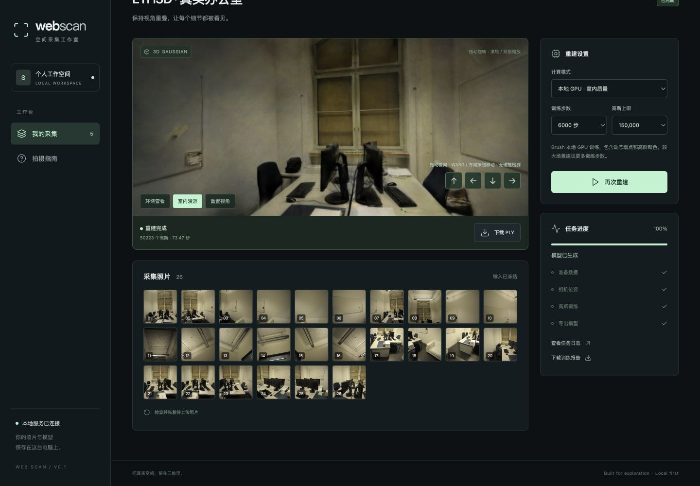
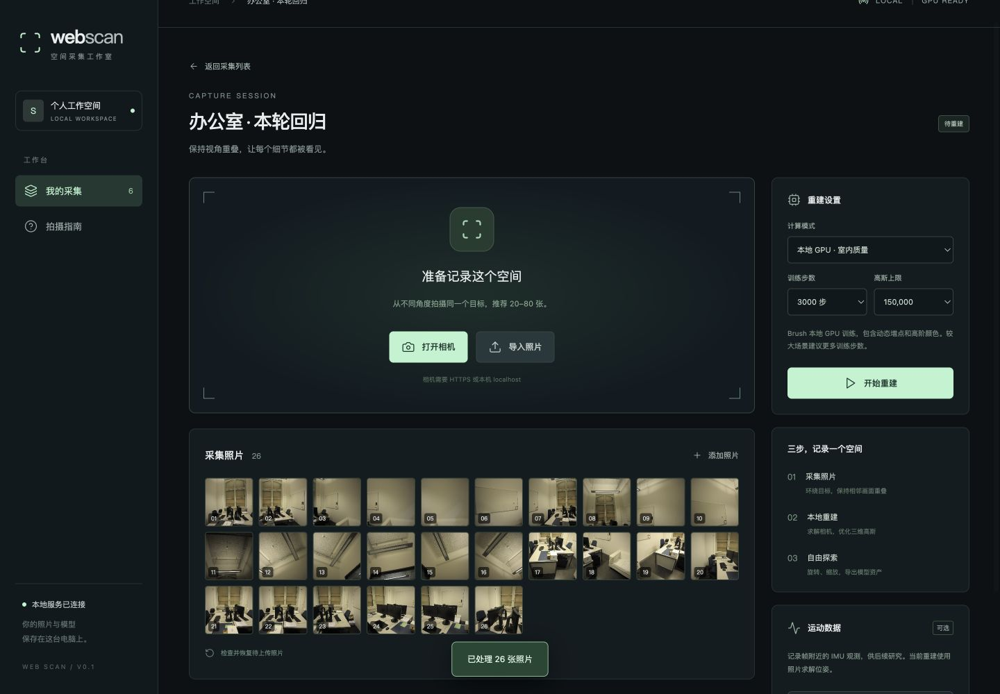
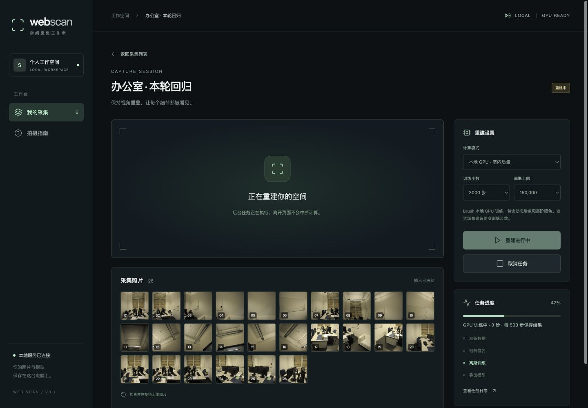
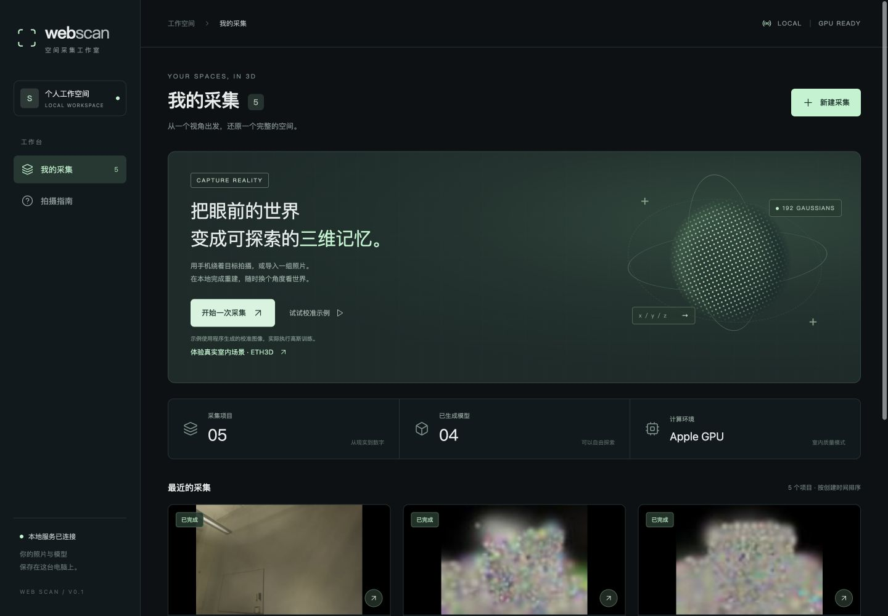
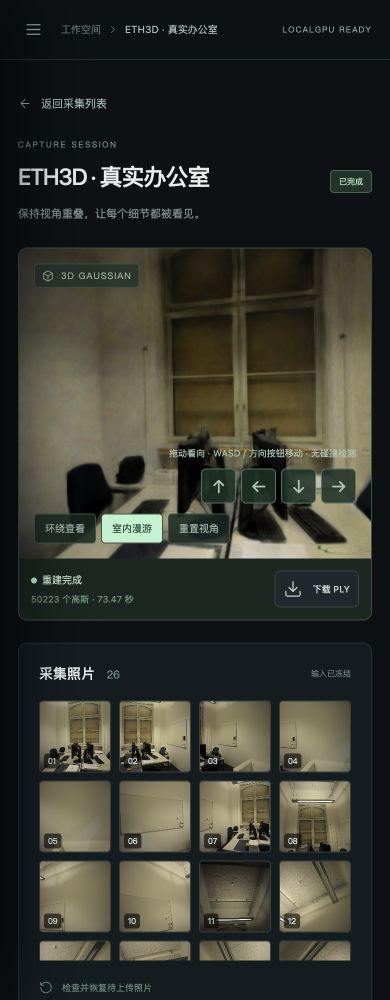
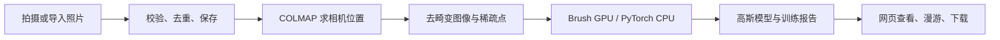

# Web Scan

这是一个在本地运行的三维重建小工具。把同一个房间从不同位置拍一组照片，导进来，等它算完，就能在浏览器里换个角度看，也能把模型下载下来。

我想先把这件事做得简单一点：不注册账号，照片留在自己的电脑上，拍摄、训练和查看放在同一个页面里。目前主要在 Apple Silicon Mac 上开发，室内重建用 COLMAP 和 Brush，另外留了一条 CPU 训练路径，方便调试。

## 先看跑出来的效果

下面是 ETH3D 的一间办公室。26 张照片，COLMAP 全部定位成功；在本机训练 6,000 步后，生成了 50,223 个高斯。截图来自实际运行的页面，可以看到桌椅、显示器和窗户，也能拖动视角走到旁边看看。



这次总任务耗时 73.47 秒，其中不包括下载和上传照片的时间。它是这组数据在这台电脑上的一次结果，换个房间、换台机器，耗时和画质都会变。墙面和细节仍有模糊，离专业扫描工具还有距离。

这些截图都由本地页面直接截取。室内照片来自 [ETH3D office](https://www.eth3d.net/datasets)；不是把不同房间的网络图片拼到一起，也没有用预先生成好的办公室模型。

### 照片导进来之后

先给采集起个名字，再选择照片。上传完成的图片会显示在下面；拍的是同一处空间，相邻视角要有足够的重叠。



本地有两种常用模式：

| 模式 | 什么时候用 |
| --- | --- |
| 本地 GPU · 室内质量 | Mac 上的主要使用方式。调用 Brush，用动态增点和 SH3 训练室内场景。 |
| 本地 CPU · 参考实现 | 检查安装和算法流程。分辨率低、点数少，能跑，但画面比较粗。 |

训练时可以看到当前阶段，也能打开日志或取消任务。返回项目列表不会停止计算，列表会继续更新状态。



### 日常查看和手机页面

项目列表会保留之前的采集、照片数量和重建状态。失败的任务也会留下，方便回头查原因。



手机布局下可以切换环绕和漫游，也有方向按钮。下面是浏览器缩到 390 像素宽时的截图；真实手机的相机授权、HTTPS 和后台切换还需要继续实机测试。



## 在自己的电脑上跑

准备 Python 3.12 和 Node.js 20+。当前支持 macOS、Linux；Windows 的进程管理还没适配。

```bash
git clone https://github.com/sakorman/web-scan.git
cd web-scan

python3.12 -m venv .venv
.venv/bin/python -m pip install -e '.[dev]'
npm ci
npm run build

.venv/bin/python -m webscan
```

打开 [http://127.0.0.1:8787](http://127.0.0.1:8787)。后端会一起提供网页，不必再单独启动前端。以后可以直接运行 `./start.command`。

第一次可以先点「试试校准示例」。它用程序生成的小场景检查训练和预览是否正常，和普通照片的 COLMAP 重建是两条不同的测试路径。

照片、任务和结果都放在 `.data/`，不会提交到 Git。API 文档在 `/docs`。

### 启用 Mac GPU 训练

```bash
.venv/bin/python scripts/install_brush.py
./start.command
```

安装脚本下载 Brush 0.3.0 的官方二进制，并核对 SHA-256。重启服务后，可以选择「本地 GPU · 室内质量」。也可以通过 `WEBSCAN_BRUSH=/绝对路径/brush_app` 使用已有安装。

默认是 3,000 步、512 像素长边；想多看一点细节，可以选 6,000 步。高斯上限是预算，实际生成数量可能小得多。

### 复现上面的办公室

```bash
curl -L --fail --continue-at - \
  https://www.eth3d.net/data/office_dslr_jpg.7z \
  -o /tmp/office_dslr_jpg.7z

.venv/bin/python scripts/prepare_indoor.py /tmp/office_dslr_jpg.7z
```

下载约 220 MiB。准备脚本需要支持 7z 的 libarchive `tar`，macOS 自带；它会把 26 张照片缩到长边 1600 像素，放进 `.samples/eth3d-office/`。刷新页面后，点「体验真实室内场景 · ETH3D」即可导入。

重建时只用这些照片，不读取数据集自带的相机标定。原始图片和生成模型留在本地；数据的使用、再分发仍按 ETH3D 的条款处理，本项目的 MIT 许可证不覆盖数据集。

### 用手机拍

手机和电脑连到同一个网络后，需要一个手机信任的 HTTPS 地址。普通的 `http://电脑IP:8787` 通常无法调用摄像头。

```bash
WEBSCAN_ALLOWED_HOSTS=192.168.1.10 \
  .venv/bin/python -m webscan --host 0.0.0.0 \
  --cert /path/to/trusted-cert.pem --key /path/to/private-key.pem
```

把 IP 和证书路径换成自己的，手机访问 `https://实际地址:8787`。证书要覆盖这个地址。页面进入后台会暂停拍摄，已经缓存的照片可以回来后继续上传。

目前没有多用户登录和权限隔离，适合本机或受信任的局域网使用，不要直接放到公网。

## 大致怎么做的



前端是 TypeScript，后端是 Python / FastAPI，任务和采集记录存 SQLite。每次重建开独立进程，重计算交给 COLMAP、PyTorch 或 Brush。

项目自己实现了采集页面、上传缓存、任务管理、数据适配，以及一个简化的 CPU 高斯渲染和优化循环。相机求解用 [COLMAP](https://github.com/colmap/colmap)，GPU 训练用 [Brush](https://github.com/ArthurBrussee/brush)，网页查看用 [gsplat.js](https://github.com/huggingface/gsplat.js)。这些组件各有自己的作者和许可证。

CPU 版本只优化固定数量的高斯和 SH0 颜色，没有动态增点，主要用于调试。Brush 版本保留完整 SH3 的 PLY；网页使用的 `.splat` 只保留基础颜色，所以网页预览与完整模型的视角相关颜色会有区别。

还有一个可选的 CUDA / gsplat 参考后端，通过 `.venv/bin/python -m pip install '.[cuda]'` 安装。本机没有 NVIDIA GPU，这条路径尚未实测。

模块和接口细节放在 [架构文档](docs/ARCHITECTURE.md)。[路线图](docs/ROADMAP.md) 是早期设想，其中没落地的部分不要当成现成功能。

## 这轮实际检查了什么

从页面重新创建采集、导入 26 张办公室照片，运行重建，再检查列表更新、漫游、下载和小屏布局。自动测试之外，这些操作也在浏览器里走过一遍。

顺手修了几个用起来会碰到的问题：

- 改好的重建参数，点一次「检查上传」就丢了。现在按项目和计算模式分别记住。
- 室内漫游里「重置视角」会切到室外环绕。现在只重置当前模式的视角。
- 返回列表后，已经完成的任务还显示“重建中”。现在列表会自己更新。
- 快速切换项目时，旧任务请求可能改到新页面。现在会核对项目和任务身份。
- 上传元数据包含非有限数值时，后续读取项目可能出错。现在在上传时就拒绝。

复现步骤、截图和测试结果见 [本轮验证记录](docs/QA.md)。

```bash
.venv/bin/python -m pytest -q
npm run test:web
npm run build
```

要分开调试前后端，保留后端的 8787 端口，再运行 `npm run dev`，打开 [http://127.0.0.1:5173](http://127.0.0.1:5173)。

## 还没做好的地方

室内漫游目前没有碰撞检测，可以穿过墙。玻璃、反光、纯色墙面和拍摄遗漏也容易出问题，拍照片时还是要多留意。

手机实拍和 NVIDIA GPU 尚未完成实机验证；WebXR 位姿接入、人物分割、Mesh / 3D 打印导出、云端分享都还没做。纯照片重建默认只有相对尺度，不能拿来精确量尺寸。服务中断后可以重新提交任务，但还不能从训练检查点接着跑。

接下来会先补真实手机拍摄测试和更多室内照片回归，再考虑完整 SH 的网页显示。

## 开源说明

原创代码使用 [MIT](LICENSE)，依赖的来源和许可证保留在 [第三方说明](THIRD_PARTY_NOTICES.md)。
