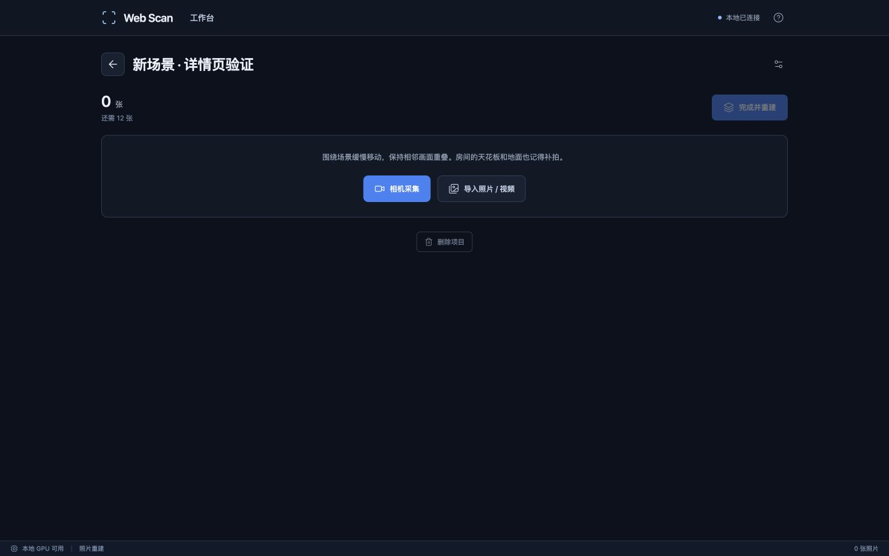
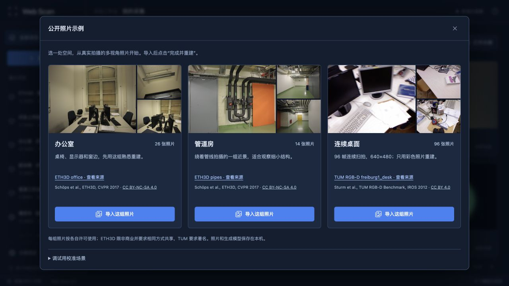
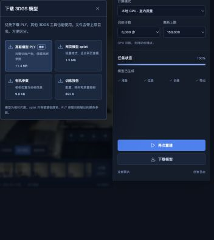
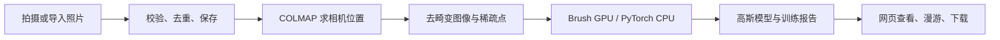

# Web Scan

Web Scan 是一个在本地运行的三维重建工具。导入同一处空间的多视角照片，在浏览器里查看、漫游，并下载生成的 3D 高斯模型。

无需注册账号，照片和模型保存在自己的电脑上。工作台左侧切换项目，中间查看模型，右侧调整重建参数。主要开发环境是 Apple Silicon Mac，相机求解使用 COLMAP，GPU 训练使用 Brush，另有用于调试的 CPU 训练路径。

每轮改动、验证结果和未采用的实验见 [Changelog](CHANGELOG.md)。

## 采集详情

采集页参考 Aholo Reality 的操作顺序：顶部显示项目名、照片数量和还差多少张，接着是相机采集与照片 / 视频导入，最后点“完成并重建”。普通采集至少需要 12 张不同照片；校准示例保留较低门槛。



导入照片时会保留有效的 EXIF 等效焦距，供相机求解使用；没有这项信息时仍按原流程估计。[焦距先验验证](docs/FOCAL-PRIOR.md)

视频在浏览器里抽成 JPEG 后上传，支持浏览器能解码的 MP4、MOV、WebM；单段不超过 250 MB、5 分钟，最多抽取 120 帧，也会遵守每项目 200 张的限制。原始视频不会传到后端。

详情页链接带 `?p=项目ID`，刷新后可以回到同一项目。“删除项目”会先确认，只从列表隐藏，保留本地文件；可通过 `POST /api/sessions/{id}/restore` 恢复。

## 一屏工作台

重建完成后，模型、照片缩略条、重建参数和任务状态放在同一屏里，主页面不用上下翻。照片全集、单张大图、日志、下载选项和帮助各自打开面板。项目首页每页显示 6 个项目，手机上点“重建”展开设置。

## 重建示例

没有现成的照片，可以点 **示例项目**。目前提供 [ETH3D](https://www.eth3d.net/datasets) 办公室 26 张、管道房 14 张，以及 [TUM RGB-D](https://cvg.cit.tum.de/data/datasets/rgbd-dataset) 连续桌面 96 帧。每组都是同一空间的多视角实拍，导入后计算相机位姿、训练高斯，再下载模型。TUM 示例只使用彩色照片，原生分辨率为 640×480。



下面是 ETH3D 的一间办公室。26 张照片，COLMAP 全部定位成功；在本机训练 6,000 步后，生成了 50,223 个高斯。截图来自实际运行的页面，可以看到桌椅、显示器和窗户，也能拖动视角走到旁边看看。


这次总任务耗时 73.47 秒，其中不包括下载和上传照片的时间。它是这组数据在这台电脑上的一次结果，换个房间、换台机器，耗时和画质都会变。墙面和细节仍有模糊，离专业扫描工具还有距离。

截图来自本地运行页面，模型由 [ETH3D office](https://www.eth3d.net/datasets) 的实拍照片重建。

### 导入照片

先给采集起个名字，再选择照片或视频。上传完成的图片会显示在底部缩略条，点“全部照片”打开照片墙；拍的是同一处空间，相邻视角要有足够的重叠。


本地有两种常用模式：

| 模式 | 什么时候用 |
| --- | --- |
| 本地 GPU · 室内质量 | Mac 上的主要使用方式。调用 Brush，用动态增点和 SH3 训练室内场景。 |
| 本地 CPU · 参考实现 | 检查安装和算法流程。分辨率低、点数少，能跑，但画面比较粗。 |

训练时可以看到当前阶段，也能打开日志或取消任务。返回项目列表不会停止计算，列表会继续更新状态。


### 日常查看和手机页面

左边可以随时切换项目，项目首页分页显示之前的采集、照片数量和重建状态。失败的任务也会留下，方便回头查原因。


手机上把主要空间留给模型，重建设置从右上角展开。可以切换环绕和漫游，直接拖动画面调整视角。下面是浏览器缩到 390 像素宽时的截图；真实手机的相机授权、HTTPS 和后台切换还需要继续实机测试。


训练期间会显示实际步数与当前高斯数。最终模型校验通过后，自动清理这次任务的中间 PLY，保留最终 PLY 和 splat 下载。实验记录见 [持续迭代记录](docs/ITERATIONS.md)。

网页预览的中间缓冲使用更高精度，固定模型的六个测试视角均有小幅评分改善；会增加一些 GPU 缓冲占用。[预览对照与代价](docs/VIEWER-PRECISION.md)

模型静止后停止重复绘制，拖动、缩放或切换视角时再更新。查看原照片或切到后台时暂停模型绘制，减少无效开销。[查看器测试记录](docs/VIEWER-PERFORMANCE.md)

## 检查画质

模型支持 **拍摄视角**：按相机内参、位置和方向还原画面，点击“对照原照片”可在模型与去畸变照片之间切换。模型和原照片使用相同画幅。老任务没有照片尺寸信息时仍可漫游，重新重建后才有精确对照。

“历史结果”可以查看之前的模型，链接也会保存选中的任务。右侧的“下次重建”参数与正在查看的历史结果分别保存；点“质量报告”查看当前结果的实际配置、定位数量及未定位照片。

评测与最终模型分开：最终模型默认使用全部定位照片；做算法对照时，在更多设置里选择“留出部分照片”。后者每 8 张留出 1 张，但这些照片仍参与过上游位姿计算，指标不是完全独立的端到端评测。没有留出评估时，项目列表的照片封面会明确标为“采集封面”。

留出评测任务会检查最终步数、图片集合、尺寸和指标；缺图或评测失败时明确报错，保留训练器输出供排查。[评测校验说明](docs/EVALUATION.md)

对照结果与适用范围见 [画质优化实测](docs/QUALITY.md)。


## 下载重建模型

重建完成后，点模型上方的 **下载模型**，桌面右侧也有同一个入口。手机无需展开设置，直接从画面上方下载。

- **PLY**：推荐，保存完整训练输出的高斯参数和颜色系数。
- **splat**：适合网页查看，只保留基础颜色。
- 相机参数和训练报告也可以单独保存。

Brush 模型发布前会检查非空模型、完整 SH3 字段和有效颜色系数，异常输出会保留供排查。[模型校验与回归](docs/PLY-VALIDATION.md)

面板会显示文件大小，下载文件名包含项目名和任务编号。文件从本机直接传输，支持 HTTP Range；不会重新训练或转换模型。



## 在自己的电脑上跑

准备 Python 3.12 和 Node.js 20+。当前支持 macOS、Linux；Windows 的进程管理还没适配。

```bash
git clone https://github.com/sakorman/web-scan.git
cd web-scan

python3.12 -m venv .venv
.venv/bin/python -m pip install -e '.[dev]'
npm ci
npm run build

.venv/bin/python -m webscan
```

打开 [http://127.0.0.1:8787](http://127.0.0.1:8787)。后端会一起提供网页，不必再单独启动前端。以后可以直接运行 `./start.command`。

首次运行可打开「示例项目 → 调试用校准场景」，检查训练和预览是否正常。校准场景使用已知相机位姿，普通照片则由 COLMAP 求解位姿。

照片、任务和结果都放在 `.data/`，不会提交到 Git。API 文档在 `/docs`。

### 启用 Mac GPU 训练

```bash
.venv/bin/python scripts/install_brush.py
./start.command
```

安装脚本下载 Brush 0.3.0 的官方二进制，并核对 SHA-256。重启服务后，可以选择「本地 GPU · 室内质量」。也可以通过 `WEBSCAN_BRUSH=/绝对路径/brush_app` 使用已有安装。

新项目默认使用精细档：6,000 步、1024 像素长边、15 万高斯预算，并使用全部已定位照片训练。点重建标题旁的“更多设置”，可切换快速预览（3,000 步 / 512 像素）；已有项目保留之前的参数。高斯上限是预算，实际生成数量可能小得多。精细档通常需要数分钟。

同一镜头且全程未变焦的照片，可以在“更多设置 → 照片来自”中选择同镜头模式；混合相机、变焦或不确定时保持默认。文档中的两组 ETH3D 对照实验使用同镜头模式。

### 准备公开数据集照片

下载一次即可。三组照片独立准备，先选一组就能开始：

| 示例 | 实拍照片 | 官方归档大小 | 本地位置 |
| --- | --- | --- | --- |
| ETH3D office · 办公室 | 26 张 | 约 220 MiB | `.samples/eth3d-office/` |
| ETH3D pipes · 管道房 | 14 张 | 约 105 MiB | `.samples/eth3d-pipes/` |
| TUM freiburg1_desk · 连续桌面 | 96 帧 | 约 328 MiB | `.samples/tum-freiburg1_desk/` |

办公室：

```bash
curl -L --fail --continue-at - \
  https://www.eth3d.net/data/office_dslr_jpg.7z \
  -o /tmp/office_dslr_jpg.7z

.venv/bin/python scripts/prepare_indoor.py /tmp/office_dslr_jpg.7z
```

管道房：

```bash
curl -L --fail --continue-at - \
  https://www.eth3d.net/data/pipes_dslr_jpg.7z \
  -o /tmp/pipes_dslr_jpg.7z

.venv/bin/python scripts/prepare_indoor.py /tmp/pipes_dslr_jpg.7z --scene pipes
```

准备脚本单次读取归档，本机 pipes / office 分别约 5.5 / 11.2 秒，输出照片与旧版逐字节相同。[准备速度与重建回归](docs/SAMPLE-PREPARATION.md)

准备脚本需要支持 7z 的 libarchive `tar`，macOS 自带。它会把照片缩到长边 1600 像素，保存原文件名、来源和 SHA-256 清单。准备好后重新打开「示例项目」，点「导入这组照片」；不用重启后端。照片不完整时按钮不会启用，导入前还会校验文件有没有改变。

连续桌面：

```bash
curl -L --fail --continue-at - \
  https://cvg.cit.tum.de/rgbd/dataset/freiburg1/rgbd_dataset_freiburg1_desk.tgz \
  -o /tmp/rgbd_dataset_freiburg1_desk.tgz
.venv/bin/python scripts/prepare_tum.py /tmp/rgbd_dataset_freiburg1_desk.tgz
```

按时间戳顺序均匀选择 96 帧 RGB，保持 640×480 原始尺寸。这组照片来自同一镜头，可在更多设置中选择“同镜头”。归档里的深度、真值位姿和原始标定不参与重建。[来源、采样和实测](docs/TUM-DESK.md)

重建只使用照片，不读取数据集自带的相机标定或模型。程序生成的校准图保留在面板底部的调试选项中。

ETH3D 照片来源：Schöps 等人的 ETH3D / CVPR 2017 数据集，采用 [CC BY-NC-SA 4.0](https://creativecommons.org/licenses/by-nc-sa/4.0/)（署名、非商业、相同方式共享）。照片及其衍生模型不在本项目 MIT 许可证的范围内；README 中含这些照片或重建结果的截图同样保留数据集许可。原图和模型不提交到 Git，下载的训练报告会记录来源与许可。

TUM 照片来源：Sturm 等人的 TUM RGB-D Benchmark / IROS 2012，遵循 [CC BY 4.0](https://creativecommons.org/licenses/by/4.0/)。示例面板、来源清单和训练报告分别保留两种数据集的作者与许可。

### 用手机拍

手机和电脑连到同一个网络后，需要一个手机信任的 HTTPS 地址。普通的 `http://电脑IP:8787` 通常无法调用摄像头。

```bash
WEBSCAN_ALLOWED_HOSTS=192.168.1.10 \
  .venv/bin/python -m webscan --host 0.0.0.0 \
  --cert /path/to/trusted-cert.pem --key /path/to/private-key.pem
```

把 IP 和证书路径换成自己的，手机访问 `https://实际地址:8787`。证书要覆盖这个地址。页面进入后台会暂停拍摄，已经缓存的照片可以回来后继续上传。

目前没有多用户登录和权限隔离，适合本机或受信任的局域网使用，不要直接放到公网。

## 导入和重复重建提速

图片 / 视频现在最多 3 路并发上传，视频抽帧不用等每张照片传完。服务端会恢复原始帧顺序，上传断开后仍可以从照片面板恢复。

同一组照片调整步数重新训练时，会复用校验通过的相机和去畸变结果。一次本地办公室对照测试中，1000 步任务从 16.76 秒降到 7.12 秒，其中 SfM 从 8.60 秒降到 0.034 秒。这是同一采集重复训练的收益，首次重建仍需要完整求位姿。

具体条件、缓存规则和复现命令见 [性能记录](docs/PERFORMANCE.md)。

位姿流程先按采集顺序登记照片，再并行提取特征，避免完成先后改变图像编号。几何求解和训练仍可能波动。[重复性检查](docs/SFM-ORDER.md)

## 技术架构



前端是 TypeScript，后端是 Python / FastAPI，任务和采集记录存 SQLite。每次重建开独立进程，重计算交给 COLMAP、PyTorch 或 Brush。

项目包含采集页面、上传缓存、任务管理、数据适配，以及简化的 CPU 高斯渲染和优化循环。相机求解用 [COLMAP](https://github.com/colmap/colmap)，GPU 训练用 [Brush](https://github.com/ArthurBrussee/brush)，网页查看用 [Spark](https://sparkjs.dev/) 和 [Three.js](https://threejs.org/)。依赖来源与许可证见 [第三方说明](THIRD_PARTY_NOTICES.md)。

CPU 版本只优化固定数量的高斯和 SH0 颜色，没有动态增点，主要用于调试。Brush 版本保留完整 SH3 的 PLY，网页也直接加载这份 PLY，保留随视角变化的颜色。下载选项中的 `.splat` 是兼容用的基础颜色格式。不同渲染器的排序、滤波与量化仍可能带来细微差异。

还有一个可选的 CUDA / gsplat 参考后端，通过 `.venv/bin/python -m pip install '.[cuda]'` 安装。本机没有 NVIDIA GPU，这条路径尚未实测。

模块和接口细节放在 [架构文档](docs/ARCHITECTURE.md)。[路线图](docs/ROADMAP.md) 是早期设想，其中没落地的部分不要当成现成功能。

## 测试

测试覆盖采集创建、照片与视频导入、重建、模型下载、参数保存和任务状态更新。浏览器验证包括模型漫游、原照片对照、历史结果切换和手机宽度布局。

已修复的问题：

- 恢复上传后参数丢失：按项目和计算模式保存重建设置。
- 漫游重置切换了模式：重置仅作用于当前查看模式。
- 项目列表状态滞后：列表自动跟进后台任务状态。
- 切换项目后旧请求覆盖新页面：响应更新前校验项目和任务 ID。
- 异常元数据导致读取失败：上传时拒绝 NaN、Infinity 等非有限数值。

复现步骤、截图和测试结果见 [测试记录](docs/QA.md)。

```bash
.venv/bin/python -m pytest -q
npm run test:web
npm run build
```

要分开调试前后端，保留后端的 8787 端口，再运行 `npm run dev`，打开 [http://127.0.0.1:5173](http://127.0.0.1:5173)。

## 当前限制

室内漫游目前没有碰撞检测，可以穿过墙。玻璃、反光、纯色墙面和拍摄遗漏也容易出问题，拍照片时还是要多留意。

手机实拍和 NVIDIA GPU 尚未完成实机验证；WebXR 位姿接入、人物分割、Mesh / 3D 打印导出、云端分享都还没做。纯照片重建默认只有相对尺度，不能拿来精确量尺寸。服务中断后可以重新提交任务，但还不能从训练检查点接着跑。

后续重点是实际手机采集、更多室内场景回归，以及训练输入顺序和结果稳定性。

## 开源说明

原创代码使用 [MIT](LICENSE)，依赖的来源和许可证保留在 [第三方说明](THIRD_PARTY_NOTICES.md)。
