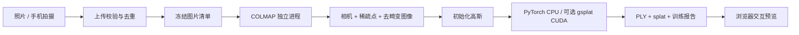

# Web Scan

**把真实空间，留在三维里。**

一个优先在本地运行的手机采集与 3D Gaussian Splatting 工作室。通过浏览器拍摄或导入照片，在本机求解相机位姿、训练三维高斯，再交互浏览和下载结果。

应用层、任务编排、采集交互与 CPU 高斯参考渲染器为本项目实现；位姿求解、自动微分和浏览器查看使用开源组件。来源见 [THIRD_PARTY_NOTICES.md](THIRD_PARTY_NOTICES.md)。

> 当前版本是可运行的本地 MVP。CPU 模式用于小规模开发验证；新增 Brush 本地 GPU 模式，在 Apple Silicon 上支持动态增点和 SH3 训练，已用真实办公室照片完成验证。没有使用占位模型替代重建结果。

## 已实现

- 手机 / 桌面响应式采集工作台、拍摄指南与项目列表。
- 浏览器摄像头定时拍摄、照片批量导入、IndexedDB 待上传缓存和恢复。
- 可选 IMU 帧附近观测记录；当前不参与位姿求解。
- 图片解码校验、内容去重、容量限制、输入冻结与重建前校验。
- SQLite 持久任务队列、单计算进程、真实进度、任务取消和失败日志。
- **照片路径：COLMAP 特征 / 匹配 / 相机求解 → 去畸变 → 高斯训练。**
- **校准示例：程序生成带已知位姿的场景 → 真实高斯训练**，用于快速检查环境。
- CPU PyTorch 可微高斯渲染器，优化位置、尺度、旋转、透明度、颜色。
- **Brush 本地 GPU 后端**：Apple Silicon / Metal 实测，支持动态增点、SH3 和留出视角评估。
- 可选 CUDA / gsplat 参考渲染后端，复用训练和导出逻辑。
- 环绕查看与室内漫游，支持拖动、WASD、触屏方向按钮；无碰撞检测。
- ETH3D 真实办公室样本入口，原始图片与生成资产仅保留本地。
- 交互模型预览、Gaussian PLY 下载、训练报告和相机导出。

## 本地启动

环境：macOS 或 Linux，Python 3.11+，Node.js 20+。首次安装会下载 PyTorch 和 COLMAP 等依赖。建议使用 Python 3.12；已在 Apple Silicon + Python 3.12 上验证。

```bash
git clone https://github.com/sakorman/web-scan.git
cd web-scan

python3.12 -m venv .venv
.venv/bin/python -m pip install -e '.[dev]'
npm ci
npm run build

.venv/bin/python -m webscan
```

打开 **http://127.0.0.1:8787**。后端同时提供已构建的前端；API 文档位于 `/docs`。数据保存在当前目录 `.data/`，照片、数据库和模型均不会进入 Git。

可使用 `./start.command` 再次启动已配置好的本地项目。

首次建议点击「试试校准示例」→「开始重建」，确认训练和 WebGL 查看器可用，然后创建采集导入同一目标的多视角照片。

### 前后端分开调试

```bash
# 终端 1
.venv/bin/python -m webscan --port 8787

# 终端 2
npm run dev
```

访问 http://127.0.0.1:5173 ，Vite 把 `/api` 转发到 8787。后端修改后需要重启；前端使用热更新。

`requirements-lock.txt` 保存本次本地验证的 Python 依赖版本；`package-lock.json` 固定前端依赖。CUDA 环境需独立核对驱动、PyTorch、CUDA 与 gsplat 的兼容组合。

### 手机访问本机

摄像头需要安全上下文。手机访问电脑的普通 HTTP 局域网地址无法直接使用相机。准备手机信任的 HTTPS 证书，并把电脑的局域网主机名加入允许列表：

```bash
WEBSCAN_ALLOWED_HOSTS=192.168.1.10 \
  .venv/bin/python -m webscan --host 0.0.0.0 \
  --cert /path/to/trusted-cert.pem --key /path/to/private-key.pem
```

将示例 IP 替换为电脑的实际地址，然后在同一局域网的手机访问 `https://实际地址:8787`。证书需覆盖该地址。相机和传感器权限由用户主动授权；页面进入后台会停止拍摄，已进入本地缓存的照片可恢复上传。

该版本是**单用户本地工具，没有用户登录系统**。默认只监听本机；局域网模式仅适用于受信任网络，不应直接暴露到公网。Windows 的进程组和文件锁尚未适配。

## 重建原理



每个高斯包含位置、三轴尺度、旋转、透明度和颜色。训练器把高斯投影到照片视角，计算二维协方差并按深度做 alpha 合成，再通过图像误差反向更新参数。

CPU 参考路径使用密集 `N × H × W` 张量，默认 384 个高斯、长边 96 像素、120 步训练，界面上限 768 个高斯。它便于在没有 NVIDIA GPU 的机器上检查算法与产品链路。当前是固定数量、SH0 颜色模型，没有动态稠密化或高阶视角相关颜色。

macOS 上 COLMAP 与 PyTorch 可能携带不同 OpenMP 运行库，因此位姿求解与训练在独立进程中执行；不使用忽略运行库冲突的环境变量。

更多模块、接口、数据结构见 [技术架构](docs/ARCHITECTURE.md)。早期完整产品设想保留在 [路线图](docs/ROADMAP.md)，其中的对象存储、分布式队列等尚未实现。

## 本地 GPU 室内重建（推荐）

本项目通过独立进程调用未修改的 [Brush 0.3.0](https://github.com/ArthurBrussee/brush)，使用其 WebGPU / Metal 训练实现。应用、采集、任务服务和数据适配由本项目提供，Brush 保留原作者与 Apache-2.0 许可证。

```bash
.venv/bin/python scripts/install_brush.py
# 重启后端，界面出现“本地 GPU · 室内质量”
./start.command
```

脚本从官方 release 下载固定版本并验证 SHA-256。二进制保存在被 Git 忽略的 `.tools/brush/`。也可设置 `WEBSCAN_BRUSH=/绝对路径/brush_app` 使用自行安装的版本。

室内模式默认 3000 步、512 像素长边，支持 1000 / 3000 / 6000 步与 5 万 / 15 万 / 30 万高斯上限。上限不代表实际生成数量；细节复杂的场景需要更多训练。每 8 张图像留出一张评估，这些图片仍参与过上游 SfM。原始 PLY 保留 SH3，浏览器 `.splat` 预览保留 SH0。

### 使用网上的真实室内照片

采用 [ETH3D office](https://www.eth3d.net/datasets) 的 26 张同一办公室多视角照片，不混用不同房间的网络图片。

```bash
curl -L --fail --continue-at - \
  https://www.eth3d.net/data/office_dslr_jpg.7z \
  -o /tmp/office_dslr_jpg.7z
.venv/bin/python scripts/prepare_indoor.py /tmp/office_dslr_jpg.7z
```

归档约 220 MiB。预处理脚本使用支持 7z 的 libarchive `tar`（macOS 自带），将图片长边缩到 1600 像素，保存到 `.samples/eth3d-office/`。重启后页面显示「体验真实室内场景 · ETH3D」。照片仍通过正常 COLMAP 重建流程，不读取数据集自带相机参数。

数据源为 ETH3D 官方发布，素材与训练产物不随本项目发布，其使用与再分发遵循原数据提供方条款。本项目 MIT 许可证不覆盖这些数据。

## 可选 CUDA 参考后端

```bash
# 在已配置兼容 NVIDIA 驱动 / CUDA / PyTorch 的环境中
.venv/bin/python -m pip install '.[cuda]'
```

该后端调用 gsplat 的光栅化器；其余输入、任务和导出流程相同。本次 Apple Silicon 验证未运行 CUDA 路径。安装 gsplat 不会自动获得生产级稠密化、百万高斯训练或质量保证。

## 验证与测试

```bash
.venv/bin/python -m pytest -q
npm run build

# 生成原创纹理立方体照片；不向重建器提供相机位姿
PYTHONPATH=. .venv/bin/python scripts/make_photo_fixture.py .qa/photo-fixture

# 先启动本地后端，再运行完整 API 验证
.venv/bin/python scripts/smoke.py --images .qa/photo-fixture
```

测试覆盖重复上传、损坏图片、冻结输入、重复任务、取消、资源限制、持久化、alpha 合成、梯度、坐标归一化和模型导出。端到端脚本提交图片，执行实际 COLMAP 与训练，并下载检查所有结果。

本地验证记录与未验证项目见 [QA.md](docs/QA.md)。校准示例与纹理立方体为程序生成；ETH3D office 为真实室内照片。单场景结果不代表所有房间或手机采集质量，训练视角误差下降不等同于独立视角质量通过。

## 当前限制与下一步

- 摄像头功能已实现；真实 iPhone / Android 的 HTTPS、权限、后台切换和 IMU 行为仍需实机测试。
- CPU / CUDA 参考模式使用固定高斯数量和简单损失，细节有限；Brush 模式使用上游动态增点与训练算法。两种路径都可能在弱纹理、反光和未覆盖区域出现缺陷。
- 未实现 WebXR 位姿接入、人物分割、自动覆盖分析、Mesh / 3D 打印导出、云端账号和公网分享。
- 默认纯照片 SfM 输出相对尺度，不能直接用于精确测量。
- 服务正常退出会终止活动任务；异常重启后活动任务标记中断，可重新提交，尚不支持训练检查点续跑。
- 上传缓存最多 20 张 / 64 MB；单张上传最多 16 MB；单次采集最多 200 张 / 512 MB，处理后的图像长边最多 2400 像素。
- 后续优先扩展真实照片集、实机采集测试、完整 SH 网页渲染和 GPU 性能优化。

## 许可证

本项目原创代码使用 [MIT](LICENSE)。开源依赖保持各自许可证和归属，详见 [第三方说明](THIRD_PARTY_NOTICES.md)。
