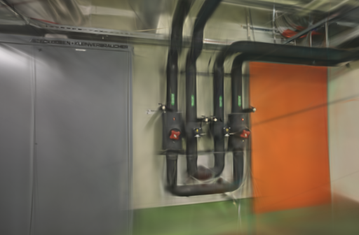
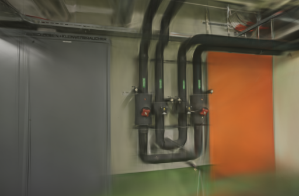
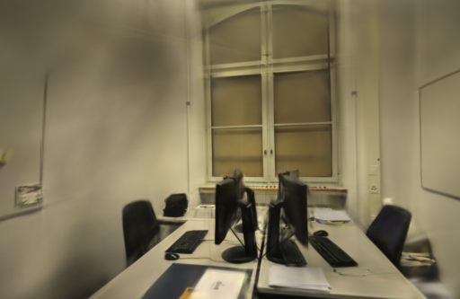
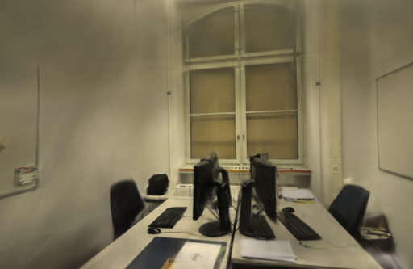

# Adam 稳定项与首轮旋转变化

2026-10-22。固定初始化后，重复训练的差异仍从第一次参数更新开始。本轮记录实际梯度，并把实验训练器的 Adam 稳定项从 `1e-15` 改为 `1e-8` 做对照。早期旋转差异明显缩小，但 pipes 平均 PSNR 下降，最终模型仍不确定，因此不采用为默认参数。

## 为什么检查稳定项

[当前 Brush 训练代码](https://github.com/ArthurBrussee/brush/blob/3edecbb2fe79d3e2c87eeab85b15e0b1dd10d486/crates/brush-train/src/train.rs)将 Adam 的 epsilon 设为 `1e-15`。[优化器实现](https://github.com/ArthurBrussee/brush/blob/3edecbb2fe79d3e2c87eeab85b15e0b1dd10d486/crates/brush-train/src/adam_scaled.rs)把它加在二阶矩平方根之后。按照 [Adam 原论文](https://arxiv.org/abs/1412.6980)的更新公式，第一次更新可简化为：

```text
参数变化 = -学习率 × 梯度 / (|梯度| + epsilon)
```

当梯度很小、但仍比 epsilon 大很多时，更新量仍接近整个学习率。仅把输入种子固定，不能消除这种对微小梯度差异的放大。论文给出的 `1e-8` 是本轮候选值，不代表它已经适合这套三维重建参数。

在同一实验二进制中增加两个独立开关：`WEBSCAN_STABLE_ADAM=1` 将所有参数组的 epsilon 改成 `1e-8`；`WEBSCAN_TRACE_GRADIENT=1` 记录首轮五类梯度，以及更新前后的原始旋转四元数。两组都启用相同观测，仅稳定项不同。

## 梯度和更新的实际证据

八次真实训练的初始三轴尺度逐点相同，起点是球形高斯。理论上球形协方差不随旋转改变；实测首轮旋转梯度绝对值的中位数为 0，90 分位约 `1.27e-12`～`1.52e-12`，最大值约 `1.31e-9`～`8.09e-9`。这些微小梯度在重复运行间仍有差异，具体来自哪一步反向计算尚未确认。

使用实际梯度、原始四元数和旋转学习率 `0.001`，独立代入上式，八次结果与实际更新的最大绝对差均小于 `3.24e-8`。基线单次最大旋转更新约 `0.001`；候选降至 pipes `0.000116`～`0.000223`、office `0.000447` 左右。这支持稳定项会放大近零梯度差异的判断，并没有证明梯度本身已经正确或确定。

下表比较同设置的两次运行。旋转差为导出归一化四元数的最大分量差，并非角度或最终渲染误差：

| 场景 | 完成更新次数 | epsilon `1e-15` | epsilon `1e-8` |
| --- | ---: | ---: | ---: |
| pipes | 0 | 0 | 0 |
| pipes | 1 | 0.00257936 | 0.00009882 |
| pipes | 100 | 0.05232838 | 0.00040757 |
| office | 0 | 0 | 0 |
| office | 1 | 0.00263312 | 0.00047743 |
| office | 100 | 0.06726458 | 0.00055307 |

位置、尺度、透明度和颜色仍有小差异；四组设置的最终 PLY 均未逐字节重复。前 100 次更新尚未增点，不能把这些早期差异都归因于增点索引顺序。提高稳定项只是抑制部分变化，没有解决完整训练的确定性。

## 固定条件与训练成绩

Apple M5 / 32 GiB、Metal，独立构建 `0.3.0-adam-epsilon-study`。源码和锁文件沿用 Brush `3edecbb2fe79d3e2c87eeab85b15e0b1dd10d486`，Rust / Cargo 1.99.0。

- pipes 输入 / 定位 14 / 14，训练 / 评估 12 / 2；office 为 26 / 26、22 / 4，没有未定位照片。
- 复用 10 月 12 日同镜头模式几何。每场景相机、稀疏文件、照片字节、评估集合与参考图摘要相同。
- 3000 步、512 像素长边、15 万高斯预算、SH3，每 100 步增点，80% 步数后停止增长，每 500 步导出，每 8 张留出一张。
- 两组都固定照片消费顺序、真实点编号排序、CPU 加权采样和 GPU 随机种子 42。全部参数组共用本轮 epsilon；没有只调整旋转组。
- 每场景两设置各两次，共八次训练；pipes 按基线、候选、候选、基线运行，office 顺序相反。GPU 串行使用，浏览器在训练期间停在项目列表，未清空系统和驱动缓存。

使用 `compare_quality.py` 在同相机、同画幅、相同参考图下统一到长边 512，计算 RGB PSNR 与 11×11 Gaussian-window SSIM，按视角等权平均。评估照片参与过 SfM，属于固定几何下的渲染留出测试。

| 场景 | 重复 | epsilon | 训练与导出 | 实际高斯 | PLY 字节 | PSNR / SSIM |
| --- | ---: | --- | ---: | ---: | ---: | --- |
| pipes | 1 | `1e-15` | 24.1987 s | 11,593 | 2,737,498 | 17.8780 / 0.72965 |
| pipes | 1 | `1e-8` | 23.2499 s | 11,767 | 2,778,562 | 16.6030 / 0.72456 |
| pipes | 2 | `1e-15` | 23.2057 s | 11,724 | 2,768,414 | 17.2469 / 0.73272 |
| pipes | 2 | `1e-8` | 23.2058 s | 11,740 | 2,772,190 | 17.7732 / 0.73987 |
| office | 1 | `1e-15` | 24.2246 s | 14,409 | 3,402,074 | 21.1333 / 0.86046 |
| office | 1 | `1e-8` | 24.1977 s | 14,526 | 3,429,686 | 21.6398 / 0.86539 |
| office | 2 | `1e-15` | 24.2056 s | 14,674 | 3,464,614 | 21.6944 / 0.86054 |
| office | 2 | `1e-8` | 24.2213 s | 14,489 | 3,420,954 | 21.2425 / 0.86445 |

pipes 平均 PSNR 17.5624 → 17.1881，SSIM 0.73119 → 0.73221；office 分别为 21.4139 → 21.4411、0.86050 → 0.86492。候选没有取得一致的画质收益。两次重复也不足以判断长期稳定性。

耗时包含训练、评估、梯度读回、状态快照与导出；不含源码编译和输入复制。本轮未重算 SfM、未测 API 端到端时间或峰值内存。观测会同步 GPU，可能改变执行调度；一秒轮询粒度下的耗时差与点数变化不作为生产提速结论。

固定展示首次重复的第一个评估视角，左右相机和画幅相同，原生 PNG 未修改：

| 场景 | epsilon `1e-15` | epsilon `1e-8` |
| --- | --- | --- |
| pipes |  |  |
| office |  |  |

八个模型通过完整 SH3 和评估输出校验。浏览器加载两场景的基线 / 候选，并拖动候选漫游，控制台无错误或警告；细管、线缆仍模糊，离开采集覆盖区域仍有拉丝、漂浮片段和缺失，没有确认漫游改善。

## 取舍与复现

不采用全参数组 `1e-8` 作为默认值。保留实验开关、梯度证据和模型，正式引擎、原照片及历史模型不变。下一步可单独验证旋转组的稳定项，避免同时改变其它参数组的收敛行为；仍需同相机质量验证。

项目基线 [7004e98](https://github.com/sakorman/web-scan/commit/7004e98)。[adam-epsilon.patch](benchmarks/adam-epsilon.patch)是相对干净 Brush `v0.3.0` 的累计实验补丁，包含此前读图、采样、编号和 GPU 种子修正；不能叠加旧补丁。按[源码构建方法](LOADER-ORDER.md#决定与复现)换用本补丁，release 构建通过。

两组都设置以下变量为 `1`：`WEBSCAN_SINGLE_LOADER`、`WEBSCAN_TRACE_LOADER`、`WEBSCAN_TRACE_SAMPLING`、`WEBSCAN_SEEDED_SAMPLING`、`WEBSCAN_STABLE_INIT`、`WEBSCAN_TRACE_STATE`、`WEBSCAN_SEED_GPU`、`WEBSCAN_TRACE_GRADIENT`。只把 `WEBSCAN_STABLE_ADAM` 在 `0` / `1` 间切换。固定 CLI 参数：

```text
--seed 42 --total-steps 3000 --max-splats 150000 --max-resolution 512
--refine-every 100 --growth-stop-iter 2400 --export-every 500
--export-name export_{iter}.ply --eval-split-every 8
--eval-every 3000 --eval-save-to-disk
```

每次使用独立输入副本和 `--export-path`。本机资料在 `.data/benchmarks/adam-epsilon-20261022/`，包括实际二进制、日志、适配器、模型和状态 / 梯度分析脚本。公开[完整记录](benchmarks/adam-epsilon.json)保留逐次与逐视角成绩、梯度分位数、首轮公式误差、状态差值、输入 / 构建 / 图片摘要。没有修改应用源码，不重复其本地回归；提交后由标准 CI 检查后端、前端、类型与构建。

补丁遵循 [Brush Apache-2.0 许可](../THIRD_PARTY_NOTICES.md#brush-loading-experiment)，照片与渲染遵循 [ETH3D 署名及许可](../THIRD_PARTY_NOTICES.md#test-dataset)。
