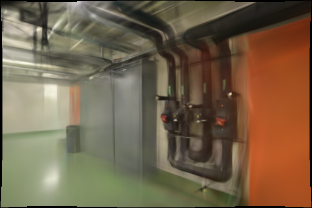
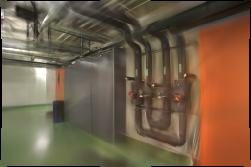
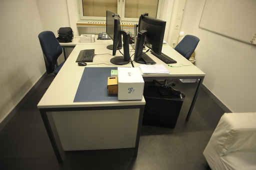
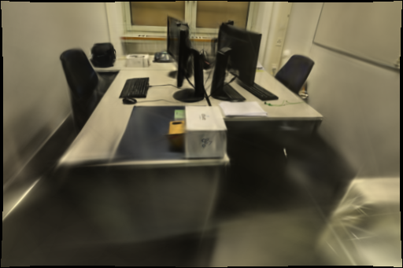
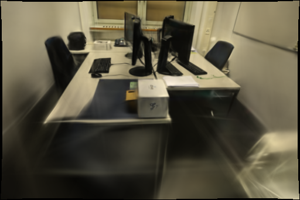

# 仿射 DSP 特征对照

2026-10-31，Apple M5 / 32 GiB，PyCOLMAP 3.13.0 CPU 与 Brush 0.3.0 Metal。仿射估计未通过重复质量门槛：office 的 SSIM 两次下降，pipes 收益不稳定，因此不采用该组合。

## 问题与依据

上一轮 [DSP-SIFT 对照](DSP-SIFT.md)在 pipes 改善，但 office 的 SSIM 两次下降。复查 office `0008`（界面照片 9）发现原图大部分是低纹理墙面，稀疏观测集中在局部；仅凭整个场景的匹配总数不能判断该视角是否得到更可靠的支撑。

[COLMAP 官方 FAQ](https://colmap.github.io/faq.html#increase-number-of-matches-sparse-3d-points)建议结合 DSP、仿射形状估计和 guided matching。本轮以已经开启 DSP 的配置为基线，仅开启 `estimate_affine_shape`，检验这项尚未完成的组合消融。两者均走 [COLMAP 3.13.0 Covariant SIFT CPU 实现](https://github.com/colmap/colmap/blob/3.13.0/src/colmap/feature/sift.cc)，并非固定关键点只替换描述子；实际关键点数会改变。DSP 方法来自 Dong、Soatto 的 [CVPR 2015 论文](https://arxiv.org/abs/1412.8556)。

另查阅 Kim 等的 [TWINGS（CVPR 2026）](https://arxiv.org/abs/2605.22069v3)及[官方代码](https://github.com/sandokim/TWINGS-official/tree/1585e8933516a6abadf6383346e887746e1128e4)：用薄板样条将预测深度反投影点对齐到三角化控制点，值得作为低纹理初始化的后续假设。其[初始化环境](https://github.com/sandokim/TWINGS-official/blob/1585e8933516a6abadf6383346e887746e1128e4/TWINGS-Init/README.md)要求自编译 OpenCV SfM，并以 CUDA 12.1 配置 MASt3R；训练也依赖 CUDA 扩展。主仓库标示 Apache-2.0，不代表各权重与子模块许可相同。本轮仅审阅，未安装、移植或复现其效果，不能将其论文成绩当作本机 Metal 收益。

## 固定条件

- 代码基点为 [0372f6c](https://github.com/sakorman/web-scan/commit/0372f6c985e9889abc25e62cf3e4e2e257912021)。基线是该版本加上上一轮 DSP 补丁，候选只多一项仿射开关。默认生产代码未应用实验补丁。
- ETH3D pipes 14 张、office 26 张，输入均为 1600×1067 RGB；不使用真值位姿、深度或雷达。
- 共享 RADIAL 内参，穷举匹配、guided matching、几何验证种子 42；特征长边 1600、预算 8192、4 CPU 线程。DSP 尺度范围 1/6–3、10 个尺度；Mapper 设置不变。
- Brush 固定 3000 步、512 像素长边、150000 高斯上限、SH3、种子 42，每 100 步增密、2400 步结束增密、每 500 步导出。种子固定不保证 Mapper 与 Metal 逐位确定。
- 每场景每变体两次，共 8 次新建 SfM 数据库和 Brush 进程。先完成 office 第一份基线，才生成候选补丁；每场景的第二组反转运行顺序。GPU 串行使用，训练时未打开模型查看器；系统文件与 Metal 缓存没有清空，也没有复用历史 SfM 或训练检查点。
- 每第八张留出：pipes 12 张训练 / 2 张评估（`0000`、`0008`）；office 22 / 4（`0000`、`0008`、`0016`、`0024`）。所有照片参与 SfM，所以这只是高斯训练留出，不是独立端到端评估。

## 结果

八次均完整定位：pipes 14 / 14，office 26 / 26，无未定位照片。以下“DSP”是实验基线，并非当前生产默认 SIFT。

| 场景 / 变体 | 关键点 | 有效图像对 | 几何内点 | 稀疏点 | 重投影误差 px |
| --- | ---: | ---: | ---: | ---: | ---: |
| pipes / DSP | 42,185 | 48 | 10,990 | 1,957 | 0.669770 |
| pipes / DSP + 仿射 | 44,950 | 47 | 10,877 | 1,919 | 0.688576 |
| office / DSP | 37,926 | 140 | 19,068 | 2,594 | 0.781037 |
| office / DSP + 仿射 | 40,029 | 141 | 18,843 | 2,673 | 0.823404 |

两次重复的上述匹配与几何统计相同。候选在两个场景都提取了更多关键点，但内点总数更少、重投影误差更高。

| 场景 / 次数 | 变体 | 高斯数 | 完整 PLY 字节 | SfM s | 训练及导出 s | 总计 s | PSNR | SSIM |
| --- | --- | ---: | ---: | ---: | ---: | ---: | ---: | ---: |
| pipes / 1 | DSP | 11,881 | 2,805,466 | 6.8396 | 22.8199 | 29.6917 | 19.577815 | 0.764800 |
| pipes / 1 | DSP + 仿射 | 11,947 | 2,821,042 | 7.3427 | 23.1366 | 30.5032 | 18.095971 | 0.755176 |
| pipes / 2 | DSP | 12,090 | 2,854,790 | 6.6164 | 23.0861 | 29.7274 | 18.244029 | 0.759041 |
| pipes / 2 | DSP + 仿射 | 12,042 | 2,843,462 | 7.3572 | 23.2291 | 30.6102 | 19.783124 | 0.772787 |
| office / 1 | DSP | 15,173 | 3,582,378 | 8.6435 | 23.6472 | 32.3365 | 21.253248 | 0.877022 |
| office / 1 | DSP + 仿射 | 15,091 | 3,563,026 | 9.3465 | 23.8598 | 33.2462 | 21.267655 | 0.870206 |
| office / 2 | DSP | 15,153 | 3,577,658 | 8.5251 | 23.7119 | 32.2720 | 21.612676 | 0.879737 |
| office / 2 | DSP + 仿射 | 14,954 | 3,530,694 | 9.2852 | 23.7473 | 33.0665 | 21.899724 | 0.876853 |

office 的 SSIM 两次下降（-0.006816 / -0.002883），均值差 **-0.004850**；PSNR 均值虽增加 0.150727 dB，仍未通过双指标门槛。`0016` 两次 PSNR / SSIM 都下降，SSIM 差分别为 -0.022486 / -0.013597。

pipes 第一组 PSNR / SSIM 下降（-1.481844 dB / -0.009624），第二组上升（+1.539094 dB / +0.013746）；均值 +0.028625 dB / +0.002061 不能写成稳定收益。只做两次重复，未估计置信区间。

总计平均增加 pipes 0.8471 秒（2.85%）、office 0.8521 秒（2.64%）。模型平均改变 +2,124 / -33,158 字节，点数平均改变 +9 / -140.5；质量和点数同时变化，不作同质量速度结论。

### office 局部支撑

| 留出图 / 变体 | 有效观测 | 占据格子 / 16 | 最大格子占比 | 有效相邻图数 | 相连内点总数 |
| --- | ---: | ---: | ---: | ---: | ---: |
| 0008 / DSP | 130 | 7 | 61.54% | 10 | 485 |
| 0008 / DSP + 仿射 | 144 | 7 | 61.11% | 9 | 478 |
| 0016 / DSP | 637 | 15 | 28.41% | 11 | 2429 |
| 0016 / DSP + 仿射 | 648 | 13 | 28.09% | 12 | 2496 |

局部统计在两次重复中相同。`0008` 增加 14 个观测，但仍只占 7 格，约 61% 观测集中在一个格子，相连图数还少一张；没有形成更广分布的支撑。`0016` 观测与相连内点增多，占据格子却由 15 降到 13。这些事实说明“更多点”不能单独作为采用依据，尚不能证明局部格子减少就是画质退化的原因。

## 评分与计时边界

使用 `compare_raw_quality.py` 将两种相机的渲染各自反投影至相同原始照片的 512×341 网格。原图使用 Lanczos，渲染使用双线性采样；只在双方有效像素的交集评分，SSIM 仅取完整 11×11 窗口。每对核验原图 SHA-256、留出名称、原始相机参数和完整 SH3。本轮两次共同有效像素比例均为 pipes 97.4890%、office 97.3836%。pipes 基线去畸变画幅为 1600×1067、候选为 1600×1066；office 两者均为 1600×1066。只比较相同原始域的成对差值，不与其它轮次的原生去畸变分数混比。

SfM 包含提取、匹配、映射、去畸变及场景诊断；训练及导出包含引擎识别、留出渲染、输出检查和格式转换。总计从复制、校验冻结输入开始，到模型工件与输入复核结束；不含采集上传、队列等待、进程启动或离线评分。未测峰值内存，点数变化不等于同质量提速。

局部支撑统计在原始 `chosen` COLMAP 模型中选择轨迹长度至少 2、有限重投影误差小于 4 px 的点；按照片画幅均分 4×4 网格，排除非有限或越界坐标。网格仅描述观测分布，不设置自动删点或删图门槛，也不能证明某个表面已被完整观察。图像对数据来自各自新建数据库，逐图内点数之和必须等于所有有效图像对内点数的两倍。

## 同视角与漫游

以下是首组 512×341 原始域同视角图；黑色边缘为反投影无效区，不参与评分。pipes 管道和控制器仍有重影，office 显示器、桌沿和椅子边缘仍有模糊与拉丝，未见一致的细结构改善。

| 场景 / 留出图 | 原图 | DSP | DSP + 仿射 |
| --- | --- | --- | --- |
| pipes `0008` |  |  |  |
| office `0016` |  |  |  |

训练完成后，现有 Spark / SH3 查看器实际加载首组四模型，分别从 pipes 照片 9、office 照片 17 切到漫游，并同方向拖动。四模型均可操作，控制台无警告或错误；仍有漂浮细线、近处暗区和模糊，未确认覆盖空洞得到改善。不同 SfM 坐标系下的漫游只作定性观察，不代替原始域评分或几何真值。

## 结论与复现

**不采用仿射 DSP 组合。** 它没有通过相对 DSP 基线的重复质量门槛，因此不再增加与生产默认 SIFT 的新训练对照，也不向主流程加入新的特征开关或网格告警。保留全部实验记录，结束这组全局特征开关筛查。

后续优先验证能针对低纹理区域提供约束的方法，先检查深度/多视图先验在本机的运行条件、权重许可与点云坐标兼容性，再决定是否进行独立试验；不得直接移植 CUDA 配方或把学习先验当作测量真值。也需在独立、更密集采集上验证，避免继续按同一组留出照片选参数。

193 项后端、18 项前端、类型检查、生产构建与四模型浏览器验证通过；保留已有 TestClient 弃用提示及查看器包体警告。局部诊断的网格计数、数据库图像对总和、八份 SH3、源图摘要与相机核验通过。8787 本地服务保持可用。

复现时使用独立目录，不覆盖已有实验。先构造 DSP 基线，再应用本轮唯一的仿射差异：

```bash
mkdir -p .data/benchmarks/affine-dsp-repro/adapters .data/benchmarks/affine-dsp-repro/jobs
git show 0372f6c:webscan/reconstruction.py > .data/benchmarks/affine-dsp-repro/adapters/baseline.py
patch .data/benchmarks/affine-dsp-repro/adapters/baseline.py < docs/benchmarks/dsp-sift.patch
cp docs/benchmarks/affine-dsp-config.json .data/benchmarks/affine-dsp-repro/config.json
PYTHONPATH=. .venv/bin/python docs/benchmarks/dsp-sift-run.py \
  --root .data/benchmarks/affine-dsp-repro --source OFFICE_SOURCE_JOB \
  --name office-r1-baseline --variant baseline
cp .data/benchmarks/affine-dsp-repro/adapters/baseline.py .data/benchmarks/affine-dsp-repro/adapters/candidate.py
patch .data/benchmarks/affine-dsp-repro/adapters/candidate.py < docs/benchmarks/affine-dsp.patch
```

按[配置](benchmarks/affine-dsp-config.json)的 `run_order` 换名称、变体和源任务继续，每次使用新名称。使用已有[冻结运行脚本](benchmarks/dsp-sift-run.py)，异常时保存 `result.json` 和输出，不删除失败任务。本轮源任务：pipes `44537f26e3b34c5bb417deacb103ce47`、office `c6a40f0953a54a9092430d295e2055a9`；其它机器需替换为含冻结 `source.json` 的相同照片任务。

```bash
PYTHONPATH=. .venv/bin/python docs/benchmarks/affine-dsp-analyze.py \
  --root .data/benchmarks/affine-dsp-repro
```

[逐次数据](benchmarks/affine-dsp.json)保存完整输入身份、失败视角、各次相机设置、训练/评估数量、阶段耗时、原生及原始域分数、逐照片局部支撑。完整照片、模型和日志留在 `.data/benchmarks/affine-dsp-20261031/`，既有任务不作改写。

数据及衍生图来自 Schöps 等的 [ETH3D / CVPR 2017](https://www.eth3d.net/datasets)，遵循 [CC BY-NC-SA 4.0](../THIRD_PARTY_NOTICES.md#test-dataset)。Brush 为 Arthur Brussee 等的 Apache-2.0 项目，COLMAP 为 Johannes L. Schönberger 等的 BSD 项目。
