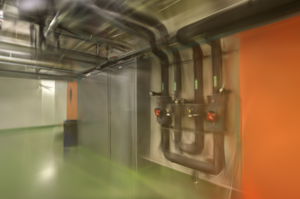
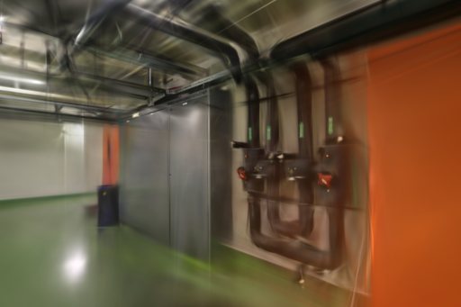
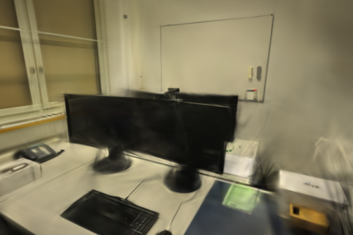
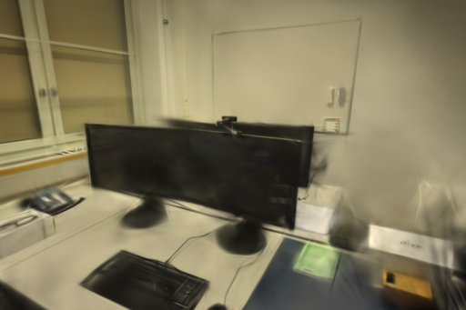
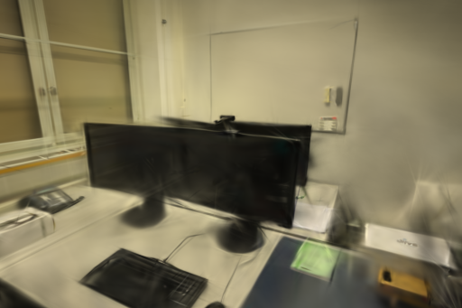
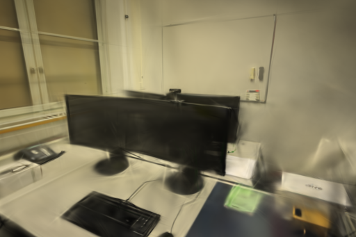

# 初始点三角化视差对照

2026-10-31，macOS / Apple Silicon，Brush 0.3.0 Metal。仅保留最大三角化角至少 3° 的初始点，office 两次重复的 PSNR、SSIM 均下降；pipes 没有稳定收益，因此不采用。生产代码和默认训练设置保持不变。

## 依据与范围

前一轮[最短轨迹筛查](TRACK-INITIALIZATION.md)损失了部分视角质量，本轮改测几何视差。[COLMAP 3.13.0](https://github.com/colmap/colmap/blob/3.13.0/src/colmap/sfm/incremental_mapper.h) 的默认过滤角为 1.5°；[角度实现](https://github.com/colmap/colmap/blob/3.13.0/src/colmap/geometry/triangulation.cc)使用 `min(θ, π−θ)`，避免把方向相反但共线的射线视作稳定三角化。本地假设是：提高已有初始点的角度门槛，可能减少不稳定几何。3° 是本次实验选择，并非论文推荐值。

同时查阅 Manuel Hofer、Markus Steinberger、Thomas Köhler 的 [Pi-GS（2026）](https://arxiv.org/abs/2602.03327)：其方法结合 π3 稠密初始化、置信度深度约束、法线一致性和图像变形监督，涉及学习得到的位姿与点云。截至本次检查，[官方仓库固定提交](https://github.com/Mango0000/Pi-GS/tree/db48bc49f1cf29ee32d40c6d037d0aad86056cfd)只有标记 Coming Soon 的 README，没有可接入的训练实现。本轮未移植或复现该方法，也未验证它在 Metal 上的适用性。

实测仅用 RGB 照片经 COLMAP 求得的相机，不用 ETH3D 真值位姿、深度或雷达，没有 CUDA 对照。角度按完整 SfM 轨迹计算，包含后续训练留出的照片；因此它既不等同于训练视图支撑，也不能证明独立端到端泛化。

## 配置与输入

基线为 [34b8b31](https://github.com/sakorman/web-scan/commit/34b8b312fda748b98f6d8073a988de41d568c1d0)。每场景、每变体重复两次，共 8 次串行 Metal 重建。pipes 顺序为基线/候选、候选/基线，office 相反。训练结束后才打开实验查看器；训练期间没有另一项 Brush 任务。

| 配置 | pipes | office |
| --- | ---: | ---: |
| 输入 / 已定位照片 | 14 / 14 | 26 / 26 |
| 未定位照片 | 无 | 无 |
| 训练 / 留出视图 | 12 / 2 | 22 / 4 |
| 原图尺寸 | 1600×1067 | 1600×1067 |
| 去畸变尺寸 | 1600×1066 | 1600×1067 |
| 初始点：基线 → 候选 | 1,881 → 1,866 | 2,482 → 2,314 |
| 删除初始点 | 15（0.80%） | 168（6.77%） |
| 解除关联的图像观测 | 30 | 420 |

固定共享 RADIAL 求解结果、去畸变 PINHOLE 相机、照片顺序、位姿和归一化。固定 3,000 步、512 像素长边、150,000 高斯上限、SH3、种子 42、每 100 步增密、2,400 步结束增密、每 500 步导出、每 8 张留出一张。所有原生渲染与共同评分尺寸为 512×341。固定种子不保证 Metal 逐位确定性。

候选只修改独立任务副本：对每点的观测射线两两计算锐角，最大值不足 3° 时删除该点，并解除 `images.bin` 中对应点 ID 的关联。相机、图像坐标和位姿不变，保留点的记录及顺序逐字节不变。独立用 PyCOLMAP 的三角化函数复算，删除集合完全一致；8 次运行的稀疏文件与预先验证的对应模型一致，源任务照片和模型摘要未变。[补丁](benchmarks/angle-initialization.patch)只用于实验适配器。

原始点没有小于 1.5° 的情况。过滤也会减少局部支撑：office `0009` 的观测数从 113 降到 99（12.39%），pipes `0006` 从 269 降到 263（2.23%）。这些统计说明全局角度规则存在覆盖代价，但不单独证明最终画质下降的原因。

## 实测结果

以下为 `compare_quality.py` 的共同网格评分，按留出视图等权平均。Brush 原生评分另存于[逐次数据](benchmarks/angle-initialization.json)，不与此表混用。

| 场景 / 重复 | 变体 | 实际高斯 | 完整 PLY 字节 | 训练、评测及导出 | PSNR | SSIM |
| --- | --- | ---: | ---: | ---: | ---: | ---: |
| pipes / 1 | 基线 | 11,447 | 2,703,042 | 22.8662 s | 19.349718 | 0.771780 |
| pipes / 1 | 3° 筛选 | 11,676 | 2,757,086 | 22.9947 s | 18.689420 | 0.755950 |
| pipes / 2 | 基线 | 11,851 | 2,798,386 | 22.8124 s | 18.782324 | 0.759008 |
| pipes / 2 | 3° 筛选 | 11,446 | 2,702,806 | 22.7894 s | 19.302777 | 0.773351 |
| office / 1 | 基线 | 14,684 | 3,466,974 | 23.5039 s | 21.801526 | 0.882340 |
| office / 1 | 3° 筛选 | 13,733 | 3,242,538 | 23.4926 s | 21.080941 | 0.873337 |
| office / 2 | 基线 | 14,539 | 3,432,754 | 23.5383 s | 21.469158 | 0.874624 |
| office / 2 | 3° 筛选 | 13,494 | 3,186,134 | 23.2740 s | 21.158580 | 0.868723 |

pipes 两次变化方向相反，均值 PSNR / SSIM 为 -0.069922 dB / -0.000743；office 两次均下降，均值为 **-0.515582 dB / -0.007452**。office 平均高斯数减少 6.83%、PLY 减少 235,528 字节，但质量损失不支持采用。

每次启动新的 Brush 进程，复用准备好的 SfM，不续跑训练检查点，也未清空文件系统或 Metal 缓存。计时含候选过滤、训练、评测和导出，排除输入复制及 SfM；SfM 与端到端耗时未测，记录为 null。候选过滤耗时 0.0230–0.0640 秒；训练、评测和导出均值差为 pipes +0.05275 秒、office -0.1378 秒。点数与质量同时改变，不能称为等质量提速。训练峰值内存未测。

## 同视角与漫游复查

以下 PNG 是训练器保存的同相机、同画幅渲染，尺寸均为 512×341，未修图。pipes 的管线模糊和橙墙渗色仍存在；office 的屏幕、白板和桌面细节没有稳定改善。office `0024` 两次 PSNR 差为 -0.608488 / +0.124203 dB，SSIM 差为 -0.007176 / -0.002166，不能将该视角描述为每次所有指标都下降。

| 场景 / 留出视角 | 基线 | 3° 筛选 |
| --- | --- | --- |
| pipes / 第一次 / `0008` |  |  |
| office / 第一次 / `0024` |  |  |
| office / 第二次 / `0024` |  |  |

训练结束后，浏览器通过现有 Spark 完整 SH3 查看器加载首次运行的四个模型，从 pipes 照片 1、office 照片 25 进入室内漫游，对两变体做相同方向拖动。均能正常加载，控制台无警告或错误；仍有细线漂浮、边缘拖影、模糊遮挡和前景覆盖不足，没有观察到稳定改善。该检查不能代替全场景几何误差测量。

## 验证与复现

8 份 PLY 均通过完整 SH3 数值和字段检查；相机、留出照片身份与画幅逐项一致。188 项后端、18 项前端、类型检查和构建通过，保留已有 TestClient 弃用提示和查看器包体警告。8787 服务保持可用。

实验汇总首轮同时导入几何库与评分库，因重复 OpenMP 运行时中止，尚未生成分数；去掉评分时不需要的 PyCOLMAP 导入、将几何校验独立执行后通过，未使用绕过检查的环境变量。另修正局部脚本把属性当函数调用、把 PLY 字段行当列表成员匹配的两处错误。训练和模型有效，无需重复 GPU 任务。

复现时在仓库根目录创建新目录，补丁仅应用到冻结适配器副本：

```bash
mkdir .data/benchmarks/angle-init-repro
git show 34b8b31:webscan/brush.py > .data/benchmarks/angle-init-repro/baseline.py
cp .data/benchmarks/angle-init-repro/baseline.py .data/benchmarks/angle-init-repro/candidate.py
patch .data/benchmarks/angle-init-repro/candidate.py < docs/benchmarks/angle-initialization.patch
.venv/bin/python scripts/benchmark_exports.py --repo . \
  --baseline .data/benchmarks/angle-init-repro/baseline.py \
  --candidate .data/benchmarks/angle-init-repro/candidate.py \
  --output .data/benchmarks/angle-init-repro/runs \
  --jobs 44537f26e3b34c5bb417deacb103ce47 c6a40f0953a54a9092430d295e2055a9 \
  --steps 3000 --resolution 512 --repeats 2
```

上述 ID 是本机已完成的 pipes / office 任务；其他机器需换成同数据与配置、保留去畸变稀疏模型的任务。新建评分目录，将 `jobs/0-0-baseline`、`jobs/0-0-candidate` 等符号链接指向对应运行目录，运行 `compare_quality.py --data <评分目录> --quick 0-0-baseline --detail 0-0-candidate --size 512 --output <结果.json>`，其余三对同理。不要直接过滤历史任务或共享缓存。

两次重复不足以推断一般性能，留出照片参与上游 SfM 和角度选择。本轮与前轮都不支持全局删点作为默认优化；下一步优先检查低覆盖区域及补拍证据，或在公开实现可用后单独验证几何约束，避免继续无依据地扫过滤阈值。

照片及衍生截图来自 Schöps 等的 [ETH3D / CVPR 2017](https://www.eth3d.net/datasets)，遵循 [CC BY-NC-SA 4.0](../THIRD_PARTY_NOTICES.md#test-dataset)。Brush 为 Arthur Brussee 等的 Apache-2.0 项目；COLMAP 为 Johannes L. Schönberger 等的 BSD 项目。原始照片、模型和完整日志保留在本机 `.samples` / `.data`，公开仓库保存实验补丁、测量摘要与上述截图。
