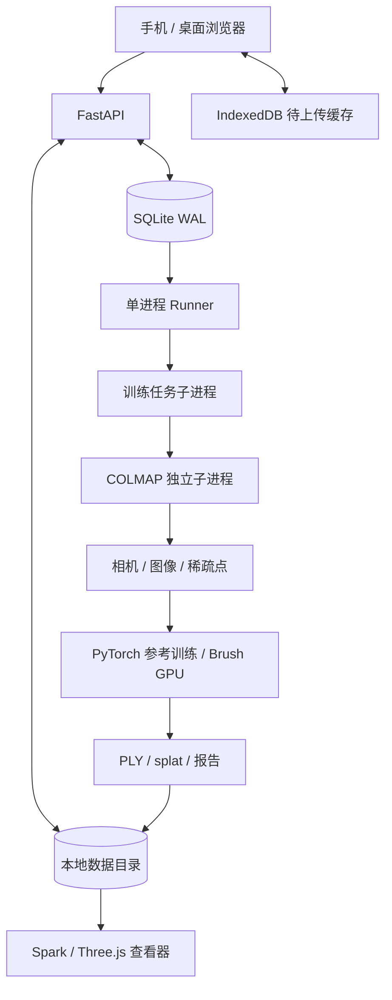

# Web Scan 当前技术架构

本文描述 v0.1 的实际实现。完整产品的未来设计见 ROADMAP.md。

## 服务边界

浏览器使用 TypeScript + Vite 构建，FastAPI 提供 API 和静态页面。元数据与队列保存在 SQLite，图像和产物保存在本地目录。一个服务只启动一个 Runner，不需要 Redis、对象存储或外部模型服务。



## 代码组织

| 位置 | 职责 |
| --- | --- |
| `src/main.ts` | 页面状态、采集、导入、任务操作与进度轮询 |
| `src/queue.ts` | IndexedDB 有界上传缓存、上传确认 |
| `src/upload-pipeline.ts` | 3路并发上传、生产背压与失败等待 |
| `src/viewer.ts` | 完整 PLY / SH3 载入、相机对照与资源释放 |
| `webscan/api.py` | 请求校验、文件处理、输入冻结、任务与产物接口 |
| `webscan/store.py` | SQLite 表、会话和任务持久化 |
| `webscan/runner.py` | 服务独占锁、原子领取、进程组管理、取消与退出 |
| `webscan/sfm_cache.py` | 按输入与求解版本校验、发布和恢复SfM缓存 |
| `webscan/frame_order.py` | 并发上传后的原始帧顺序 |
| `webscan/sfm.py` | 与 PyTorch 分离的 COLMAP 进程入口 |
| `webscan/reconstruction.py` | 位姿求解、去畸变、坐标归一化、原创测试场景 |
| `webscan/gaussian.py` | 可微参考渲染、优化循环、PLY / splat 编码、CUDA 适配 |
| `webscan/brush.py` | Brush CLI、阶段输出、模型归一化与预览转换 |
| `webscan/worker.py` | 输入完整性校验、阶段串联和成功结果发布 |

## 输入与一致性

图片解码后按 EXIF 方向旋转、转 RGB、限制分辨率，再编码为 JPEG。以规范化图片的 SHA-256 在会话内去重。上传完成后浏览器才删除 IndexedDB 中的待传记录。

`finalize` 与上传提交共享 SQLite 写事务，避免输入冻结后仍混入新图片。冻结清单记录帧 ID 与摘要；重建前再次校验摘要并复制固定输入到任务工作目录。元数据不信任文件名作为路径。

会话：`capturing → ready`。冻结后只允许重建；补拍创建新会话。

任务：`queued → running → succeeded / failed / cancelled`，另记录 `prepare / sfm / train / export` 阶段。数据库更新只允许修改活动任务，已取消任务不能被迟到的完成记录覆盖。

## 任务调度

Runner 持有数据目录独占文件锁，使用 `BEGIN IMMEDIATE` 原子领取任务。任务子进程新建进程组，COLMAP 子进程继承该组，因此取消可以同时终止求位姿和训练。退出时先 TERM，必要时再 KILL；正常完成则核对最终状态。

本地默认单任务，避免 CPU / 内存争抢。SQLite 保存队列与进度，页面使用 1.5 秒轮询。服务重启后遗留 running 状态改为 interrupted / failed，用户可重新提交；当前不做自动重试或阶段检查点续跑。

## 重建算法

1. COLMAP 在 CPU 上提取 SIFT、匹配并做增量重建；取已注册图像最多的模型。
2. 至少注册 3 张、注册率达到 50%；滤除支持不足或误差较高的稀疏点。
3. 去畸变，保证训练照片与相机内参一致；从中位点与分位半径归一化坐标。
4. 从稀疏点采样固定数量高斯，以近邻距离初始化尺度。
5. 高斯尺度采用 log 参数，透明度 / 颜色使用 sigmoid，旋转用归一化四元数。
6. 参考渲染器投影协方差、按深度排序并前向 alpha 合成；Adam 优化图像 L1 误差与轻量尺度正则。
7. 导出 SH0 Gaussian PLY、32 字节 / 点的 splat、相机和报告。

CUDA 后端把渲染替换为 gsplat.rasterization；本项目训练调度和导出逻辑不变。该适配在当前无 NVIDIA GPU 的环境下未实测。

## 室内 GPU 路径

Brush 0.3.0 作为未修改的外部二进制，由任务子进程调用。它消费 COLMAP 去畸变数据，执行动态增点、SH3、L1 / SSIM 优化，并按固定步数导出 PLY。适配器增量读取 refinement 日志中的真实步数更新进度，解析评估日志，保留完整 SH 的 PLY，同时生成供下载兼容使用的 SH0 splat。模型和相机统一归一化到同一坐标。最终模型校验和转换成功后，清理本次任务较早的 PLY；训练中的导出频率保持每 500 步，原照片、历史任务和最终产物不受影响。

ETH3D office 的样本导入只读取预先准备好的本地照片；按正常上传校验流程创建会话，并记录数据源。首个采集视图用作漫游初始相机。

## API

| 方法 / 路径 | 用途 |
| --- | --- |
| `GET /api/health` | 依赖与后端状态 |
| `GET /api/sessions` | 列出采集与最新任务 |
| `POST /api/sessions` | 创建采集 |
| `GET /api/sessions/{id}` | 图片和任务详情 |
| `POST /api/sessions/{id}/frames` | multipart 图片与 JSON 元数据 |
| `GET /api/sessions/{id}/frames/{frame_id}` | 获取采集图像 |
| `POST /api/sessions/{id}/finalize` | 冻结输入 |
| `POST /api/indoor-sample` | 导入本地 ETH3D 办公室照片 |
| `POST /api/fixtures` | 创建原创校准测试场景 |
| `POST /api/jobs` | 创建重建任务，活动任务去重 |
| `GET /api/jobs/{id}` | 查询任务 |
| `POST /api/jobs/{id}/cancel` | 取消任务 |
| `GET /api/jobs/{id}/log` | 查看日志尾部 |
| `GET /api/jobs/{id}/artifacts/{name}` | 成功后访问白名单产物 |

## 数据目录

```text
.data/
├── state.sqlite3
├── worker.lock
├── sessions/<id>/
│   ├── images/*.jpg
│   ├── manifest.json          # 普通照片采集冻结输入
│   └── fixture.json           # 仅校准示例的已知相机与初始点
└── jobs/<id>/
    ├── worker.log
    ├── input/                 # 已校验的冻结照片
    ├── sfm/                   # 数据库、COLMAP 模型、去畸变图片
    └── artifacts/
        ├── gaussians.ply
        ├── preview.splat
        ├── thumbnail.jpg
        ├── cameras.json
        └── report.json
```

默认限制 Host 和跨站写请求，以本机单用户为边界。远程多用户部署需要新增登录、会话隔离、配额和更严格的上传网关，不能把当前服务直接当作公网产品。


## 采集入口补充

普通采集 finalize 要求至少 12 张不同图像，校准示例为 3 张；已冻结的历史输入保持兼容。浏览器对最多 5 分钟 / 250 MB 的受支持视频做均匀抽帧，最多 120 帧，逐张复用 JPEG 上传队列。

`DELETE /api/sessions/{id}` 在无排队 / 运行任务时将状态设为 deleted，从列表隐藏；文件保留。`POST /api/sessions/{id}/restore` 按现有冻结清单恢复 ready 或 capturing。删除中的项目不能追加照片或再次冻结。


## 重复任务与上传优化

同一冻结输入可以复用经过完整摘要校验的 SfM 输出，当前 Worker 仍按任务串行调度；不改变训练参数。每次仍校验原始图像，缓存无效则重算。上传生产与最多3路网络请求重叠，按导入批次与序号恢复训练图像顺序。实测与边界见 [PERFORMANCE.md](PERFORMANCE.md)。


## 画质与对照

- 位姿求解支持自动模式和用户明确选择的同镜头模式，使用 8192 SIFT 特征及 guided matching。相机模式计入 SfM 缓存签名，训练分辨率和步数不改变缓存。
- 新项目 GPU 训练默认 6,000 步 / 1024 像素 / 150,000 高斯预算。API 上限 30,000 步、1600 像素、500,000 高斯；CPU 调试预算保持独立限制。
- `evaluation_mode=all` 使用全部已定位照片；`holdout` 每 8 张留出一张用于训练后的评测。旧客户端默认保留 holdout 行为，前端新项目明确提交 all。
- `cameras.json` 保存每个去畸变视图的宽高、K、world-to-camera 矩阵及图像文件名。`GET /api/jobs/{id}/views/{index}` 仅返回完成任务内对应的去畸变照片。
- `src/camera.ts` 把 COLMAP right/down/forward 转成 Three.js right/up/backward，保留偏心主点，用完整投影矩阵还原照片。视口按照片比例留边，不裁剪；数学测试覆盖轴向、平移、旋转和主点。
- Spark 在 GPU 上使用 SH0–SH3，直接读取导出的 PLY。未对几何额外旋转，因此 SH 方向与模型坐标保持一致。查看器按需加载，旧任务缺少完整相机信息时禁用照片对照。
- 历史结果通过所属项目内的任务列表选择，`?p=...&j=...` 可复现。下一次训练设置独立保存，切换结果不会覆盖正在编辑的参数。


查看器由 `RenderScheduler` 合并帧请求。相机操作、视口变化和 Spark `onDirty` 异步通知触发更新，环绕阻尼和按键移动结束后停止。相机控制器仅在操作尚未结束时更新，避免排序完成回调反复推动已经静止的相机。原照片对照或文档隐藏时暂停绘制，恢复时重画；释放查看器后，迟到的回调不会重启旧画布。


## 评测完整性

`webscan/evaluation.py` 根据固定版本 Brush 的 COLMAP 排序与每 8 张留出规则核对视图数量，要求最终步数对应的有限指标及完整 PNG 集合，并检查解码、尺寸和画幅。只有校验通过才转换最终模型、清理中间 PLY 和发布成功状态。全照片模式校验训练视图数，保持 `evaluation=null`。

报告增加 `evaluation_verified` 与 `evaluation_images`（名称、尺寸、输出与参考照片摘要）。对照脚本重新检查完整集合、参考照片和已有摘要，不能因两份任务同时缺少同一视角而缩小评测集。
