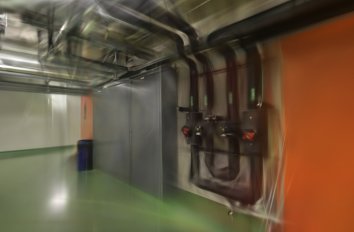
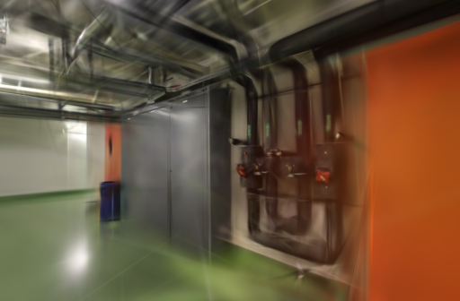
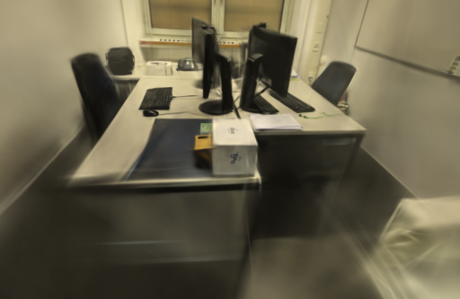
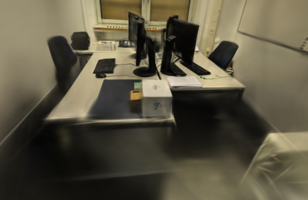

# 辅助约束结束时刻筛查（未采用）

2026-10-28。Brush 的透明度与尺度辅助约束默认在训练进度 90% 时归零，而当前 3,000 步任务在 80% 时已停止增点。为检验后 10% 的弱约束是否影响细节收敛，本轮只把 `--aux-loss-time` 从 `0.9` 改为 `0.8`；这会让辅助约束恰好在第 2,400 步停止，其余训练、相机、位姿、照片和评测均不变。

该筛查没有得到跨场景一致结果，因此默认值仍为 `0.9`。

## 方法

- Apple Silicon macOS、Brush 0.3.0、Metal、SH3、种子 42；每次 3,000 步、512 像素长边、150,000 高斯上限，每 100 步细化、第 2,400 步停止增点、每 500 步导出、每 8 张照片留出一张。
- 复用已完成 SfM 的 ETH3D pipes 与 office：分别为 14 / 14、26 / 26 输入 / 定位照片，训练 / 评估为 12 / 2、22 / 4。每次训练各自复制去畸变图和冻结的相机；计时只覆盖训练、留出评测与导出，不含 SfM、输入复制或下载。
- 每场景两次、两设置交错运行，共 8 次串行 GPU 训练。评测前核对相机 JSON、留出照片名和参考 SHA-256；输出必须含完整 SH3 PLY 和留出渲染图。
- `compare_quality.py` 不上采样，将相同相机与评估照片统一到长边 512，以 RGB PSNR 和 11×11 Gaussian-window SSIM 按视角等权平均。留出照片参与了上游 SfM，不是独立的端到端留出集。

Brush 的实现将辅助系数设为 `clamp(aux_loss_time - train_progress, 0, 1)`，并用于透明度和尺度正则；候选因此只移除了最后 600 步的这两项逐步衰减约束，没有改变主 L1/SSIM 损失、均值噪声或增点规则。[训练实现](https://github.com/ArthurBrussee/brush/blob/v0.3.0/crates/brush-train/src/train.rs#L143-L199) · [配置定义](https://github.com/ArthurBrussee/brush/blob/v0.3.0/crates/brush-train/src/config.rs)

## 结果

| 场景 | 设置 | 训练、评测与导出 | 实际高斯 | 原生 PSNR / SSIM | 共同 512 PSNR / SSIM |
| --- | --- | ---: | ---: | --- | --- |
| ETH3D pipes | `0.9` | 23.2539 s | 10,737 | 18.1425 / 0.74956 | 18.0172 / 0.72561 |
| ETH3D pipes | `0.8` | 23.2251 s | 11,282 | 18.8414 / 0.75418 | **18.6936 / 0.73008** |
| ETH3D office | `0.9` | 23.2396 s | 14,383 | 21.8585 / 0.87816 | 21.6983 / 0.86367 |
| ETH3D office | `0.8` | 23.2519 s | 14,571 | 21.4697 / 0.87170 | **21.3244 / 0.85695** |

共同网格中，pipes 候选提高 0.6764 dB PSNR、0.00447 SSIM，但多出 5.08% 高斯；office 则下降 0.3739 dB、0.00672 SSIM，并多出 1.31% 高斯。两场景的计时差分别为 -0.03 s 和 +0.01 s，低于进程轮询粒度，不能作提速结论。

首次 pipes 同视角里候选的墙面和阀门轮廓略稳定；办公桌第二次的 `0016` 视角则出现明显更深的前景和缺失区域，与该视角 PSNR / SSIM 从 18.4571 / 0.81577 降至 16.3805 / 0.75830 一致。下图是训练器直接保存的 PNG，未修图或替换。

| 场景 / 视角 | 默认 `0.9` | 候选 `0.8` |
| --- | --- | --- |
| pipes / 第一次 / `0008` |  |  |
| office / 第二次 / `0016` |  |  |

## 取舍与限制

候选没有通过两组室内照片均不退化的筛查，且没有减少高斯或稳定缩短运行时间，故不修改生产适配器。完整原始汇总、逐视角结果、输入摘要和快照摘要见 [公开数据](benchmarks/aux-loss-stop.json)；本机模型、日志与评测图保留在 `.data/benchmarks/aux-loss-stop-20261028/`，不随仓库发布。

两次重复足以拒绝当前候选，不能估计一般性效果；不同的分辨率、步数、室外场景或 CUDA 后端可能表现不同。近期工作如 [SteepGS](https://openaccess.thecvf.com/content/CVPR2025/html/Wang_Steepest_Descent_Density_Control_for_Compact_3D_Gaussian_Splatting_CVPR_2025_paper.html) 与 [AD-GS](https://doi.org/10.1145/3757377.3763993)说明密度控制与收敛阶段需要联合验证，但没有给出本参数的直接推荐值。下一步应继续优先验证位姿与采集覆盖，而不是在同一辅助约束上做小幅反复调参。

照片与衍生图像遵循 [ETH3D 的 CC BY-NC-SA 4.0 许可](../THIRD_PARTY_NOTICES.md#test-dataset)。
