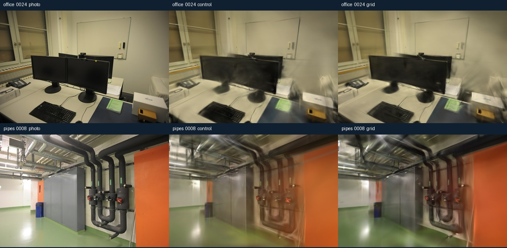
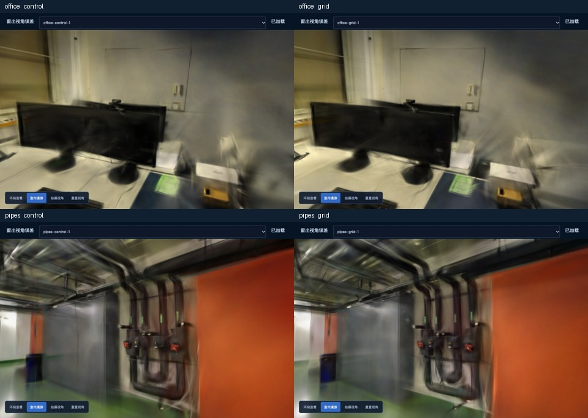

# 稀疏轨迹驱动的双边网格校色

2026-11-27。对同一三维点，训练照片拍到的颜色有时不同。用稀疏对应拟合每张训练照片的局部颜色偏移后，office、pipes 在保留轨迹上的颜色误差分别下降 10.3%、12.4%。在独立留出的整张照片上，pipes 的分区色偏连续两次上升。此方案保留为可复现的离线实验，默认 Brush 重建继续使用原色图像。[逐视角数据、内参与模型摘要](benchmarks/bilateral.json)

## 方法与对照

每张训练图使用一个 4×4×4 网格，三个轴为横坐标、纵坐标和编码 RGB 亮度。每个格点只拟合三个加性偏移，空格点由零先验约束。COLMAP 稀疏点须有至少三张独立训练片的有效观测，点平均误差小于 4 px，单个观测重投影误差最多 2 px。双线性采样每个投影位置，取其他照片在该点的逐通道中位数作目标。按三维点编号模 5 保留一组作核验，其余用于带 L2 正则的最小二乘拟合，零先验权重为 8，目标与格点偏移均限于 ±8/255。两次候选使用同一组拟合点和核验点。

| 场景 | 拟合 / 核验观测数 | 核验 RGB 平均绝对误差，校色前 → 后 |
| --- | ---: | ---: |
| office | 4,114 / 978 | 0.07625 → 0.06838 |
| pipes | 2,414 / 554 | 0.07240 → 0.06344 |

这里的误差在 [0,1] 编码 RGB 上、每个核验观测的连续校正值处计算。核验轨迹与拟合轨迹分开，仍来自同一批训练相机。目标中位数可能受到遮挡、反光、位姿误差影响，不能作为表面真实颜色。

## 八次实拍重建

ETH3D office 输入 26 张，定位 26 张，22 张训练、4 张留出。pipes 输入 14 张，定位 14 张，12 张训练、2 张留出。两场景均无定位失败。纯照片使用已冻结的共享 RADIAL 相机，原图 1600×1067，office / pipes 焦距约 906.44 / 906.09 px。每八张留一张，留出照片参与上游 SfM，校色和高斯训练均只使用训练照片。两组训练图都转成无损 PNG，留出 JPEG 逐字节保留。逐对比对五份稀疏模型二进制、拍摄相机和参考图摘要。

使用同一 Brush v0.3.0 在 Apple M5 / Metal 串行运行，种子 42，3,000 步，长边 512，上限 150,000 个高斯，导出完整 SH3。第一轮先原色后校色，第二轮反序。固定留出视角全幅按 512×341 评分。训练时间含评估、转换和导出。总时间从准备独立数据集起算；复用已定位场景，新增 SfM 时间为 0，冷启动未测。

| 场景 / 次数 | 训练图 | PSNR dB / SSIM | 高斯数 / PLY 字节 | 准备 / 训练导出 / 总计 s |
| --- | --- | --- | ---: | --- |
| office 1 | 原色 | 21.949 / 0.87517 | 14,213 / 3,355,818 | 0.72 / 24.41 / 25.14 |
| office 1 | 校色 | 21.715 / 0.87892 | 14,346 / 3,387,206 | 7.39 / 24.02 / 31.43 |
| office 2 | 原色 | 20.937 / 0.87344 | 14,481 / 3,419,066 | 0.68 / 23.93 / 24.62 |
| office 2 | 校色 | 21.960 / 0.87683 | 14,510 / 3,425,910 | 7.06 / 24.03 / 31.10 |
| pipes 1 | 原色 | 18.818 / 0.76123 | 11,291 / 2,666,226 | 0.40 / 24.76 / 25.17 |
| pipes 1 | 校色 | 18.712 / 0.76013 | 11,701 / 2,762,986 | 3.79 / 23.27 / 27.06 |
| pipes 2 | 原色 | 18.141 / 0.75432 | 11,280 / 2,663,630 | 0.40 / 23.06 / 23.47 |
| pipes 2 | 校色 | 18.981 / 0.75399 | 11,526 / 2,721,686 | 3.81 / 23.32 / 27.14 |

面积加权的 4×4 分区色偏取每格 RGB 残差均值的平方，再对留出视角等权平均。pipes 的该指标在两轮分别上升 32.8%、8.5%，office 分别上升 5.7%、下降 31.2%。两场景第一轮 PSNR 均下降，第二轮均上升，只有两个配对，单一分数易受训练波动影响。校色使数据准备额外花费约 3.4–6.7 秒，内存开销随解码后的训练照片总像素数增加。下一步可在训练损失内拟合每个视角的外观变换，直接用原色留出图检验导出的模型。



第一轮四个模型均在浏览器从同一拍摄视角拖动检查。office 两种结果的显示器底座和纸边都发软。pipes 上方细管有重影，橙墙附近仍有颜色渗入相邻区域。短路径中没有辨认出稳定减少的空洞或漂浮物。下图记录拖动后的同位置画面。照片来自 Thomas Schöps 等人的 ETH3D，衍生截图沿用 CC BY-NC-SA 4.0。[数据集署名与许可](../THIRD_PARTY_NOTICES.md)



## 复现

以已完成的真实照片 Brush 留出任务为输入，从仓库根目录分别运行两种模式，每次使用新输出目录。下面以本次 office 任务为例。比较脚本同时输出逐视角 PSNR、SSIM 和色偏。pipes 的源任务及另外三对结果见上方数据文件。

```sh
source_job=.data/jobs/fe0f85e26772440ead01b7b2085d21b4
out=$(mktemp -d .data/benchmarks/grid-check-XXXXXX)
for variant in control grid; do
  .venv/bin/python -m scripts.benchmark_bilateral --source "$source_job" \
    --output "$out/jobs/$variant" --variant "$variant"
done
.venv/bin/python -m scripts.compare_quality --data "$out" --quick control \
  --detail grid --size 512 --error-grid 4 --output "$out/scores.json"
```

Yuehao Wang 等提出使用逐视角双边网格建模相机处理导致的外观差异。Richard Shaw 等在 WildAnySplat 中也使用逐图网格。本实验独立实现了训练前拟合的加性校正，两篇工作涉及的辐射场联合训练或前馈模型不在此次测试范围内。[Bilateral Guided Radiance Field Processing](https://bilarfpro.github.io/) · [作者实现与 Apache-2.0 许可](https://github.com/yuehaowang/bilarf) · [WildAnySplat v1](https://arxiv.org/abs/2611.31023v1) · [Brush v0.3.0，Apache-2.0](https://github.com/ArthurBrussee/brush/tree/v0.3.0)
