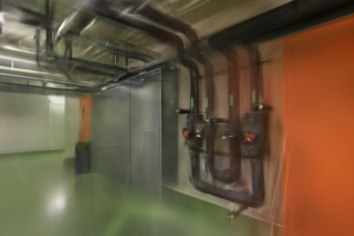
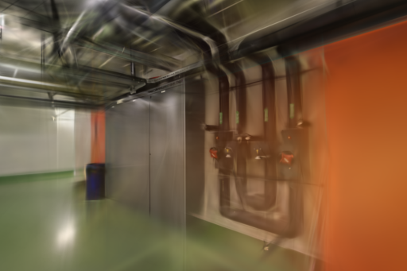
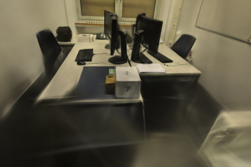
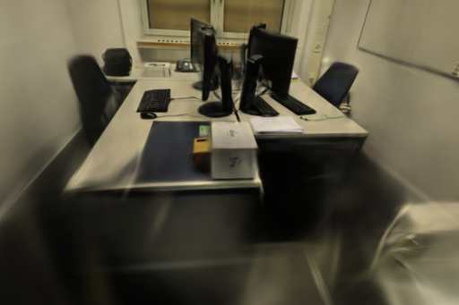

# 训练结束等待

2026-10-31。Brush 结束后，后端现在直接进入输出校验，避免继续等待固定的一秒进度间隔。采用此改动；收益限于结束检测延迟。[基线提交](https://github.com/sakorman/web-scan/commit/3611df623ff3dd5fdc111c096edb5f300a3fb1c2) · [完整数据](benchmarks/completion-wait.json)

## 问题与实现

原循环每秒读取训练进度，然后调用 `sleep(1)`。如果子进程在睡眠刚开始时结束，后端仍会等到下一轮才检查返回码。改动前先用一个睡眠 0.2 秒的真实子进程建立基线：适配器总用时 1.0023 秒，子进程退出标记到发现结束相隔 779.88 毫秒。

现改为 `process.wait(timeout=1)`：子进程退出时返回，仍在执行则捕获 `TimeoutExpired` 并继续更新进度。非零返回码、取消时终止子进程、一小时上限与最终模型校验保持原有规则。Brush 的程序、命令参数、模型转换及网页渲染没有改动。

Python 的 [Popen.wait 官方说明](https://docs.python.org/3.12/library/subprocess.html#subprocess.Popen.wait)明确允许超时后重试。POSIX 带超时等待内部使用短暂睡眠和轮询，因此会比原来每秒一次更频繁地检查进程；本轮未测 CPU 或能耗差异。训练日志写入普通文件，不使用可能填满缓冲的 `stdout=PIPE`。

## 受控进程对照

`benchmark_completion.py` 为每种等待长度运行三组交错对照，共 18 次。每次独立启动 Python 子进程，睡眠后写入单调时钟标记，再退出；没有 GPU、照片或生成模型。以下是从该标记到适配器发现结束的中位时间：

| 子进程睡眠 | 基线 | 新实现 |
| --- | ---: | ---: |
| 0.1 秒 | 880.430 ms | 17.763 ms |
| 0.4 秒 | 570.119 ms | 51.008 ms |
| 0.7 秒 | 272.908 ms | 9.682 ms |

测量包含写标记和进程退出开销，不是内核退出时刻的精确测量。样本覆盖不同退出相位，不能把三个中位数之比解释成训练加速倍数，也不能保证每次节省同样时间。

## 实拍重建回归

使用本地 Brush 0.3.0、Metal、种子 42、SH3、3,000 步、512 像素长边、15 万高斯上限，每 100 步细化、2,400 步停止增点、每 500 步导出；按每八张留出一张评估。GPU 串行，顺序为 pipes 基线 / 新实现、office 新实现 / 基线，训练期间没有浏览器模型渲染。所有运行均启动新 Brush 进程，未清空系统文件或 Metal 缓存，不能称为冷启动测试。

| 场景 | 输入 / 定位 | 失败视角 | 训练 / 留出 | 原照片尺寸 | 去畸变尺寸 |
| --- | ---: | --- | ---: | --- | --- |
| pipes | 14 / 14 | 无 | 12 / 2 | 1600×1067 | 1600×1066 |
| office | 26 / 26 | 无 | 22 / 4 | 1600×1067 | 1600×1067 |

复用固定的共享 RADIAL 内参、位姿、初始点和去畸变 PINHOLE 场景；完整相机参数和摘要见数据文件。照片、相机与来源文件摘要校验通过。没有重新计算 SfM，SfM 和端到端耗时记为未测，不填零；下表只计适配器内训练、评测、导出、完成等待和转换，排除输入复制。

| 场景 / 实现 | 训练评测及导出 | 实际高斯数 | 完整 PLY 字节 | 共同网格 PSNR | SSIM |
| --- | ---: | ---: | ---: | ---: | ---: |
| pipes / 基线 | 23.2342 s | 11,709 | 2,764,874 | 18.413866 | 0.758346 |
| pipes / 新实现 | 22.8007 s | 11,464 | 2,707,054 | 17.897290 | 0.746648 |
| office / 基线 | 24.2559 s | 14,661 | 3,461,546 | 21.266005 | 0.874311 |
| office / 新实现 | 23.4064 s | 14,718 | 3,474,998 | 20.910894 | 0.858249 |

评分使用 `compare_quality.py` 的同相机、同参考照片和 512×341 网格。Brush 原生评分另外保留在 JSON 中，不与此表混用。留出照片仍参与上游 SfM，这不是独立的端到端留出评估。

两场景候选均值较低，不能称为画质改善。固定种子也不保证 Metal 两次训练得到相同模型；每种仅一次，没有建立质量差异或总耗时差异的因果关系。因此仅采用受控进程已验证的等待修复，不用这四次运行推算训练加速或等质量收益。

四个输出都通过完整 SH3 和评测身份校验。对每一份原始 `export_3000.ply` 再使用冻结基线转换，得到的 `gaussians.ply` 和 `preview.splat` 与本次文件逐字节相同；这验证同源转换一致性，不表示两次独立训练的模型相同。

## 同视角记录

直接保留训练器输出的 512×341 PNG，不改相机或画幅。pipes `0008` 仍有管线重影和薄结构模糊；office `0016` 的桌面、显示器可辨，前景与桌下仍存在黑区和拖影，候选桌下黑区更明显。本轮没有渲染或交互改动，未重复浏览器漫游测试；不对空洞或漂浮物改善作结论。

| pipes 基线 | pipes 新实现 |
| --- | --- |
|  |  |

| office 基线 | office 新实现 |
| --- | --- |
|  |  |

## 回归与复现

新增五项等待相关测试，覆盖短任务立即结束、跨进度间隔、非零退出、取消和整体超时。61 项相关回归、全量 188 项后端、18 项前端、类型检查和生产构建通过；保留已有 TestClient 弃用提示和查看器大包提示。8787 本地服务健康，新任务由独立 worker 加载新实现。

在仓库根目录使用一个尚不存在的输出目录：

```bash
mkdir -p .data/benchmarks/completion-recheck
git show 3611df6:webscan/brush.py > .data/benchmarks/completion-recheck/baseline.py
.venv/bin/python scripts/benchmark_completion.py \
  --baseline .data/benchmarks/completion-recheck/baseline.py \
  --candidate webscan/brush.py \
  --output .data/benchmarks/completion-recheck/control --repeats 3
.venv/bin/python scripts/benchmark_exports.py --repo . \
  --baseline .data/benchmarks/completion-recheck/baseline.py \
  --candidate webscan/brush.py \
  --output .data/benchmarks/completion-recheck/runs \
  --jobs 44537f26e3b34c5bb417deacb103ce47 c6a40f0953a54a9092430d295e2055a9 \
  --steps 3000 --resolution 512 --repeats 1
```

实拍命令依赖本机已有的两个准备任务；其它机器需先准备相同 ETH3D 场景，并替换任务编号。下次涉及训练参数的实验仍需独立建立重复基线；历史的一秒轮询计时不追溯改写。

照片来自 Schöps 等的 [ETH3D / CVPR 2017](https://www.eth3d.net/datasets)，本页截图及衍生模型遵循 [CC BY-NC-SA 4.0](https://creativecommons.org/licenses/by-nc-sa/4.0/)。训练引擎为 Arthur Brussee 等维护的 [Brush 0.3.0](https://github.com/ArthurBrussee/brush/releases/tag/v0.3.0)，保留 Apache-2.0 许可。本轮未移植新的 3DGS 论文算法。
