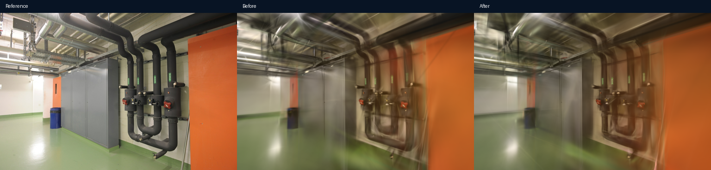
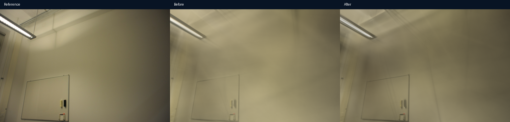

# 数据库事务结束后释放连接

2026-11-18。历史服务曾出现无法打开数据库；本轮启动检查正常，未复现该故障。但独立测试确认：原来的 `with store.connect()` 只结束事务，不关闭连接，读取历史或轮询任务后会等待垃圾回收释放文件描述符。本轮统一使用 `Store.transaction()`，在提交或回滚之后关闭连接，包括提交本身失败的情况。

保留此修复。它解决的是已复现的连接生命周期问题，**尚未证明是此前访问失效的根因**，也不代表训练显存、画质或速度提升。

## 依据与适用范围

- [Python 3.12 官方说明](https://docs.python.org/3.12/library/sqlite3.html#how-to-use-the-connection-context-manager)明确区分事务上下文与连接关闭；实现用外层 `contextlib.closing` 包住原生事务，保留提交、回滚和异常传播。API、Store 和队列启动的连接均覆盖；领取任务仍使用零等待及原来的取消竞争检查。
- 查阅 Arthur Brussee 的 [Brush 近期实现 1388f74](https://github.com/ArthurBrussee/brush/commit/1388f74c6fe0236f68ee4915564bf00e9d2e3747)（2026-10-03，[PR 556](https://github.com/ArthurBrussee/brush/pull/556)，Apache-2.0）：减少查看器上传和训练计算，但没有本地对照数据，故本轮不升级引擎。
- Xiaobin Deng、Changyu Diao、Min Li、Duanqing Xu 的 [BoundedGS，2026-10-25 v1](https://arxiv.org/abs/2610.34233v1)通过缩短局部渲染缓存的存活时间控制高分辨率训练资源。[作者实现 23bca83](https://github.com/XiaoBin2001/BoundedGS/tree/23bca8369a793ab9e29cc2b5d7c5966d4660d850)使用 CUDA；原创新代码 MIT，继承部分仍受 3DGS / ImprovedGS 等原许可证约束。只借鉴“测量资源存活范围”的思路，未移植或复现其算法，论文的 GPU 收益不能用于解释本轮数据库结果。

本轮为照片 → COLMAP → Brush / Metal，无数据集真值位姿、深度或雷达输入。数据库修复不依赖 GPU 后端，但真实重建只验证 Apple M5 / Metal；未验证 CUDA。

## 独立资源基线

基线代码为 [297aefc](https://github.com/sakorman/web-scan/commit/297aefc)，Python 3.12.14、SQLite 3.53.1。两个版本各使用独立临时 WAL 数据库，连续读取同一个采集 200 次。`lsof -Ffn` 只计数字描述符，排除内存映射项；不锁定生产数据库、不改系统权限或描述符限制。

| 垃圾回收条件 | 读取次数 | 修改前未关闭描述符 | 修改后 |
| --- | ---: | ---: | ---: |
| 正常 | 25 | 51 | 0 |
| 正常 | 50 | 52 | 0 |
| 正常 | 100 | 62 | 0 |
| 正常 | 200 | 109 | 0 |
| 暂停自动回收 | 25 | 51 | 0 |
| 暂停自动回收 | 50 | 101 | 0 |
| 暂停自动回收 | 100 | 201 | 0 |
| 暂停自动回收 | 200 | 401 | 0 |

显式回收后原版也降到 0，所以这是延迟释放，不是已证明永不回收的泄漏。正常回收的数量受分配时序影响，不视为固定上限。暂停回收是独立压力条件，生产服务未暂停回收。初次统计把映射项也计入，报告已改为仅计文件描述符并重测。

[完整数据](benchmarks/connection-lifetime.json) · [复现脚本](benchmarks/connection-lifetime-probe.py)：

```bash
mkdir -p .data/benchmarks/connection-lifetime-recheck
PYTHONPATH=. .venv/bin/python docs/benchmarks/connection-lifetime-probe.py \
  .data/benchmarks/connection-lifetime-recheck 297aefc
PYTHONPATH=. .venv/bin/python docs/benchmarks/connection-lifetime-probe.py \
  .data/benchmarks/connection-lifetime-recheck
```

脚本需要 macOS `lsof`，第一条从 Git 读取指定版本的 Store，第二条使用工作区版本。临时数据库自动清理，不触碰真实任务。

## 实拍队列回归

先在原服务完成 pipes / office 基线；确认没有排队或运行任务后平滑重启加载修复，62 条历史任务的 ID 与状态保持一致。之后完成两场景新任务，并因 pipes 评分降低补做一次相同配置复测。任务、照片、模型、缓存和原始测量保留在 `.data` / `.samples`。

重建通过 `POST /api/jobs` 提交以下配置，把 `session_id` 替换为已有、已冻结的对应场景采集 ID；每次等待该任务成功后再提交下一次。完整任务 ID、实际配置和各项摘要在 JSON 中。修改前后各新建任务，不覆盖历史产物。

```json
{"session_id":"已有采集ID","backend":"brush","steps":3000,"resolution":512,"max_points":150000,"camera_mode":"shared","evaluation_mode":"holdout"}
```

五次均为 Brush 0.3.0（程序 SHA-256 见数据）、种子 42、3000 步、512 长边、15 万高斯预算、SH3、同镜头 RADIAL、每 8 张留出 1 张。pipes 14/14 定位，12 训练 / 2 留出；office 26/26 定位，22 训练 / 4 留出；失败定位均为 0。原图都是 1600×1067，相机与去畸变结果复用已校验缓存，训练图及留出参考没有改变。原始相机的 `[f,cx,cy,k1,k2]` 分别是 pipes `[906.091436,800,533.5,-0.100914,0.067285]`、office `[906.438109,800,533.5,-0.103277,0.069590]`；完整参数保留于各任务相机文件。

留出照片参与过上游 SfM，不能视作独立端到端评估。比较用 `scripts/compare_quality.py` 核验相机和参考摘要，以共同 512×341 网格计算 PSNR / SSIM；表中不是 Brush 日志中的原生评分。

| 场景 / 任务 | 高斯数 | PLY 字节 | PSNR dB | SSIM | 缓存恢复 s | 训练评估导出 s | 任务总计 s |
| --- | ---: | ---: | ---: | ---: | ---: | ---: | ---: |
| pipes 修改前 `25db943c` | 11654 | 2751894 | 19.4260 | 0.765165 | 0.0312 | 23.0952 | 23.21 |
| pipes 修改后 `761b5d88` | 11601 | 2739386 | 18.9148 | 0.752420 | 0.0214 | 22.7414 | 22.81 |
| pipes 修改后复测 `e7742510` | 11568 | 2731598 | 18.5000 | 0.750395 | 0.0249 | 22.7936 | 22.86 |
| office 修改前 `9c211f32` | 14322 | 3381542 | 20.9537 | 0.873084 | 0.0476 | 23.4749 | 23.58 |
| office 修改后 `9d2e88aa` | 14306 | 3377766 | 21.4310 | 0.875657 | 0.0427 | 23.5285 | 23.63 |

pipes 两次低于这次基线约 0.51 / 0.93 dB，office 一次高约 0.48 dB。训练配置、归一化场景和相机一致，算法文件未改；固定种子仍不能保证 Brush 完全重复。此次样本不足以把评分差异归因于数据库修改或排除系统性退化，**不作画质通过或提升结论**，保留这些结果用于下一轮训练重复性复查。

顺序为基线 pipes、基线 office、修改后 pipes、修改后 office、修改后 pipes 复测。串行使用 GPU，训练期间无测试浏览器渲染。全部复用 SfM，不存在本轮新 SfM 耗时；每次新 Brush 进程，未清系统或 Metal 缓存，不是冷启动对照。任务总计不含照片导入与排队；客户端提交至观察完成分别 24.36 / 24.34 / 23.35 / 24.37 / 23.34 秒，含最多约一秒轮询等待。数量不同、重复次数少，不计算提速比。

## 同视角与漫游

左到右为去畸变参考、修改前、修改后第一次。两图均为照片序号 8（从 0 开始）；完整逐视角指标见 JSON。





Chrome 实际加载四份首轮 PLY，选择拍摄视角后切到漫游，执行同一鼠标拖动。页面、控制台和 HTTP 无错误。pipes 的细管、吊顶和阀门仍发软，反光地面及橙色墙附近有颜色外溢；office 墙面细节、显示器边缘和桌前区域仍模糊，近处有拉伸、漂浮及未覆盖区域，未宣称几何改善。

[pipes 修改前漫游](screenshots/connection-lifetime-pipes-baseline-walk.png) · [修改后](screenshots/connection-lifetime-pipes-candidate-walk.png) · [office 修改前漫游](screenshots/connection-lifetime-office-baseline-walk.png) · [修改后](screenshots/connection-lifetime-office-candidate-walk.png)

## 验证与限制

四项新增回归覆盖正常提交、异常回滚、延迟约束导致的提交失败，以及 API 创建、读取、隐藏、恢复与不存在任务路径的连接释放。前三项在原行为下失败、修改后通过。API 测试初稿修正了创建接口应返回 201，以及跨线程核验应读取连接状态而非执行 SQL；未修改产品接口约定。全量 309 项后端、18 项前端、类型检查与构建通过，保留既有 TestClient 弃用和查看器包体提示。

五次真实任务完整 SH3 字段、实际点数及模型读回通过，123 次健康与历史检查均为 200 且队列存活。每次主动关闭可能增加文件重开和 WAL 收尾开销，未测长时间 HTTP 吞吐或峰值 RSS；没有引入连接池或自动重启。下一步观察长期运行的描述符和数据库访问状态，并复查 pipes 同配置训练波动；此前 office 墙面亮度退化也仍待定位。

照片与衍生截图来源：Schöps 等人的 ETH3D / CVPR 2017，[CC BY-NC-SA 4.0](https://creativecommons.org/licenses/by-nc-sa/4.0/)。原图与模型不提交到公开仓库。
