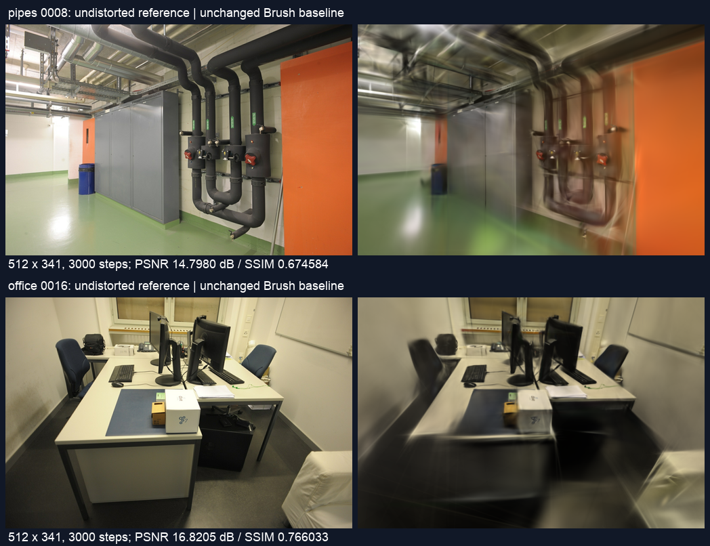
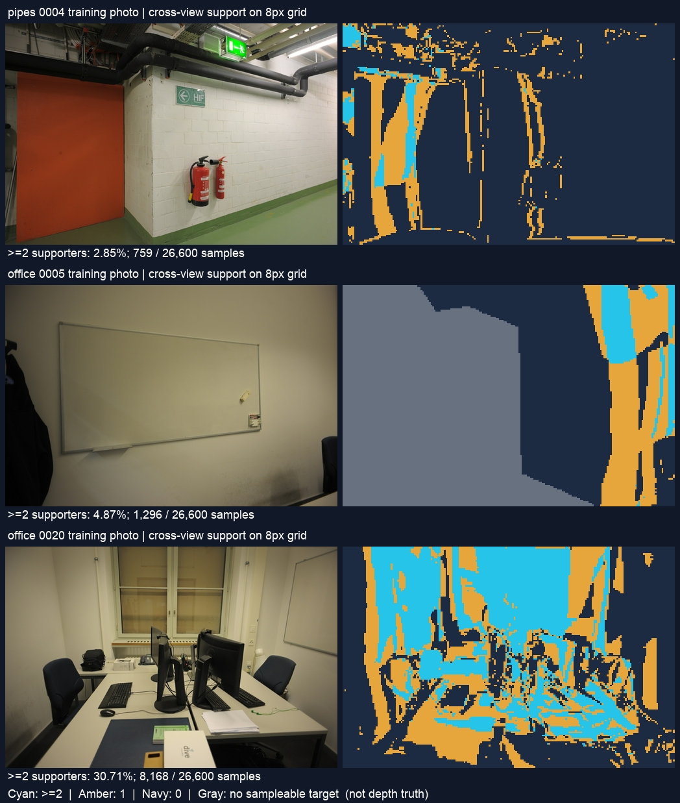

# 相对深度的跨视图一致性筛查

2026-11-01，Apple M5 / 32 GiB，基点 [7ad863f](https://github.com/sakorman/web-scan/commit/7ad863f)。

新增离线跨视图诊断。在通过单图稀疏对齐检查的照片中，每 8 像素取一个候选位置，pipes 只有 10.75%、office 只有 8.78% 得到两个额外视角支持。其余位置包含覆盖不足、疑似遮挡和深度冲突，不能全部解释为错误预测。通过两票的位置仍可能与其他视角冲突，因此本轮只保留诊断工具，未补点、未修改训练损失或默认流程。

## 依据与本轮边界

上一轮 [单图对齐](DEPTH-PRIOR.md) 只能验证有 SfM 观测的位置，不能证明墙面等区域在不同照片之间一致。[COLMAP 3.13.0 融合代码](https://github.com/colmap/colmap/blob/3.13.0/src/colmap/mvs/fusion.cc) 同时检查深度、重投影与法线，并统计融合支撑。本轮借鉴几何检查思路，自己实现 NumPy 诊断，没有复制融合代码，也没有运行 CUDA PatchMatch、法线融合或完整 MVS。

近期 [In Depth We Trust](https://arxiv.org/abs/2604.05715) 讨论选择性使用单目深度，避免局部不可靠先验影响已有几何；[StereoGS](https://arxiv.org/abs/2606.30545v2) 使用立体先验和一致性初始化处理尺度与跨视图问题。两篇仅作为研究依据，本轮没有复现其训练方法或引用论文成绩作为本地收益。基础多视图研究见 Schönberger 等人的 [Pixelwise View Selection for Unstructured Multi-View Stereo](https://doi.org/10.1007/978-3-319-46487-9_31)。

数据仍为纯 ETH3D RGB 照片，自行估计相机；未使用官方位姿、深度真值、雷达或传感器深度。Depth Anything V2 Small 的 MPS 推理只针对训练照片，沿用上一轮固定版本与 Apache-2.0 权重；来源、许可与参数见 [配置](benchmarks/depth-consistency-config.json) 和 [第三方署名](../THIRD_PARTY_NOTICES.md)。不能把相对深度当作米制测量，也不能将此筛查称为 CUDA 方法的 Metal 复现。

## 新建真实照片基线

两场景各新建一个 SfM 与 Brush 任务，先完成训练，再运行深度推理与几何检查，GPU 串行。没有活动重建任务，也未打开自有浏览器渲染页面。新数据库不复用 SfM 缓存，系统文件缓存未清空，未保证全系统 GPU 完全空闲。

| 项目 | pipes-baseline | office-baseline |
|---|---:|---:|
| 输入 / 定位照片 | 14 / 14 | 26 / 26 |
| 定位失败视角 | 无 | 无 |
| 有效稀疏点 | 1,881 | 2,488 |
| 重投影误差 | 0.5676 px | 0.7420 px |
| 训练 / 留出照片 | 12 / 2 | 22 / 4 |
| 步数 / 长边 / 高斯预算 | 3000 / 512 / 150,000 | 3000 / 512 / 150,000 |
| 实际高斯数 | 11,431 | 14,452 |
| 完整 SH3 PLY 字节 | 2,699,266 | 3,412,222 |
| SfM 秒 | 6.0604 | 8.5725 |
| 训练与导出秒 | 22.7296 | 23.4084 |
| 本地完整任务秒 | 28.8255 | 32.0256 |
| 独立复评 PSNR / SSIM | 18.648026 / 0.756634 | 21.602198 / 0.870604 |

普通 SIFT、共享 RADIAL，相机参数 `f,cx,cy,k1,k2` 分别为 `(906.091436,800,533.5,-0.100914,0.067285)`、`(906.662803,800,533.5,-0.103017,0.069554)`。输入 1600×1067，去畸变后 1600×1066。Brush 0.3.0、seed 42，不保证确定性；完整引擎与源图摘要见 [逐次数据](benchmarks/depth-consistency.json)。

留出零起点索引为 pipes `0000,0008`，office `0000,0008,0016,0024`；它们不参与 Brush 训练和深度推理，但参与过 SfM。表内为去畸变参考与相机对齐渲染在 512×341 下的独立 PSNR / SSIM，参考用 Lanczos 缩放；与 Brush 原生或原始畸变域成绩分别记录。本轮没有改变高斯重建算法，与上轮不是画质改进对照。



细管、桌下和边缘仍有模糊、条带与覆盖不足。未改变显示或交互，未重复浏览器漫游；没有新的漫游质量结论。

## 预设几何规则

先完成原有单图筛查，仍为 pipes 7/12、office 16/22 张通过；未通过的 11 张既不产生候选位置，也不提供跨视图支持。新 [脚本](../scripts/benchmark_depth_consistency.py) 校验照片、预测与锚点摘要，拒绝重复照片和非去畸变 PINHOLE 相机。

1. 在原图坐标 `(4.5+8i,4.5+8j)` 上采样轴向深度，每图 133×200 = 26,600 个位置。用原始 SfM 相机反投影到世界坐标，再投影到同场景其他通过单图检查的训练视图；不使用网页归一化坐标。
2. 只在目标相机前方、图像内且能采到有限正深度时检查。记源点投到目标的深度为 `Zp`，目标预测为 `Zt`。`(Zp-Zt)/Zt > 5%` 标为疑似遮挡，低于 `-5%` 标为前方深度冲突。目标深度也可能错误，前者不是已确认的真实遮挡。
3. 深度差在 5% 内时，将目标预测点反投影并返回源图，要求往返误差不超过 **原尺寸 2 px**，返回源图的相对轴向深度差也不超过 5%，两条观察射线的夹角至少 1°。
4. 至少两个不同的其他训练照片满足上述条件才记为有支持。源图不计票；相同姿态或纯旋转不能靠无视差投票。没有在运行结果出来后放宽门槛，也没有根据检查区域重新拟合单图尺度。

这是预设工程筛查，未做阈值寻优。支持数按照片计，并不保证所有支持视角相互独立。无图可投影、疑似遮挡、前方冲突、往返失败和低视差在每对视图中互斥统计；不同视图间可以出现不同判断。

## 实测结果

| 采样位置统计 | pipes | office |
|---|---:|---:|
| 单图筛查通过的图数 | 7 | 16 |
| 单图筛查后的候选样本 | 186,200 | 425,600 |
| 无任何可采样目标视图 | 20,714 | 44,343 |
| 至少两个可采样目标视图 | 144,676 | 327,211 |
| 零支持样本（含视野外） | 119,083 | 293,701 |
| 仅一个支持视图 | 47,097 | 94,511 |
| 至少两个支持视图 | 20,020 | 37,388 |
| 占全部候选 | 10.75% | 8.78% |
| 占至少两个目标可采样的位置 | 13.84% | 11.43% |
| 两票通过但另有前方冲突 | 2,086 | 24,761 |

“可采样”仅表示投影位置与目标深度有效，不代表物理可见。候选样本是多张图上的采样位置，可能对应同一空间位置；没有融合或去重，不能当作新增点数，更不能当作高斯数。

office 两票通过样本中 66.23% 仍与至少一个其他视角存在前方冲突；pipes 为 10.42%。两个视角的一致性不足以证明几何正确，不能直接把这些掩码当作可信补点区域。本轮没有将冲突样本全部自动判错，也没有追加调整投票规则来追求更高保留率。

| 有序视图对上的分类次数 | pipes，42 对 | office，240 对 |
|---|---:|---:|
| 目标不可采样 | 611,636 | 4,709,580 |
| 疑似遮挡 | 98,138 | 685,611 |
| 前方深度冲突 | 74,755 | 442,241 |
| 深度在带内但往返检查失败 | 240,790 | 350,091 |
| 往返通过但视差不足 | 999 | 16,596 |
| 通过该目标视图检查 | 90,882 | 179,881 |

这里按“源采样位置 × 目标图”计次，不同于上表的源采样位置计数。总数分别等于 `186,200×6`、`425,600×15`；无无效源深度。逐对与逐图计数、掩码摘要均保存在 JSON。



青色至少两票、黄色一票、深蓝零票、灰色无可采样目标。pipes `0004` 仅 2.85% 通过；office `0005` 的单图稀疏对齐很好，但只有 4.87% 得到两票，其墙面大部未获支持。office `0020` 为 30.71%，桌面仍呈零碎分布。图示只能解释筛查分布，不是真实几何准确率。

## 验证、成本和下一步

新增 11 项回归覆盖已知平面的位移投影、遮挡符号、纯旋转、往返误差、相机后方、无效深度、尺度不变性、原生像素中心、两额外视图计数、失败视图排除和预测篡改。完整 211 项后端、18 项前端、类型检查和构建通过；保留已有 FastAPI 弃用与查看器体积提示。两个基线完整 SH3、源图、相机与留出身份核验通过。统计字段补充后的第二次 CPU 检查与第一次掩码逐数组完全一致，未重复训练。

34 张新预测在 MPS 完成，加载至保存耗时 4.437 秒；权重与源码使用本地缓存。跨视图诊断以 NumPy CPU 执行，包含摘要校验、深度转换、282 对检查及掩码压缩落盘，两次约 1.053 / 1.054 秒。没有用这两个数字宣称相对上轮提速，峰值内存未测；应用不新增依赖，预测、锚点和掩码保留本地。本轮未使用 CUDA。

采用离线支撑与冲突诊断；继续放弃直接按单图预测补点。当前的主要缺口是密集区域缺少独立约束，不能靠放宽门槛解决。下一步优先在有合法深度真值的公开场景上校验这些判定，或验证真正的多视图深度来源，再考虑固定相机、训练预算与评估视图的补点对照。

## 复现与归档

本地目录 `.data/benchmarks/depth-consistency-20261101`；原照片、旧模型与上一轮实验均保留。先参照 [上一轮流程](DEPTH-PRIOR.md#复现)，使用本轮 [配置](benchmarks/depth-consistency-config.json) 和 `7ad863f` 的 `webscan/reconstruction.py`，分别新建 `pipes-baseline` / `office-baseline`。源任务 ID 在配置中；仍用 [冻结驱动](benchmarks/dsp-sift-run.py)，随后用 `benchmark_depth_prior.py` 在本轮 `anchors/`、`predictions/`、`analysis.json` 输出单图结果。每次必须用新目录，不能覆盖已有任务。

```sh
depth_run=.data/benchmarks/depth-consistency-20261101
PYTHONPATH=. .venv/bin/python scripts/benchmark_depth_consistency.py \
  --anchors "$depth_run/anchors/anchors.json" --analysis "$depth_run/analysis.json" \
  --predictions "$depth_run/predictions" --config "$depth_run/config.json" \
  --output "$depth_run/cross-view-v2"
PYTHONPATH=. .venv/bin/python docs/benchmarks/depth-consistency-report.py
```

报告脚本固定本轮路径和 macOS Arial 字体，生成 [机器可读结果](benchmarks/depth-consistency.json) 与两张图；检查脚本路径可配置。图示中的 ETH3D 内容继续按原作者及 CC BY-NC-SA 4.0 署名，权重和完整照片不进入公开仓库。
