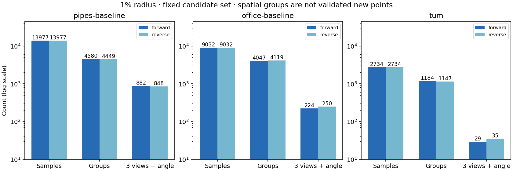

# 深度候选的空间去重与照片来源

2026-11-04，基点 [dfaddfd](https://github.com/sakorman/web-scan/commit/dfaddfd)。上一轮的候选数是图像采样次数，同一块表面可能反复出现。本轮增加离线空间分组，结果表明：**不能把接近的候选直接融合为可靠补充点**。TUM 在 1% 半径下有 1,184 / 1,147 组（正序 / 逆序），其中 29 / 35 组含三个有足够视差的照片来源，而完整传感器核验仅通过 1 / 0 组。

保留诊断与来源追踪，放弃将本轮分组直接写入初始化点云。没有修改默认 SfM、Brush、渲染或交互。

## 方法与研究依据

[COLMAP 3.13.0 融合实现](https://github.com/colmap/colmap/blob/3.13.0/src/colmap/mvs/fusion.cc)在融合点之外记录来源照片的可见性集合；像素个数和不同照片数是两个量。[StereoGS v2](https://arxiv.org/abs/2606.30545v2)及[作者实现](https://github.com/StringerYwh00/StereoGS/tree/2238f559ce6da2c8f9b0e98110eedc7e53ea952b)采用多视图深度估计与一致性过滤后融合。这些方法提示本轮假设：先前通过筛查的候选，是否在同一三维邻域内还保有来自不同照片的支撑。本轮没有移植这些实现、法线检验或 CUDA 训练，NumPy CPU 分组也不等同于 COLMAP 的深度融合。

1. 冻结上轮纯 RGB / SfM 候选：另外两张训练图支持、无前方冲突、到同图已有观测的距离大于画幅对角线的 1%，到全场景稀疏点的距离大于来源相机 Z 的 1%。ETH3D 使用已过单图筛查的训练图；TUM 只统计传感器诊断的检查格。传感器数值不参与候选选择、排序或分组。
2. 默认按照片名、像素网格索引排序，再按完全相反的顺序复算。每个候选归入最近且满足距离条件的已有组，否则新建组。组代表固定为首个候选，距离不超过半径乘以双方来源 Z 的较小值；不移动代表、不平均坐标、不经由中间点传递合并。同组两个非代表成员可能相距两倍半径，因此这里只叫分组，不叫同一点。
3. 每组每张来源照片只选离代表最近的一次观测。至少三张不同照片，并且能找到三个相机中心，在代表处形成的三对射线夹角都至少 1°，才算通过来源与视差检查。同一照片的多个像素不增加来源数，相同照片摘要直接拒绝；不同照片也可能存在相关预测误差，不代表统计独立。
4. TUM 事后核验这些每图代表：将各图传感器轴深还原到世界坐标，要求测量点到组代表距离不超过测量 Z 的 1%，且测量点自身仍远离已有稀疏点（归一化距离大于 1%）。至少三张满足条件的照片仍需通过两两 1° 检查。尺度沿用拟合格估计；缺测不能算通过。分组半径取 0.5%、1%、2%，传感器核验半径固定 1%。

TUM 约 27% 原始检查位置缺测，还有配准、时间与传感器误差。这里同时要求每个来源本身通过保守的候选筛选，且只使用离散网格；未进入同组不代表原来提供支持的照片失效，也不能据此推断所有密集几何都不准确。

## 固定实拍结果

| 1% 分组半径 | 候选采样次数 | 组数，正 / 逆序 | 三来源及视差通过，正 / 逆序 |
|---|---:|---:|---:|
| pipes | 13,977 | 4,580 / 4,449 | 882 / 848 |
| office | 9,032 | 4,047 / 4,119 | 224 / 250 |
| TUM desk | 2,734 | 1,184 / 1,147 | 29 / 35 |

正序下，pipes / office / TUM 分别有 2,559 / 3,168 / 945 组仅来自一张照片。ETH3D 没有独立深度测量，因此三来源通过数仍是待核验候选，不是新增准确三维点。



| TUM 分组半径 | 三来源及视差通过，正 / 逆序 | 其中至少三图有测量 | 三图测量位置与稀疏距离均通过 |
|---|---:|---:|---:|
| 0.5% | 14 / 8 | 13 / 7 | 1 / 0 |
| 1% | 29 / 35 | 26 / 32 | 1 / 0 |
| 2% | 20 / 33 | 16 / 27 | 1 / 1 |

分组半径变大并不单调增加可用组数，会合并邻域并更换每图代表。正反顺序改变分组边界，结果不稳定。早期核验仅查代表与测量的距离，在 1% 正序下得到 3 组；补齐“测量点也远离已有稀疏点”后剩 1 组。前者会把可能重复已有几何的位置纳入，不采用为补点依据；两阶段本地输出均保留。

## 验证、成本与限制

这是对已完成真实照片重建的新诊断测试。三场景的照片摘要、SfM 点、位姿与相机、支持掩码、完整 SH3 文件均复核；新增可选样本导出前后的逐视图距离统计完全一致。复用 [11 月 3 日基准](DEPTH-OVERLAP.md)，本轮没有新训练或画质对比，也没有新的漫游改善结论。既有同视角截图见该报告；未改变界面，不重复浏览器操作。

| 冻结 RGB 基准 | 输入 / 定位；训练 / 留出 | 实际高斯 / PLY 字节 | SfM / 训练评估导出 / 任务秒 | PSNR / SSIM |
|---|---|---:|---:|---:|
| pipes | 14/14；12/2 | 11,431 / 2,699,266 | 6.06 / 22.73 / 28.83 | 18.6480 / 0.75663 |
| office | 26/26；22/4 | 14,452 / 3,412,222 | 8.57 / 23.41 / 32.03 | 21.6022 / 0.87060 |
| TUM | 96/96；84/12 | 71,730 / 16,929,830 | 44.49 / 43.33 / 87.98 | 22.9490 / 0.83870 |

全部无失败定位；共享 RADIAL、3000 步、512 长边、15 万高斯预算、seed 42。ETH3D 输入 1600×1067，去畸变 1600×1066，评分 512×341；TUM 输入 640×480，去畸变 626×469，评分 512×384。相机参数与逐图留出记录沿用[数据文件](benchmarks/depth-groups.json)。留出图参与 SfM，不参加训练；上述历史成绩不是本轮新结果。

三半径 × 两顺序共六次分组，pipes / office / TUM 总计 CPU 墙钟耗时约 4.74 / 2.35 / 0.36 秒；样本提取和校验另需 0.29 / 0.60 / 0.86 秒。复用预测及文件缓存，包含读取、摘要核验和落盘，不含进程启动；未测峰值内存。无新增 GPU 任务，不宣称训练提速或模型缩小。局部样本和分组对应关系留在独立目录；历史模型未修改。

新增 8 项测试覆盖传递链、同图重复、三对视差、尺度变换、双方 Z 半径、传感器缺测与事后核验、空输入以及文件摘要；原样本测试增加导出坐标与统计兼容检查。246 项后端、18 项前端、类型检查和构建通过。

下一步应在完整深度图上按代表位置重投影查来源、互相验证遮挡和几何距离，避免要求目标恰好也落在离散候选网格。先验证小规模融合的可靠性与顺序稳定性，再安排固定预算的重建对照；本轮不根据仅一组通过的结果调参追求更多点。

## 复现与署名

在仓库根目录、具备已有实拍基准的环境中运行：

```sh
sh docs/benchmarks/depth-groups.sh .data/benchmarks/depth-groups-repeat
PYTHONPATH=.:.tools/depth-plot-deps .venv/bin/python docs/benchmarks/depth-groups-report.py \
  --root .data/benchmarks/depth-groups-repeat
```

[冻结配置](benchmarks/depth-groups-config.json) · [全部汇总和文件摘要](benchmarks/depth-groups.json)。新目录必须不存在，原照片、预测、模型与逐样本分组文件不提交。ETH3D 来自 Schöps 等人，TUM RGB-D 来自 Sturm 等人（CC BY 4.0），Depth Anything V2 Small 权重与代码沿用[第三方声明](../THIRD_PARTY_NOTICES.md)。
