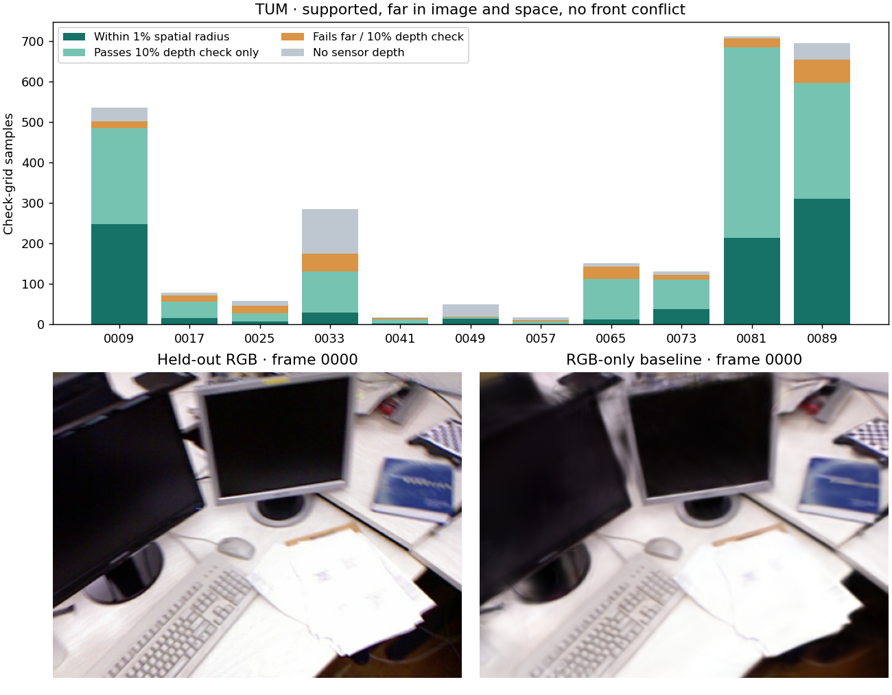

# 支持深度与已有稀疏点重合多少

2026-11-03，基点 [fce617c](https://github.com/sakorman/web-scan/commit/fce617c)。[上轮](DEPTH-SUPPORT.md)发现，得到另外两张照片支持的深度样本误差较低，但尚不知道它们是否只重复已有 SfM 轨迹。此次测得：一部分候选确实远离稀疏点，但能用传感器细查的范围很小。TUM 的 105,600 个检查位置中，只有 **891 个（0.84%）**同时通过无前方冲突、远离稀疏点和同尺度传感器位置核验；其中 772 个来自 3 张照片。保留离线工具，暂不把候选直接加进模型。

## 距离与分母

- 先冻结训练图上的深度、两票支持掩码与相机，不使用留出图的深度。对每个样本量两种最近距离：原生像素到**同图全部已关联观测**的距离除以画幅对角线；预测位置到**全场景全部 SfM 点**的三维欧氏距离除以该视图的轴向深度 Z。前者看图像覆盖，后者防止把其他照片已看到的三维点算作空白。两种距离都严格大于 1% 才记作“双远”，另报 0.5% 和 2%。这些是诊断半径，不是精度规范，也不等同于低纹理。
- ETH3D 在去畸变 PINHOLE 网格每 8 像素取样；TUM 在原始 RADIAL 网格每 4 像素取样，仅统计留给深度检查的棋盘格。逐图验证照片、预测和掩码摘要，核对相机、位姿和拟合所用轨迹的坐标与深度。TUM 两次原始模型的 16,410 个点均与各自送给 Brush 的去畸变模型逐 ID、逐坐标相同。SfM 使用全部照片，这不是完全独立的端到端留出。
- 传感器只用于事后核验。对“双远、无前方冲突”的位置，先看测量深度还原出的三维点是否也远离稀疏点、预测轴深误差是否 ≤10%。由于 10% 大于 1% 的空间判定半径，再检查预测点到传感器点的三维距离是否 ≤测量 Z 的 1%。缺测单列；场景尺度仅用拟合格估计，不用检查格或保留子集回调。传感器配准和时间误差也可能影响严格结果。

| 1% 半径 | 有效检查位置 | 图像上远 | 有两票支持 | 有两票且双远 | 双远且无前方冲突 |
|---|---:|---:|---:|---:|---:|
| ETH3D pipes（7 张过筛） | 186,200 | 160,473 | 20,020 | 15,845 | 13,977 |
| ETH3D office（16 张过筛） | 425,600 | 378,409 | 37,388 | 28,820 | 9,032 |
| TUM desk（11 张配对训练图） | 105,600 | 71,709 | 7,787 | 3,348 | 2,734 |

office 的 28,820 个双远位置中，19,788 个与其他视图有前方深度冲突。ETH3D 本轮无传感器核验，两场景最后一列是候选数，不是准确点数或无纹理墙面已经补全。TUM 的 2,734 个候选中，266 个传感器缺测；有读数的 2,468 个中，2,242 个通过 10% 轴深及测量点双远检查，但只有 891 个通过同一空间半径。后者在照片 0009、0081、0089 分别为 248、214、310 个，0057 仅 1 个。

| 相对半径 | pipes / office 双远无冲突 | TUM 双远无冲突 | TUM 传感器有效 | TUM 同半径核验通过 |
|---|---:|---:|---:|---:|
| 0.5% | 16,340 / 11,113 | 4,356 | 3,918 | 739 |
| 1% | 13,977 / 9,032 | 2,734 | 2,468 | 891 |
| 2% | 10,224 / 6,027 | 1,452 | 1,374 | 975 |

半径增大时，“远离已有点”更难满足，但对预测与测量间误差的容忍度也增大；不能据此选出最优半径。同一区域可能在多张图中重复，计数不是去重后的新三维点。下一步只在独立任务内按空间去重并检查来自不同照片的独立支撑，再决定是否值得做固定预算的补点训练。



图中绿色两段均通过较宽的 10% 深度检查，深绿色还通过同半径三维核验。下方是新 RGB 基线的第一张留出照片及同相机渲染；键盘与纸面纹理仍模糊。本轮没有修改训练、渲染或交互，也没有新的漫游画质结论。

## 实拍重建与成本

为检查计数是否依赖某一次重建，TUM 用同一组 96 张 RGB 重新求位姿、独立训练 Brush 0.3.0 / Metal，再重新运行 MPS 深度推理、相对对齐、掩码与传感器核验。没有使用提供的位姿或传感器训练。新旧 TUM 尺度分别为 0.231862、0.231913 m/SfM 单位；三个半径的逐视图计数相同。两次使用同一批照片，不是跨场景验证。输入按摘要检查；三场景均通过完整 SH3 PLY 校验。

| 场景 | 输入 / 定位；训练 / 留出 | 高斯数 / PLY 字节 | SfM / 训练评估导出 / 任务秒 | 留出 PSNR / SSIM |
|---|---|---:|---:|---:|
| pipes（冻结） | 14/14；12/2 | 11,431 / 2,699,266 | 6.06 / 22.73 / 28.83 | 18.6480 / 0.75663 |
| office（冻结） | 26/26；22/4 | 14,452 / 3,412,222 | 8.57 / 23.41 / 32.03 | 21.6022 / 0.87060 |
| TUM desk（新任务） | 96/96；84/12 | 71,730 / 16,929,830 | 44.49 / 43.33 / 87.98 | 22.9490 / 0.83870 |

均无定位失败。共享 RADIAL；ETH3D 1600×1067 去畸变到 1600×1066，TUM 640×480 去畸变到 626×469。TUM 新相机参数为 (545.393335, 320, 240, 0.140152, −0.237818)。全部 3000 步、512 长边、15 万高斯预算、seed 42；固定照片和画幅的独立 RGB 评分分辨率分别为 ETH3D 512×341、TUM 512×384。新任务未复用 SfM；未清除系统缓存。GPU 训练与深度推理串行，两组 ETH3D 未重复训练。重合统计只用 CPU，pipes / office / 新 TUM 各约 0.30 / 0.60 / 0.90 秒（不含进程启动）；未测峰值内存。没有画质或速度提升结论。

## 复现与来源

[配置](benchmarks/depth-overlap-config.json) · [逐视图计数、模型摘要和 RGB 分数](benchmarks/depth-overlap.json) · [完整命令](benchmarks/depth-overlap.sh)。在已有[跨视图基准](DEPTH-CONSISTENCY.md)和[传感器基准](SENSOR-DEPTH.md)、对应 MPS 权重与绘图依赖的仓库根目录运行：

```sh
sh docs/benchmarks/depth-overlap.sh .data/benchmarks/depth-overlap-repeat
```

任务目录必须不存在；模型、照片、预测和传感器图留在本地。公开图例来自 Sturm 等人的 [TUM RGB-D](https://cvg.cit.tum.de/data/datasets/rgbd-dataset)（CC BY 4.0），固定基准来自 Schöps 等人的 [ETH3D](https://www.eth3d.net/datasets)。[Initialize to Generalize](https://arxiv.org/abs/2510.17479) 与 [StereoGS 作者实现](https://github.com/StringerYwh00/StereoGS)分别研究补充 SfM 稀疏区域和一致性过滤后融合深度。这里只验证覆盖假设，没有引入其代码、点融合或 CUDA 训练方法；已有模型来源及许可见[第三方声明](../THIRD_PARTY_NOTICES.md)。
