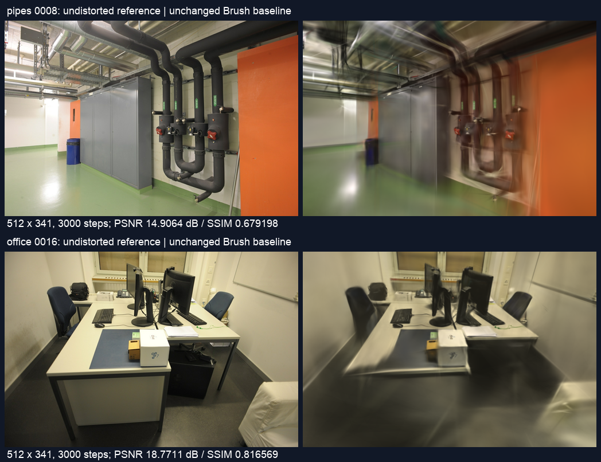
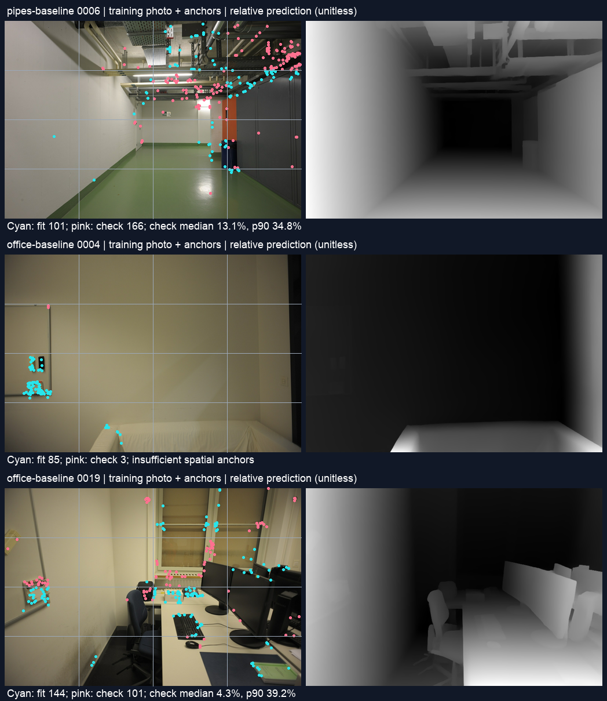

# 单目深度与 SfM 对齐筛查

2026-11-01，Apple M5 / 32 GiB，基点 [b8d1d52](https://github.com/sakorman/web-scan/commit/b8d1d52)。

Depth Anything V2 Small 已在本机 MPS 跑通，34 张训练照片中只有 23 张通过预先设定的稀疏对齐门槛。因此保留离线诊断工具，暂不将深度预测用于初始点云、训练损失或默认重建流程。这是运行条件和几何一致性筛查，没有获得新的 3DGS 画质提升结论。

## 研究依据与适用范围

前一轮的 [仿射 DSP 实验](AFFINE-DSP.md) 仍无法解决局部支撑集中。[TWINGS 论文](https://arxiv.org/abs/2605.22069v3) 与其 [官方实现](https://github.com/sandokim/TWINGS-official/tree/1585e8933516a6abadf6383346e887746e1128e4) 提供学习先验初始化的研究方向，但官方依赖 CUDA，不能把本轮视作 Metal 上的 TWINGS 复现。

本轮选择 Lihe Yang 等人的 [Depth Anything V2](https://arxiv.org/abs/2406.09414v2) 小模型作为可独立验证的深度来源。官方示例支持 MPS；所用 [代码版本](https://github.com/DepthAnything/Depth-Anything-V2/tree/a561b849ebae10a6f5ef49e26c83cbbcd36c71bf) 与 [Small 权重](https://huggingface.co/depth-anything/Depth-Anything-V2-Small/tree/03876f8651c73a60fe4c2c48294e09fcb6838fcf) 标注 Apache-2.0。Base / Large / Giant 权重另有非商业许可，本轮没有使用。相对深度模型与该项目另行发布的米制深度模型不同，输出不能直接解释为米。

只使用 ETH3D RGB 照片与新估计的 SfM；没有雷达、传感器深度、官方相机位姿或密集深度真值。没有下载、运行 CUDA 训练实现。照片和图示保留 [ETH3D 作者与 CC BY-NC-SA 4.0](../THIRD_PARTY_NOTICES.md#test-dataset)；权重、原图、预测数组和模型均留在被忽略的本地目录。

## 固定基线

从冻结照片各新建一次数据库、位姿和 Brush 任务，训练先于深度推理完成。基线使用普通 SIFT、同镜头 RADIAL、共享相机；原图 1600×1067，去畸变图 1600×1066。新任务位于 `.data/benchmarks/depth-prior-20261101/jobs/`，原始任务和历史模型未改动。

| 项目 | pipes-baseline | office-baseline |
|---|---:|---:|
| 输入 / 定位 | 14 / 14 | 26 / 26 |
| 定位失败视角 | 无 | 无 |
| 有效稀疏点 | 1,881 | 2,490 |
| 重投影误差 | 0.5676 px | 0.7426 px |
| 训练 / 留出视图 | 12 / 2 | 22 / 4 |
| 步数 / 训练长边 / 高斯预算 | 3000 / 512 / 150,000 | 3000 / 512 / 150,000 |
| 实际高斯数 | 11,590 | 14,120 |
| 完整 SH3 PLY 字节 | 2,736,790 | 3,333,870 |
| SfM 秒 | 5.9464 | 8.4983 |
| 训练与导出秒 | 22.9250 | 23.5007 |
| 本地完整任务秒 | 28.9039 | 32.0424 |
| 独立复评 PSNR / SSIM | 18.308354 / 0.757780 | 22.172923 / 0.882853 |

Brush 0.3.0，seed 42，不保证确定性；引擎摘要、全部输入摘要、相机参数和逐阶段计时见 [完整数据](benchmarks/depth-prior.json)。两场景 RADIAL 参数按 `f,cx,cy,k1,k2` 分别为 `(906.091436,800,533.5,-0.100914,0.067285)`、`(906.661569,800,533.5,-0.103041,0.069571)`。

留出索引按零起点为 pipes `0000,0008`，office `0000,0008,0016,0024`；这些照片仍参与上游 SfM。表内复评采用匹配相机的去畸变参考照片、512×341 网格、Lanczos 缩放、现有 `ReferenceMetrics` 的 PSNR / SSIM。没有将其混同于原始畸变域评分或 Brush 原生评分，原生值单独保存在 JSON。本轮没有候选高斯模型，不作前后画质比较。



图中 pipes 的细管仍有明显模糊和漂浮条带，office 桌下和边缘也存在模糊。本轮未改渲染和交互，未重复浏览器漫游，不能据此声称漫游几何改善。

## 对齐方法与预设门槛

新增 [离线脚本](../scripts/benchmark_depth_prior.py)，将锚点提取、MPS 推理与分析分为独立进程，避免 PyCOLMAP 与 PyTorch 的 OpenMP 运行时冲突。推理仅使用 34 张 Brush 训练照片，6 张留出照片被明确排除。

1. 从各任务去畸变后的原始 SfM 模型取轨迹长度至少 2、重投影误差小于 4 px 的点。用原始 `cam_from_world` 得到正的相机轴向 Z；不用世界 Z、射线距离或浏览器归一化坐标。
2. 在原尺寸浮点预测图上，以 COLMAP 像素坐标减去 0.5 后双线性采样。共导出 12,673 个观测，58 个边缘观测不满足不外插采样范围；12,615 个参与后续划分，没有隐藏剔除大误差点。
3. 每张图划为固定 4×4 棋盘格，偶数格只拟合，奇数格只检查。假设 `1/Z_sfm = a × prediction + b`，用最小二乘求尺度和偏移。它是本轮待验证的对齐假设，不是模型提供的米制标定。
4. 两组各至少 20 个锚点，系数有限且 `a > 0`；整张映射逆深度的无效比例不超过 1%，检查区不得产生非正或非有限深度。检查区绝对相对误差 `|Z_pred/Z_sfm − 1|` 的中位数不超过 10%、p90 不超过 25%。这些是事前工程筛查线，非论文标准。

作为弱基线，每张图另用**拟合区**的 SfM Z 中位数预测检查区常深度。不能用检查区数据选择拟合方式或修正参数。

| 筛查结果 | pipes | office |
|---|---:|---:|
| 推理照片 | 12 | 22 |
| 有效拟合 / 检查锚点 | 2,143 / 2,820 | 3,885 / 3,767 |
| 通过 | 7 | 16 |
| 误差门槛失败 | 5 | 4 |
| 空间分组锚点不足 | 0 | 2 |
| 可评分照片的逐图中位误差均值 | 6.73% | 6.04% |
| 常深度对应误差均值 | 18.69% | 17.67% |

office 后两行仅包括可评分的 20 张，另两张不能被当作通过。32 张可评分照片均得到正斜率、全图正的有限映射逆深度，但仍有 9 张在检查区域误差超线。相对常深度，中位误差在 pipes 12/12、office 18/20 张降低；这只说明比弱基线更符合已有 SfM 支撑，不能证明稀疏区域之外的几何。

未通过的零起点索引：pipes `0005,0006,0007,0009,0012`；office `0004,0009,0012,0013,0018,0019`。其中 office `0004` 的拟合 / 检查观测为 85 / 3，`0009` 为 13 / 99，直接停止拟合。pipes `0006` 检查误差中位数 13.10%、p90 34.83%；office `0019` 中位数仅 4.28%，但 p90 达 39.18%，仅看中位数会漏掉局部大误差。



青色为拟合锚点，粉色为检查锚点；右图只是逐图归一化的相对预测显示，无米制色标。office 墙面图像的支撑集中在开关和床沿，整面墙的预测没有得到独立验证。

## 时间、内存与取舍

PyTorch 2.14.1、torchvision 0.29.1、OpenCV headless 4.13.0.92，后两项安装到独立 `.tools/depth-prior-deps`，没有新增应用运行依赖。Small 为 24,785,089 参数，权重 99,218,434 字节，SHA-256 `715fade13be8f229f8a70cc02066f656f2423a59effd0579197bbf57860e1378`，下载 165.52 秒，不计入推理。

MPS Float32，禁用算子自动 CPU 回退；OpenCV 预处理仍在 CPU。官方预处理的 `input_size=518` 在本场景得到 **518×784（高×宽）** 网络张量，输出回原图 1066×1600，并非训练的 512 长边。加载阶段 0.361 秒，首张同步推理与预处理 1.498 秒，其余 33 张中位数 0.101 秒；进程内模型加载至全部预测保存共 5.641 秒，不含 Python / Torch 初始导入、下载、SfM 和训练。首张与后续照片内容不同，这不是严格的同图冷热启动速度对照。

每张完成后的 MPS 驱动分配快照最大 1,242,267,648 字节；它包含框架保留内存，**不是推理峰值内存**。34 份 Float32 数组有效载荷共 231,961,600 字节。只进行一轮推理，未测 CUDA、CPU、峰值内存或重复执行波动。

本轮自有训练与推理串行，没有打开自有渲染页面。检查时另有一个独立项目的 Vite 服务在运行，未停止或改变其状态；不能保证整台机器无其他图形活动。SfM 使用新数据库但未清空系统文件缓存，以上时间是本次运行记录，不能宣称端到端提速。

## 验证与后续

新增 7 项回归覆盖轴向坐标、半像素采样、已知逆深度公式、区域隔离、退化 / 反向拟合、无效密集区域和无效检查点。完整 200 项后端、18 项前端、类型检查及构建通过；保留既有 FastAPI 弃用提示和约 2.99 MB 查看器体积提示。两份基线的原图摘要、完整 SH3、相机与留出身份检查通过，诊断图已实际检查。本轮首次锚点导出因 PyCOLMAP 相机字段名错误终止，修正后两次导出逐字节一致，没有为此重复训练或规避运行时检查。

暂不采用“每张图独立线性对齐后直接补点”。门槛未在所有训练图成立，且 SfM 锚点本身有误差、相互关联，也没有约束未观测表面。下一步应先检验跨视图重投影一致性和遮挡关系，必要时用独立深度真值验证；之后才值得做固定相机、固定训练配置的补点对照。通过当前筛查的照片也不能直接证明可生成可信密集几何。

## 复现

所有命令从仓库根目录执行；已有输出必须保留，新实验使用新目录。

```sh
git clone https://github.com/DepthAnything/Depth-Anything-V2.git .tools/depth-anything-v2
git -C .tools/depth-anything-v2 checkout a561b849ebae10a6f5ef49e26c83cbbcd36c71bf
.venv/bin/python -m pip install --no-deps --target .tools/depth-prior-deps \
  torchvision==0.29.1 opencv-python-headless==4.13.0.92
```

从上述固定 Hugging Face revision 下载 `depth_anything_v2_vits.pth` 到 `.tools/depth-anything-v2/`，核对给定 SHA-256。完整配置见 [depth-prior-config.json](benchmarks/depth-prior-config.json)，包含源任务 ID、依赖与硬件。先准备独立工作目录，并用 [冻结重建驱动](benchmarks/dsp-sift-run.py) 分别运行两个场景：

```sh
depth_run=.data/benchmarks/depth-prior-20261101
mkdir -p "$depth_run/adapters" "$depth_run/jobs" "$depth_run/logs"
cp docs/benchmarks/depth-prior-config.json "$depth_run/config.json"
git show b8d1d52:webscan/reconstruction.py > "$depth_run/adapters/baseline.py"
PYTHONPATH=. .venv/bin/python docs/benchmarks/dsp-sift-run.py \
  --root "$depth_run" --source 44537f26e3b34c5bb417deacb103ce47 --name pipes-baseline --variant baseline
PYTHONPATH=. .venv/bin/python docs/benchmarks/dsp-sift-run.py \
  --root "$depth_run" --source c6a40f0953a54a9092430d295e2055a9 --name office-baseline --variant baseline
.venv/bin/python scripts/benchmark_depth_prior.py anchors \
  --jobs "$depth_run/jobs/pipes-baseline" "$depth_run/jobs/office-baseline" --output "$depth_run/anchors-v2"
PYTHONPATH=.tools/depth-prior-deps PYTORCH_ENABLE_MPS_FALLBACK=0 \
  .venv/bin/python scripts/benchmark_depth_prior.py infer \
  --anchors "$depth_run/anchors-v2/anchors.json" --repository .tools/depth-anything-v2 \
  --weights .tools/depth-anything-v2/depth_anything_v2_vits.pth --device mps --output "$depth_run/predictions"
.venv/bin/python scripts/benchmark_depth_prior.py analyze \
  --anchors "$depth_run/anchors-v2/anchors.json" --predictions "$depth_run/predictions" --output "$depth_run/analysis.json"
PYTHONPATH=. .venv/bin/python docs/benchmarks/depth-prior-report.py
```

报告脚本固定本轮路径和 macOS Arial 字体，生成 [逐图数据](benchmarks/depth-prior.json) 与两张图示；核心筛查脚本的路径可配置。原始数组、完整日志、输入照片和模型保留在本地实验目录，不上传权重和数据集副本。
