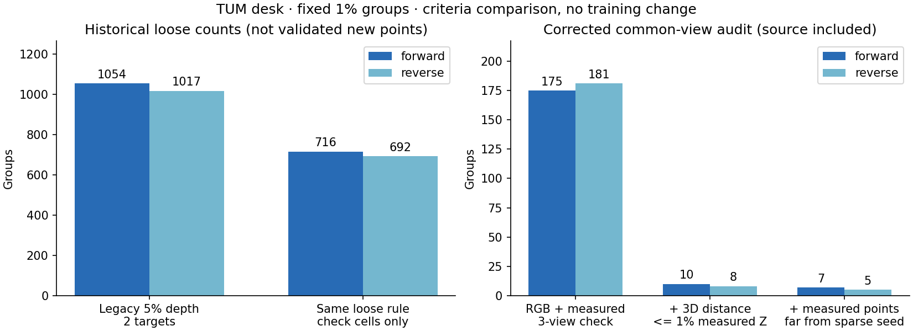

# 重投影核验条件更正

2026-11-06，基点 [3142c6b](https://github.com/sakorman/web-scan/commit/3142c6b)。修正离线核验，撤回上轮“高通过数说明候选网格漏检”的推断。冻结 TUM 1% 正序的 1,184 组，旧规则仍通过 1,054 组；同一组三个 RGB 支持视角在传感器检查格都有测量的仅 175 组，加入 1% 三维距离和稀疏点距离条件后为 7 组，逆序为 5 组。不采用补点，本轮没有新训练或画质收益。

## 为什么原结论不成立

上轮代表点来自已经通过原生重投影筛选的候选，再次得到较高原生支持，主要重现了选择条件。与空间分组相比，核验还从 1% 三维距离改为 5% 轴向深度差，省略了三视角两两视差要求；两种通过数不能直接证明网格漏检。

旧传感器计数混入用于拟合全局尺度的区域，且传感器支持照片不必与 RGB 支持照片相同，也不核验来源照片自身。旧脚本记录了部分摘要，但没有完整校验样本、分组、位姿与预测的身份链。历史数值可以复现，原先的几何解释和“全部文件均已校验”的描述需要更正。

## 固定核验规则

- 保留原来的三个分组半径（0.5%、1%、2%）、正逆序、代表坐标、照片集合和预测，不重新分组或根据传感器挑选代表。
- RGB 使用既有 `check_pair`：5% 相对深度差、2 px 往返误差、1° 视差。来源照片与两个目标照片必须两两有至少 1° 视差；排除任何目标的前方深度冲突。保留旧版仅检查轴向深度的计数，明确标为 `legacy`。
- 传感器使用冻结的 TUM 关联和全局尺度；只在未参与尺度拟合的 4×4 奇数检查格核验，按实际采样像素中心反投影。要求同一组三张 RGB 支持照片（含来源）都有检查格测量，每个测量与代表的三维距离不超过该测量轴向深度的 1%，且每个测量离已有稀疏点大于同一 1% 距离。
- 传感器可用性独立于单目预测是否有效；分别记录拟合格、检查格及不可测位置。传感器不参与 RGB 选择、尺度之外的深度拟合或重建训练。检查格隔离只针对尺度拟合，不能等同于独立场景测试。
- 校验样本→分组、跨图检查→分析→锚点→预测、原图、相机和位姿、稀疏模型、原任务与传感器摘要；按任务筛选照片，拒绝同名误配。分组映射另校验代表索引、成员数和来源像素。输出逐组逐视图掩码，拒绝覆盖旧结果。

## 同一批实拍模型的结果

下表为 1% 分组。RGB 列只反映先验自洽，没有独立深度真值。

| 场景 / 顺序 | 组数 | 旧版两个目标轴向支持 | 恢复往返检查的两个目标支持 | 含来源的三视差且无前方冲突 |
| --- | ---: | ---: | ---: | ---: |
| pipes 正序 | 4,580 | 4,580 | 4,580 | 4,578 |
| pipes 逆序 | 4,449 | 4,449 | 4,449 | 4,448 |
| office 正序 | 4,047 | 4,043 | 4,047 | 3,612 |
| office 逆序 | 4,119 | 4,117 | 4,119 | 3,664 |
| TUM 正序 | 1,184 | 1,184 | 1,184 | 1,184 |
| TUM 逆序 | 1,147 | 1,147 | 1,147 | 1,147 |

既有往返检查用目标采样深度作相对误差分母，旧核验用投影深度作分母；边界附近会改变通过结果，故 office 的往返列略高，不能把所有列解释为单调收紧的筛选。office 逆序共有 4,119 组，旧报告把 4,117 个支持组误写为总组数，现已更正。

| TUM 1% 顺序 | 旧版传感器两目标支持，含拟合格 | 旧规则仅检查格 | 同一组三张 RGB 支持照片有检查格测量 | 再要求三维距离 ≤1% | 再要求测量远离稀疏点 |
| --- | ---: | ---: | ---: | ---: | ---: |
| 正序 | 1,054 | 716 | 175 | 10 | 7 |
| 逆序 | 1,017 | 692 | 181 | 8 | 5 |

正序共尝试 11,840 个其他视图位置，6,409 个有传感器测量，其中 3,340 个在拟合格、3,069 个在检查格，5,431 个不可测。不可测包含视野外、无效投影和深度缺测；不能把这些位置都算作几何错误。旧版还要求单目采样有效，因而对应可测数为 6,408。逆序为 11,470 / 6,280 / 3,250 / 3,030 / 5,190。逐视图矩阵和摘要保存在本地独立实验目录。



其余冻结半径也完整复算，未据此选择阈值：0.5% 分组正 / 逆序最终通过 15 / 13 组，2% 分组为 0 / 1 组。半径改变分组数量和代表，不能把更多通过数当作更好几何。完整数值、相机内参、源图与留出清单见[机器可读记录](benchmarks/depth-reprojection-audit.json)。

## 冻结重建配置

三场景均使用纯照片求解的同镜头 RADIAL 相机、Brush 0.3.0 / Metal、种子 42、3,000 步、512 像素长边和 15 万高斯预算。留出图参与 SfM，但不参与训练；以下 PSNR / SSIM 是已保存的训练留出成绩，本轮没有重新评分，不作独立端到端评估。

| 场景 | 输入 / 定位；训练 / 留出 | 实际高斯 | 完整 SH3 字节 | SfM / 训练评估导出 / 端到端秒 | PSNR / SSIM；评分尺寸 |
| --- | --- | ---: | ---: | --- | --- |
| pipes | 14 / 14；12 / 2 | 11,431 | 2,699,266 | 6.06 / 22.73 / 28.83 | 18.64803 / 0.75663；512×341 |
| office | 26 / 26；22 / 4 | 14,452 | 3,412,222 | 8.57 / 23.41 / 32.03 | 21.60220 / 0.87060；512×341 |
| TUM desk | 96 / 96；84 / 12 | 71,730 | 16,929,830 | 44.49 / 43.33 / 87.98 | 22.94897 / 0.83870；512×384 |

未定位照片均为空。诊断照片为 pipes 7/12、office 16/22 和 TUM 11/84；这些是通过先前筛查的子集，不代表全场景覆盖。TUM 最初 12 张探针中，0001 因传感器关联时差 382 ms 被排除，其余不超过 20 ms。ETH3D 原图为 1600×1067，诊断使用去畸变 PINHOLE 1600×1066；TUM 诊断使用原始 RADIAL 640×480，训练去畸变尺寸为 626×469。参数与文件摘要写入 JSON。

原始照片与三份完整 SH3 均重新校验、读取通过，模型未改变。[既有同视角截图与漫游记录](DEPTH-OVERLAP.md)继续有效；本轮未重复浏览器漫游，也没有空洞、漂浮物或细节改善的证据。修复对象是离线测量，重复 GPU 训练不能验证核验条件是否正确，因此使用冻结真实重建逐项复算。

## 成本与复现

M5 / 32 GB 上，pipes / office / TUM 六种分组的更正核验各耗约 0.542 / 0.665 / 1.094 秒 CPU 墙钟，包含输入校验、加载及掩码保存，不含解释器导入、历史基线运行或后续完整 PLY 读取。复用文件和预测缓存，无 GPU 训练或浏览器渲染；未测冷启动、峰值内存或能耗。新旧规则与计算批次不同，不以此宣称提速。

在仓库根目录执行，下列输出目录必须不存在：

```sh
PYTHONPATH=. .venv/bin/python docs/benchmarks/depth-reprojection-audit-run.py \
  --root .data/benchmarks/depth-reprojection-audit-repeat
PYTHONPATH=. .venv/bin/python docs/benchmarks/depth-reprojection-audit-report.py \
  --root .data/benchmarks/depth-reprojection-audit-repeat
```

需要原先准备的三场景、深度预测和分组。运行器从基点提交提取旧脚本，逐场景先复现旧计数，再执行更正规则；核对全部六组历史结果、候选脚本摘要及完整模型身份。第二条命令更新公开 JSON 和统计图，原始照片、模型及逐组数组保留在 `.data`。本轮最终目录为 `.data/benchmarks/depth-reprojection-audit-20261106/final`，前一次核验保留在 `verified`。

新增 14 项回归，覆盖来源缺测、拟合格隔离、同一组三视角、纯旋转、三维误差、传感器像素中心、尺度不变性、摘要替换和历史输出保护。全量 262 项后端、18 项前端、类型检查和构建通过，统计图已检查。生产界面和训练未改。

## 研究依据与下一步

[StereoGS v2](https://arxiv.org/abs/2606.30545v2)（Wenhao Yuan、Yiyuan Ge、Deli Cai，2026-07-05）把 MVS 初始化和重投影过滤用于几何支撑。[作者实现的 fusion.py](https://github.com/StringerYwh00/StereoGS/blob/2238f559ce6da2c8f9b0e98110eedc7e53ea952b/submodules/mvs_modules/fusion.py)分别检查重投影和深度一致性，再统计支持；所查版本为 2026-06-29 的 `2238f55`。仓库根目录采用 Inria/MPII Gaussian-Splatting License，相关执行路径使用 CUDA。本轮只验证“支持必须保持相同几何条件”这一假设，没有移植代码、权重或在 Metal 上复现其训练。

[COLMAP 3.13.0 融合实现](https://github.com/colmap/colmap/blob/3.13.0/src/colmap/mvs/fusion.cc)（ETH Zurich / UNC Chapel Hill，BSD 3-Clause）分别处理深度、重投影、法向与来源可见性。本轮复用项目已有投影函数，没有实现其完整融合或法向检查。ETH3D、TUM 与 Depth Anything V2 Small 的原作者、数据许可及模型说明继续保留在 [第三方声明](../THIRD_PARTY_NOTICES.md)。

纯照片流程仍缺独立密集几何真值；RGB-D 只提供诊断尺度与事后测量，不等同于使用已知位姿或雷达的重建。7 / 5 组受代表顺序、传感器缺测、时间差和位姿误差影响，尚不足以支持训练初始化。下一步应先准备真正多视图深度估计的坐标与运行条件对照，并预先规定独立检查区域；不继续依据这批传感器结果微调阈值或挑点训练。
