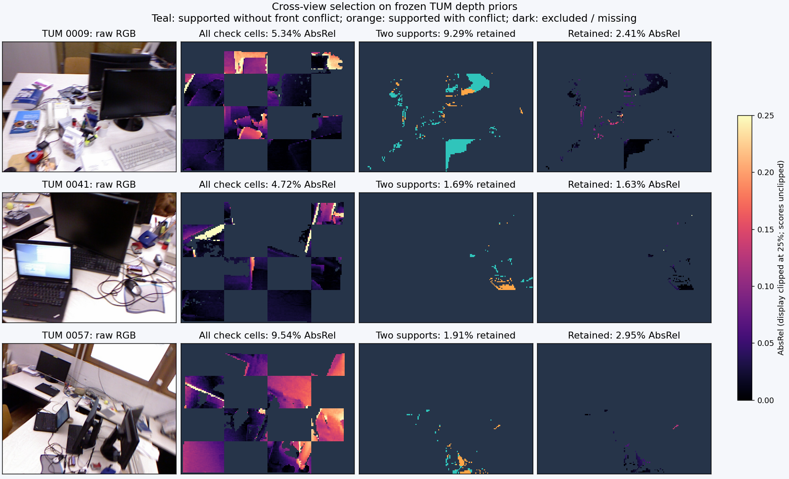
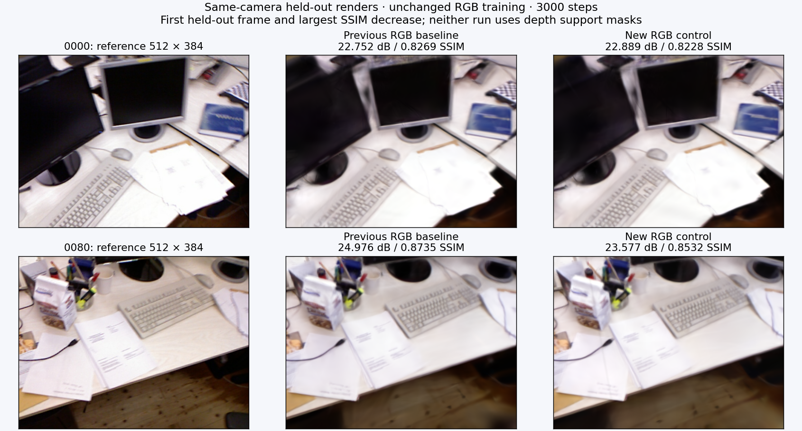
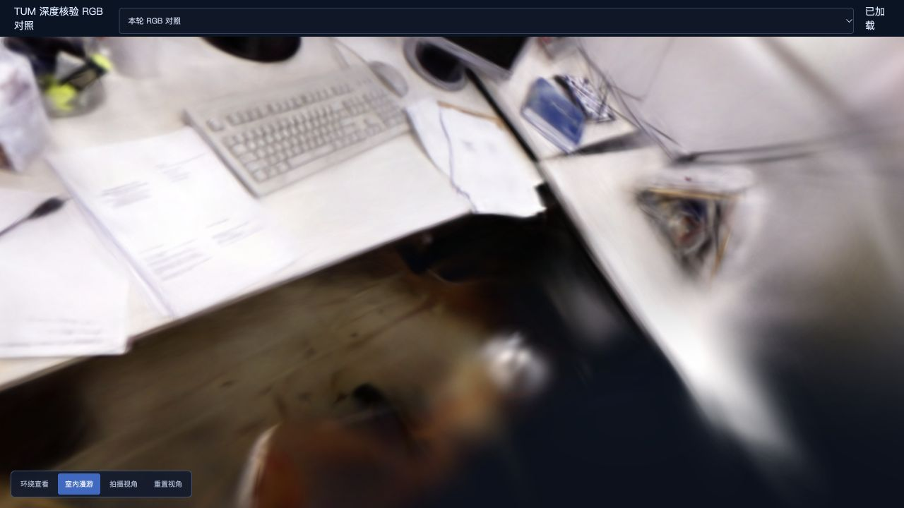

# 跨视图深度支持的传感器核验

2026-11-02，Apple M5 / 32 GiB，基点 [35cbdd0](https://github.com/sakorman/web-scan/commit/35cbdd0)。

固定上一轮 TUM 的深度预测、SfM 相机、传感器配对与场景尺度，检查“另外两张照片支持”能否筛出误差更小的位置。11 个视角全部得到更低的保留区域平均误差：逐视图平均 AbsRel 从全检查区域的 **5.66%** 到保留区域的 **2.33%**，但只保留 **7.37%** 检查位置。这是筛选不同像素子集的结果，深度值没有变好，不能写成重建画质提升。

采用原始 RADIAL 相机核验工具，暂不补点或修改默认训练。进一步要求没有前方冲突后，平均误差为 2.09%，覆盖只有 5.52%；照片 `0041` 反而从 1.63% 升至 2.86%，不采用“更严格就一定更准”的结论。

## 问题与研究依据

旧 `benchmark_depth_consistency.py` 明确要求去畸变 PINHOLE，而 TUM 的预测和传感器测量位于原始 RGB 网格。基线调用正常拒绝 RADIAL，不能直接把原始像素当作针孔像素。本轮让几何检查接受显式投影函数，原有 PINHOLE 默认路径不变；新入口使用 PyCOLMAP 3.13.0 的 `cam_from_img` / `img_from_cam`，验证刚性位姿、相机参数及反畸变往返残差。传感器图不重采样。

[COLMAP 相机文档](https://colmap.github.io/cameras.html)说明了先透视除法、再畸变和内参的投影顺序，以及左上像素中心 `(0.5, 0.5)` 的约定；对应[固定版本实现](https://github.com/colmap/colmap/blob/3.13.0/src/colmap/sensor/models.h)。[In Depth We Trust](https://arxiv.org/abs/2604.05715)（2026-04，CVPR 3DMV Workshop）研究单目先验的尺度、局部误差和跨视图不一致，采用选择性深度约束。本轮仅验证筛选信号，没有复现论文的训练方法，也未移植 CUDA 算子。

预测仍来自 [Depth Anything V2 Small](https://github.com/DepthAnything/Depth-Anything-V2/tree/a561b849ebae10a6f5ef49e26c83cbbcd36c71bf) 的缓存 MPS 输出，完整来源、权重摘要与许可沿用[上轮报告](SENSOR-DEPTH.md)和[依赖声明](../THIRD_PARTY_NOTICES.md)。TUM RGB-D 来自 Sturm 等人、IROS 2012，CC BY 4.0；[数据格式](https://cvg.cit.tum.de/data/datasets/rgbd-dataset/file_formats)中的深度单位、零值缺测和 RGB 配准规则保持不变。原照片、传感器图和模型留在本地。

## 冻结的比较方法

- 输入为上一轮 96 张 RGB 的同一个 SfM 场景；诊断预选 12 张训练照片，`0001` 最近深度差 382.465 ms，沿用 20 ms 上限排除，其余 11 张配对不变。所有 11 张通过原有单视图筛查。
- 原始图 640×480，共享 RADIAL：`f=545.3933351142, cx=320, cy=240, k1=0.1401522122, k2=-0.2378178462`。每图相对预测只用 RGB / SfM 拟合格对齐到相机轴向 Z。
- 冻结阈值为深度差 5%、原生像素往返差 2 px、视差至少 1°、另外两张照片支持；4 像素网格，与原传感器检查位置一致。11×10=110 个有序视图对；先在不读取传感器的独立进程生成掩码，再评分。
- 全网格 211,200 个位置中 16,544 个得到支持；下表仅评分奇数棋盘格的 **105,600** 个检查位置，其中传感器有效 77,120，缺测 28,480。拟合格不进入下表。
- 全场景尺度固定为 `0.23191291699129682 m/SfM unit`，仍由上一轮 5,898 个拟合格稀疏锚点求得，不重新拟合，不按保留位置调尺度。传感器只用于尺度和事后评分，掩码不使用它。
- 预先定义全区域、两视图支持、两视图支持且无前方冲突三个集合，全部报告。没有按结果调阈值。无效预测计为坏样本，缺测计数单列，空集合输出不可评分而非完美分数；保留和排除区域同时保存。

## 筛选准确性与覆盖代价

| 检查格统计 | 全区域 | 两视图支持 | 支持且无前方冲突 |
|---|---:|---:|---:|
| 检查位置 / 保留率 | 105,600 / 100% | 7,787 / 7.3741% | 5,833 / 5.5237% |
| 保留位置中传感器有效 / 缺测 | 77,120 / 28,480 | 7,025 / 762 | 5,288 / 545 |
| 原有传感器有效位置的保留率 | 100% | 9.1092% | 6.8568% |
| 逐视图平均 AbsRel | 5.6623% | 2.3269% | 2.0882% |
| 合并所有有效位置的 AbsRel | 5.6249% | 2.3120% | 2.1010% |
| 合并有效位置中误差 ≤10% | 84.8509% | 98.5196% | 98.6762% |
| 好样本保留数 / 原有 65,437 | 65,437 / 100% | 6,921 / 10.5766% | 5,218 / 7.9741% |
| 坏样本保留数 / 原有 11,683 | 11,683 / 100% | 104 / 0.8902% | 70 / 0.5992% |

这里“好”仅指相对传感器误差 ≤10%，不是精确几何真值。两视图规则丢掉了约 89.42% 的好样本；不支持不等于错误，可能是覆盖、遮挡、视差或预测误差。严格规则排除的 1,954 个检查位置里，有 1,703 个是有传感器参考的好样本，只减少 34 个坏样本。不能将高精度子集的低误差称为整张深度图改善。

| 视角 | 全区域 AbsRel | 两视图支持 AbsRel | 检查位置保留率 |
|---|---:|---:|---:|
| 0009 | 5.3404% | 2.4082% | 9.2917% |
| 0017 | 3.6328% | 1.6379% | 9.0417% |
| 0025 | 3.8155% | 2.1272% | 4.6875% |
| 0033 | 8.8584% | 3.3940% | 7.1354% |
| 0041 | 4.7157% | 1.6307% | 1.6875% |
| 0049 | 2.9839% | 1.7208% | 3.4375% |
| 0057 | 9.5430% | 2.9475% | 1.9063% |
| 0065 | 6.3692% | 2.4748% | 11.0000% |
| 0073 | 4.8446% | 2.8776% | 6.8229% |
| 0081 | 8.4077% | 2.5557% | 10.6354% |
| 0089 | 3.7742% | 1.8215% | 15.4688% |



图示首张匹配图、保留率最低图和未筛选误差最高图。青色为支持且无前方冲突，橙色为支持但仍存在其他视角冲突；暗色为排除或缺测。误差图显示上限 25%，数值评分不裁剪。稀疏保留集中在局部区域，尚无证据覆盖无纹理墙面和传感器空洞；这些是图像采样位置，不是去重后的新增三维点。

## 实拍重建与固定基准回归

本轮另建 `depth-support-20261102/jobs/tum-control`，复制既有去畸变场景后独立运行 Brush 0.3.0 / Metal。仅验证真实 RGB 重建和导出链路；两次训练都不使用本轮掩码。相机、训练 / 留出集合及原图摘要一致，seed 42 不能保证 Metal 训练确定性。

| 项目 | 上轮 TUM 基线 | 本轮 RGB 对照 |
|---|---:|---:|
| 输入 / 定位 / 失败视角 | 96 / 96 / 0 | 同左，复用位姿 |
| 训练 / 留出图 | 84 / 12 | 84 / 12 |
| 步数 / 长边 / 高斯预算 | 3000 / 512 / 150,000 | 同左 |
| 实际高斯数 | 71,756 | 71,516 |
| 完整 SH3 PLY 字节 | 16,935,966 | 16,879,326 |
| SfM 时间 | 41.6448 秒 | 未执行，复用 |
| 训练、评估、导出 | 39.2639 秒 | 41.5644 秒 |
| 任务时间 | 81.0669 秒（含 SfM） | 41.7467 秒（含复制，不含 SfM） |
| PSNR / SSIM | 22.885935 / 0.839308 | 23.056641 / 0.838267 |

原始 640×480、去畸变 626×469；12 张同相机留出图统一到 512×384，沿用 Lanczos 与 SSIM 定义。留出照片参加 SfM，不参加训练，不是完全独立的端到端评估。新运行 PSNR 略高、SSIM 略低，`0080` 视角 SSIM 由 0.87345 降至 0.85316；这是未改算法的单次训练波动，不作收益结论，也不将省略 SfM 的时间当优化。



训练结束后在浏览器分别加载两份完整 PLY，从照片 81 进入室内漫游并拖动。键盘与文字仍模糊，桌侧线状漂浮、近处模糊块及桌下黑区仍存在；没有支持掩码改善漫游质量的结论。控制台无警告或错误。



ETH3D office / pipes 复用[既有完整基线](DEPTH-CONSISTENCY.md)，只重跑本次涉及的 PINHOLE 几何计算。23 张筛查通过图、282 个有序视图对的全部统计和 NPZ 数组与旧版完全一致：office 37,388 / 425,600，pipes 20,020 / 186,200。固定基线仍为 office 26/26、22 训练 / 4 留出、14,452 高斯、3,412,222 字节；pipes 14/14、12 训练 / 2 留出、11,431 高斯、2,699,266 字节。原相机、分辨率、逐图评分和阶段时间收录在本轮 JSON 中，未重复训练或改写旧成绩。

## 成本、验证与下一步

CPU 原始域掩码生成约 0.653 秒，传感器子集评分约 0.042 秒，包含读取、摘要检查和结果保存，不含 Python 启动；未测峰值内存或完全冷启动。预测缓存复用，不重新推理。唯一新增 GPU 任务串行运行，浏览器检查在训练结束之后进行。生产页面和训练代码未改。

新增 13 项回归覆盖径向投影的独立公式、针孔等价、已知平面与相机位移、遮挡符号、零视差、无效值、空集合、坏样本分母、重复 / 混合身份、摘要与网格错误，以及改变传感器值不会改变已冻结掩码的保留位置。全量 234 项后端、18 项前端、类型检查和构建通过；保留已有 FastAPI 弃用和查看器体积提示。

收尾时发现旧服务进程的健康接口暂时无法识别已安装依赖及示例照片，本机文件仍完整；确认无运行任务后正常重启，依赖版本、示例检测和首页 HTTP 200 恢复。根因尚未确定，若再次出现需单独诊断，未更改权限。

保留该离线核验能力，放弃将少数支持直接当作补点许可。下一步先查保留点与已有稀疏轨迹的空间重合，量化低覆盖区的实际新增支撑；只有得到互补几何证据后，才考虑固定高斯预算的补点对照。单场景、相关像素、传感器配准与时间误差，以及约 27% 缺测限制仍然存在。

## 复现

[冻结配置](benchmarks/depth-support-config.json) · [逐图、逐对、重建与回归数据](benchmarks/depth-support.json) · [RGB 对照驱动](benchmarks/depth-support-retrain.py) · [图表驱动](benchmarks/depth-support-report.py)。需要先具备上轮保存的传感器基线；各输出目录必须为新目录，不覆盖历史模型。

```sh
src=.data/benchmarks/depth-sensor-20261101
run=.data/benchmarks/depth-support-20261102
mkdir -p "$run/jobs"
cp docs/benchmarks/depth-support-config.json "$run/config.json"
ln -s ../../depth-sensor-20261101/jobs/tum-baseline "$run/jobs/tum-baseline"
PYTHONPATH=. .venv/bin/python scripts/benchmark_depth_support.py masks \
  --anchors "$src/sensor-v2/anchors.json" --analysis "$src/analysis.json" \
  --predictions "$src/predictions-v2" --config "$run/config.json" --output "$run/masks"
PYTHONPATH=. .venv/bin/python scripts/benchmark_depth_support.py evaluate \
  --consistency "$run/masks/consistency.json" \
  --sensor "$src/evaluation-v3/sensor-evaluation.json" --output "$run/evaluation"
PYTHONPATH=. .venv/bin/python docs/benchmarks/depth-support-retrain.py
PYTHONPATH=. .venv/bin/python scripts/compare_quality.py --data "$run" \
  --quick tum-baseline --detail tum-control --output "$run/rgb-scores.json"
```

`jobs/tum-baseline` 在新实验目录中是指向上一轮任务的只读使用符号链接，源文件不改动；创建新实验目录后复制冻结配置为 `config.json`。几何进程与 PyTorch 评分分开，未更改系统权限或 OpenMP 保护；图库、权重、传感器图、缓存和完整模型均未提交。
