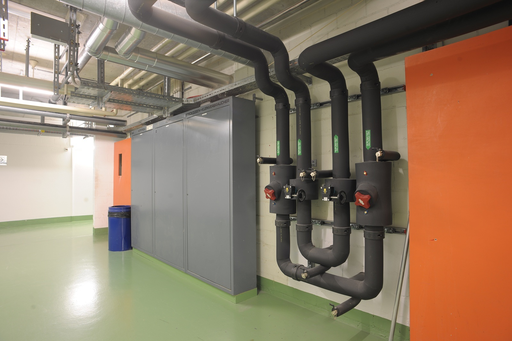
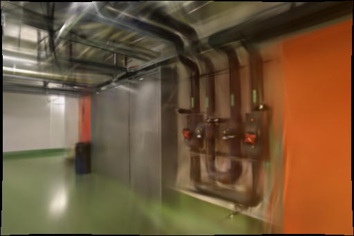
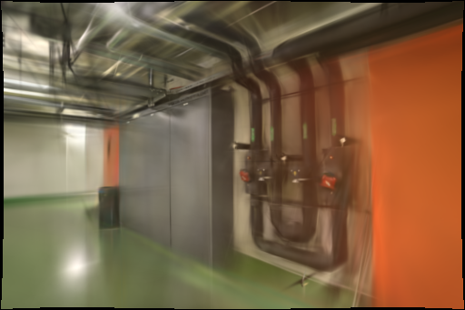
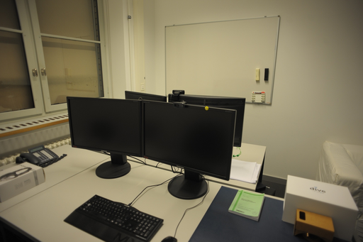
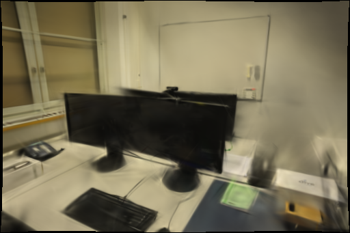
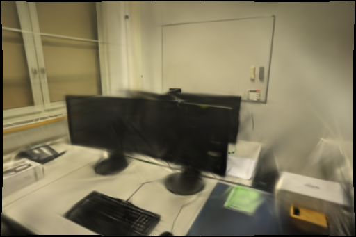

# DSP-SIFT 特征对照

2026-10-31，Apple M5 / 32 GiB，PyCOLMAP 3.13.0 CPU、Brush 0.3.0 Metal。仅开启 `domain_size_pooling` 后，pipes 的两次留出均值改善，但 office 的 SSIM 两次下降，因此不启用为默认。生产重建、界面和历史模型保持原样。

## 依据与实验范围

[Dong、Soatto 的 DSP-SIFT（CVPR 2015）](https://arxiv.org/abs/1412.8556)在多个描述区域尺度上汇合梯度信息，不需要学习权重。[COLMAP FAQ](https://colmap.github.io/faq.html#increase-number-of-matches-sparse-3d-points)建议结合 DSP 与仿射形状估计增加匹配；本轮只检验其中的 DSP 开关，`estimate_affine_shape=false`，不能据此否定或验证完整组合。

安装版本的[公开实现](https://github.com/colmap/colmap/blob/3.13.0/src/colmap/feature/sift.cc)在该开关开启时切到 Covariant SIFT CPU 路径，本机日志也确认了这一点。因此这是一项配置消融，并非在完全相同关键点上的纯描述子对照；实际关键点数量变化如实记录，不能把增加点数本身称为质量收益。

同时查阅 Zouein 等的 [AV1 稠密匹配与 3DGS 初始化研究（2026）](https://arxiv.org/abs/2605.14629)及[作者项目页](https://sigmedia.tv/AV1-3DGS.github.io/)。其评测基于七组视频序列，利用编码器运动向量，与当前任意顺序照片的配对条件不同。项目页指向的[代码仓库](https://github.com/sigmedia/AV1-3D-Reconstruction)在本次网页与 GitHub API 检查均返回 404；尚不能审查其实现和许可，未接入、未本地复现其性能结论。

本轮只使用 ETH3D RGB 照片，不使用数据集真值位姿、深度或雷达；没有 CUDA 对照。所有照片仍参与上游 SfM，只有高斯训练留出每第八张，所以不是独立端到端泛化评估。

## 固定配置

基线提交：[5c16597](https://github.com/sakorman/web-scan/commit/5c16597efb45f58f9ae54d314a333ff126c6ec50)。先完成 pipes 基线，再生成仅有一处差异的[候选补丁](benchmarks/dsp-sift.patch)，所有操作都在独立实验目录。

- pipes：14 张输入 / 14 张定位，12 张训练 / 2 张留出（`0000`、`0008`）；office：26 / 26，22 / 4（`0000`、`0008`、`0016`、`0024`）。八次均无未定位照片。
- 原图均为 1600×1067。共享 RADIAL 内参、穷举匹配、guided matching、几何验证种子 42；特征最长边 1600、预算 8192、4 线程。Mapper 保持原设置，并非完全确定。
- 候选只开启 `domain_size_pooling=true`，尺度范围 1/6–3、10 个尺度，其余提取设置不变。实际求得的内参、位姿和归一化允许随 SfM 改变，完整内参保存在[数据](benchmarks/dsp-sift.json)中。
- 固定 3000 步、512 像素长边、150000 高斯上限、SH3、Brush 种子 42、每 100 步增密、2400 步结束增密、每 500 步导出。固定种子不保证 Metal 逐位确定。
- 每场景、每变体重复两次，共八次串行完整重建。pipes 顺序为基线/候选、候选/基线；office 相反。每次新建 SfM 数据库和 Brush 进程，不复用 SfM 或训练检查点；操作系统和 Metal 缓存没有清空。浏览器在训练结束后才加载模型。

## 匹配与几何

关键点与匹配统计在每种设置的两次运行中相同；office 基线的 Mapper 输出有小幅变化。

| 场景 / 变体 | 实际关键点 | 有效图像对 | 几何内点总数 | 稀疏点 | 重投影误差 px |
| --- | ---: | ---: | ---: | ---: | ---: |
| pipes 基线 | 40,440 | 49 | 10,375 | 1,881 | 0.56761 |
| pipes DSP | 42,185 | 48 | 10,990 | 1,957 | 0.66977 |
| office 基线 | 36,280 | 147 | 17,752 | 2,482 / 2,490 | 0.75074 / 0.74261 |
| office DSP | 37,926 | 140 | 19,068 | 2,594 | 0.78104 |

DSP 的内点总数增加，但有效图像对减少，误差也升高。不能只看内点或稀疏点总量来判定约束更可靠，也尚不能把某个视角的画质损失直接归因于图像对减少。

## 留出画质与耗时

两变体求得的去畸变相机不同，不能直接比较其原生分数。pipes 基线去畸变尺寸为 1600×1066，候选为 1600×1067；office 均为 1600×1067。用 `compare_raw_quality.py` 将渲染投回相同原始照片的 512×341 网格，原照片用 Lanczos、渲染反投影用双线性采样；仅在双方有效像素交集评分，SSIM 仅使用完整 11×11 窗口。每对验证相同原图 SHA-256 和留出名称。

共同有效像素比例为 pipes 97.4982%，office 两次为 97.3745% / 97.3699%。所有评分使用原始照片坐标；不能与采用去畸变参考图的历史分数直接比较。

| 场景 / 重复 | 变体 | 高斯数 | 完整 PLY 字节 | SfM | 训练及导出 | 总计 | PSNR | SSIM |
| --- | --- | ---: | ---: | ---: | ---: | ---: | ---: | ---: |
| pipes / 1 | 基线 | 11,515 | 2,719,090 | 5.9577 s | 22.9311 s | 28.9224 s | 18.722052 | 0.738885 |
| pipes / 1 | DSP | 11,977 | 2,828,122 | 6.5977 s | 23.3479 s | 29.9724 s | 19.801429 | 0.766529 |
| pipes / 2 | 基线 | 11,606 | 2,740,566 | 5.8691 s | 22.8928 s | 28.7885 s | 18.426036 | 0.752565 |
| pipes / 2 | DSP | 11,827 | 2,792,722 | 6.9584 s | 23.0531 s | 30.0431 s | 19.545696 | 0.759668 |
| office / 1 | 基线 | 14,516 | 3,427,326 | 8.4255 s | 23.4813 s | 31.9399 s | 21.659779 | 0.880160 |
| office / 1 | DSP | 15,086 | 3,561,846 | 8.4293 s | 23.6277 s | 32.1012 s | 21.570830 | 0.874592 |
| office / 2 | 基线 | 14,457 | 3,413,402 | 8.5475 s | 23.4854 s | 32.0762 s | 21.743358 | 0.876814 |
| office / 2 | DSP | 14,869 | 3,510,634 | 8.4237 s | 23.5098 s | 31.9681 s | 21.771943 | 0.875983 |

总计从输入摘要校验、复制开始，到 SfM、训练、评测、完整 SH3 导出及工件检查结束；不含采集上传、队列等待、进程启动和离线原始域评分。SfM 含提取、匹配、映射、去畸变和场景诊断；训练及导出含引擎识别、留出渲染、验证与格式转换。分阶段秒数和原生分数另存于数据文件。未测峰值内存。

两次均值差：pipes **+1.099518 dB / +0.017373 SSIM**，office **-0.030182 dB / -0.003199 SSIM**。office 的 SSIM 两次都降；`0008` 两次 PSNR / SSIM 都降，`0016` 两次 SSIM 都降，`0024` 两次 PSNR 分别下降 1.7477 / 1.3972 dB。pipes 第二次 `0008` 的 SSIM 小幅下降，不能声称所有视角都改善。

pipes 平均总计增加 1.1523 秒（约 4.0%），office 增加 0.0266 秒；两场景平均 PLY 分别增加 80,594 / 115,876 字节。训练点数和画质均改变，样本只有两次，不作为等质量提速结论。

## 同视角与漫游

以下为首轮原始域图片，尺寸均为 512×341；黑色边缘为重投影无效区，不参与评分。pipes 管道控制器的重复轮廓有所减轻，地面和墙面仍模糊；office 桌面和显示器存在拉丝，细小结构没有一致改善。

| 场景 / 留出图 | 原图参考 | 基线 | DSP |
| --- | --- | --- | --- |
| pipes `0008` |  |  |  |
| office `0024` |  |  |  |

训练后，用现有 Spark / SH3 查看器加载首轮四模型，从 pipes 照片 1、office 照片 25 切换漫游并同方向拖动。模型均正常加载，控制台无警告或错误；两变体仍可见漂浮细线、遮挡附近的稀薄区域和模糊边缘，不能证明覆盖空洞已经消除。SfM 坐标和相机有变化，拖动观察只作定性检查，不代替相同原始像素域评分或几何真值测量。

## 决策与复现

不修改默认特征提取。保留 pipes 的正向证据，也保留 office 回退；后续先复查 office `0008`、`0016` 的局部匹配与覆盖，再决定是否值得在独立采集上验证完整的 DSP/仿射组合。不能将本轮两场景结果推广到混合镜头、低重叠视频或 CUDA。

193 项后端、18 项前端、类型检查及生产构建通过；保留已有 TestClient 弃用提示和查看器包体警告。八份完整 SH3、相机与照片身份检查通过。原始照片和历史任务不作修改，8787 服务可用。实验目录为 `.data/benchmarks/dsp-sift-20261031/`，失败时保留输出，不覆盖已有任务。

在仓库根目录准备新的实验目录：

```bash
mkdir -p .data/benchmarks/dsp-sift-repro/adapters .data/benchmarks/dsp-sift-repro/jobs
git show 5c16597:webscan/reconstruction.py > .data/benchmarks/dsp-sift-repro/adapters/baseline.py
cp .data/benchmarks/dsp-sift-repro/adapters/baseline.py .data/benchmarks/dsp-sift-repro/adapters/candidate.py
patch .data/benchmarks/dsp-sift-repro/adapters/candidate.py < docs/benchmarks/dsp-sift.patch
cp docs/benchmarks/dsp-sift-config.json .data/benchmarks/dsp-sift-repro/config.json
PYTHONPATH=. .venv/bin/python docs/benchmarks/dsp-sift-run.py \
  --root .data/benchmarks/dsp-sift-repro --source PIPES_SOURCE_JOB \
  --name pipes-r1-baseline --variant baseline
```

`--source` 是保留冻结 `source.json` 的本机任务；本轮 pipes / office 分别为 `44537f26e3b34c5bb417deacb103ce47`、`c6a40f0953a54a9092430d295e2055a9`，其他机器需替换为相同数据的任务。按上文交错顺序换 `--variant`、`--name` 和源任务运行八次，每次必须使用新名称。保留所有日志和输出；不要把补丁应用到历史任务或生产模块。

```bash
PYTHONPATH=. .venv/bin/python scripts/compare_raw_quality.py \
  --data .data/benchmarks/dsp-sift-repro \
  --baseline pipes-r1-baseline --candidate pipes-r1-candidate \
  --size 512 --output .data/benchmarks/dsp-sift-repro/pipes-r1-raw.json \
  --images-dir .data/benchmarks/dsp-sift-repro/images/pipes-r1
```

其余三对同理。[完整逐次数据](benchmarks/dsp-sift.json)包含输入摘要、失败视角、相机参数、阶段时间、模型大小、原生与原始域成绩；[冻结配置](benchmarks/dsp-sift-config.json)与[运行脚本](benchmarks/dsp-sift-run.py)可独立复查。

照片及衍生图来自 Schöps 等的 [ETH3D / CVPR 2017](https://www.eth3d.net/datasets)，遵循 [CC BY-NC-SA 4.0](../THIRD_PARTY_NOTICES.md#test-dataset)。Brush 为 Arthur Brussee 等的 Apache-2.0 项目；COLMAP 为 Johannes L. Schönberger 等的 BSD 项目。公开仓库只保存实验代码、测量摘要及上述衍生图，完整模型与照片留在本地。
