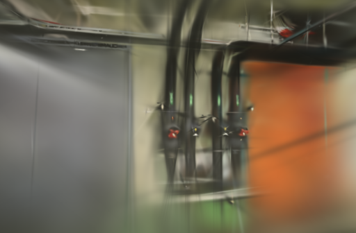
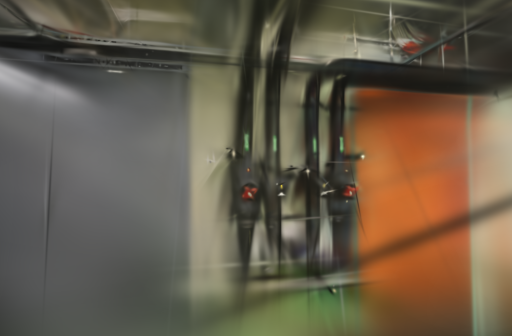

# 训练器标识与种子范围

2026-10-20。修复了训练报告把所有可执行文件都写成 `Brush 0.3.0` 的问题。使用 `WEBSCAN_BRUSH` 切换本地构建时，版本号原先不会随之变化，普通任务也没有保存文件摘要和训练种子，难以核对两次实验是否使用了相同引擎。

## 现在记录什么

每次训练前，对实际选中的可执行文件流式计算 SHA-256，并读取其 `--version` 输出。报告新增：

| 字段 | 含义 |
| --- | --- |
| `engine_version` | CLI 返回的版本；查询失败、超时或格式无法识别时为 `null` |
| `engine_sha256` | 所选可执行文件的字节摘要，不记录本机绝对路径 |
| `engine_identity_seconds` | 文件摘要及版本查询耗时，计入训练与导出阶段 |
| `training_seed` | 显式传给 CLI 的种子，目前为 42，与原版默认值相同 |
| `determinism_guaranteed` | `false`；固定这个种子不保证模型逐字节相同 |

版本未知时，`engine` 只写 `Brush`，不再拿安装脚本的固定版本代替。版本查询最多等待 5 秒，查询失败仍可尝试正常训练。已有模型和历史报告不会被回填为未经验证的新信息。

版本是程序的自报信息，摘要标识入口文件，不证明上游来源，也不覆盖包装脚本调用的其它程序或动态依赖。适配器仍按 Brush 0.3.0 的 CLI 和输出格式验证，记录其它版本号不等于保证兼容。

## 固定种子为什么仍有波动

检查了当前使用的公开版本源码：

- [训练入口](https://github.com/ArthurBrussee/brush/blob/v0.3.0/crates/brush-process/src/train_stream.rs#L48-L104)把 CLI 种子传给张量后端，并初始化一个局部 RNG；图像加载器另用固定值 42。
- [图像加载器](https://github.com/ArthurBrussee/brush/blob/v0.3.0/crates/brush-dataset/src/scene_loader.rs#L61-L119)启动多个带独立种子的生产任务，共用接收队列。完成顺序仍可影响训练收到图像的顺序。
- [加权采样](https://github.com/ArthurBrussee/brush/blob/v0.3.0/crates/brush-train/src/multinomial.rs#L1-L18)另取 `rand::rng()`，没有接收前述 CLI 种子。

这些是源码中可确认的独立随机与调度来源，不是对每一步训练的跟踪结果；本轮没有测出它们各自贡献多少波动，也没有修改引擎。下一步需要独立的实验构建，分别验证有序读图和显式加权采样，再比较速度与效果。

## 基线复现与回归

先用一个自报 `0.3.0-local` 的模拟训练器复现：旧报告仍返回 `Brush 0.3.0`。修复后，正常模型通过原有校验，报告保留自报版本及实际文件摘要，命令明确包含 `--seed 42`。

新增测试覆盖版本缺失、异常输出、失败与超时，以及同路径同版本但文件内容不同的情况。114 项后端、18 项前端测试、类型检查、构建与代码检查通过。

所有真实训练使用同一个官方 Brush 0.3.0 / Metal 文件，摘要为 `8380ed40cce870025393e1ea0257e0752351c67a409d827b76dc75ec3a999a71`。本机 Apple M5 / 32 GiB，训练串行执行，计时期间浏览器停在项目列表，未清空系统及驱动缓存。四次新版训练的标识读取耗时 **61.2–70.2 ms**；包含每次读取约 143.5 MiB 的可执行文件，不是永久缓存。

### 同相机的适配器对照

两组各跑一次旧版和新版，共四次 1000 步 / 512 像素训练，高斯上限 15 万。使用 10 月 12 日的固定同镜头几何：pipes 输入 / 定位 14 / 14、训练 / 评估 12 / 2；office 为 26 / 26、22 / 4，均无失败视角。每场景相机、稀疏文件、照片字节和参考图摘要相同。

用 `compare_quality.py` 按相同 512 长边、画幅和评估照片重新计算 RGB PSNR / Gaussian-window SSIM。评估照片参与过上游 SfM，属于固定几何下的渲染留出测试。

| 场景 | 适配器 | 训练与导出 | 实际高斯 | PLY 字节 | PSNR / SSIM |
| --- | --- | ---: | ---: | ---: | --- |
| pipes | 旧版 | 8.07 s | 3,006 | 710,965 | 18.5915 / 0.68703 |
| pipes | 新版 | 7.12 s | 3,060 | 723,709 | 17.5837 / 0.67841 |
| office | 旧版 | 8.08 s | 3,979 | 940,593 | 19.2372 / 0.78871 |
| office | 新版 | 8.13 s | 3,938 | 930,917 | 19.0642 / 0.79120 |

四次日志都明确记录 `Using seed 42`，新版没有改变生效的种子或训练参数。单次短训练的差异不能归因为元数据修复，更不能当作提速或画质提升；耗时还受适配器一秒轮询粒度影响。这里没有重测 SfM，表中也未加入历史 SfM 耗时。

下面固定展示各场景首个评估视角，均为原始 PNG；左右相机及画幅一致，未修图。

| 场景 | 旧版 | 新版 |
| --- | --- | --- |
| pipes |  |  |
| office |  |  |

### 新采集与报告下载

另建两个独立采集，走示例导入、冷 SfM、1000 步 Metal 训练、模型转换及下载校验。使用自动相机模式、512 像素、5 万高斯预算和留出评测，分别定位 14/14、26/26，训练 / 评估仍为 12/2、22/4。没有失败视角。

| 场景 | SfM | 训练与导出 | Worker 总耗时 | 导入至下载校验 | 实际高斯 | PLY 字节 | Brush 日志 PSNR / SSIM |
| --- | ---: | ---: | ---: | ---: | ---: | ---: | --- |
| pipes | 6.35 s | 8.15 s | 14.57 s | 14.81 s | 3,005 | 710,729 | 15.4628 / 0.69418 |
| office | 9.28 s | 8.16 s | 17.51 s | 17.82 s | 3,997 | 944,841 | 19.2495 / 0.80350 |

这两次相机重新求解，表中为流程成绩，不能与上一表直接作画质比较。导入至下载校验使用本机 TestClient 和真实 Worker 子进程，不代表公网传输速度。

六次训练均通过完整 SH3 与评估输出校验。两个新任务的 PLY / splat 由旧、新转换函数处理同一原始导出后逐字节一致；全部下载文件与磁盘一致，报告中的版本、种子、摘要和日志已核对。

浏览器检查了两组新模型加载、质量面板、报告下载入口及拖动漫游，控制台无错误。短训练仍有模糊、细线缺失和拉丝，本轮修复报告可信度，没有改善训练采样本身。

## 记录与复现

基线：[e600bfe](https://github.com/sakorman/web-scan/commit/e600bfe)。[完整配置、逐视角成绩、模型摘要与 API 报告](benchmarks/engine-identity.json)保留两类实验的计时范围。原始数据在 `.data/benchmarks/engine-identity-20261020/`，包括两个适配器快照、四个固定相机训练目录、两个新采集、重评分与集成脚本。

对照可使用 `scripts/benchmark_exports.py`，传入旧、新适配器文件，以及完整定位的 pipes / office 任务，参数为 `--steps 1000 --resolution 512 --repeats 1`。核对完整相机与参考图摘要后再调用 `compare_quality.py` 评分。新增报告字段可以从任意新建的 Brush 任务下载查看，旧任务保留旧字段。

照片与衍生图片遵循 [ETH3D 署名及许可](../THIRD_PARTY_NOTICES.md#test-dataset)。

后续实测：单生产任务能固定这两组照片的消费顺序，但模型仍不确定，平均 PSNR 下降，未设为默认。[读图顺序实验](LOADER-ORDER.md)
