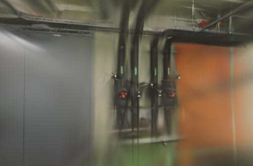
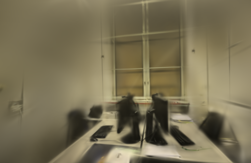

# 评测结果完整性

2026-10-14。留出评测只有在最终步数、图片集合和指标都完整时才算成功；全照片训练仍正常生成模型，不产生留出评测成绩。

## 解决的问题

Brush 0.3.0 的训练循环会记录评测错误后继续导出模型，因此进程退出成功并不保证评测完成。旧适配器只要找到最终 PLY 就返回成功，缺少评测结果时填入 `null`，并使用输入照片作为封面。对照脚本也只检查两次运行现存的 PNG 文件名是否相同；如果两边恰好缺了同一张图，就会只对剩余图片算分。

复现使用独立临时目录，保留原任务：

- 模拟正常退出的训练器，提供真实的有效 PLY、12 张训练 / 2 张评估的日志和评测失败信息。旧适配器返回成功，评测为空；新适配器明确失败，保留原始 PLY，不发布下载模型。
- 复制同一真实任务两次，在两份副本中都移除一张评估图。旧对照脚本接受剩余的 1 张；新脚本按应有的 2 张检查，拒绝缺图结果。[复现记录](benchmarks/evaluation-missing-view.json)

具体规则依据固定版本的 [Brush COLMAP 加载器](https://github.com/ArthurBrussee/brush/blob/v0.3.0/crates/brush-dataset/src/formats/colmap.rs) 与 [训练评测流程](https://github.com/ArthurBrussee/brush/blob/v0.3.0/crates/brush-process/src/train_stream.rs)。

## 校验规则

- 按已定位照片文件名排序，每 8 张取一张，与当前训练器的留出规则一致；检查实际训练数和评测数。
- 读取目标步数对应的最终指标，拒绝缺失、旧步数、NaN、Infinity 或超出有效范围的 SSIM。支持科学计数法；合法的黑色画面不会被判为失败。
- 检查最终评测目录中的 PNG 文件集合，拒绝缺图、多图、截断文件、格式错误和尺寸/画幅不符。
- 训练报告保存每张评估图的名称、尺寸、SHA-256 和参考照片 SHA-256。对照时检查相机、参考照片和已有摘要，拒绝训练后被改动的文件。
- 校验通过才转换和发布模型、清理中间 PLY。校验失败保留训练器输出，方便排查，历史任务不被修改。

`evaluation_verified=true` 表示最终评测输出通过这些完整性检查，不是对场景重建质量的认证。全照片模式为 `false`，评测指标仍为 `null`。旧报告没有图片摘要时，会重新核对完整集合；缺少分辨率记录的早期报告使用现有 PNG 尺寸作为画幅核对依据，不补写历史结果。

## 验证

既有 pipes、office 的两组 10000 步评测通过校验，PSNR / SSIM 与原报告完全一致；全照片模式的历史结果也正常通过。一次完整性检查分别耗时约 24 ms、35 ms，全照片模式不足 1 ms。这是当前本机测量，不是所有规模的开销保证。[记录](benchmarks/evaluation-existing.json)

重新串行训练两组公开照片，并额外检查全照片模式。参数均为 1000 步、512 像素、5 万高斯上限，复用已冻结的相机；下表计时包含训练、评测、校验与导出，不含 SfM 和输入复制。

| 场景 / 模式 | 输入 / 定位 | 训练 / 评估 | 高斯数 | 耗时 | PSNR / SSIM |
| --- | --- | --- | ---: | ---: | --- |
| pipes / 留出评测 | 14 / 14 | 12 / 2 | 2968 | 7.06 秒 | 18.065 / 0.7119 |
| office / 留出评测 | 26 / 26 | 22 / 4 | 3964 | 7.05 秒 | 19.601 / 0.8183 |
| pipes / 全照片 | 14 / 14 | 14 / 0 | 2905 | 7.07 秒 | 不适用 |

两次留出评测分别完整生成 2 张、4 张评估图，最终 PLY 可完整解析。全照片模式没有伪造评测指标。[完整配置与报告](benchmarks/evaluation-training.json)

这些短任务验证输出流程，不代表高质量重建成绩，也没有用于声称训练加速。评测照片参与过上游位姿计算；训练本身仍存在运行波动。本次没有修改训练算法、照片、相机或评分公式。

测试覆盖缺失/过时/非有限指标、视图数错误、缺图、多图、损坏 PNG、画幅错误、科学计数法、黑色画面、全照片模式、失败后保留原始输出，以及两次评测同时缺图和图片事后修改。真实旧任务的完整评分通过对照脚本复算，数值与之前的记录相同。

下面为这两次 1000 步流程回归的首张评测渲染图，保留实际模糊和未收敛的结构，不作为高质量重建样例。

Python 57 项测试通过。照片及评测渲染图沿用 [ETH3D 数据许可与署名](../THIRD_PARTY_NOTICES.md#test-dataset)。
