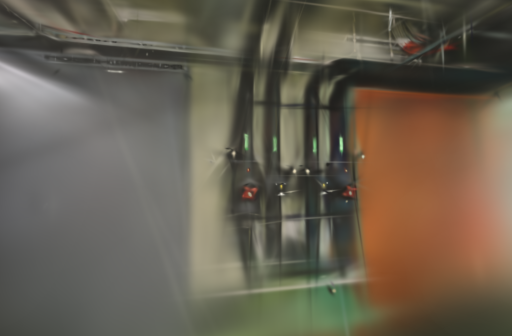
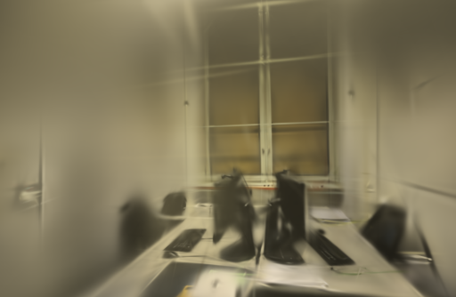

# 导入照片的焦距先验

2026-10-15。照片缩小和重新编码时保留有效的 EXIF `FocalLengthIn35mmFilm`，让 COLMAP 能读到相机记录的等效焦距。此前导入接口和示例准备脚本都会丢弃这项信息，COLMAP 只能从通用焦距初值开始求解。

## 实现

读取原照片的 35 mm 等效焦距，校验为合法的正整数后，写入一个新的最小 EXIF 块。未知值、零值、越界或无效数值按没有先验处理。不会根据缺失字段猜测焦距，也不复制原照片的 GPS、作者、序列号或其他 EXIF 信息。照片方向先转正，随后保留等效焦距；缩放不改变这个以毫米表示的字段。

COLMAP 根据归一化后图片的对角线和等效焦距计算像素焦距。本功能不固定最终相机参数，位姿优化仍可调整焦距；相机型号未被添加到归一化照片，自动模式不会因此强制合并镜头分组。

规则依据固定版本的 [COLMAP EXIF 读取实现](https://github.com/colmap/colmap/blob/3.13.0/src/colmap/sensor/bitmap.cc) 与 [ImageReader](https://github.com/colmap/colmap/blob/3.13.0/src/colmap/controllers/image_reader.cc)。

## 数据验证

重新读取 ETH3D office 和 pipes 官方原始归档，40 张照片均记录 20 mm 等效焦距。构造两份输入，像素处理、JPEG 编码参数和照片顺序完全相同，仅一份保留焦距 EXIF；逐张解码后像素完全相同。

两种输入都使用自动相机模式、8192 特征和相同 SfM 参数。无先验时，COLMAP 初始像素焦距为 1920，所有相机的 `has_prior_focal_length` 为假。保留焦距后，初值约 888.905，40 个相机均正确标记为有先验；图片和相机数量保持一致。

| 场景 | 输入类型 | 定位 | SfM | 训练与导出 | 总计 | PSNR / SSIM |
| --- | --- | --- | ---: | ---: | ---: | --- |
| pipes | 无焦距信息 | 14 / 14 | 5.90 s | 8.10 s | 14.00 s | 17.361 / 0.7034 |
| pipes | 保留 20 mm | 14 / 14 | 5.80 s | 7.09 s | 12.89 s | 16.135 / 0.6896 |
| office | 无焦距信息 | 26 / 26 | 8.40 s | 8.10 s | 16.50 s | 18.979 / 0.8033 |
| office | 保留 20 mm | 26 / 26 | 8.47 s | 7.06 s | 15.53 s | 19.718 / 0.8117 |

GPU 训练均为 1000 步 / 512 像素 / 5 万点预算，每 8 张留出一张。两组输入分别重新求解了位姿，因此去畸变和参考图也可能不同；这不是固定几何条件下的训练参数对照。每配置只跑了一次，训练本身有波动，不能将时间差解释为稳定加速。

pipes 的短训练指标下降，office 上升；本次没有证据说明保留焦距可以普遍提高画质。采用该变更的依据是修复真实相机信息在导入时被丢弃的问题，而不是依靠这四个数值选参数。错误或过期的 EXIF（例如裁剪后未更新）也可能给出不准确的先验，实际重建仍需检查相机轨迹和图像对照。

[输入焦距记录](benchmarks/focal-inputs.json)与[完整实验结果](benchmarks/focal-results.json)保留参数、相机先验、定位数、模型大小和评测文件摘要。模型是相对尺度，等效焦距并不能提供空间的物理尺寸。

## 回归范围

76 项后端测试通过，覆盖方向转正、像素不变、重复上传去重、只保留焦距字段、无效焦距回退、归档准备到导入的完整路径，并在独立进程中实际验证 PyCOLMAP 读取该先验。两组真实照片共四次位姿求解和 GPU 训练完成，最终模型与评测输出均通过完整性校验。

已有冻结采集和模型不作修改。旧照片如果已在归一化时丢失焦距，无法从当前文件恢复；需重新导入原照片，或重新运行公开示例的准备脚本。无 EXIF 的浏览器相机帧继续使用原来的求解方式。

公开照片与衍生结果遵循 [ETH3D 数据许可](../THIRD_PARTY_NOTICES.md#test-dataset)。

以下是保留焦距先验后的两次 1000 步回归渲染，仍有模糊和未收敛细节，不作为精细重建效果宣传。

