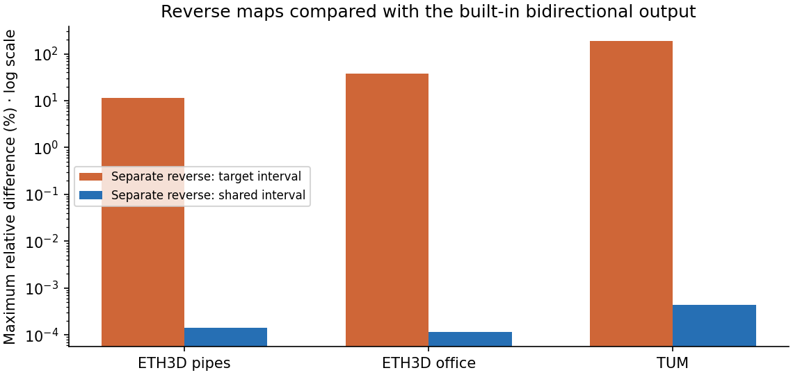

# 双向深度的搜索范围

**保留逐视角的深度搜索范围。** UniMatch 的内置双向模式让两张图共用同一组逆深度候选；原有审计则让每个方向按自己的 SfM 观测估计近远界。在 13 个实拍图对上，反向最大逐像素相对差一度达到 190.33%；仅把单独反向的搜索范围对齐，该值就降至 0.000435% 以下。先前的差异不能归因于 MPS 数值不稳定，也不能当作可见性或预测置信度。

[Confidence matters](https://arxiv.org/abs/2608.06117)（Hongyu Zhou、Zorah Lähner）研究学习得到的多视图置信图；[GVGS](https://arxiv.org/abs/2601.20331v3)（Mai Su 等，[作者实现](https://github.com/sumai-1998/GVGS/tree/78792f47c9e37b3fcdb83dcfb172171fdc785fcd)）研究高斯可见性。这里检验一个更窄的问题：能否用一次双向前向直接替代[已有的独立反向预测](GMDEPTH-CYCLE.md)。[UniMatch 匹配实现](https://github.com/autonomousvision/unimatch/blob/943a99006950ab6c84ea72a72beb147fdd03c19a/unimatch/matching.py#L214-L218)会反转相对位姿并重复同一组深度候选。使用 Haofei Xu 等人的固定 MIT 源码和官方 ScanNet 权重；[版本、权重摘要及许可边界](GMDEPTH.md)。未移植两篇论文的训练器或复测 CUDA。

## 同图对、同范围对照

固定浮点精度、相机内参、图像顺序、权重、64 个逆深度候选和检查视角。输入仅含 RGB 与本机求解的 SfM 位姿，无官方位姿、雷达或传感器输入。每个图对先比内置正向与冻结正向，再比内置反向与两种独立反向：① 目标图自身范围；② 改用源图范围，其余独立反向参数不变。近远界取对应照片拟合格轴向深度 1% / 99% 分位数乘 0.5 / 2。逐像素差为 `abs(内置 / 独立 - 1)`，均值按图对等权，不是对传感器的误差。

| 场景（网络宽×高） | 配对数 | 正向逐元素相同 | 目标范围：反向平均 / 最大差 | 相同范围：反向最大差 |
| --- | ---: | ---: | ---: | ---: |
| ETH3D pipes（512×352） | 1 | 1/1 | 1.340% / 11.625% | 0.000144% |
| ETH3D office（512×352） | 1 | 1/1 | 4.742% / 38.415% | 0.0001144% |
| TUM（512×384） | 11 | 11/11 | 1.513% / 190.328% | 0.000435% |



最大差出现在 TUM 0057→0025，源图范围为 2.594–28.792，目标为 1.912–22.547（SfM 单位）。11 个目标中仅 0025 有预先冻结的传感器参考：同一目标相机的 6,854 个有效像素上，共用范围与独立目标范围的平均 AbsRel 分别为 **19.53% / 17.57%**，单目为 3.82%。一个目标不足以推广范围选择。11 个源视角的 104,390 个检查格中 77,106 个有测量，正向与上轮逐项复现：GMDepth 7.35%、单目 5.66%。传感器仅提供事后评分与全局尺度，这些训练照片上的深度测量不是留出 RGB 成绩。

MPS 同步计时的内置前向合计为 pipes 0.377 秒、office 0.164 秒、TUM 0.956 秒。不含导入、权重加载和写盘；系统缓存未清空，未测峰值内存或等质量提速。初次混合 PyTorch 和 PyCOLMAP 的 TUM 评分因重复 OpenMP 运行库中止；拆分进程后又发现评分清单本身没有相机参数，改用同源相机清单并校验摘要。图表由已有可选绘图环境生成。保留失败任务，未修改运行库权限或关闭检查。

## 真实重建回归

串行新建两个纯 RGB Brush 0.3.0 / Metal 控制任务，均使用缓存共享 RADIAL 位姿，新增 SfM 时间为 0；3000 步、长边 512、上限 15 万、种子 42、完整 SH3。两组原图均全部定位，无失败照片；相机与冻结参考照片、画幅一致。留出照片参与过 SfM，未参加高斯训练或图对推理。下列是控制任务本身的成绩，未将候选深度用于训练。

| 场景 | 定位/输入；训练/留出 | 实际高斯 / PLY 字节 | 训练评估导出 / 含准备总秒数 | 512×341 留出 PSNR / SSIM |
| --- | --- | ---: | ---: | ---: |
| pipes | 14/14；12/2 | 11,663 / 2,754,018 | 22.947 / 23.013 | 17.7136 / 0.76460 |
| office | 26/26；22/4 | 14,754 / 3,483,494 | 23.673 / 23.752 | 22.1487 / 0.87852 |

[pipes 同相机照片 / 渲染](screenshots/202-bidir-pipes.png)中阀门和柜门文字变糊；[office 对照](screenshots/202-bidir-office.png)中显示器背线与键盘细节变弱。在浏览器中分别从照片 9 和 17 切到室内漫游并拖动：[pipes](screenshots/203-bidir-pipes-walk.png) 的管道与柜门边缘仍有重影和悬线，[office](screenshots/203-bidir-office-walk.png) 的桌前缘有拉长的暗区，无法仅凭这两个角度判断空洞规模。TUM 仅复用 96/96 定位、84/12 训练/留出基准，本轮不重训。照片与派生图的 ETH3D（Schöps 等）和 TUM RGB-D（Sturm 等）署名及许可见[第三方说明](../THIRD_PARTY_NOTICES.md)。

## 复现

需具备[冻结图对与权重](GMDEPTH.md)和[反向基线](GMDEPTH-CYCLE.md)。在仓库根目录运行，下列输出目录必须是新目录；示例沿用原始实验的本地布局。训练和深度推理串行执行。

```sh
set -e
export PYTHONPATH=.
base=.data/benchmarks/gmdepth-20261107
cycle=.data/benchmarks/gmdepth-cycle-20261108/run
out=.data/benchmarks/gmdepth-bidir-repeat
.venv/bin/python docs/benchmarks/gmdepth-controls.py --root "$out"
for scene in pipes office tum; do
  .venv/bin/python -m scripts.benchmark_gmdepth_bidir \
    --pairs "$base/$scene/pairs.json" --forward "$base/$scene-mps" --reverse "$cycle/$scene-reverse" \
    --repo .data/research/unimatch --weights .data/research/gmdepth-scale1-scannet-d3d1efb5.pth \
    --device mps --output "$out/$scene"
done
.venv/bin/python -m scripts.benchmark_gmdepth_bidir_score \
  --pairs "$base/tum/pairs.json" --predictions "$out/tum" --reverse "$cycle/tum-reverse" \
  --baseline "$base/tum-final" --sensor-root .data/benchmarks/depth-overlap-20261103 --output "$out/tum-score"
PYTHONPATH=.:.data/research/plotting .venv/bin/python docs/benchmarks/gmdepth-bidir-report.py --root "$out"
```

[逐对范围、误差、照片与模型身份、控制任务数据](benchmarks/gmdepth-bidir.json)。下一步先获取更多有独立深度参考的目标相机，再判断共享范围对遮挡和薄结构的影响；现有双向置信筛查继续用独立反向预测。
