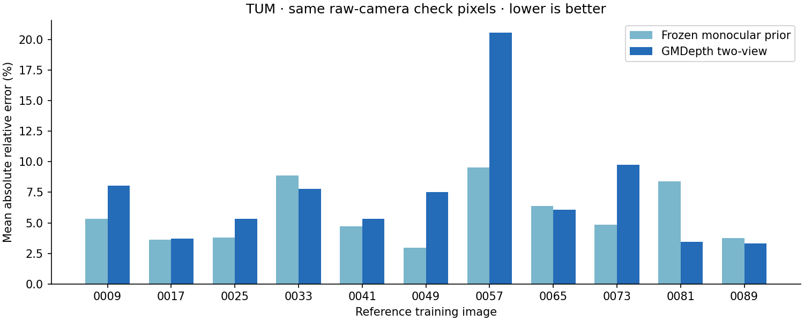
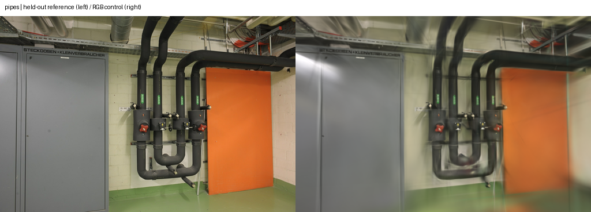
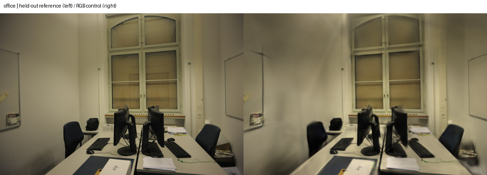

# 双视图深度的本机验证

2026-11-07，基点 [c67c550](https://github.com/sakorman/web-scan/commit/c67c550)。UniMatch 的 GMDepth 已用现有 SfM 位姿在 MPS 跑通，首个实拍图对与 CPU 的最大逐像素相对差为 0.000393%。但在固定 TUM 检查位置上，双视图平均相对误差为 7.35%，已有单目基线为 5.66%，没有稳定收益。保留离线适配与测量工具，放弃直接补点，默认重建不变。

## 假设与适用范围

上一轮核验发现，单目先验的高支持数不能证明新增几何可靠。本轮检验能否用两张真实照片及 SfM 相对位姿构造深度代价体，并在相同测量位置优于已有单目预测。网络预测没有使用传感器深度、米制尺度或数据集真值位姿。

近期 [StereoSplat v1](https://arxiv.org/abs/2610.35902v1)（Vladimir Yugay 等，页面记载 2026-09-29）针对双目视频提取视差，并做高斯聚合；它依赖双目采集条件，不能把其米制结论直接用于本项目的任意单镜头照片。[DepthSplat](https://github.com/cvg/depthsplat)（Haofei Xu 等，CVPR 2025）结合单目与多视图特征，官方环境采用 CUDA。本轮只验证其相关基础模块 UniMatch 的双视图深度路径，不复现两篇论文的高斯网络。

采用 [autonomousvision/UniMatch](https://github.com/autonomousvision/unimatch/tree/943a99006950ab6c84ea72a72beb147fdd03c19a) 的 `943a990`（2025-01-04），作者 Haofei Xu、Jing Zhang、Jianfei Cai、Hamid Rezatofighi、Fisher Yu、Dacheng Tao、Andreas Geiger；源码为 MIT，Copyright 2022 autonomousvision。使用[官方模型表](https://github.com/autonomousvision/unimatch/blob/943a99006950ab6c84ea72a72beb147fdd03c19a/MODEL_ZOO.md)中的 `gmdepth-scale1-scannet-d3d1efb5.pth`，18,768,907 字节，SHA-256 为 `d3d1efb5d1615404828574b6bad63e138c8f4fd8077557392b18b57324982b49`。代码与权重仅保留本地，不加入应用依赖或重新分发；模型表未单列权重许可证，不将其许可扩大解释为本项目 MIT。

## 固定实验

- 输入为冻结的 ETH3D pipes 14/14、office 26/26、TUM 96/96 定位，训练/留出分别为 12/2、22/4、84/12，未定位列表均为空。留出图参与 SfM，不参与图对或高斯训练。原图、模型、相机与已存评分身份沿用[上一轮记录](benchmarks/depth-reprojection-audit.json)。
- ETH3D 各取按文件名排序的第一张训练图；TUM 使用既有 11 张传感器诊断探针，不根据本次误差增删。目标只在训练图中选择：至少 20 个共同稀疏点、共同点视差中位数在 1°–30° 内，按共同轨迹数最多选择，平局按名称排序。pipes 为 0001→0010（584 点、5.53°），office 为 0001→0021（287 点、6.03°）。完整配对和相机矩阵见 [JSON](benchmarks/gmdepth.json)。
- 使用去畸变 PINHOLE 图，ETH3D 原尺寸 1600×1066，TUM 为 626×469。网络尺寸分别为 512×352、512×384，每维向上取 16 的倍数；因此两个方向的缩放率分别计算。先按缩放率变换 COLMAP 内参，再减去半像素，将角点坐标改为网络的零起点像素中心。相对位姿为 `target_from_world × inverse(source_from_world)`。
- 固定 Float32、单尺度、64 个逆深度候选、Swin attention splits=2、无回归 refinement。近远范围仅由来源图偶数拟合格的 SfM 轴向 Z 决定：第 1 百分位的一半至第 99 百分位的两倍。无传感器辅助选择，无逐图尺度或偏移拟合。
- TUM 在原始 RADIAL 相机的同一 4 像素网格、奇数检查格评分。原像素射线经去畸变相机与网络缩放映射后采样预测；沿用先前仅用拟合格估计的全局尺度，把 SfM 单位换成米。两方法共同有效画幅有 77,106 个传感器测量，预测无效数均为 0；1,210 个检查网格位置在网络采样边界外，两者均排除。传感器缺测不算正确或错误预测。

## 实测结果与代价

| 检查 | 结果 |
| --- | --- |
| pipes CPU / MPS 逐像素相对差 | 平均 0.0000652%，最大 0.000393% |
| pipes 稀疏检查格误差 | 有效预测中位 3.84%，p90 13.54%；469 个检查点有 1 个不可采样 |
| office 稀疏检查格误差 | 有效预测中位 5.88%，p90 23.03%；457 个检查点有 4 个不可采样 |
| TUM 同位置逐视图平均 AbsRel | 单目 5.66%，双视图 7.35% |
| TUM 改善 / 退化视角 | 4 / 7；照片 0057 从 9.54% 升至 20.54% |

ETH3D 两张探针因少量边缘检查点不可采样，均未满足既有诊断的“零无效预测”门槛；不将有效子集的误差写成全图通过。



稀疏检查仅衡量与既有 SfM 的一致性；SfM 也用于位姿、配对和范围估计，因此不是独立几何真值。TUM 的全局尺度借助传感器，不能宣称纯照片得到米制精度。此处比较不同深度估计方法及其固定运行尺寸，不是相同计算量对照，也不证明双视图方法普遍较差。

M5 / 32 GB、Torch 2.14.1：pipes CPU 首次前向约 0.364 秒，MPS 首次约 2.642 秒；随后 office 的独立 MPS 进程前向约 0.249 秒，TUM 11 对合计约 1.290 秒。加载权重至保存结果分别为 2.967 / 0.421 / 1.569 秒；不含解释器导入、下载、SfM 或评分。GPU 串行运行，未并行渲染或训练。首个 MPS 运行含编译预热，后续可能复用系统缓存；这些不同图对不能用作 CPU/MPS 加速比。未测峰值内存与冷启动总成本。

## 真实重建回归

另用冻结位姿串行完成 pipes、office 两次新的纯 RGB Brush 控制任务，没有注入预测深度。配置为 Brush 0.3.0 / Metal、种子 42、3,000 步、512 像素长边、15 万高斯预算，训练/留出集合与原基线完全相同。完整 SH3 重新读取、原图摘要、相机与评分参考身份通过；SfM 为缓存复用，新增耗时为 0。控制任务的成绩与完整时间见 JSON，不能归因于本轮深度适配。

| 控制任务 | 高斯 / PLY 字节 | 训练评估导出 / 含准备总秒数 | 512×341 留出 PSNR / SSIM |
| --- | --- | --- | --- |
| pipes | 11,505 / 2,716,730 | 23.757 / 23.812 | 19.02061 / 0.77497 |
| office | 14,427 / 3,406,322 | 23.657 / 23.737 | 21.71546 / 0.88856 |





这些同相机图仍用于检查覆盖与纹理。没有采用候选初始化，未进行候选漫游对照，不能宣称空洞、漂浮物或细小结构改善。显示和交互代码未改，未重复浏览器操作。

新增三项相机缩放、位姿变换及图对选择回归；265 项后端、18 项前端、类型检查与构建通过。控制任务首次准备因历史结果未内嵌 `config` 失败，尚未开始训练；改从冻结配置清单读取后，在新目录完成，失败脚本与日志保留。首次绘图缺少可选 matplotlib，安装到独立本地目录后重做，不改应用依赖。上游 meshgrid 弃用警告与现有 Vite 包大小提示保留。

## 复现与下一步

执行前准备已有冻结基准；外部源码应保持上述提交且工作区清洁，权重下载地址见官方模型表。新输出目录必须不存在。以下为 pipes 的 CPU/MPS 对照：

```sh
PYTHONPATH=. .venv/bin/python scripts/benchmark_gmdepth.py prepare \
  --work .data/benchmarks/depth-consistency-20261101/jobs/pipes-baseline \
  --output .data/benchmarks/gmdepth-repeat/pipes
PYTHONPATH=. .venv/bin/python scripts/benchmark_gmdepth.py infer \
  --pairs .data/benchmarks/gmdepth-repeat/pipes/pairs.json \
  --repo .data/research/unimatch \
  --weights .data/research/gmdepth-scale1-scannet-d3d1efb5.pth \
  --device mps --output .data/benchmarks/gmdepth-repeat/pipes-mps
PYTHONPATH=. .venv/bin/python scripts/benchmark_gmdepth.py score \
  --pairs .data/benchmarks/gmdepth-repeat/pipes/pairs.json \
  --predictions .data/benchmarks/gmdepth-repeat/pipes-mps \
  --output .data/benchmarks/gmdepth-repeat/pipes-final
```

CPU 使用相同命令改为 `--device cpu` 和新的输出目录。office 替换场景名；TUM 使用 `.data/benchmarks/depth-overlap-20261103/jobs/tum-baseline`，准备时加 `--references .data/benchmarks/depth-overlap-20261103/sensor/anchors.json`，评分时加 `--sensor-root .data/benchmarks/depth-overlap-20261103`。准备、推理和评分分进程运行以隔离原生运行时。控制重建用 `docs/benchmarks/gmdepth-controls.py --root 新目录`；汇总脚本见 [gmdepth-report.py](benchmarks/gmdepth-report.py)。

下一步优先检查深度误差较大的配对是否存在遮挡与重复纹理，再决定是否值得验证更强的多视图模型；不要根据传感器误差挑选点进入训练。本轮确认了本机运行和坐标适配可行，没有确认足够可靠的新几何。
