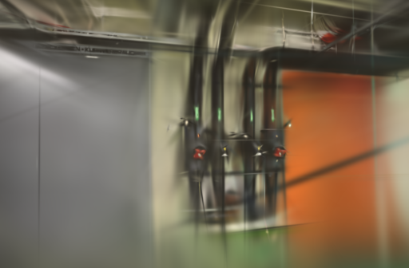
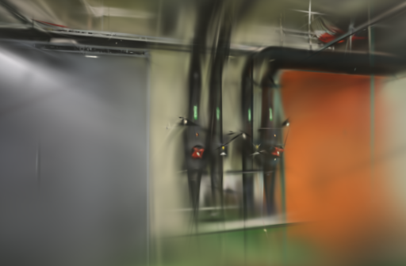
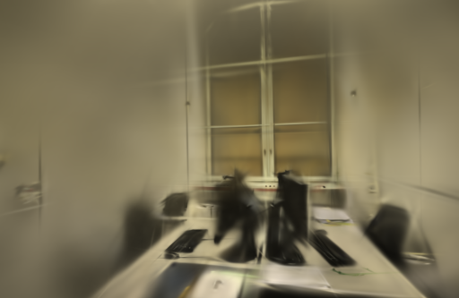

# GPU 随机种子传递

2026-10-22。在独立 Brush 构建中找到一处种子传递缺口：CLI 设置的种子没有传到实际生成 GPU 随机张量的状态。补上传递后，pipes 和 office 的两次训练初始 PLY 分别逐字节相同。第一次参数更新后仍出现差异，因此保留修正用于实验，尚未替换正式引擎。

## 问题从训练前就开始

上一轮已固定照片消费顺序、加权采样 RNG 和真实点编号顺序。本轮先增加状态导出，在开始训练前，以及完成第 1、10、100 次参数更新后保存完整 SH3 PLY。两场景各跑两次 1000 步，共四次定位实验：开始训练前，位置、尺度、颜色相同，旋转和透明度已经不同。

核对本地锁定的依赖后，发现两个不同的随机状态：

- [Burn 的 `Backend::seed`](https://github.com/tracel-ai/burn/blob/dd2a02905ea4a29ce2100e432e49d63b365546ab/crates/burn-cubecl/src/backend.rs)写入 Burn 模块自己的状态。
- [GPU 正态分布内核](https://github.com/tracel-ai/burn/blob/dd2a02905ea4a29ce2100e432e49d63b365546ab/crates/burn-cubecl/src/kernel/prng/normal.rs)调用 CubeCL 随机函数；[CubeCL 的 `get_seeds`](https://github.com/ArthurBrussee/cubecl/blob/43580a8c294f3a8140921c26f6378a12aef82881/crates/cubecl-random/src/base.rs)读取另一份状态，未设置时使用熵初始化。

因此，日志里的 `Using seed 42` 不足以证明 GPU 初始化受同一个种子控制。这个判断针对本次锁定的依赖组合，不推广到所有 Burn / CubeCL 版本，也不据此宣称已验证官方发布文件的全部构建来源。

修正在加载数据集前，同时调用 `burn_cubecl::cubecl::random::seed(seed)`。增加实际 Wgpu 测试，生成 Normal `[64, 4]` 和 Uniform `[64]` 张量，检查两次种子 42 的结果完全相同，再检查种子 17 会改变两种结果。旧逻辑触发相等断言失败；修正后该测试通过，使用的是实际 Metal 设备。

## 固定条件的八次对照

同一个 `0.3.0-gpu-seed-study` 二进制，基线不补传 GPU 种子，候选补传 42。其余排序、采样、训练与状态导出设置相同。

| 项目 | pipes | office |
| --- | ---: | ---: |
| 输入 / 定位照片 | 14 / 14 | 26 / 26 |
| 训练 / 评估照片 | 12 / 2 | 22 / 4 |
| 初始高斯 | 1,873 | 2,456 |
| 未定位照片 | 无 | 无 |

使用 10 月 12 日同镜头模式的固定几何，相机、稀疏文件、照片字节和评估参考摘要逐项一致。每次 1000 步、512 像素长边、15 万高斯预算、SH3，每 100 步增点、80% 步数后停止增长、每 500 步导出、每 8 张留出一张。CLI 种子、CPU 加权采样种子均为 42，单个图像生产任务，初始点按真实编号排序。

Apple M5 / 32 GiB，Metal，Rust / Cargo 1.99.0。源码锁定 Brush `3edecbb2fe79d3e2c87eeab85b15e0b1dd10d486` 及原 `Cargo.lock`。两设置各重复两次，pipes 按基线、候选、候选、基线运行，office 顺序相反；GPU 串行使用，浏览器在训练期间停在项目列表。系统与驱动缓存未清空，属于预热环境。

本轮复用几何，未重算 SfM、未测新的 API 端到端耗时或峰值内存。计时覆盖训练、评估、状态快照与导出，不含源码编译、输入复制或照片准备。

## 初始状态已一致，完整训练仍不确定

下表比较同一设置的两次重复，而非比较基线与候选：

| 场景 | GPU 种子 | 训练前完整 PLY | 训练前旋转最大差 | 训练前透明度最大差 | 最终 PLY |
| --- | --- | --- | ---: | ---: | --- |
| pipes | 未补传 | 不同 | 1.92478 | 1.07045 | 不同 |
| pipes | 补传 42 | 逐字节相同 | 0 | 0 | 不同 |
| office | 未补传 | 不同 | 1.97018 | 1.08206 | 不同 |
| office | 补传 42 | 逐字节相同 | 0 | 0 | 不同 |

候选完成第一次参数更新后，旋转分量最大差已经达到 pipes `0.002630`、office `0.002674`；两场景颜色系数最大差为 `3.73e-9`，office 尺度还出现 `1.49e-8` 的差。此时尚未开始增点，不能把所有剩余差异归因于后续采样或增点索引的遍历顺序。下一步应检查首轮梯度和优化器更新，原因尚未确认。

快照记录的是导出的渲染参数：尺度为对数值、透明度为 logit，四元数经过导出归一化；它没有覆盖优化器内部状态或原始未归一化四元数。导出需要从 GPU 读回张量，会同步执行并可能改变调度。上述证据适用于这条带快照的实验路径，不能作为未加观测时的完整确定性保证。

## 同相机画质与耗时

使用 `compare_quality.py` 核对完整相机、评估集合和参考图摘要后，统一到长边 512，计算 RGB PSNR 与 11×11 Gaussian-window SSIM，再按视角等权平均。评估照片参与过 SfM，属于固定几何下的渲染留出对照。

| 场景 | 重复 | GPU 种子 | 训练及导出 | 实际高斯 | PLY 字节 | PSNR / SSIM |
| --- | ---: | --- | ---: | ---: | ---: | --- |
| pipes | 1 | 未补传 | 7.1508 s | 3,037 | 718,281 | 17.3714 / 0.67001 |
| pipes | 1 | 补传 42 | 7.1578 s | 3,003 | 710,257 | 17.5720 / 0.68493 |
| pipes | 2 | 未补传 | 7.1596 s | 3,036 | 718,045 | 18.3040 / 0.68004 |
| pipes | 2 | 补传 42 | 7.1513 s | 2,986 | 706,245 | 18.2248 / 0.68640 |
| office | 1 | 未补传 | 7.1339 s | 3,956 | 935,165 | 19.1225 / 0.78798 |
| office | 1 | 补传 42 | 7.1192 s | 3,966 | 937,525 | 19.5571 / 0.79361 |
| office | 2 | 未补传 | 7.1513 s | 3,983 | 941,537 | 18.6463 / 0.78298 |
| office | 2 | 补传 42 | 7.1293 s | 4,011 | 948,145 | 18.5132 / 0.78567 |

平均 PSNR：pipes 17.8377 → 17.8984，office 18.8844 → 19.0352；平均 SSIM 分别为 0.67502 → 0.68566、0.78548 → 0.78964。两次短训练的分数仍波动，不能据此确认画质收益。计时包含快照开销，适配器按一秒粒度轮询，实际点数也不同；毫秒级差值不作为提速依据。

下图固定展示首次重复的第一个留出视角，左右相机、画幅一致。图片为未修改的原生评估 PNG，完整分数和摘要见[测量数据](benchmarks/gpu-seed.json)。

| 场景 | 未补传 GPU 种子 | 补传 GPU 种子 |
| --- | --- | --- |
| pipes |  |  |
| office |  |  |

八个正式模型通过完整 SH3 与评估输出检查。浏览器加载两场景的基线和候选，并拖动候选漫游，控制台无错误或警告。1000 步模型仍很粗，细管、线缆、窗框有模糊和拉丝，采集覆盖外仍有漂浮片段与缺失；没有确认漫游质量提升。

## 保留修正与复现

保留 GPU 种子传递修正、实际 GPU 回归测试和状态快照开关，继续用于独立实验。正式安装的 Brush 未覆盖，应用源码、原照片和历史模型保持原状。应用测试与构建由提交后的标准 CI 检查，不在本地重复未改变的应用测试。

项目基线为 [83afb9f](https://github.com/sakorman/web-scan/commit/83afb9f)。[gpu-seed.patch](benchmarks/gpu-seed.patch)是相对干净 Brush `v0.3.0` 的累计补丁，包含此前读图、采样和点编号修正，不能叠加旧补丁。按[源码构建方法](LOADER-ORDER.md#决定与复现)换用本补丁，构建版本应为 `0.3.0-gpu-seed-study`。实际 GPU 回归测试：

```bash
cargo test --manifest-path .tools/brush-order-study/Cargo.toml \
  --locked --release -p brush-process tensor_seed_controls_normal_and_uniform
```

对照时两组均设置下列变量为 `1`：`WEBSCAN_SINGLE_LOADER`、`WEBSCAN_TRACE_LOADER`、`WEBSCAN_TRACE_SAMPLING`、`WEBSCAN_SEEDED_SAMPLING`、`WEBSCAN_STABLE_INIT`、`WEBSCAN_TRACE_STATE`；只将 `WEBSCAN_SEED_GPU` 在 `0` / `1` 间切换。两组都传入：

```text
--seed 42 --total-steps 1000 --max-splats 150000 --max-resolution 512
--refine-every 100 --growth-stop-iter 800 --export-every 500
--export-name export_{iter}.ply --eval-split-every 8
--eval-every 1000 --eval-save-to-disk
```

每次使用独立输入副本与 `--export-path`，不得覆盖已有结果。实验二进制、构建及测试日志、适配器、八次训练、状态对照脚本保存在 `.data/benchmarks/gpu-seed-20261022/`；早期四次定位实验在 `.data/benchmarks/state-trace-20261022/`，单独记录，不混入最终 A/B 均值。公开 JSON 保存构建与输入摘要、逐次成绩、状态比较和图片摘要，不提交大体积二进制。

补丁遵循 [Brush Apache-2.0 许可](../THIRD_PARTY_NOTICES.md#brush-loading-experiment)，照片与衍生渲染遵循 [ETH3D 署名及许可](../THIRD_PARTY_NOTICES.md#test-dataset)。

后续追踪发现近零旋转梯度被很小的 Adam 稳定项放大。提高稳定项能减少早期差异，但全参数组调整没有通过两场景质量要求。[首轮梯度与 epsilon 对照](ADAM-EPSILON.md)
