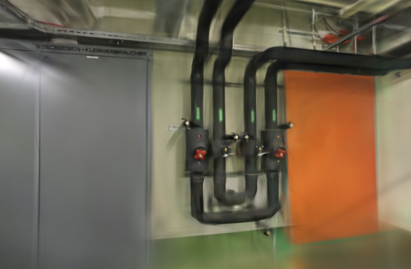
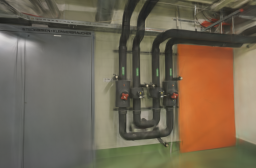
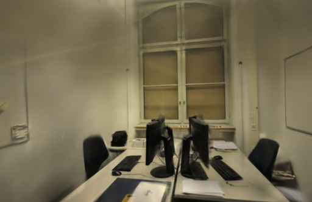
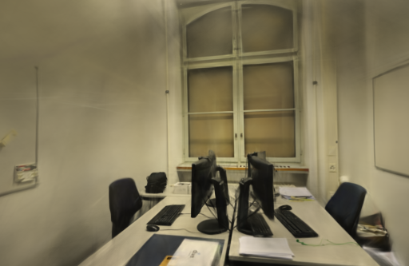

# 高梯度扩张比例筛查

2026-10-27。当前 Brush 每次细化只扩张 10% 的高梯度高斯；为检查细管和遮挡边界是否受限于扩张不足，固定相机、照片与训练预算，只把 `--growth-select-fraction` 改为 `0.2`。候选在两组场景提高 SSIM，但共同网格 PSNR 都下降，并显著增加模型和时间；不修改默认训练参数。

## 参数含义与固定条件

Brush 先从梯度超过阈值的高斯中计算可增长数量，再用 `growth_select_fraction` 决定其中实际扩张的比例。每次扩张会复制并缩放高斯，因此更多点本身不是质量收益。本轮 `0.2` 在运行前固定，是默认 `0.1` 的两倍；没有改动阈值、细化频率、透明度、相机或步数。

- Apple M5 / 32 GiB / macOS，官方 Brush 0.3.0，二进制 SHA-256 为 `8380ed40cce870025393e1ea0257e0752351c67a409d827b76dc75ec3a999a71`。
- 两组均为 3,000 步、512 像素长边、150,000 高斯上限、SH3、种子 42、每 100 步细化，第 2,400 步停止增长；只追加 `--growth-select-fraction 0.2`。
- pipes 输入 / 定位为 14 / 14，训练 / 留出为 12 / 2；office 为 26 / 26、22 / 4；没有未定位视角。计时涵盖训练、留出评测和导出，不含 SfM 与输入复制。
- GPU 串行运行：pipes 为基线→候选，office 为候选→基线。每组只有一次，用于筛出明显的取舍，不建立一般性参数结论。

## 结果

原生留出分数和共同网格复评都显示候选没有保住 PSNR。虽然 SSIM 增加，但候选高斯数和 PLY 同时大幅增长，训练时间也增加；不把这一组合写成更高画质或更高性能。

| 场景 | 比例 | 训练、评估、导出 | 实际高斯 / PLY | Brush PSNR / SSIM | 统一 512 网格 PSNR / SSIM |
| --- | --- | ---: | ---: | --- | --- |
| pipes | `0.1` | 23.2557 s | 11,408 / 2,693,838 B | 18.79204 / 0.769589 | 18.63055 / 0.744532 |
| pipes | `0.2` | 28.3034 s | 53,084 / 12,529,374 B | 18.53930 / 0.777674 | 18.37687 / 0.753130 |
| office | `0.1` | 23.2388 s | 14,310 / 3,378,710 B | 21.86368 / 0.875084 | 21.71532 / 0.860464 |
| office | `0.2` | 28.2906 s | 54,129 / 12,775,994 B | 21.06035 / 0.887093 | 20.94722 / 0.873714 |

相对基线，候选的共同网格 PSNR 在 pipes / office 分别下降 0.25367 / 0.76810 dB，SSIM 增加 0.00860 / 0.01325。高斯数增加 365.32% / 278.26%，训练、评测和导出各增加约 5.05 秒（约 21.7%）。上限没有触及，但更高的扩张比例已带来明确的时间与模型代价，不能只因点数增多就称为细节改善。

## 同视角检查

下面固定展示各场景按文件名排序的第一张留出 PNG。pipes 候选中橙色门板上的斜向漂浮线条较少，但管道和柜门边缘依然偏软；office 的其他留出视角有明显 PSNR 回退。四个输出均通过完整 SH3 PLY 检查；共同评分先验证相机、留出照片和参考摘要，再在不放大的 512 网格上计算。

| 场景 | 默认 `0.1` | 候选 `0.2` |
| --- | --- | --- |
| pipes |  |  |
| office |  |  |

留出照片参与过上游 SfM，因而不是完全独立的端到端评测；这一轮也没有带深度真值来测量几何误差。单张漫游中的局部漂浮改善不足以抵消全视角指标和模型代价。

## 工件与复现

[公开汇总](benchmarks/growth-select.json)包含输入摘要、逐次指标、模型大小和评分口径；完整模型、训练日志与评测 PNG 留在 `.data/benchmarks/growth-select-20261027/`，不纳入仓库。复现实验可将补丁应用在固定版本的适配器快照上：

```bash
git show b16428b:webscan/brush.py > /tmp/brush-baseline.py
cp /tmp/brush-baseline.py /tmp/brush-growth.py
patch /tmp/brush-growth.py < docs/benchmarks/growth-select.patch
.venv/bin/python scripts/benchmark_exports.py --repo . \
  --baseline /tmp/brush-baseline.py --candidate /tmp/brush-growth.py \
  --output .data/benchmarks/growth-select-repeat \
  --jobs PIPES_JOB OFFICE_JOB --steps 3000 --resolution 512 --repeats 1
```

近期稀疏输入研究常把扩张与额外几何约束、深度或尺度策略结合；当前本机训练器没有这些监督，不能把论文结论等同为单个 CLI 参数的收益。[Brush 0.3.0 细化实现](https://github.com/ArthurBrussee/brush/blob/v0.3.0/crates/brush-train/src/train.rs#L398-L432) · [Brush 0.3.0 配置](https://github.com/ArthurBrussee/brush/blob/v0.3.0/crates/brush-train/src/config.rs) · [AD-GS](https://doi.org/10.1145/3757377.3763993) · [EFA-GS](https://arxiv.org/abs/2508.02493) · [ETH3D](https://www.eth3d.net/datasets)
