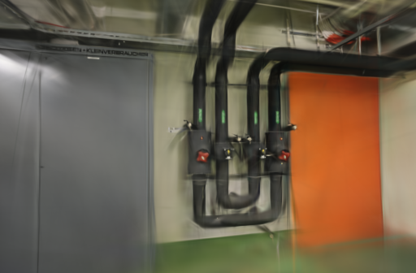
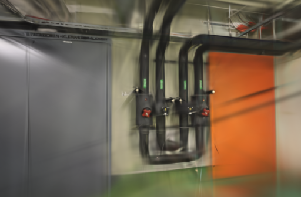
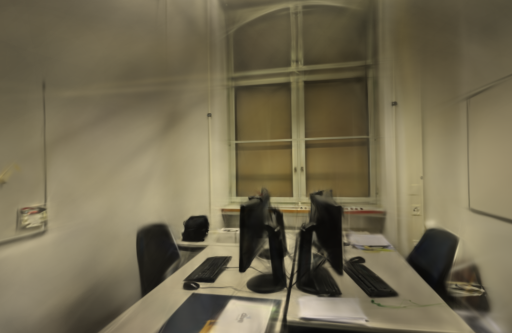
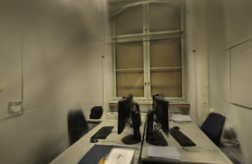

# 提前结束增点的对照

2026-10-16。本轮测试把增点结束时刻从训练进度的 80% 提前到 50%，希望给已有高斯留下更多收敛时间。两场景的平均 PSNR 和 SSIM 均下降，因此没有采用，默认仍为 80%。

## 假设与边界

[Brush 0.3.0 的默认配置](https://github.com/ArthurBrussee/brush/blob/v0.3.0/crates/brush-train/src/config.rs)采用 30000 总步数和 15000 步结束增点。本项目为较短训练设为 80%，此前更频繁增点没有得到稳定收益。本轮只检查结束时刻，不同时改变增点频率、损失或学习率。

结束增点不等于停止全部细化：[固定版本训练代码](https://github.com/ArthurBrussee/brush/blob/v0.3.0/crates/brush-train/src/train.rs)在该时刻之后仍执行低效高斯的删除与替换。实验只减少继续扩张的阶段，不能称为“后半程完全固定几何”。

## 固定条件

Apple M5、32 GiB、Brush 0.3.0 / Metal。每次 3000 步、512 像素长边、15 万高斯预算、增点间隔 100 步、种子 42，每 500 步导出，最终完整 SH3 校验。两种设置分别在第 2400 / 1500 步结束增长。

沿用已保存的 ETH3D office / pipes 纯照片 SfM 结果；同镜头模式，没有使用数据集提供的标定。每组四次运行的完整去畸变照片和稀疏几何摘要一致。

| 场景 | 输入 / 定位 | 未定位 | 训练 / 留出 | 初始稀疏点 |
| --- | --- | ---: | --- | ---: |
| pipes | 14 / 14 | 0 | 12 / 2 | 1,873 |
| office | 26 / 26 | 0 | 22 / 4 | 2,456 |

各设置各重复两次，共八次真实训练。pipes 按 80 → 50 → 50 → 80，office 按相反顺序，串行使用 GPU，网页返回项目列表停止模型渲染。每次使用新训练进程和独立目录，不从模型检查点继续。没有清空系统/GPU 缓存，首个进程的冷启动和之后的缓存影响不能完全分离。

SfM 本轮不执行，不将其记为零秒求解。以下时间包含训练、评测、导出和校验，不含输入复制、原图导入或 SfM，也不是完整端到端重建耗时。

## 结果

以下为两次运行均值。高斯数有小数表示两次结果的平均，不是单个模型存在半个高斯。

| 场景 | 增点结束 | 耗时 | 实际高斯 | PLY 字节 | Brush PSNR | Brush SSIM |
| --- | --- | ---: | ---: | ---: | ---: | ---: |
| pipes | 80% | 24.12 s | 11,571 | 2,732,306 | 18.6647 | 0.76602 |
| pipes | 50% | 23.12 s | 5,354 | 1,265,093 | 17.5640 | 0.74439 |
| office | 80% | 24.12 s | 14,124.5 | 3,334,932 | 21.0374 | 0.87280 |
| office | 50% | 23.10 s | 6,765.5 | 1,598,207 | 20.7704 | 0.86059 |

提前结束增长使实际高斯约减半、文件更小，但 pipes 平均 PSNR 下降 1.10 dB，office 下降 0.27 dB；两场景 SSIM 也下降。耗时仅少约 1 秒，与适配器的一秒轮询粒度接近，且点数已经变化，不能解释为相同质量下的稳定提速。

原始试次仍有明显波动：pipes 的 50% 设置 PSNR 为 18.2074 / 16.9207，80% 为 18.1344 / 19.1950。固定种子没有消除结果差异；两次重复不足以建立统计显著性，也不能把结论推广到 6000 步或其他数据。

全部评估视图、图片尺寸和参考照片摘要通过校验。另用现有 RGB PSNR / Gaussian SSIM 实现，在相同 512 像素画幅重新评分；其实现与 Brush 不同，数值分别报告：

| 场景 | PSNR：80% → 50% | SSIM：80% → 50% |
| --- | ---: | ---: |
| pipes | 18.4923 → 17.4393 | 0.74034 → 0.71774 |
| office | 20.9048 → 20.6302 | 0.85786 → 0.84522 |

[完整试次、均值/范围、配置、模型大小及逐视角评分](benchmarks/growth-stop.json)。留出照片参与过上游 SfM，这不是独立的端到端评测，也不是全照片最终模型成绩。

## 同视角观察

以下是每场景第一次重复的首个留出视角，均为训练器直接保存的 512 像素渲染。两列相机、参考照片与画幅一致。

| 80% | 50% |
| --- | --- |
|  |  |
|  |  |

浏览器也实际打开了四个模型。50% 的管线、阀门和桌面边缘更容易出现模糊，pipes 拖动漫游后仍有墙面拉丝和未充分覆盖的区域，未观察到足以支持采用的几何改善。两种设置均可正常加载，未记录控制台错误。

## 采用决定与复现

**放弃本次参数调整，继续使用 80%。** 本轮只新增实验记录，没有修改正式训练代码、前端或现有模型。不继续扩大这个候选的训练规模；下一步优先补充覆盖更密集的合法实拍数据，再检查位姿、曝光一致性和细节收敛。

实验适配器、模型和原始日志保存在 `.data/benchmarks/growth-stop-20261016/`。复现时从项目根目录执行，两个任务 ID 需换成已完成 SfM 的公开照片任务：

```bash
mkdir -p .qa/growth-stop
git show 8d47231:webscan/brush.py > .qa/growth-stop/baseline.py
cp .qa/growth-stop/baseline.py .qa/growth-stop/candidate.py
patch .qa/growth-stop/candidate.py < docs/benchmarks/growth-stop-50.patch
.venv/bin/python scripts/benchmark_exports.py --repo . \
  --baseline .qa/growth-stop/baseline.py \
  --candidate .qa/growth-stop/candidate.py \
  --jobs PIPES_JOB OFFICE_JOB --steps 3000 --resolution 512 --repeats 2 \
  --output .qa/growth-stop/runs
```

基准脚本在开始时保存适配器快照；输出目录必须不存在，避免覆盖旧实验。文档链接、参数补丁和 JSON 记录均已核对，原照片与历史结果保留。未新增应用代码，因此没有为了这次记录再跑一遍相同的本地前后端测试；远程 CI 随提交执行常规回归。

图片与衍生模型遵循 [ETH3D 数据许可和署名](../THIRD_PARTY_NOTICES.md#test-dataset)。
