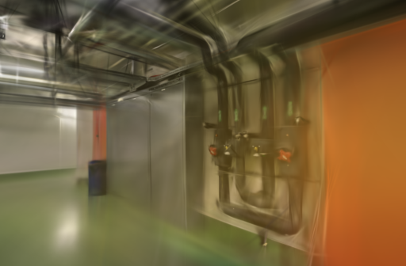
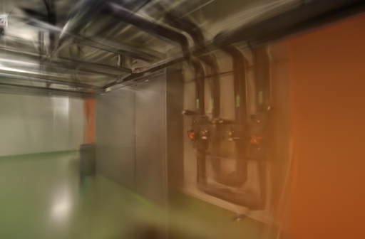

# 增点梯度阈值筛查（未采用）

2026-10-28。高斯增密依赖屏幕空间梯度：较高阈值会让更少的高斯进入扩张流程，理论上能降低模型和训练开销，也可能遗漏细节。本轮只把 Brush 的 `--growth-grad-threshold` 从 `0.00004` 提高到 `0.00008`，以两组冻结的真实照片位姿做交错重复；结果没有同时保住两组画质，因此默认值不变。

## 方法

- Apple Silicon macOS、Brush 0.3.0、SH3、种子 42；每组固定 3,000 步、512 像素长边、150,000 高斯预算、每 100 步细化、第 2,400 步停止增长，并每 8 张留出 1 张。
- 使用前一轮 ETH3D pipes / office 的已验证 SfM 输出：分别为 14 / 14、26 / 26 张定位，训练 / 留出分别为 12 / 2、22 / 4。相机、图片、留出集合和参考图摘要在各变体之间一致；本筛查不重跑 SfM 或复制输入，计时只包含训练、评估、导出和模型校验。
- 每场景各运行两次，第二轮交换基线和候选的先后顺序。随后以相同相机、相同留出图和不放大的 512 像素共同网格复评。评估照片参与上游 SfM，并非独立端到端评测。

## 结果

| 场景 | 阈值 | 训练、评估、导出均值 | 高斯均值 | Brush PSNR / SSIM 均值 | 共同 512 网格 PSNR / SSIM 均值 |
| --- | ---: | ---: | ---: | --- | --- |
| ETH3D pipes | `0.00004` | 23.6935 s | 11,055 | 18.271838 / 0.76184510 | 18.109351 / 0.73735738 |
| ETH3D pipes | `0.00008` | 23.6967 s | 8,897.5 | 17.966113 / 0.74934366 | 17.817798 / 0.72528269 |
| ETH3D office | `0.00004` | 24.2130 s | 14,577 | 20.983553 / 0.87307733 | 20.847019 / 0.85815908 |
| ETH3D office | `0.00008` | 23.7091 s | 11,587.5 | 21.301173 / 0.87158380 | 21.159899 / 0.85647569 |

候选在两组分别少约 19.5% 和 20.5% 高斯，但 pipes 的共同网格 PSNR / SSIM 平均下降 0.291553 dB / 0.012075，耗时没有下降；office 的 PSNR 上升 0.312880 dB，但 SSIM 下降 0.001683，平均只快约 0.50 秒。第二轮 pipes 的候选出现更明显回退，说明首轮收益不能当作稳定改进。

## 同视角检查

下列是 pipes 第二轮同一张留出照片、同一画幅的真实训练输出，未替换为原照片或后期处理。候选的橙色墙面渗色更重，管线与控制器区域更软，与共同网格回退一致。

| `0.00004` 基线 | `0.00008` 候选 |
| --- | --- |
|  |  |

八个模型均完成完整 SH3 PLY、相机和留出渲染校验；八次原始结果、共同网格评分、输入摘要和适配器摘要见 [公开汇总](benchmarks/growth-threshold.json)。完整模型、日志和评测 PNG 保留在本机 `.data/benchmarks/`，不随仓库发布。

## 结论与边界

- 不采用：当前参数在 pipes 上稳定性不足，少点数也没有转化为同画质提速；不会改动默认训练器或已有模型。
- 这不是对所有梯度阈值、场景或训练步数的结论。两次重复只能发现明显的不稳定，不能估计通用效应。
- 后续若有带深度或遮罩的公开场景，可将密度控制与几何监督一起评估；不把近期论文中的自适应策略直接简化为单一阈值。

参考：[Brush 0.3.0 配置](https://github.com/ArthurBrussee/brush/blob/v0.3.0/crates/brush-train/src/config.rs) · [原始 3DGS 的增密参数](https://github.com/graphdeco-inria/gaussian-splatting#--densify_grad_threshold) · [Improving Adaptive Density Control for 3D Gaussian Splatting](https://arxiv.org/abs/2503.14274) · [ETH3D](https://www.eth3d.net/datasets)（[CC BY-NC-SA 4.0](https://creativecommons.org/licenses/by-nc-sa/4.0/)）
