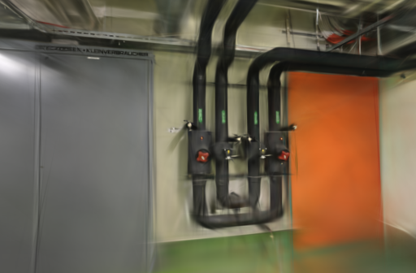
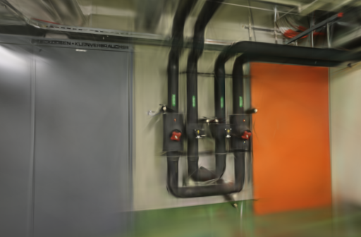
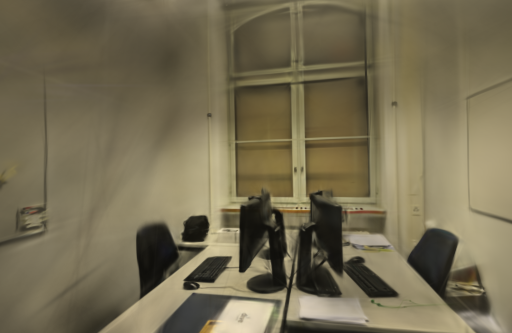
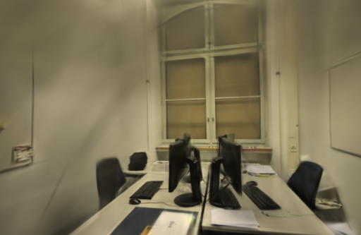

# 初始点编号与排序

2026-10-22。独立 Brush 构建中修正了 `points3D.bin` 点编号的字节序，并验证按编号排序可以稳定初始点序列。但首次采样权重和最终模型仍有变化，两场景的画质结果也有升有降，因此没有替换正式训练器。

## 点编号读取错误

第一次排序试验中，点编号出现了巨大的负数。核对原始文件发现，[COLMAP 二进制格式](https://colmap.github.io/format.html#binary-file-format)规定使用小端序，而 Brush 0.3.0 的点编号读取用了 `read_i64()`。文件中的 ID `1` 被解释成 `72057594037927936`，`128` 被解释成 `-9223372036854775808`。

新增二进制 / 文本一致性测试，覆盖 `1`、`128`、`257`、`1099511627793` 四种编号，以及位置、颜色、误差和观测轨迹。旧代码复现失败；改为 `read_i64_le()` 后，8 项读取测试全部通过。修正后的真实数据编号集合也逐一与 Python 按小端解析的原始文件一致。

这个修正解决编号解释错误，不足以说明此前的画质问题都由字节序引起。原来的位置、颜色等字段已有独立的读取逻辑，本次测试确认其载荷与文本格式对应。

初次试验的八次 3000 步训练和两次验收保留在原目录，未进入下文的最终汇总：它们排序的是读错字节序后的内部键，不是原始 COLMAP 编号。[完整数据](benchmarks/init-order.json)中的 `preliminary_probe` 单独保存这批结果和排除原因。

## 排序对照

最终两组都修正了编号字节序，使用同一个 `0.3.0-init-le-study` 二进制。基线沿用容器遍历顺序，候选按数值编号排序；位置和颜色从同一组点记录生成，抽样也在排序之后执行。两个初始化测试检查了不同插入顺序、编号 `1 / 2 / 10` 的数值排序、坐标与颜色配对，以及抽样时保留原始容器。

本轮读取测试 8 项、初始化测试 2 项通过；此前同一任务的采样测试 5 项通过。源码锁定 Brush `3edecbb2fe79d3e2c87eeab85b15e0b1dd10d486` 及其 `Cargo.lock`，本机为 Apple M5 / 32 GiB、Rust / Cargo 1.99.0、Metal。官方安装文件未覆盖。

- pipes 输入 / 定位 14 / 14，训练 / 评估 12 / 2；office 为 26 / 26、22 / 4。没有失败定位视角。
- 使用 10 月 12 日的固定同镜头几何；每场景相机、稀疏文件、照片字节与评估参考摘要相同。
- 3000 步、512 像素长边、15 万高斯预算、SH3、CLI 与加权采样种子均为 42，单个图像生产任务。每 100 步增点，80% 步数后停止增长，每 500 步导出，每 8 张留出一张。
- 修正后两场景、两设置、各两次，共八次正式训练，另有两次 500 步验收。GPU 串行执行，顺序交错，计时期间浏览器停在项目列表。系统与驱动缓存未清空，正式运行属于预热环境。

本轮没有重新计算 SfM，也未测新的 API 端到端时间；下表耗时只覆盖训练、评估和导出。源码构建、输入复制和下载不计入，没有测峰值内存。

## 哪些结果稳定了

八次正式训练的 24,000 条照片消费记录完整。每场景的输入点集合一致，并通过真实 COLMAP 编号核对。下表每行统计同设置的两次运行：

| 场景 | 初始化 | 照片序列数 | 点编号序列数 | 首次采样权重数组数 | 最终模型数 |
| --- | --- | ---: | ---: | ---: | ---: |
| pipes | 原始遍历 | 1 | 2 | 2 | 2 |
| pipes | 按编号排序 | 1 | 1 | 2 | 2 |
| office | 原始遍历 | 1 | 2 | 2 | 2 |
| office | 按编号排序 | 1 | 1 | 2 | 2 |

排序稳定了点编号序列，首次加权采样之前仍存在差异。不能据此保证完整高斯状态或训练结果确定，也不能把余下变化直接归因于 refinement 的索引顺序。后续应分开核对训练前的尺度、旋转、透明度和首次前向 / 梯度，确认差异从哪一步开始。

## 同视角评分

以 `compare_quality.py` 将相同相机、画幅和留出照片统一到长边 512，计算 RGB PSNR 与 11×11 Gaussian-window SSIM，并按视角等权平均。评估照片参与过 SfM，属于固定几何下的渲染留出对照。

| 场景 | 重复 | 初始化 | 训练与导出 | 实际高斯 | PLY 字节 | PSNR / SSIM |
| --- | ---: | --- | ---: | ---: | ---: | --- |
| pipes | 1 | 原始遍历 | 23.26 s | 11,715 | 2,766,290 | 17.9830 / 0.73491 |
| pipes | 1 | 按编号排序 | 23.27 s | 11,737 | 2,771,482 | 18.2052 / 0.73946 |
| pipes | 2 | 原始遍历 | 23.26 s | 11,716 | 2,766,526 | 19.0386 / 0.74357 |
| pipes | 2 | 按编号排序 | 23.28 s | 11,551 | 2,727,586 | 16.9738 / 0.70958 |
| office | 1 | 原始遍历 | 23.27 s | 14,259 | 3,366,674 | 20.3409 / 0.85616 |
| office | 1 | 按编号排序 | 23.27 s | 14,321 | 3,381,306 | 21.8782 / 0.86403 |
| office | 2 | 原始遍历 | 23.29 s | 14,460 | 3,414,110 | 21.5063 / 0.85876 |
| office | 2 | 按编号排序 | 23.29 s | 14,183 | 3,348,738 | 20.9834 / 0.86331 |

平均 PSNR：pipes 18.5108 → 17.5895，office 20.9236 → 21.4308；平均 SSIM 分别为 0.73924 → 0.72452、0.85746 → 0.86367。候选没有取得两场景一致的画质收益。只有两次重复，不能把这种分数差异概括为排序的普遍效果，也没有从一秒轮询粒度下的耗时差建立提速结论。

下图固定展示首次重复的第一个评估视角，左右相机及画幅一致，均为原样保存的 PNG。

| 场景 | 原始遍历 | 按编号排序 |
| --- | --- | --- |
| pipes |  |  |
| office |  |  |

修正后的十个训练输出通过完整 SH3 和评估校验。浏览器加载两场景基线 / 候选，并拖动候选漫游，控制台无错误或警告。细管、线缆和轨迹外区域仍有模糊、拉丝及缺失，未确认稳定的漫游收益。

## 保留内容与复现

保留正确读取编号的修正与排序开关，继续用于独立实验；不把整个实验构建设为默认，不改原照片和历史模型。应用源码没有变化，不重复其本地单测和构建；提交后由 CI 执行标准回归。

项目基线为 [8fca097](https://github.com/sakorman/web-scan/commit/8fca097)。[init-order.patch](benchmarks/init-order.patch)是相对干净 Brush `v0.3.0` 的累计补丁，包含读图追踪、持久采样状态、编号读取修正和初始化排序，不能叠加此前补丁。按[源码构建方法](LOADER-ORDER.md#决定与复现)换用本补丁，构建版本应为 `0.3.0-init-le-study`。

两组均设置 `WEBSCAN_SINGLE_LOADER=1`、`WEBSCAN_TRACE_LOADER=1`、`WEBSCAN_TRACE_SAMPLING=1`、`WEBSCAN_SEEDED_SAMPLING=1`；仅将 `WEBSCAN_STABLE_INIT` 在 `0` / `1` 之间切换。不要用未修正字节序的构建混入同一对照。

本机资料保留在 `.data/benchmarks/init-order-20261021/`：根目录为早期探查，`le/` 是修正编号后的独立运行，包含构建、测试、模型、采样追踪、适配器及评分脚本。`reader-before.log` 保留故障复现；最终摘要、逐视角指标及早期数据见[完整记录](benchmarks/init-order.json)。未提交大体积二进制。

实验代码遵循 [Brush Apache-2.0 许可](../THIRD_PARTY_NOTICES.md#brush-loading-experiment)，照片与衍生渲染遵循 [ETH3D 署名及许可](../THIRD_PARTY_NOTICES.md#test-dataset)。

后续追踪确认，训练前的旋转和透明度未受同一个 GPU 种子控制。补传 CubeCL 种子后初始 PLY 可重复，但第一次参数更新后仍出现差异。[GPU 随机种子传递](GPU-SEED.md)
