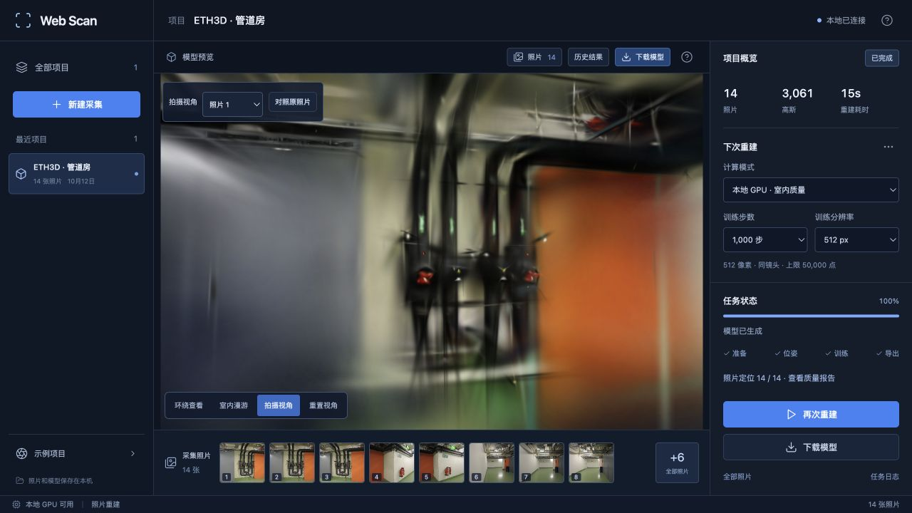

# 迭代记录

每轮只保留有验证依据的改动，记录速度、画质和代价。公开数据集基准沿用 ETH3D office / pipes；实验日志和模型保存在本机，公开报告保留配置、摘要和必要截图。

## 2026-10-13：训练进度与中间导出

此次实验采用真实日志进度和成功后的中间文件清理。两组基线产物的留存占用减少约 82%，最终模型字节不变。加速实验未通过画质检查，没有调整默认训练导出频率。

问题：旧版每 500 步生成一份完整 PLY，页面再根据文件名估算训练进度。应用并不支持从这些 PLY 恢复优化器状态，任务失败后仍需重新训练。训练越长，重复序列化和存储开销越大。

参考固定版本的 [Brush 0.3.0 训练循环](https://github.com/ArthurBrussee/brush/blob/v0.3.0/crates/brush-process/src/train_stream.rs) 和 [CLI 进度事件](https://github.com/ArthurBrussee/brush/blob/v0.3.0/crates/brush-cli/src/lib.rs)：训练会记录真实 refinement 步数，最终一步会导出模型。此次只调整应用适配器，不修改 Brush 算法、损失、相机或数据。

先实验“只在最后导出 PLY”。pipes 这次耗时从 334.215 秒到 322.119 秒，但平均评测 PSNR 从 18.549 降到 16.600，SSIM 从 0.78584 降到 0.77279。输入摘要、相机、配置、种子和评估照片一致，仍不能通过画质检查，因此不将这个导出策略设为默认。

日志在第 101 步（首次第 500 步导出之前）就出现不同高斯数量：旧版 2020，新版 2015。它说明这两次运行在第一次导出前已经不完全一致，不能凭一次比较把质量下降全归因于导出策略。也不能反过来用“只是随机波动”忽略退化。完整对照继续保留，后续需要重复试验定位训练不稳定来源。

进一步检查 [Brush 0.3.0 SceneLoader](https://github.com/ArthurBrussee/brush/blob/v0.3.0/crates/brush-dataset/src/scene_loader.rs)：多个异步加载任务各自按种子洗牌，然后把图像送入同一个通道，训练按到达顺序取图。由源码推断，线程调度和加载耗时可能使实际训练视图顺序随运行变化；固定随机种子不等于固定全局输入次序。该实验未插桩记录逐步图像序列，因此它是有源码依据的候选原因，尚未证明是唯一根因。

最终改动保留每 500 步导出的训练调用方式，进度改为增量读取真实日志。单次最多读取 64 KiB，不按时间推算虚假步数。训练完成、最终 PLY 验证和转换成功后，只清理这次新任务产生的较早 PLY；最终 PLY、评估图片、下载产物、原始照片和以前的任务保持完整。清理失败会留存文件并记录，不导致有效模型丢失。

这能提前反馈训练进度、减少任务结束后的存储占用，没有证据说明最终采用的方案提高了训练速度。

环境：Apple M5、32 GiB 内存、macOS、Brush 0.3.0（Metal），固定随机种子 42。

验证方案：关闭网页模型渲染，串行使用本机 GPU；每组固定相机、照片、6000 步、1024 像素、15 万高斯预算和留出评估集。pipes 按旧版 → 新版运行，office 按新版 → 旧版运行。评估留出照片参与过 SfM，不是完全独立的端到端测试。此次测量包含训练、评估及导出，不包含 SfM 和输入复制。

单次每场景对照只能说明此次实验表现，不能将小幅时间差当作稳定加速。完整结果、逐视角评分与资源占用记录如下。

### 四次长训练结果（未采用的最终一次导出策略）

| 场景 | 原策略耗时 → 实验策略耗时 | 平均 PSNR → 实验策略 | 平均 SSIM → 实验策略 | PLY 写出量 |
| --- | --- | --- | --- | --- |
| pipes | 334.22 → 322.12 秒 | 18.549 → 16.600 | 0.78584 → 0.77279 | 93.94 → 17.58 MiB |
| office | 305.08 → 301.03 秒 | 21.028 → 21.382 | 0.89504 → 0.89380 | 95.46 → 16.77 MiB |

表中质量指标来自 Brush 同一分辨率的评估；[逐视角复核](benchmarks/export-comparison.json)另用统一 1024 长边的 RGB PSNR 与 Gaussian-window SSIM 重新评分，指标实现不同，数值不与 Brush 混用。pipes 的退化在复核中同样存在。只有每场景一次 AB/BA，时间差为 1.3%–3.6%，不足以声称稳定加速。

[原始测量](benchmarks/export-runs.json)包含相同输入摘要和适配器版本摘要；[未采用策略补丁](benchmarks/export-final-only.patch)用于复现实验，不是当前默认代码。

### 最终版本的留存空间

对这两次真实基线任务的导出文件各复制一份，再运行最终版本的清理函数：pipes 从 98,503,992 字节降到 18,121,630 字节（减少 81.60%），office 从 100,096,757 字节降到 17,301,294 字节（减少 82.72%）。每组由 12 份 PLY 留存为 1 份，最终 PLY 清理前后的 SHA-256 完全相同。这是训练完成后的存储节省，不减少训练期间写盘量，也不是速度收益。[校验记录](benchmarks/export-retention.json)

### 最终版本验收

临时数据目录中通过真实 API 创建 1000 步 / 512 像素的 GPU 任务，页面实际显示了训练步数与高斯数。记录显示第 101 步、约 2 秒时尚未生成 PLY，进度已经更新。任务 15.17 秒完成，写出 2 份 PLY 共 1,308,414 字节，校验最终模型后删除较早一份，留存 723,945 字节。下载字节与最终产物完全一致。此短任务用于功能验收，不代表精细重建的画质或性能。

[API 验收记录](benchmarks/export-api-smoke.json)保留实际状态变化；下面是该短任务完成后的截图。



Python 42 项测试通过。旧任务、原照片和已有模型不受清理影响。正式服务保持可用，临时验收服务在结束后关闭。

后续候选：先检查性能 profile 与真实误差，再评估增点预算、视图覆盖和曝光校正。先验证并发图像加载的输入顺序与训练结果波动，再继续测试速度收益。更换算法或训练器时保留同条件基线，不直接套用另一硬件或另一数据集的结论。


### 复现导出策略实验

先准备两组已完成 SfM 的任务，关闭模型查看器，确保没有其他重建正在运行。在项目目录执行：

```bash
mkdir -p .qa/export-study
git show ef8165f:webscan/brush.py > .qa/export-study/baseline.py
cp .qa/export-study/baseline.py .qa/export-study/candidate.py
patch .qa/export-study/candidate.py < docs/benchmarks/export-final-only.patch
# 以上只生成实验文件；当前默认版保留周期导出。
.venv/bin/python scripts/benchmark_exports.py --repo . \
  --baseline .qa/export-study/baseline.py --candidate .qa/export-study/candidate.py \
  --jobs PIPES_JOB OFFICE_JOB --output .qa/export-study/runs
```

脚本保存输入 SHA-256、训练器与适配器摘要、逐次配置、首个进度更新时间、评估指标和 PLY 占用。每组输入严格一致，执行顺序按场景交错。原始训练日志与评估图片在指定输出目录内，输出目录必须不存在，以免覆写旧实验。

截图中包含 ETH3D pipes 数据的重建结果，沿用 [ETH3D 数据许可与署名](../THIRD_PARTY_NOTICES.md#test-dataset)。


## 2026-10-13：查看器按需绘制

静止模型和原照片对照不再持续提交 WebGL 绘制；相机操作、窗口尺寸和 Spark 异步排序变化时才更新。管道房静止观察 75 秒、原照片对照观察 105 秒，绘制计数均没有增加，拖动后可正常更新。相同视角的模型区域截图逐像素一致。前端 18 项测试及两组真实照片的短训练回归通过。该变更减少闲置绘制，不改变训练方法；数据和适用范围见 [查看器实测](VIEWER-PERFORMANCE.md)。


## 2026-10-14：评测结果完整性

修复评测失败仍被当作成功、两份结果同时缺图仍参与评分的问题。发布前核对最终步数、预期视图、PNG 解码与尺寸、指标有效性；对照时校验参考照片及已保存的图像摘要。失败时保留原始 PLY，正常的全照片训练不受留出评测要求影响。57 项测试和三次真实数据训练通过，历史有效成绩保持一致。[验证记录](EVALUATION.md)


## 2026-10-14：重复增点策略实验

固定相机、3000 步、512 像素和 15 万高斯预算，对 100 / 50 步增点间隔分别做两次重复，共八次真实训练。更密集的增点使高斯数量增加约 5–7 倍、耗时增加约 39%，两组场景未同时获得稳定画质收益，因此默认策略保持不变。[完整记录](REFINEMENT.md)

基准脚本支持重复次数和分辨率选项、交错运行顺序、适配器快照与均值/范围汇总。缺少运行、重复记录、输入或评测划分不一致、非有限指标都会拒绝汇总，避免单次偶然结果成为默认参数的依据。
