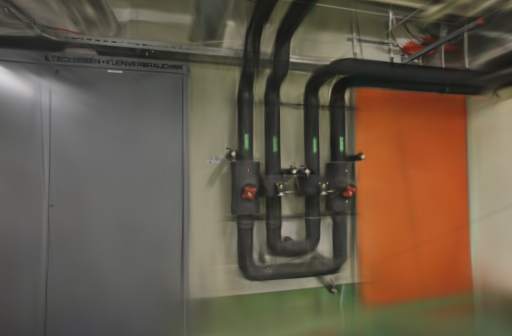
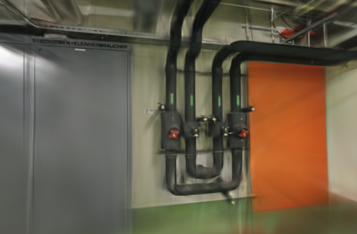
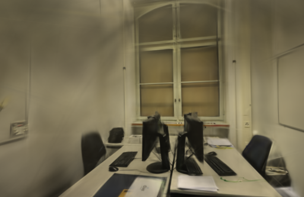
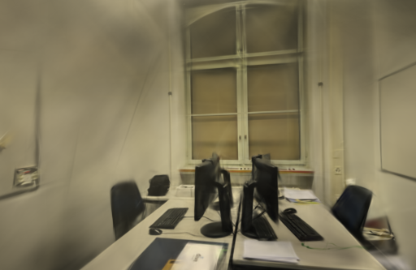

# 读图顺序实验

2026-10-21。将 Brush 的图像生产任务从本机的 10 个减少到 1 个后，两场景各两次训练收到的完整照片序列一致。但模型仍有变化，平均 PSNR 下降，**没有替换正式训练器或修改默认设置**。

## 测试范围

上一轮检查发现，Brush 0.3.0 的[图像加载器](https://github.com/ArthurBrussee/brush/blob/3edecbb2fe79d3e2c87eeab85b15e0b1dd10d486/crates/brush-dataset/src/scene_loader.rs)使用多个独立洗牌的生产任务，共用接收队列；CLI 种子不能固定它们的完成先后。本轮只检验减少到一个生产任务的效果，未调整增点采样、学习率或损失函数。

基于 Brush `v0.3.0` / `3edecbb2fe79d3e2c87eeab85b15e0b1dd10d486` 做了独立源码构建。实验补丁增加两个环境开关：

- `WEBSCAN_SINGLE_LOADER=1`：使用一个图像生产任务；`0` 保留原有数量，本机为 10。
- `WEBSCAN_TRACE_LOADER=1`：在训练消费者真正取到图片时记录步号和照片名，不把预加载入队顺序当作消费顺序。

两个设置使用**同一个带追踪的二进制**，都开启日志，避免把编译器、编译选项或日志开销混入前后对照。版本标为 `0.3.0-loader-study`，摘要见[构建与实验数据](benchmarks/loader-order.json)。正式安装的官方二进制未替换。

减少生产任务同时改变了多个洗牌序列混合后的采样顺序，不能把它解释为只减少解码并发。原有加权高斯采样仍未统一使用 CLI 种子；即使图片顺序相同，也不能据此承诺训练完全确定。

## 配置与验证方法

Apple M5 / 32 GiB，Metal，Rust / Cargo 1.99.0。保留上游 `Cargo.lock`，以 `cargo build --locked --release --bin brush_app -j 4` 构建。首次依赖获取及未修改源码构建共 14 分 18 秒，补丁增量构建 1 分 38 秒；这些是开发准备成本，不计入模型训练时间。补丁仍遵循 Brush 的 Apache-2.0 许可。

先做两次 500 步验收，确认 10 / 1 个生产任务、500 条完整消费记录、Metal 设备、SH3 与评估输出正常。随后正式比较两场景、两设置、各两次，共八次真实训练；验收运行不计入正式均值。

| 条件 | pipes | office |
| --- | --- | --- |
| 输入 / 定位 | 14 / 14 | 26 / 26 |
| 未定位照片 | 无 | 无 |
| 训练 / 评估 | 12 / 2 | 22 / 4 |
| 相机 | 复用 10 月 12 日同镜头几何 | 复用 10 月 12 日同镜头几何 |
| 步数 / 长边 | 3000 / 512 px | 3000 / 512 px |
| 高斯上限 / 颜色 | 150,000 / SH3 | 150,000 / SH3 |

种子 42，每 100 步增点，80% 步数后停止增长，每 500 步导出，每 8 张留出一张。每场景的相机 JSON、稀疏文件、训练照片和评估参考图摘要相同。GPU 串行运行，pipes 顺序为多 / 单 / 单 / 多，office 相反；浏览器停在项目列表，结束计时后才查看模型。

本轮测量训练、评估和导出，未重算 SfM，也未测新的 API 端到端耗时。系统与驱动缓存未清空，正式运行前已有验收任务，属于复用几何和已预热环境下的训练对照。没有测峰值内存。

## 顺序稳定，模型仍不确定

八次正式运行共校验 24,000 条实际消费记录，每次步号完整覆盖 0–2999。摘要按训练收到的照片名顺序计算，排除每次工作目录路径的差异。

| 场景 | 生产任务 | 两次照片序列数 | 两次模型文件数 | 每张训练照片被使用次数 |
| --- | ---: | ---: | ---: | --- |
| pipes | 10 | 2 | 2 | 首次 249–252，第二次 249–251 |
| pipes | 1 | 1 | 2 | 两次均每张 250 |
| office | 10 | 2 | 2 | 首次 132–139，第二次 133–138 |
| office | 1 | 1 | 2 | 两次均每张 136–137 |

候选的完整照片序列两次一致；实际高斯数、模型摘要和评估图片仍不同。这说明单独固定读图顺序不够，本轮没有测出其它随机来源各自贡献了多少变化。

## 同相机评分

使用 `compare_quality.py`，统一到长边 512、相同相机和画幅，以全图 RGB PSNR 和 11×11 Gaussian-window SSIM 按视角等权平均。评估照片参与过上游 SfM，这不是完全独立的端到端留出成绩。

| 场景 | 重复 | 生产任务 | 训练与导出 | 实际高斯 | PLY 字节 | PSNR / SSIM |
| --- | ---: | ---: | ---: | ---: | ---: | --- |
| pipes | 1 | 10 | 24.27 s | 11,551 | 2,727,586 | 17.4499 / 0.73644 |
| pipes | 1 | 1 | 24.28 s | 11,723 | 2,768,178 | 17.2577 / 0.72689 |
| pipes | 2 | 10 | 23.26 s | 11,690 | 2,760,390 | 18.5982 / 0.73411 |
| pipes | 2 | 1 | 24.25 s | 11,333 | 2,676,138 | 17.1142 / 0.71765 |
| office | 1 | 10 | 24.26 s | 14,098 | 3,328,678 | 20.0302 / 0.85094 |
| office | 1 | 1 | 24.28 s | 14,561 | 3,437,946 | 19.6478 / 0.84892 |
| office | 2 | 10 | 24.27 s | 14,206 | 3,354,166 | 20.9130 / 0.85678 |
| office | 2 | 1 | 24.24 s | 14,457 | 3,413,402 | 19.8463 / 0.85824 |

平均 PSNR：pipes **18.0240 → 17.1860**，office **20.4716 → 19.7471**。平均 SSIM 分别为 **0.73527 → 0.72227**、**0.85386 → 0.85358**。候选没有通过画质要求，停止扩展到默认 6000 步 / 1024 像素。

平均训练与导出时间：pipes 23.77 → 24.26 秒，office 24.27 → 24.26 秒；适配器一秒轮询粒度、实际点数变化和两次重复的数量都限制了速度判断。这里没有建立提速结论，也不把两次结果的范围当作可靠的总体方差估计。

## 原始输出与漫游

下面固定展示首次重复的第一个评估视角，左右相机、画幅一致，PNG 原样保存。所有视角和两次重复的分数、图片摘要均在[完整数据](benchmarks/loader-order.json)中。

| 场景 | 多生产任务 | 单生产任务 |
| --- | --- | --- |
| pipes |  |  |
| office |  |  |

浏览器加载两场景的基线与候选，并分别拖动候选进行漫游；控制台无错误或警告。管线边缘、桌面线缆仍模糊，转向未充分覆盖的区域仍有拉丝、漂浮物和缺失细节，没有确认出漫游质量收益。

## 决定与复现

保留实验补丁和追踪方法用于继续定位问题，**不将单生产任务用作正式默认值**。本次没有修改应用源码、默认训练器、原照片或历史模型；不为相同应用代码重复跑本地前后端构建，提交后由 CI 执行标准回归。下一步应在固定读图顺序的实验版本中单独固定加权高斯采样，再检查剩余波动，避免继续用不稳定的单次结果判断参数。

实验基础为 Web Scan [0197599](https://github.com/sakorman/web-scan/commit/0197599)。源码构建可以复现如下；已有目录不要覆盖，按需另取名称：

```bash
git clone --depth 1 --branch v0.3.0 https://github.com/ArthurBrussee/brush.git .tools/brush-order-study
git -C .tools/brush-order-study rev-parse HEAD
# 应为 3edecbb2fe79d3e2c87eeab85b15e0b1dd10d486
git -C .tools/brush-order-study apply ../../docs/benchmarks/loader-order.patch
cargo build --manifest-path .tools/brush-order-study/Cargo.toml --locked --release --bin brush_app -j 4
.tools/brush-order-study/target/release/brush_app --version
```

补丁同时修改 CLI 版本标记和加载器，见 [loader-order.patch](benchmarks/loader-order.patch)。运行时在同一个实验二进制上分别设置 `WEBSCAN_TRACE_LOADER=1 WEBSCAN_SINGLE_LOADER=0` 与 `WEBSCAN_TRACE_LOADER=1 WEBSCAN_SINGLE_LOADER=1`，其它 CLI 参数完全相同。保留输出中 `WS_LOADER` 和 `WS_ORDER` 记录，并先确认实际设备为 Metal。

本机完整实验位于 `.data/benchmarks/loader-order-20261021/`：`baseline.py` / `candidate.py` 是只差生产任务开关的适配器快照，`benchmark.py` 沿用 `scripts/benchmark_exports.py`，仅将二进制路径改为上述源码构建产物。命令使用 `--steps 3000 --resolution 512 --repeats 2` 与已完成定位的 pipes / office 任务；`analyze.py` 校验消费序列和完整模型，再进行同相机评分。保留了构建日志、锁文件摘要、两个二进制摘要、全部模型与消费序列，未提交大体积二进制。

补丁衍生自 Arthur Brussee 及 Brush 贡献者的 Apache-2.0 代码，许可和修改说明见[第三方声明](../THIRD_PARTY_NOTICES.md#brush-loading-experiment)。照片与衍生渲染遵循 [ETH3D 署名及 CC BY-NC-SA 4.0 许可](../THIRD_PARTY_NOTICES.md#test-dataset)。

后续实测：固定加权采样种子仍不足以固定模型；同一个初始点集合的容器遍历顺序和首次采样权重已经不同。[采样与初始化追踪](SAMPLING-SEED.md)
