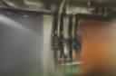
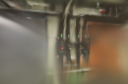
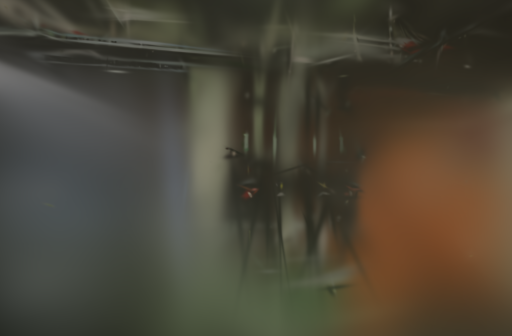
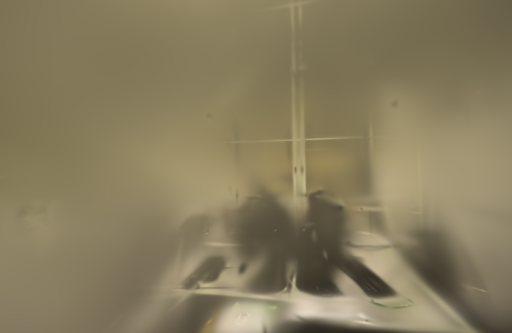

# 冻结 LPIPS 预训练参数

2026-10-26。冻结预训练网络参数后，LPIPS在512像素的pipes和office上都完成了500步重建；此前pipes会在反向阶段因约7.80GB缓冲申请失败。128像素下，同样启用LPIPS的前后对照平均耗时从56.43秒降至37.33秒，减少约34%。画质均值没有提高，512像素仍很慢，默认LPIPS继续关闭。

问题在于Brush加载VGG与评分层后仍为这些参数保留梯度。3DGS优化器没有更新感知网络，却计算了它的权重反向。实验构建改为加载后冻结参数，同时保留预测图像的梯度。

## 原因与改动

[LPIPS官方VGG实现](https://github.com/richzhang/PerceptualSimilarity/blob/082bb24f84c091ea94de2867d34c4544f68e0963/lpips/pretrained_networks.py)默认冻结特征网络。[LPIPS论文](https://arxiv.org/abs/1801.03924)中的预训练网络在这里作为固定度量，待优化的是三维高斯生成的图像。

回归在原加载器中发现18组权重张量需要梯度。锁定版本的[Burn卷积反向](https://github.com/tracel-ai/burn/blob/dd2a02905ea4a29ce2100e432e49d63b365546ab/crates/burn-autodiff/src/ops/module.rs)在权重需要梯度时执行额外的 `conv2d_weight_backward`。本轮在 `load_vgg_lpips` 完成权重加载后调用模块的 `no_grad()`，冻结这18组权重及13组偏置；没有关闭整个损失的自动微分，也没有改变预测图的梯度路径。

VGG结构、评分层、LPIPS权重0.01和原有SSIM / L1组合均保持一致。内置权重文件29,433,386字节，SHA-256为 `abb257f9aa223154f3ed476674dbfc0b6daee5b2e07618bd208918ee9600e2e7`，本轮未改动。图像仍使用NHWC布局，顺便更正了函数注释里写成NCHW的错误。

## 回归检查

先加入参数检查，旧实现报告18组权重可求导，测试失败。冻结后，18组权重及13组偏置均不生成梯度。进一步将同一组预训练参数临时设为可求导，与冻结版本比较：

| 预测输入偏移 | LPIPS分数绝对差 | 预测梯度最大绝对差 |
| --- | ---: | ---: |
| 0.3 | 0 | 1.74623e-10 |
| 0.7 | 0 | 1.45519e-10 |

输入形状为1×32×48×3，两个预测图各自反向求导；预测梯度有限且非零，参考图没有梯度。原有apple / pear评分回归也通过，共3项GPU测试。这里只证明所测输入上的等价性，不保证完整GPU训练逐位一致。

## 真实照片对照

两种引擎均启用LPIPS 0.01；基线使用上一轮保存的、网络参数可求导的二进制，候选冻结网络。两者都包含此前的CubeCL尾部修复，其余实验开关一致，参考统计与图像缓存均关闭。

pipes使用14张已定位照片，12张训练、2张留出；office为26张全部定位、22张训练、4张留出，没有未定位照片。使用同镜头固定几何，种子42，500步、15万高斯预算、完整SH3，每100步增点，第400步结束增长，第500步导出和评估。

128像素对照只使用pipes，原生128×84，按旧、新、新、旧顺序串行执行。512像素分别测试pipes的512×336和office的512×333。照片、内参及位姿不变，未填充或裁切图像。每8张留出一张，留出照片参与过SfM；没有重新计时SfM或API端到端流程。

计时含每次加载权重、内核调优、训练、评估和模型导出，不含编译与输入复制。每次是新进程，未清空操作系统、驱动及调优缓存。128对照按128长边评分，512输出按512长边评分；使用RGB PSNR与11×11 Gaussian-window SSIM，按留出视角等权平均，不跨分辨率比较质量。

| 场景 / 尺寸 | 重复 | 网络参数 | 耗时 | 实际高斯 | PLY字节 | PSNR / SSIM |
| --- | ---: | --- | ---: | ---: | ---: | --- |
| pipes / 128×84 | 1 | 求导 | 56.4864 s | 2,307 | 546,001 | 16.9302 / 0.59794 |
| pipes / 128×84 | 1 | 冻结 | 38.3272 s | 2,300 | 544,349 | 17.7523 / 0.59270 |
| pipes / 128×84 | 2 | 求导 | 56.3790 s | 2,306 | 545,765 | 17.5579 / 0.60849 |
| pipes / 128×84 | 2 | 冻结 | 36.3320 s | 2,318 | 548,597 | 15.8060 / 0.56399 |
| pipes / 512×336 | 1 | 冻结 | 358.0272 s | 2,321 | 549,305 | 14.3263 / 0.61397 |
| office / 512×333 | 1 | 冻结 | 333.0836 s | 3,067 | 725,361 | 17.2436 / 0.73637 |

128像素平均PSNR 17.2440 → 16.7792，SSIM 0.60322 → 0.57834，均下降。模型仍有明显运行波动，实际高斯数也不完全相同；这次不能宣称同画质提速，更不能用小图组件的数值一致推断整个训练确定。

128像素的旧路径没有新增调优日志，首次候选有6条，第二次候选为0条；两次候选均较快。512像素两次运行分别记录18 / 9条调优日志，耗时包含这些成本。旧512 LPIPS没有成功模型，本轮只复用其失败证据，没有再次触发相同的大缓冲申请，也没有伪造前后PSNR差。新旧pipes输入逐字节核对一致。

此前的 `BufferTooBig(7795113984)` 是失败的单次申请，不是测量到的峰值内存。冻结参数后所测512任务成功，说明无需先降低照片分辨率或分块就能解决这条失败路径；并不意味着所有分辨率都不会有内存问题。本轮没有峰值内存数据，不能量化节省多少显存。

## 输出与取舍

六个模型、14张留出渲染及3,000条消费记录校验通过。浏览器加载128基线、128候选及两个512候选，切换三个候选到室内漫游并拖动，控制台无错误或警告。500步模型仍非常模糊，细管、阀门和窗框缺失或拉长，覆盖之外有空洞、漂浮片段，没有确认漫游画质改善。

以下为首次重复的第一个留出视角，直接复制原生PNG，未重采样或修图。128两图相机与画幅相同；512图只展示成功输出。

| pipes / 128：参数求导 | pipes / 128：参数冻结 |
| --- | --- |
|  |  |

| pipes / 512：参数冻结 | office / 512：参数冻结 |
| --- | --- |
|  |  |

保留冻结参数的实验修复。它消除了无需计算的网络梯度，让此前失败的512任务可完成；成本仍为每500步约5.6～6分钟，且没有验证最终感知质量。下一步用这个可运行路径建立与默认SSIM / L1的同分辨率对照，并加入感知评分，暂不扩大步数或启用默认LPIPS。

## 复现

项目基线为[c7d2a2b](https://github.com/sakorman/web-scan/commit/c7d2a2b)。这是针对已有尾部修复实验的增量补丁。先按[尾部修复依赖说明](SSIM-TAIL-DEFAULT.md#依赖和复现)准备Brush `3edecbb2`与CubeCL `43580a8`，应用四个对应补丁，再应用[lpips-frozen.patch](benchmarks/lpips-frozen.patch)。该增量只修改LPIPS加载器、回归测试和实验版本标签，不能单独代替此前的完整源码补丁。在干净源码副本中已验证整个补丁组合与实际构建的源码及锁文件一致。

```bash
git -C .tools/brush-order-study apply ../../docs/benchmarks/lpips-frozen.patch
cargo test --manifest-path .tools/brush-order-study/Cargo.toml --locked --release \
  -p lpips -- --nocapture --test-threads 1
cargo build --manifest-path .tools/brush-order-study/Cargo.toml --locked --release \
  --bin brush_app -j 4
```

两组都传入 `--lpips-loss-weight 0.01 --seed 42 --total-steps 500 --max-splats 150000 --refine-every 100 --growth-stop-iter 400 --export-every 500 --eval-split-every 8 --eval-every 500 --eval-save-to-disk`，分辨率单独设置128或512，输出目录独立。保存的二进制、补丁、Cargo.lock与权重摘要见[公开JSON](benchmarks/lpips-frozen.json)。

应用源码没有改变，正式Brush仍为官方安装版本，默认LPIPS权重仍为0。标准CI检查应用后端、前端、类型和构建；独立Brush补丁由上述本机GPU测试与真实照片重建验证。补丁保留[Brush Apache-2.0许可](../THIRD_PARTY_NOTICES.md#brush-loading-experiment)，照片及渲染保留ETH3D的署名和CC BY-NC-SA 4.0许可；没有复制LPIPS官方仓库的代码或分发网络权重。
