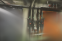
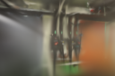

# LPIPS 低分辨率资源边界

2026-10-26补充：[冻结LPIPS预训练参数](LPIPS-FROZEN.md)后可完成512像素任务，原先优先降分辨率或分块的建议已被进一步定位。下面保留旧加载器的结果；该表采用当时的512长边重采样评分，新实验按128原生尺寸评分，两组分数不混算。

2026-10-25。512像素启用LPIPS时，Metal反向阶段申请约7.80GB缓冲并失败。本轮将目标长边降到128像素，验证是否能绕过峰值限制。结果：LPIPS路径可以完成，但pipes 500步平均耗时约72.0秒，默认路径约2.1秒；PSNR下降0.450 dB，SSIM下降0.00366。低分辨率模型也明显粗糙，因此不进入默认流程。

## 实验条件

同一CubeCL尾部修复二进制、同一pipes照片和相机、500步、128目标长边、15万高斯预算、SH3、留出每8张一张、种子42。只切换 `--lpips-loss-weight 0` 与 `0.01`，各重复两次，GPU串行。没有新SfM或API端到端计时。

| 设置 | 平均耗时 | 平均高斯 | PSNR | SSIM |
| --- | ---: | ---: | ---: | ---: |
| LPIPS 0 | 2.110 s | 2,294 | 17.1613 | 0.63114 |
| LPIPS 0.01 | 71.991 s | 2,307 | 16.7118 | 0.62747 |

四次运行全部完成并导出完整SH3。低分辨率指标仅用于资源边界观察，不与默认512 / 1024质量结果横向比较，也不能说明LPIPS在高分辨率会降低画质。

## 结论

降低分辨率可以避免512像素下的 `BufferTooBig(7795113984)`，但代价约34倍训练耗时，且这个低分辨率试验没有质量收益。正式质量档不启用LPIPS。要继续利用感知损失，需要分块提取VGG特征、控制中间激活峰值或换用专门的Metal实现，再在512 / 1024固定画幅上重新评估。

近期[Apple感知优化研究](https://machinelearning.apple.com/research/drop-in)和[TurboGS](https://proceedings.mlr.press/v306/dong26k.html)的WD-R、结构感知损失与稀疏监督均未移植。本轮只验证项目已有LPIPS模块的可运行边界，没有把论文结果换算成本机指标。

| 设置 | 原生评估图 |
| --- | --- |
| LPIPS 0 |  |
| LPIPS 0.01 |  |

两个模型都在浏览器中加载，候选拖动进入室内漫游，控制台无错误或警告。原始记录和尺寸、点数、PLY摘要见[公开JSON](benchmarks/lpips-lowres.json)。
