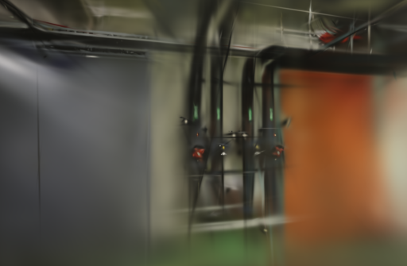

# 固定映射种子的代价

2026-10-20。测试为 COLMAP 增量映射设置固定种子 42。两组场景的重复相机与稀疏模型结果一致，但 office 的 SfM 平均耗时由 8.60 秒增至 12.26 秒，且没有建立同相机条件下的画质收益，因此本轮不修改默认配置。

## 实验范围

沿用已固定图像编号与两视图验证种子的版本，只在 `incremental_mapping` 的顶层 options 增加 `random_seed=42`。从 [COLMAP 3.13.0 的选项传递](https://github.com/colmap/colmap/blob/3.13.0/src/colmap/controllers/incremental_pipeline.cc)可以确认，这个设置同时作用于 Mapper 和 Triangulator；[绝对位姿估计](https://github.com/colmap/colmap/blob/3.13.0/src/colmap/sfm/incremental_mapper.cc)使用它设置随机采样。不能把本轮结果全部归因于单个 PnP 或三角化步骤。

没有调种子选成绩。42 在实验开始前固定，其他特征、匹配、相机和训练设置保持原样。实验文件位于独立目录，正式源码始终未修改。

## 十二次 SfM

Apple M5 / 32 GiB，PyCOLMAP 3.13.0，4 线程。ETH3D pipes 14 张、office 26 张，自动相机模式。每组原版和候选各三次，共十二次完整 SfM，使用相同输入目录、新数据库，顺序交错。所有运行的图像 ID、关键点、描述子及完整两视图几何在同场景内一致。

| 场景 | Mapper 种子 | 定位数（各三次） | 相机结果数 | 稀疏文件结果数 | SfM 均值 / 范围 | 稀疏点 |
| --- | --- | --- | ---: | ---: | --- | --- |
| pipes | 默认 -1 | 14 / 14 / 14 | 1 | 1 | 5.74 s / 5.63–5.95 s | 1,874 |
| pipes | 42 | 14 / 14 / 14 | 1 | 1 | 5.62 s / 5.60–5.66 s | 1,873 |
| office | 默认 -1 | 26 / 26 / 26 | 2 | 2 | 8.60 s / 8.54–8.70 s | 2,495 / 2,511 / 2,495 |
| office | 42 | 26 / 26 / 26 | 1 | 1 | 12.26 s / 12.19–12.29 s | 2,187 |

没有失败定位视角。相机摘要包含每张照片的内参与归一化位姿；稀疏文件摘要覆盖去畸变输出下全部 `.bin` 文件。候选在本机两场景各三次的这些摘要完全相同，跨硬件、跨版本的一致性仍未验证。

office 的完整 SfM 平均增加约 42.6%，新增约 3.66 秒，三次范围没有与基线重叠；其最终稀疏点也更少。重投影误差约 0.9017 px，基线约 0.9041–0.9474 px。点数与重投影误差的变化都不足以单独证明重建画质更好。

时间包含特征、匹配、映射和去畸变，不含 GPU 训练。每次数据库全新，但操作系统缓存未清空；本表只反映这些输入在本机的重复结果。[完整配置、摘要与时间](benchmarks/mapper-seed.json)

## 四次 GPU 验收

每场景取第一次原版和候选位姿各训练一次，使用相同 Brush 0.3.0 / Metal、1000 步、512 像素长边、5 万高斯预算和留出模式。GPU 串行执行，浏览器停在项目列表。训练/评估分别为 pipes 12/2、office 22/4，均通过完整 SH3 和评估输出校验。

| 场景 | Mapper 种子 | 训练与导出 | SfM + 训练分阶段合计 | 实际高斯 | PLY 字节 | PSNR / SSIM |
| --- | --- | ---: | ---: | ---: | ---: | --- |
| pipes | 默认 -1 | 7.07 s | 13.02 s | 3,029 | 716,393 | 18.128 / 0.7088 |
| pipes | 42 | 7.05 s | 12.65 s | 2,953 | 698,457 | 15.583 / 0.6878 |
| office | 默认 -1 | 7.07 s | 15.62 s | 3,921 | 926,905 | 19.707 / 0.8102 |
| office | 42 | 7.08 s | 19.27 s | 3,539 | 836,753 | 18.938 / 0.7838 |

合计为该次 SfM 和后续训练各阶段测量的相加，不是一次 API 端到端计时，未包含导入、复制或下载。两组设置分别重新校准，内参、位姿与去畸变参考图不同；上述单次分数只记录流程结果，不能当作严格同相机画质对照，也不能把下降全部归因于种子。评估照片参与过 SfM。

以下为候选的首个评估视角，均为训练器直接保存的 512 像素输出，未与另一个相机解强行拼成“前后提升”图。

浏览器实际加载两个候选模型，并在 pipes 拖动漫游，控制台没有错误。管线、阀门和桌面边缘仍模糊，离开采集轨迹仍能看到拉丝与不完整区域；未观察到足以抵消额外计算成本的明确收益。

## 决定与复现

不把这个固定 Mapper 种子设为默认。它适合需要固定本机几何的专项实验，但本次对照显示 office 成本显著增加，尚缺少同条件的质量收益证据。保留已验证的图像顺序和两视图采样设置；后续继续检查相机约束、采集覆盖和训练图像调度。

本轮仅提交实验记录和补丁，没有修改生产代码，也不为相同代码重复跑本地前后端构建。已有照片、模型、缓存和历史任务保持完整，远程 CI 随记录提交执行常规回归。

实验在 `.data/benchmarks/mapper-seed-20261020/`，包含 baseline / candidate 快照、十二个 SfM 目录和四个训练目录。复现时用 `git show 43d5895:webscan/reconstruction.py` 获取基线，在候选文件应用 [单项参数补丁](benchmarks/mapper-seed.patch)。按 [SfM 重复实验方法](SFM-ORDER.md#验证与复现)，对同一输入分别启动新进程和新目录，不复用数据库。训练可调用现有 Brush 适配器，使用对应几何与去畸变照片，并保留明确的计时范围。

照片与衍生模型遵循 [ETH3D 许可和署名](../THIRD_PARTY_NOTICES.md#test-dataset)。
