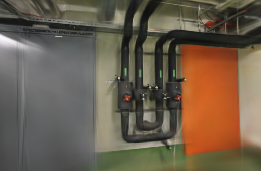
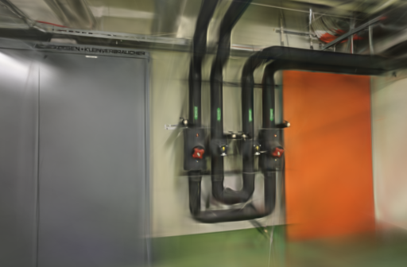
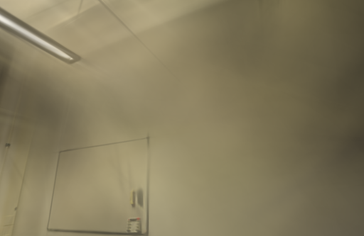
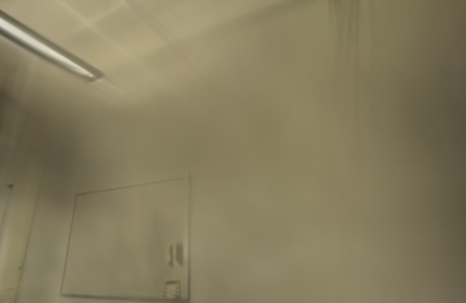

# 低透明度均值噪声筛查

2026-10-27。Brush 0.3.0 会对低透明度高斯的均值加入随机扰动，默认权重为 `40`。为了判断这是否会在室内反光边缘造成不必要的漂浮，本轮固定相机、照片和训练预算，只把 `--mean-noise-weight` 降为 `20`。pipes 变好而 office 变差，默认仍使用 `40`。

## 假设与固定条件

Brush 将该选项定义为低透明度高斯均值的噪声量。上游后续曾专门将噪声保留至训练末尾，说明它会参与稳定的增点过程；因此本轮只做减半筛查，不把它视作可随意清零的去噪旋钮。

- Apple M5 / 32 GiB / macOS，Brush 0.3.0，二进制 SHA-256 `8380ed40cce870025393e1ea0257e0752351c67a409d827b76dc75ec3a999a71`。
- 两组均为 3,000 步、512 像素长边、150,000 高斯上限、SH3、种子 42、每 100 步细化、第 2,400 步停止增长；只有候选额外传入 `--mean-noise-weight 20`。
- pipes 输入 / 定位为 14 / 14，训练 / 留出为 12 / 2；office 为 26 / 26、22 / 4；没有未定位视角。计时涵盖训练、留出评测和导出，不含 SfM 和输入复制。
- GPU 串行运行：pipes 为基线→候选，office 为候选→基线。两组各只跑一次，用于排除跨场景不稳定的默认参数，不估计一般性收益。

## 结果

两组相机、留出照片、参考摘要与评分尺寸完全一致。pipes 的两个留出视角都提高，但 office 的 4 个视角整体回退；候选只少约 0.4% / 1.9% 的高斯，时间差在轮询精度内，不能构成压缩或加速收益。

| 场景 | 均值噪声 | 训练、评估、导出 | 实际高斯 / PLY | Brush PSNR / SSIM | 统一 512 网格 PSNR / SSIM |
| --- | --- | ---: | ---: | --- | --- |
| pipes | `40` | 23.3030 s | 11,749 / 2,774,314 B | 18.43926 / 0.764643 | 18.29582 / 0.738762 |
| pipes | `20` | 23.2823 s | 11,700 / 2,762,750 B | 19.51032 / 0.782595 | 19.33224 / 0.757037 |
| office | `40` | 23.2953 s | 14,189 / 3,350,154 B | 21.73663 / 0.876984 | 21.58068 / 0.862508 |
| office | `20` | 23.2973 s | 13,913 / 3,285,018 B | 21.15428 / 0.869995 | 21.01122 / 0.855110 |

共同网格上，候选在 pipes 增加 1.03641 dB PSNR、0.018275 SSIM；在 office 降低 0.56947 dB、0.007398 SSIM。局部管线有所收紧，但 office 的大面积墙面和白板边缘更软，不能以单一 pipes 改善替换默认参数。

## 同视角检查

四个输出均通过完整 SH3 PLY 检查。下面固定展示 pipes 的排序首张留出图，以及 office 下降最明显的 `0008` 视角；图像均以原生 512 长边评分，未放大。

| 场景 | 默认 `40` | 候选 `20` |
| --- | --- | --- |
| pipes |  |  |
| office（0008） |  |  |

留出照片参与过上游 SfM，因而不是完全独立的端到端评测；这里也没有深度真值可度量几何误差。上游训练不保证完全确定性，单次配对只足以否决跨场景不稳的默认替换。

## 工件与复现

[公开汇总](benchmarks/mean-noise.json)包含输入摘要、逐次指标、模型大小和评分口径；完整模型、训练日志与评测 PNG 留在 `.data/benchmarks/mean-noise-20261027/`，不纳入仓库。可在固定版本的适配器快照上应用补丁复现：

```bash
git show 0efaaef:webscan/brush.py > /tmp/brush-baseline.py
cp /tmp/brush-baseline.py /tmp/brush-mean-noise.py
patch /tmp/brush-mean-noise.py < docs/benchmarks/mean-noise.patch
.venv/bin/python scripts/benchmark_exports.py --repo . \
  --baseline /tmp/brush-baseline.py --candidate /tmp/brush-mean-noise.py \
  --output .data/benchmarks/mean-noise-repeat \
  --jobs PIPES_JOB OFFICE_JOB --steps 3000 --resolution 512 --repeats 1
```

[Brush 0.3.0 配置](https://github.com/ArthurBrussee/brush/blob/v0.3.0/crates/brush-train/src/config.rs) · [上游保持均值噪声的改动](https://github.com/ArthurBrussee/brush/commit/9fc23abdbdc99cfee1bebb31197d6927a0c89c7c) · [3D Gaussian Splatting](https://arxiv.org/abs/2308.04079) · [ETH3D](https://www.eth3d.net/datasets)
