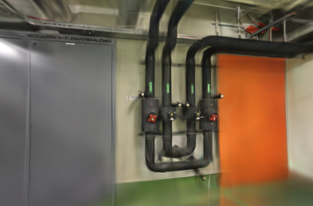
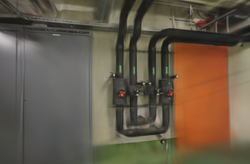
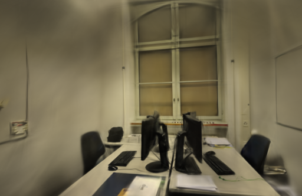
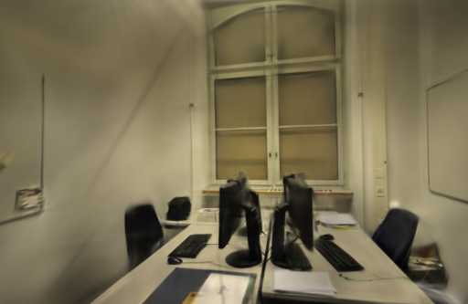

# 透明度正则筛查

2026-10-27。针对室内漫游中偶发的半透明漂浮片段，固定 ETH3D 的相机、照片和留出视角，只把 Brush 的 `--opac-loss-weight` 从默认 `1e-9` 提到 `1e-7`。两组场景的 SSIM 略升，但统一网格的 PSNR 都下降，pipes 的降幅明显；默认训练参数不变。

## 参数含义与固定条件

Brush 0.3.0 将原始 opacity 与可见性权重相乘后求和；不可见高斯仍保留 `1e-3` 的权重，并在前 90% 训练进程内线性衰减该项。本轮的 `1e-7` 是在运行前固定的 100 倍筛查值，不是论文推荐值，也没有继续针对分数调参。

- Apple M5 / 32 GiB / macOS，官方 Brush 0.3.0，二进制 SHA-256 为 `8380ed40cce870025393e1ea0257e0752351c67a409d827b76dc75ec3a999a71`。
- 固定 3,000 步、512 像素长边、150,000 高斯预算、SH3、种子 42、100 步细化和第 2,400 步停止增点。只追加 `--opac-loss-weight 1e-7`。
- pipes 输入 / 定位为 14 / 14，训练 / 留出为 12 / 2；office 为 26 / 26、22 / 4；没有未定位视角。SfM 和输入复制不计入计时。
- 按 pipes 的基线→候选、office 的候选→基线串行运行。每场景只有一组，属于退化筛查，不估计参数的一般收益。

## 结果

训练器留出分数与统一 512 网格复评分一致显示：候选没有通过两场景都不降低 PSNR 的条件。模型和 PLY 变小、耗时变化不足 0.01 秒，均不能视为同画质优化。

| 场景 | 权重 | 训练、评估、导出 | 实际高斯 / PLY | Brush PSNR / SSIM | 统一 512 网格 PSNR / SSIM |
| --- | --- | ---: | ---: | --- | --- |
| pipes | `1e-9` | 24.2145 s | 11,339 / 2,677,554 B | 18.07837 / 0.749314 | 17.92716 / 0.725729 |
| pipes | `1e-7` | 24.2164 s | 10,198 / 2,408,278 B | 17.41064 / 0.754796 | 17.29657 / 0.728620 |
| office | `1e-9` | 25.2149 s | 14,399 / 3,399,714 B | 20.49167 / 0.869188 | 20.36951 / 0.853789 |
| office | `1e-7` | 25.2049 s | 13,432 / 3,171,502 B | 20.46878 / 0.872433 | 20.34438 / 0.858000 |

相对基线，候选的共同网格 PSNR 在 pipes / office 分别下降 0.63059 / 0.02513 dB，SSIM 增加 0.00289 / 0.00421。高斯数分别少 10.06% / 6.72%，但这是正则化改变模型容量的伴随结果，且没有得到相同画质，不能表述为压缩或提速。

## 同视角检查

以下是各场景按文件名排序的第一张留出视角，左右相机、画幅和原生 512 网格相同，均为训练器直接保存的 PNG。pipes 的候选中，管道接头和橙色门板边界更软，未观察到可重复的漂浮物消失；office 的这一视角略有改善，但其余三张留出图有升有降，不能以单张图替代全视角结果。

| 场景 | 默认 `1e-9` | 候选 `1e-7` |
| --- | --- | --- |
| pipes |  |  |
| office |  |  |

四个输出均通过完整 SH3 PLY 检查；`compare_quality.py` 还验证了相机、留出照片和参考摘要完全一致，再以不放大的共同网格复评。评估照片参与过上游 SfM，因此也不是独立的端到端评测。

## 工件与复现

[公开汇总](benchmarks/opacity-loss.json)保存输入摘要、逐次时间、模型大小和所有同视角分数；本机完整模型、日志与 PNG 留在 `.data/benchmarks/opacity-loss-20261027/`，不纳入仓库。可按下面命令复现，`PIPES_JOB` 与 `OFFICE_JOB` 应是已完成定位的任务目录：

```bash
git show fd092ee:webscan/brush.py > /tmp/brush-baseline.py
cp /tmp/brush-baseline.py /tmp/brush-opacity.py
patch /tmp/brush-opacity.py < docs/benchmarks/opacity-loss.patch
.venv/bin/python scripts/benchmark_exports.py --repo . \
  --baseline /tmp/brush-baseline.py --candidate /tmp/brush-opacity.py \
  --output .data/benchmarks/opacity-loss-repeat \
  --jobs PIPES_JOB OFFICE_JOB --steps 3000 --resolution 512 --repeats 1
```

该透明度项属于现有 Brush 训练器，不等同于针对深度或表面的几何约束。近期关于漂浮物的研究通常同时改变训练策略或加入几何监督，不能直接套用到本机 Metal 参数。[Brush 0.3.0 训练实现](https://github.com/ArthurBrussee/brush/blob/v0.3.0/crates/brush-train/src/train.rs#L187-L205) · [Brush 0.3.0 配置](https://github.com/ArthurBrussee/brush/blob/v0.3.0/crates/brush-train/src/config.rs) · [EFA-GS](https://arxiv.org/abs/2508.02493) · [3D Gaussian Splatting](https://arxiv.org/abs/2308.04079) · [ETH3D](https://www.eth3d.net/datasets)
