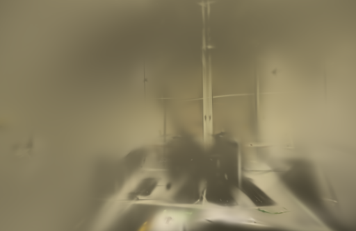

# 留出照片的感知评分

评分尺寸现已限制在双方原生渲染范围内，`--size` 表示请求上限；报告额外记录请求、有效上限及逐视角实际尺寸。[原生尺寸修正](SCORING-SIZE.md)。下文512像素实测重新核对后数值不变。

后续已对[12个6000步模型补充感知评分](PERCEPTUAL-LONG.md)，复用原模型和照片，未重新训练。

2026-10-26。对照脚本新增可选的离线LPIPS评分，读取已有重建的留出图，在相同相机、画幅和尺寸下同时记录PSNR、SSIM及Brush LPIPS-VGG。每张图的处理后摘要、评分器和权重摘要一同保存，缺图或评分不完整时拒绝生成结果。

用这个工具复查500步结果：启用LPIPS训练的pipes / office平均LPIPS分别为0.59806 / 0.48158，默认损失为0.65909 / 0.49388，数值更低。但训练与评分共享同一VGG网络，每种设置只有一次短训练，仍不能确认独立感知质量收益，也不调整默认损失。

## 评分方式

`scripts/compare_quality.py` 先检查完整相机JSON、留出拆分、图像集合、渲染及参考图摘要，再统一到指定长边。PSNR / SSIM和LPIPS使用同一份RGB像素；LPIPS输入保存为临时无损PNG，运行结束或失败时清理。原照片、渲染图和历史模型不改写。

`--lpips-scorer` 指定[独立评分程序](benchmarks/lpips_score.rs)。程序一次加载Brush内置VGG权重，在Wgpu / Metal上依次评分，返回带编号的距离；不重新训练或下载模型。协议检查拒绝缺失、重复、越界编号、非有限值、负距离及无法识别的指标 / 权重身份。结果顺序按编号恢复，避免不同视角的得分被错配。没有这个选项时，只计算PSNR / SSIM。

这里的指标明确标为 **Brush LPIPS-VGG，越低越好**。它使用Brush转换后的半精度存储权重、RGB 0～1输入及模块内的标准化，不与AlexNet、不同权重或不同预处理的LPIPS数字直接混比。[LPIPS官方说明](https://github.com/richzhang/PerceptualSimilarity)区分骨干网络和输入规范；[原论文](https://arxiv.org/abs/1801.03924)为这种感知比较提供依据。

评分程序的真实图像检查得到：自比较约 `4.93e-16`，在 `1e-8` 容差内为零；交换图像后两次均为0.46549854；尺寸不一致明确报错。Python回归检查原指标不变、RGB和尺寸一致、编号还原、各类无效结果以及相机 / 参考图变化时不会启动评分器。共127项后端、18项前端测试通过，类型检查、构建及评分程序release构建通过。

## 两组实拍检查

本轮新跑两次默认SSIM / L1训练，LPIPS权重为0；候选复用[参数冻结实验](LPIPS-FROZEN.md)中已完成的两次LPIPS 0.01训练。两边使用相同二进制 `0.3.0-lpips-frozen-study`、种子42、500步、512目标长边、15万高斯预算、SH3。输入文件、相机和照片消费顺序逐项一致，不增加步数或点数预算。

| 场景 | 输入 / 定位 | 训练 / 留出 | 实际尺寸 | 未定位照片 |
| --- | ---: | ---: | --- | --- |
| ETH3D pipes | 14 / 14 | 12 / 2 | 512×336 | 无 |
| ETH3D office | 26 / 26 | 22 / 4 | 512×333 | 无 |

采用同镜头固定几何，每8张留出一张；留出图参与过SfM。每100步增点，第400步结束增长，第500步导出与评估。评分统一到512长边，使用Lanczos缩放、RGB PSNR及11×11 Gaussian-window SSIM，按视角等权平均。CPU像素评分与GPU感知评分在训练结束后执行；训练与浏览器渲染没有同时占用本任务的GPU。

| 场景 | 训练损失 | PSNR | SSIM | Brush LPIPS-VGG ↓ |
| --- | --- | ---: | ---: | ---: |
| pipes | 默认SSIM / L1 | 14.4115 | 0.60258 | 0.65909 |
| pipes | 加LPIPS 0.01 | 14.3263 | 0.61397 | 0.59806 |
| office | 默认SSIM / L1 | 16.7262 | 0.73370 | 0.49388 |
| office | 加LPIPS 0.01 | 17.2436 | 0.73637 | 0.48158 |

对同一VGG指标的改善是一个线索，不是独立评价。500步模型仍很模糊，pipes的PSNR略降。尚未加入DISTS、人眼偏好测试或多次长期训练；[近期感知优化研究](https://machinelearning.apple.com/research/drop-in)中的WD-R也没有实现。

| 场景 / 损失 | 实际高斯 | PLY字节 | 训练、评估及导出 | 数据来源 |
| --- | ---: | ---: | ---: | --- |
| pipes / 默认 | 2,300 | 544,349 | 4.1537 s | 本轮新跑 |
| pipes / 加LPIPS | 2,321 | 549,305 | 358.0272 s | 复用上一轮 |
| office / 默认 | 3,022 | 714,741 | 4.1300 s | 本轮新跑 |
| office / 加LPIPS | 3,067 | 725,361 | 333.0836 s | 复用上一轮 |

训练成本仍高。上表来自不同时间的运行，不构成交错执行的测速实验，不据此给出精确倍速。没有重测SfM、API端到端或峰值内存；系统和驱动缓存未清空。

评分器本轮处理pipes的4对图约5.46秒，office的8对图约3.43秒，包含模型加载与GPU执行，不含Python准备PNG和读取版本；调优与缓存会影响首轮耗时，这两个数字不作为稳定吞吐基准。六个留出视角、十二对渲染 / 参考图和逐视角得分都保存在[公开JSON](benchmarks/perceptual-eval.json)。

## 图片与浏览器检查

四个模型均完成加载，新跑的两个默认损失模型实际切到室内漫游并拖动，无控制台错误或警告。管线、窗框仍有拉丝，采集覆盖外存在空洞和漂浮片段，没有得出人眼更偏好候选的结论。

以下是同相机首次留出视角的原生PNG。候选图直接引用上一轮已核对的文件，没有重复训练或修图。

| 场景 | 默认损失 | 加LPIPS 0.01 |
| --- | --- | --- |
| pipes |  |  |
| office |  |  |

## 使用方法

先按[冻结LPIPS的复现说明](LPIPS-FROZEN.md#复现)准备Brush源码与依赖。评分器使用现有转换权重，不增加应用运行依赖。确认 `crates/lpips/burn_mapped.bin` 的SHA-256与下面一致，再编译：

```bash
mkdir -p .tools/brush-order-study/crates/lpips/examples
cp docs/benchmarks/lpips_score.rs .tools/brush-order-study/crates/lpips/examples/
WEBSCAN_LPIPS_WEIGHTS_SHA256=abb257f9aa223154f3ed476674dbfc0b6daee5b2e07618bd208918ee9600e2e7 \
  cargo build --manifest-path .tools/brush-order-study/Cargo.toml --locked --release \
  -p lpips --example lpips_score

.venv/bin/python scripts/compare_quality.py \
  --data .data --quick BASELINE_JOB --detail CANDIDATE_JOB --size 512 \
  --lpips-scorer .tools/brush-order-study/target/release/examples/lpips_score \
  --output .qa/perceptual-comparison.json
```

权重哈希缺失时评分脚本拒绝运行，报告还记录评分程序SHA-256和处理后的PNG摘要。评分源码、实际二进制和Cargo.lock身份见JSON；不能把某个评分值当成所有LPIPS实现都等价的数值。

保留此工具用于后续评价，默认LPIPS训练权重继续为0。下一步可先给已有长训练结果补充感知评分，再决定是否值得增加训练实验。应用界面及官方训练器没有替换，数据集和依赖保留[原作者署名与许可](../THIRD_PARTY_NOTICES.md)。
