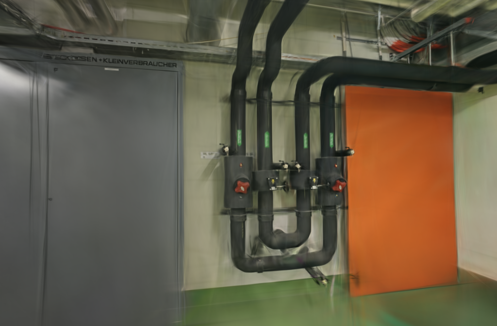
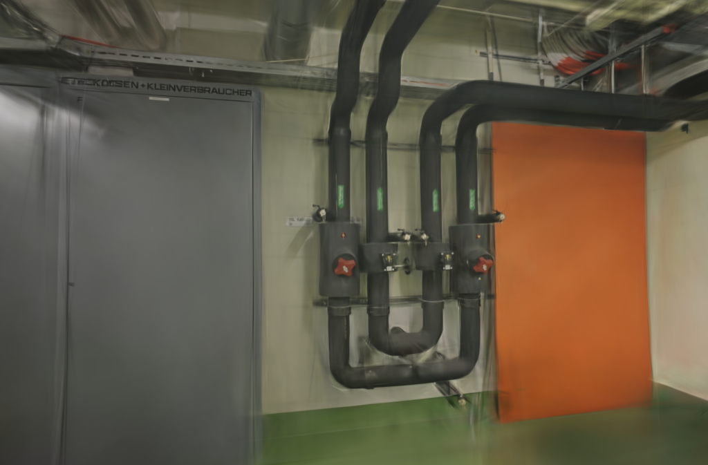
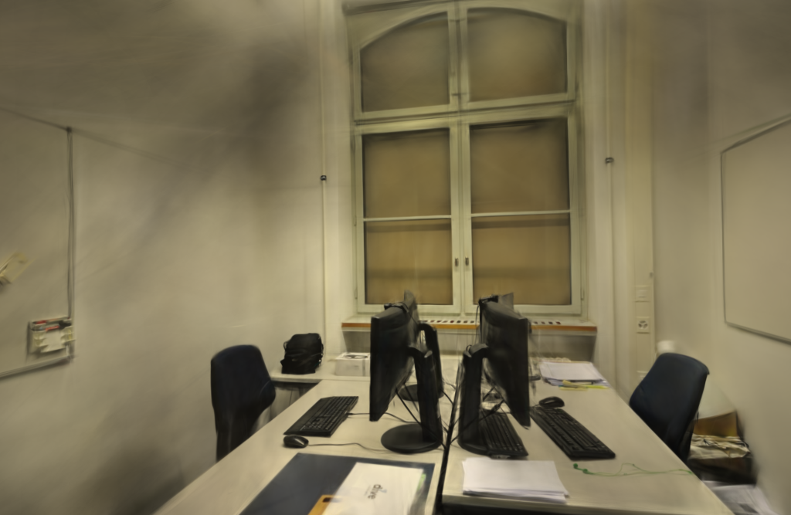
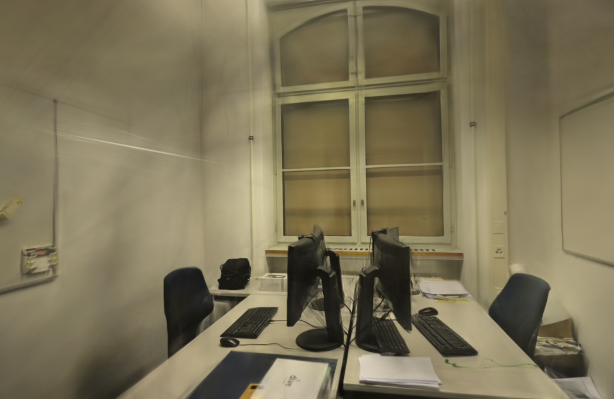

# 6000步模型的感知复查

2026-10-26。给已有尾部复制修复实验的12个模型补充Brush LPIPS-VGG评分，未重新训练。office平均LPIPS由0.28580升至0.29160（低为好），与此前PSNR / SSIM的下降一致；8组视角与重复对照中7组变差。pipes平均改善，TUM变化很小，保持原来的默认接入决定：正式引擎不替换，正确性补丁留在实验构建中。

## 条件与校验

模型来自[默认质量档复核](SSIM-TAIL-DEFAULT.md)。两种设置各重复两次，6000步、1024目标长边、15万高斯预算、SH3、种子42，每100步增点、第4800步结束增长，每500步导出，第6000步评估。基线和候选均未使用LPIPS训练损失，只比较既有尾部复制修复前后的引擎。

| 场景 | 输入 / 定位 | 训练 / 留出 | 原生渲染尺寸 | 本轮评分尺寸 |
| --- | ---: | ---: | --- | --- |
| ETH3D pipes | 14 / 14 | 12 / 2 | 1024×673 | 512×336 |
| ETH3D office | 26 / 26 | 22 / 4 | 1024×667 | 512×333 |
| TUM desk | 96 / 96 | 84 / 12 | 626×469 | 512×384 |

三组均为同镜头固定几何，没有未定位照片；TUM只用RGB。每8张留出一张，这些照片参与过SfM，属于固定几何下的渲染留出评估。应用默认全照片训练与本实验的留出模式不同。

补评分前后核对760个原始文件的摘要，包括模型、完整相机、报告、去畸变输入和评估PNG，全部不变。12个模型仍保留完整SH3。使用[已有评分工具](PERCEPTUAL-EVAL.md)，按相同RGB像素、Lanczos缩放和长边512计算三项指标，原有统一尺寸PSNR / SSIM逐项完全复现。

评分器和转换权重与上一轮相同，身份及每对处理后PNG摘要记录在[公开JSON](benchmarks/perceptual-long.json)。18个不同留出视角、两次重复、两个设置，共72对渲染 / 参考图，GPU串行评分。约53.31秒完成像素与感知评分，其中评分器子进程累计38.04秒；不含前后完整性检查。系统及驱动缓存未清空，没有新增SfM、训练、端到端或峰值内存测量。

## 三种指标一起看

各视角等权平均，再对两次重复取均值。PSNR / SSIM越高越好，Brush LPIPS-VGG越低越好。

| 场景 | PSNR：基线 → 候选 | SSIM：基线 → 候选 | LPIPS：基线 → 候选 | LPIPS改善 / 变差的配对数 |
| --- | --- | --- | --- | --- |
| pipes | 16.7509 → 17.3464 | 0.74597 → 0.74990 | 0.34727 → 0.33847 | 3 / 1 |
| office | 20.8826 → 20.6190 | 0.87347 → 0.86587 | 0.28580 → 0.29160 | 1 / 7 |
| TUM desk | 23.2843 → 23.5049 | 0.84552 → 0.84645 | 0.25509 → 0.25433 | 14 / 10 |

配对数是“视角×重复”的数量；相同场景、相同照片及两次重复之间有关联，不能当作独立样本做显著性推断。LPIPS没有新增通过门槛，也不用于覆盖此前office未通过的PSNR / SSIM筛查。

| 场景 | 重复 | 基线LPIPS | 候选LPIPS | 候选−基线 |
| --- | ---: | ---: | ---: | ---: |
| pipes | 1 | 0.336245 | 0.333416 | −0.002829 |
| pipes | 2 | 0.358297 | 0.343518 | −0.014779 |
| office | 1 | 0.280256 | 0.291596 | +0.011339 |
| office | 2 | 0.291350 | 0.291602 | +0.000252 |
| TUM desk | 1 | 0.253969 | 0.254420 | +0.000452 |
| TUM desk | 2 | 0.256218 | 0.254233 | −0.001985 |

office两个重复的LPIPS均值都变差，TUM则方向不同。这个结果支持继续保留原来的接入判断，但不证明尾部修复是全部差异的原因。GPU训练和实际增点数仍有波动，且只测了三个场景、两次重复。底层复制错误的回归修复与完整模型的画质收益是不同的验证层次。

## 历史训练成本

以下均为原实验数据，本轮没有新增训练耗时。点数是每设置两次的实际范围，PLY包含完整SH3。

| 场景 / 设置 | 实际高斯 | PLY字节范围 | 原平均训练、评估及导出 |
| --- | ---: | ---: | ---: |
| pipes / 基线 | 79,101～79,498 | 18,669,386～18,763,078 | 195.811 s |
| pipes / 候选 | 76,193～80,634 | 17,983,098～19,031,174 | 197.334 s |
| office / 基线 | 77,130～77,399 | 18,204,230～18,267,714 | 191.420 s |
| office / 候选 | 76,029～76,338 | 17,944,394～18,017,318 | 193.938 s |
| TUM / 两组 | 150,000 | 35,401,551 | 基线136.533 / 候选137.028 s |

候选此前三场景平均均略慢，这次补评分没有改变速度结论，也不把增加点数当作算法收益。

## 图片与漫游

下图引用原实验第一次重复、第一个留出视角的PNG；本轮核对摘要后直接复用，没有修图或重新编码。

| 场景 | 基线 | 尾部修复候选 |
| --- | --- | --- |
| pipes |  |  |
| office |  |  |
| TUM desk |  |  |

本轮在浏览器复查office两次重复的四个模型，并将两个候选切到室内漫游后拖动。加载及交互正常，没有控制台错误或警告；墙面仍有条纹，线缆、窗框和采集覆盖外区域存在模糊、拉丝及漂浮片段。这是人工查看记录，不是盲测偏好结论。

## 取舍与复现

保留新增的长训练感知证据，继续使用官方默认引擎，不因某一个场景的平均改善就放宽接入条件。后续改动可使用这组联合指标基线；不为追求“通过”反复运行同一个尾部修复实验。若要确认最终感知收益，还需独立感知指标或盲评。

使用已构建的评分器，对原实验每组运行以下命令（例为pipes首次重复）：

```bash
.venv/bin/python scripts/compare_quality.py \
  --data .data/benchmarks/ssim-tail-default-20261025 \
  --quick 0-0-baseline --detail 0-0-candidate --size 512 \
  --lpips-scorer .data/benchmarks/perceptual-eval-20261026/lpips_score \
  --output .qa/pipes-tail-perceptual.json
```

基线提交[9083b95](https://github.com/sakorman/web-scan/commit/9083b95)。本轮未修改训练器或评分源码，不重复未变的应用测试；提交后的标准CI检查后端、前端、类型及构建。报告修正了旧文档中pipes混入原生PSNR的表格、模型总数及一处论文链接，原始实验JSON成绩不改写。

参考[LPIPS论文](https://arxiv.org/abs/1801.03924)、[官方实现](https://github.com/richzhang/PerceptualSimilarity)及[2026年3DGS感知优化论文](https://arxiv.org/abs/2603.23297)。论文强调感知与人类评价，本轮未实现WD-R或DISTS，也没有将论文收益换算成本机结果。图片保留[ETH3D / TUM的署名与许可](../THIRD_PARTY_NOTICES.md)。
