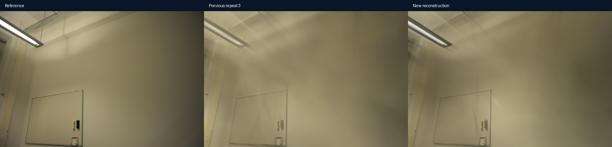
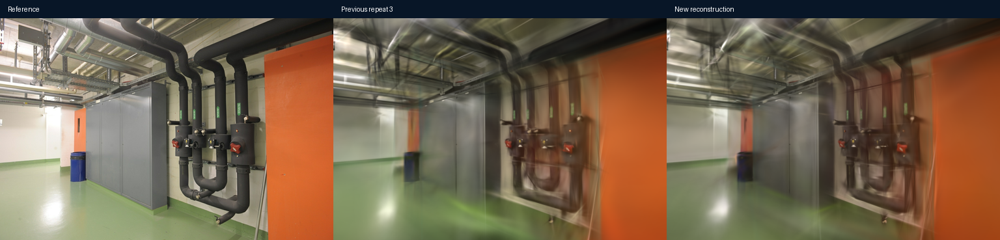
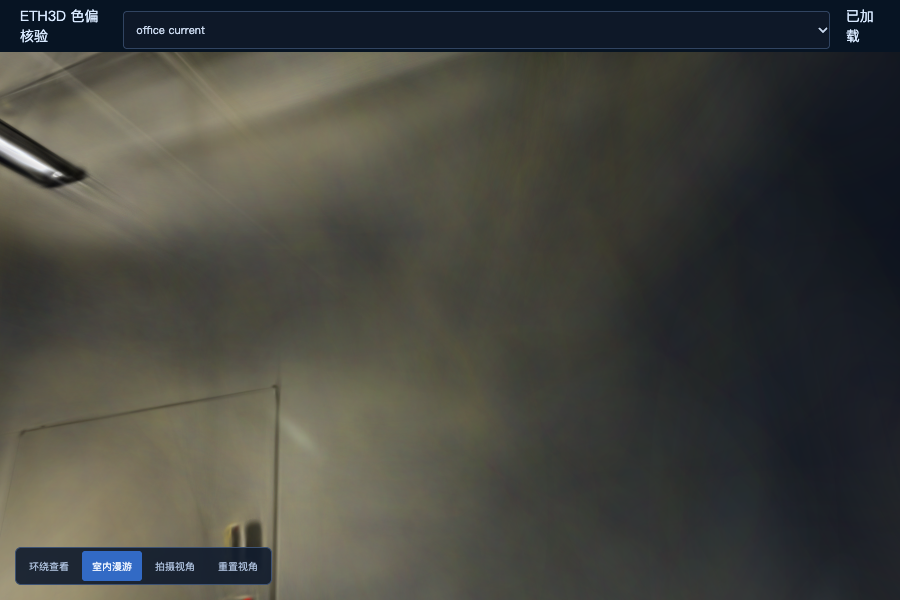
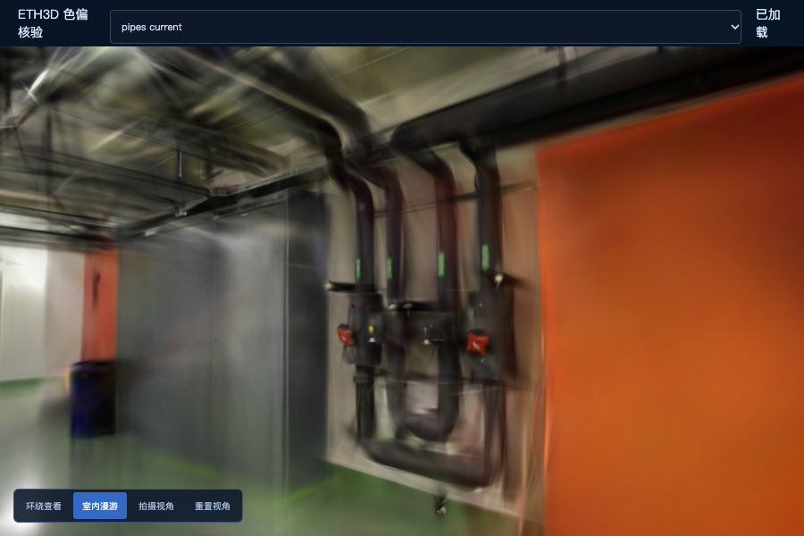

# 分区色偏与剩余误差

2026-11-20。在固定模型与相机下，给离线 `--error-grid` 增加有符号平均 RGB 误差、常量色偏 MSE 和中心化 MSE。八份实拍模型、24 张留出图的新旧 PSNR、SSIM、原有分区 MSE 完全一致。

office 第 9 张图的整图常量色偏只占 MSE 的 2.90%–34.32%，固定 4×4 分区的常量色偏占 51.12%–69.45%。保留分解诊断，暂不采用整图统一加减 RGB 的校色方案；剩余误差也不能直接叫几何误差。本轮没有改变模型、训练损失或产品预览，没有画质或提速收益。

## 依据与待验证假设

- Tongyu Wu、Jacob Edwards、Ziteng Cui、Caigui Jiang、Cheng Wang 的 [EvenSplat，2026-10-01 v1](https://arxiv.org/abs/2610.01876v1)区分跨照片曝光、图内照明和高反差条件。其图像与三维照明联合建模比常量色偏复杂；作者使用 gsplat / NVIDIA RTX 3090，并使用 RealityScan 提供的真实场景位姿。论文按 arXiv 非独占传播许可发布，本轮只参考问题划分，未复制或移植实现，也不将其结果外推至 Metal。
- 2026-11-20 核对 Kerbl 等人的 [官方 3DGS 实现 54c035f](https://github.com/graphdeco-inria/gaussian-splatting/tree/54c035f7834b564019656c3e3fcc3646292f727d)（主分支最新提交日期 2024-10-30）。[渲染器](https://github.com/graphdeco-inria/gaussian-splatting/blob/54c035f7834b564019656c3e3fcc3646292f727d/gaussian_renderer/__init__.py#L112-L115)可应用逐图仿射曝光变换，依赖 CUDA；其 [Inria / MPII 许可证](https://github.com/graphdeco-inria/gaussian-splatting/blob/54c035f7834b564019656c3e3fcc3646292f727d/LICENSE.md)限制为非商业研究与评估。本轮不导入上游代码。

本机假设是：上轮 office 墙面误差变化中，区域平均亮暗或色偏可能占较大部分，先测量再决定是否值得引入外观补偿。此假设不预先认定照片曝光错误、几何正确或某篇方法适用。本机为照片 → COLMAP → Brush / Metal，未输入真值位姿、深度或雷达。

## 分解定义

在原有共同评分网格上，对编码 RGB / 255 计算残差 `e = render − reference`。每个区域的 `b = mean_xy(e)` 是三个通道的有符号均值：正数表示渲染偏亮，负数偏暗。

`MSE = mean_rgb(b²) + mean_xyrgb((e − b)²)`。

输出字段为 `mean_rgb_error`、`bias_mse`、`centered_mse`，原来的 `xyxy` 与 `mse` 保持不变。不修改或裁剪渲染、不用校正后的图计算新 PSNR / SSIM。常量色偏项是留出图上的事后统计，不是可在未知照片上部署的校正效果；RGB 也没有线性化，不解释为物理照度。

4×4 区域采用半开边界，非整除的末行按实际像素面积加权。下表“分区占比”是各区色偏项按面积加权后除以整图 MSE，**不是各区百分比的简单平均**。整图占比用同一工具的 `--error-grid 1` 计算。网格越细越可能吸收局部变化，不能跨网格大小比较收益；本轮预先固定为 1 与 4，所有区域和留出照片均保留。

中心化项仍混合了照明梯度、纹理、模糊、错位、遮挡和几何等因素。仅凭这项统计无法区分这些原因，也不能证明空洞或漂浮物改善。

## 基线与实拍核验

基线为 [1129749](https://github.com/sakorman/web-scan/commit/1129749210d742107a4dabb843d3cc5e1fda4bf2)。修改前冻结上轮六任务的评分与 4×4 区域 MSE，修改后核验逐字段一致；另新建 pipes、office 各一次真实重建。对八任务的全部 24 张留出图，以冻结的旧评分实现再次对照，既有字段完全一致。相同场景的输入文件、位姿、相机、引擎、种子和配置经过 `compare_repeats.py` 严格身份核验。

本轮固定每场景一次新任务，只验证分解工具在新产物上可用，不据此判定训练效果改善。GPU 串行、训练期间未运行浏览器；SfM 复用缓存，新 Brush 进程，未清空 Metal / 系统缓存，不是冷启动。

- Brush 0.3.0 / Apple M5 Metal，程序 SHA-256 `8380ed40cce870025393e1ea0257e0752351c67a409d827b76dc75ec3a999a71`，seed 42；3000 步、512 长边、150000 高斯预算、SH3、细化间隔 100、增点截止 2400、导出间隔 500。
- pipes 输入 / 定位 14/14，失败 0，训练 / 留出 12/2（索引 0、8）；office 26/26，失败 0，22/4（0、8、16、24）。原图 1600×1067，去畸变参考分别为 1600×1066 / 1600×1067，统一评分 512×341。
- 同镜头 RADIAL `[f,cx,cy,k1,k2]`：pipes `[906.091435630405,800,533.5,-0.10091385666317157,0.06728544184812109]`；office `[906.4381085295956,800,533.5,-0.10327691090226823,0.06959028672322837]`。
- 留出照片参与了上游 SfM 及过往方案筛选，指标不是独立端到端或未见数据泛化测试。

| 新任务 | 实际高斯 | PLY 字节 | 平均 PSNR dB | 平均 SSIM | SfM 缓存恢复 s | 训练评估导出 s | 任务总计 s | 请求至观察完成 s |
| --- | ---: | ---: | ---: | ---: | ---: | ---: | ---: | ---: |
| pipes `6f22dd07da47476abda4ed2043c128e0` | 11896 | 2809006 | 19.1353 | 0.762182 | 0.0266 | 22.9235 | 23.00 | 23.353 |
| office `94b49136053f43fb96a6cb928a65f3c0` | 14293 | 3374698 | 22.0851 | 0.881523 | 0.0509 | 23.4621 | 23.56 | 24.428 |

实际 SfM 求解耗时为 0；输入校验分别为 0.0097 / 0.0133 秒。请求至观察完成包含一秒轮询，未包含此前照片导入和首次 SfM。旧六任务的完整高斯数、模型大小、配置与耗时见[重复性报告](REPEATABILITY.md)。本轮结果相对旧模型的分数差不属于工具的画质收益。

## 第 9 张照片的误差构成

第 9 张是上轮预先提出的复查对象，四次按时间排列；表内 MSE 均为归一化 RGB 的均方值。

| 场景 / 任务 | 原始 PSNR | 整图常量色偏占比 | 4×4 分区色偏占比 | 整图 MSE | 分区色偏 MSE | 分区剩余 MSE |
| --- | ---: | ---: | ---: | ---: | ---: | ---: |
| office 旧 1 `37fe989c` | 23.9369 | 7.74% | 51.12% | 0.00403936 | 0.00206495 | 0.00197441 |
| office 旧 2 `d5d9ca3e` | 21.9364 | 34.32% | 69.45% | 0.00640270 | 0.00444667 | 0.00195603 |
| office 旧 3 `9aa6b584` | 22.5371 | 26.51% | 60.04% | 0.00557555 | 0.00334760 | 0.00222795 |
| office 新 `94b49136` | 23.7252 | 2.90% | 57.96% | 0.00424115 | 0.00245812 | 0.00178304 |
| pipes 旧 1 `a2229147` | 14.7216 | 51.87% | 73.94% | 0.03371655 | 0.02493023 | 0.00878632 |
| pipes 旧 2 `ca14d9ea` | 15.0911 | 61.11% | 75.15% | 0.03096661 | 0.02327202 | 0.00769459 |
| pipes 旧 3 `dc5da800` | 15.6628 | 50.96% | 70.40% | 0.02714676 | 0.01911157 | 0.00803519 |
| pipes 新 `6f22dd07` | 15.0211 | 54.38% | 71.60% | 0.03146935 | 0.02253265 | 0.00893669 |

office 前两次的总误差增加约 0.00236334，分区色偏项增加约 0.00238173，剩余项反而略降。这个对照支持继续检查局部亮暗或颜色差异，不能把 2 dB 的下降全部描述为细节丢失。新 office 整图平均色偏只有 2.90%，而分区占比为 57.96%，统一偏移不足以描述该误差；尚未测试仿射增益、颜色矩阵或可学习局部补偿，不将此结论扩展为否定所有曝光方法。

pipes 也有较高色偏占比，但管线、阀门和反光地面仍明显模糊。八份结果只覆盖两个场景，误差分解不能确定物理成因。[全部留出图、分区及计时数据](benchmarks/photometric-bias.json)

## 同视角与漫游

依次为原参考、上一轮第 3 次、本轮新任务；内容均为 512×341，标题不评分，未经亮度调整。office 的照明梯度与墙面条纹不同，pipes 反光、管道边缘和细线仍有拖影。





两份新模型完成完整 SH3 读回、拍摄视角切换及相同拖动漫游，无页面或 HTTP 错误。偏离拍摄位置仍有拉伸、半透明边缘与细结构丢失；小范围轨迹不能排除其他位置的空洞或漂浮物。





## 验证、成本与复现

新增三项回归：纯正负通道色偏、零均值空间误差、非整除画幅的面积加权恒等式及原分数不变。328 项后端、18 项前端、类型检查和构建通过，保留既有 TestClient 弃用与 Vite 大包警告。两次新任务期间 49 次健康 / 历史检查均正常，服务保持运行。

启用分区时额外建立一个 Float64 RGB 残差数组并计算均值与中心化误差；512×341 下全图数组约 4 MiB，区域计算还需临时数组，峰值内存未测。不启用分区时沿用原计算路径。单任务两次完整离线比较（网格 4 和 1，含读盘与验证）本轮 pipes 约 1.14–1.25 秒、office 约 2.13–2.30 秒；期间有 CPU 回归与构建活动，不作增量开销或提速对照。

```bash
PYTHONPATH=. .venv/bin/python scripts/compare_quality.py \
  --quick 9aa6b584c61c4d779c0ce392fb594861 --detail 94b49136053f43fb96a6cb928a65f3c0 \
  --size 512 --error-grid 4 --output .data/benchmarks/photometric-recheck/office-grid.json
```

将 `--error-grid 4` 改为 `1` 获得整图常量色偏统计。使用[报告脚本](benchmarks/photometric-bias.py)复查全部八份历史产物（不重训）：

```bash
mkdir -p .data/benchmarks/photometric-recheck
git show 1129749:scripts/compare_quality.py > .data/benchmarks/photometric-recheck/old.py
.venv/bin/python - <<'PY'
import json
from pathlib import Path
d=json.loads(Path('docs/benchmarks/photometric-bias.json').read_text())
root=Path('.data/benchmarks/photometric-recheck')
(root/'plan.json').write_text(json.dumps(d['plan']))
(root/'runs.json').write_text(json.dumps(d['new_runs']))
PY
PYTHONPATH=. .venv/bin/python docs/benchmarks/photometric-bias.py \
  --plan .data/benchmarks/photometric-recheck/plan.json \
  --new-runs .data/benchmarks/photometric-recheck/runs.json \
  --baseline-module .data/benchmarks/photometric-recheck/old.py \
  --output .data/benchmarks/photometric-recheck/result.json
```

需要原有本地任务文件。新训练复用了[串行 API 脚本](benchmarks/repeatability-run.py)，本轮 `ORDER` 固定为 `['pipes','office']`，配置不变；完整计划及日志存于 `.data/benchmarks/photometric-bias-20261120`。照片和历史模型保留。

下一步先核验固定训练照片中同一表面的跨视角亮度差异，区分输入不一致与渲染插值误差；获得证据后再选外观或几何候选。当前不根据事后偏移提高留出评分，也不启用统一校色。

照片与衍生截图：Thomas Schöps 等，[ETH3D / CVPR 2017](https://www.eth3d.net/datasets)，[CC BY-NC-SA 4.0](https://creativecommons.org/licenses/by-nc-sa/4.0/)。原照片和模型不发布到仓库。
