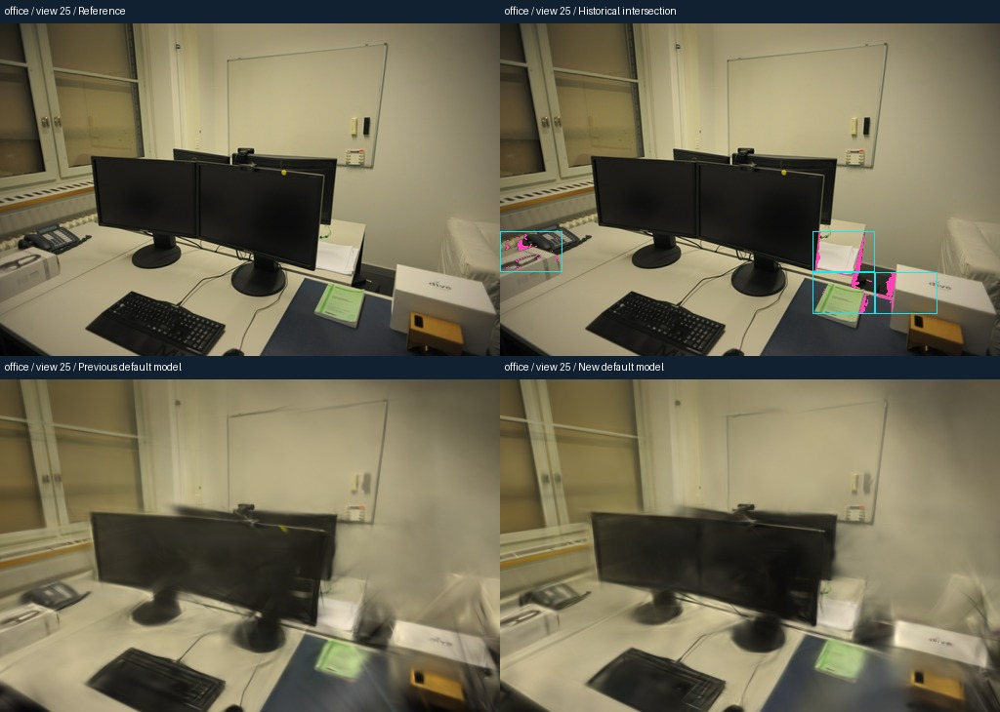
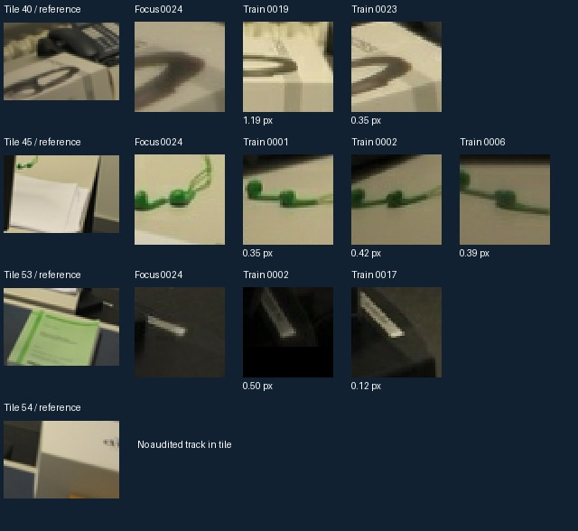
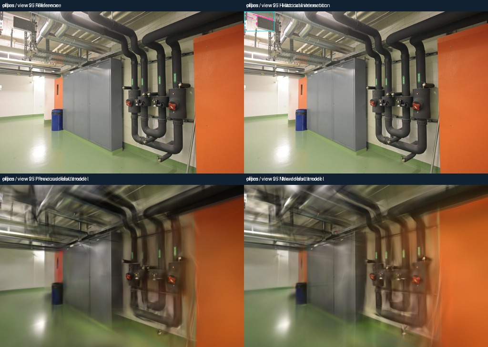
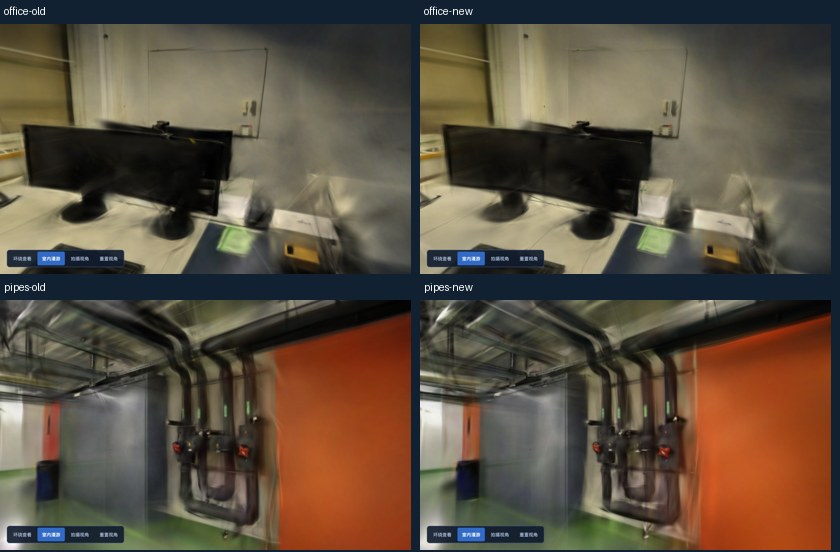

# 哪些像素在重复重建中持续出错

2026-11-27。ETH3D office 第 25 张有四个区域在历史重建中反复出现高误差。用两份默认模型预先标出 791 个像素，它们占四格总面积的 7.27%。另起任务用同一批照片训练后，这些像素占四格 RGB 平方误差的 45.33%，其中 622 个再次进入各自格内误差最高的一成。纸张、桌沿及桌面物件轮廓附近的误差最集中。保留离线掩码，供同视角局部复查。[逐视角结果、像素分母和掩码摘要](benchmarks/pixel-recurrence.json)



## 四格中的细节

格编号从左上角起，8×8 行优先，从 0 计数。下表的误差占比以**该格新模型的 RGB 平方误差总和**为分母。训练照片对应点经双向轨迹、照片去重及原图 2 px 重投影误差筛选。距离从点投影到最近的预选像素中心，在 512×341 网格上计算。

| 格 | 预选像素 / 格像素 | 再次进入前一成 | 占本格误差 | 格内稀疏点 | 距掩码最近的点 |
| --- | ---: | ---: | ---: | ---: | --- |
| 40 | 150 / 2,688 | 79 | 14.20% | 11 | 1.23 px，2 张训练片 |
| 45 | 211 / 2,688 | 189 | 66.88% | 2 | 0.72 px，9 张训练片 |
| 53 | 203 / 2,752 | 177 | 47.19% | 3 | 0.30 px，2 张训练片 |
| 54 | 227 / 2,752 | 177 | 45.32% | 0 | 对应深度未知 |

第 45 格的误差主要沿纸张两侧。格内最近的轨迹落在纸张上方的绿色物件上，多个训练源图能辨认出它。即使邻近像素已有可靠对应，纸边的深度和遮挡关系仍待核验。第 54 格白色箱体左边缘反复出错，缺少合格轨迹来确认该处几何。下一步可从第 45 格的九张有对应照片入手，核验相邻纸边的可见范围。



回查上轮旋转学习率实验，四格整体 MSE 在两组分别增加 0.000598、0.001234。将增量按同一批 791 个像素拆开，它们对两组总增量的贡献分别为 +0.000682、+0.000598，其余像素为 −0.000084、+0.000636。各格的增量在两次之间均改变符号。掩码能帮助定位重复误差，学习率对单格的影响仍有波动。[两组原始对照](ROTATION-RATE.md) · [基线提交](https://github.com/sakorman/web-scan/commit/285c687)

## 基线与独立重建

使用上轮预选的 24 格。对同场景两份历史默认模型，在每格内按像素的三通道平方误差之和取最高的 10%（名额向上取整）。跨越截点的并列组整体排除，仅取正误差。两张二值图的交集即预选掩码。独立排序程序在新训练开始前保存了每格计数与哈希。训练后，评分脚本核对相机、参考图和原生渲染尺寸，以同一网格统计误差；全部 24 格的掩码与预存摘要一致。归一化区域 MSE = RGB 平方误差和 / (像素数 × 3 × 255²)。对同一张参考照片的多次重建能检验重复性，推论范围限于这些已知视角。

| 场景 / 照片序号 | 预选像素占所选格面积 | 占新模型所选格误差 | 预选像素再次入选率 |
| --- | ---: | ---: | ---: |
| pipes 1 | 4.20% | 19.93% | 63.66% |
| pipes 9 | 5.28% | 21.03% | 93.66% |
| office 1 | 5.48% | 11.33% | 68.61% |
| office 9 | 5.96% | 18.61% | 83.13% |
| office 17 | 5.29% | 15.04% | 71.31% |
| office 25 | 7.27% | 45.33% | 78.63% |

实拍输入为 1600×1067，纯 RGB 通过共享 RADIAL 相机求姿，office / pipes 焦距分别为 906.44 / 906.09 px。各自复用已核对的去畸变针孔相机、初始稀疏模型及照片，每八张留一张。留出照片参与 SfM，排除在高斯训练外。默认 Brush v0.3.0 在 Apple M5 / Metal 上串行训练，种子 42，3,000 步，长边 512，最多 150,000 个高斯，完整 SH3。六个留出视角均按 512×341 全幅评分。完整内参、配对来源和固定引擎摘要见前次配置。[历史输入与配置](benchmarks/rotation-rate.json)

| 场景 | 输入 / 定位 / 失败 | 训练 / 留出 | 新高斯数 / PLY 字节 | 历史两次 PSNR / SSIM | 新 PSNR / SSIM | SfM 缓存恢复 / 训练评估导出 / 服务总计 |
| --- | --- | --- | --- | --- | --- | --- |
| office | 26 / 26 / 0 | 22 / 4 | 14,453 / 3,412,458 | 21.070 / 0.87325，20.480 / 0.87003 | 20.899 / 0.87176 | 0.042 / 23.672 / 23.76 秒 |
| pipes | 14 / 14 / 0 | 12 / 2 | 11,443 / 2,702,098 | 18.166 / 0.75373，18.158 / 0.74774 | 18.793 / 0.76016 | 0.030 / 22.794 / 22.89 秒 |

两次新任务按默认配置独立运行。客户端从请求到观测完成分别为 24.34、23.36 秒。未测冷启动 SfM。三份模型的输入核验及离线评分耗时为 office 2.37 秒、pipes 1.12 秒（成对评分、像素分区和文件校验，不含另行核验完整 SfM 目录、模型和写图）。分析额外保存每个模型的一张整型误差图，内存随对照模型数和像素数增长。



训练结束后在浏览器读入两场景的新旧完整 SH3，从同一拍摄视角拖动漫游。office 显示器底座及箱体轮廓发软，pipes 顶部细管可见重影。短路径内未确认新增的独立漂浮物或空洞，遮挡背面仍缺证据。首次切换模型出现一次 `Worker terminate` 页面异常，四份模型均加载完成。相同顺序另测两次，均无页面或 HTTP 错误，触发条件仍待定位。图片来自 Thomas Schöps 等的 ETH3D，含实拍内容的衍生图沿用 CC BY-NC-SA 4.0。[数据与署名](../THIRD_PARTY_NOTICES.md)



## 研究参考

Haiyang Xu 等的 QuantileGS v1（2026-11-16）研究单像素 RGB-MAE 的分位数估计，并以独立照片校准覆盖率。本次用实测 RGB 平方误差的排名寻找同图重复位置，不估计新视角的置信区间。Shiwei Ren 等的 FastGS 将多个训练视角的高误差像素映射回高斯，作者实现依赖 CUDA。这里只在 Metal 训练完成后用 CPU 比较留出渲染，未引入深度、雷达或 CUDA 训练组件。[QuantileGS v1](https://arxiv.org/abs/2611.21253v1) · [论文分发许可](https://arxiv.org/licenses/nonexclusive-distrib/1.0/) · [FastGS 实现 97910ad](https://github.com/fastgs/FastGS/blob/97910adf0214080e715111052d7679fa27c36ff9/utils/fast_utils.py) · [FastGS 原创部分 MIT 许可](https://github.com/fastgs/FastGS/blob/97910adf0214080e715111052d7679fa27c36ff9/LICENSE) · [Brush v0.3.0，Apache-2.0](https://github.com/ArthurBrussee/brush/tree/v0.3.0)

## 复算 office 数据

在仓库根目录运行。示例使用本次本地留存的三份重建，通过独立目录中的符号链接读取相机、参考图和留出渲染。标准服务的三个任务都在同一数据目录时，可直接传该目录和实际任务 ID。掩码 PNG 与留出图同尺寸，白色表示历史交集。JSON 中每格保存半开像素边界、计数、掩码摘要和平方误差和。

```sh
out=$(mktemp -d .data/benchmarks/pixel-check-XXXXXX)
mkdir "$out/jobs"
for n in 1 2; do
  ln -s "$PWD/.data/benchmarks/rotation-rate-20261126/run/jobs/office-baseline-$n" "$out/jobs/office-baseline-$n"
done
job=fe0f85e26772440ead01b7b2085d21b4
ln -s "$PWD/.data/jobs/$job" "$out/jobs/$job"
.venv/bin/python -c 'import json; print(json.dumps(json.load(open("docs/benchmarks/rotation-rate.json"))["regions"]["office"]["tiles"]))' > "$out/regions.json"
.venv/bin/python -m scripts.benchmark_pixel_recurrence --data "$out" \
  --history office-baseline-1 office-baseline-2 --check "$job" \
  --regions "$out/regions.json" --masks-dir "$out/masks" --output "$out/scores.json"
```
