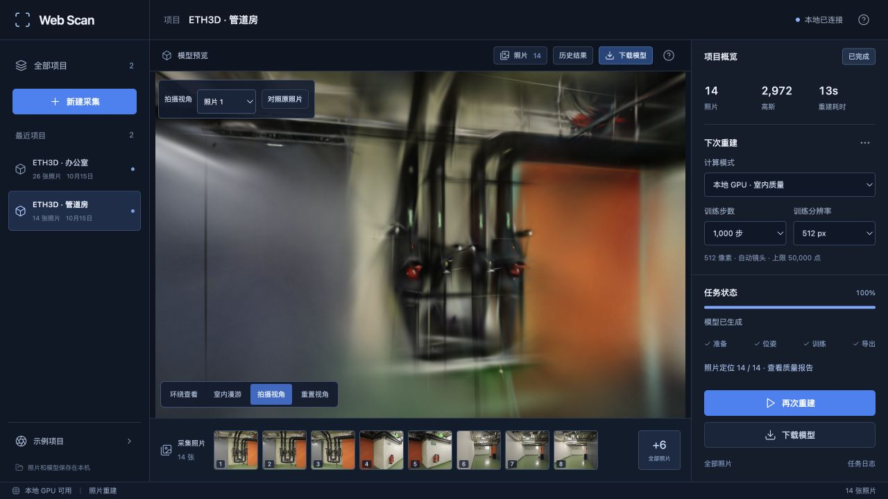
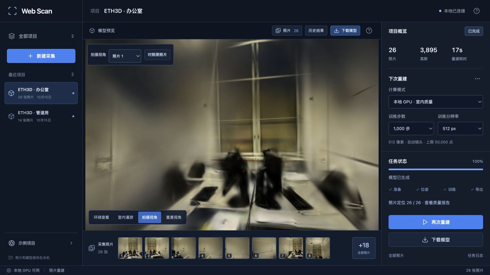

# 模型发布前的 PLY 校验

2026-10-15。修复高阶颜色系数未被完整检查、零高斯模型仍可通过的问题。现在会拒绝空模型、残缺球谐字段和非有限颜色值，Brush 的成功输出必须包含完整 SH3；失败时保留原始导出和中间文件。

## 问题复现

从 pipes 历史真实模型复制一条高斯记录，分别将 `f_rest_44` 设为 NaN、移除该字段，以及构造零顶点输出。[基线版本](https://github.com/sakorman/web-scan/commit/f56c7b4)均接受这三类文件。此前仅检查位置、缩放、旋转、不透明度和基础颜色，方向相关颜色没有进入检查。

这是对模型副本的故障注入，用来复现校验遗漏；原照片与历史模型未修改。[复现摘要](benchmarks/ply-validation.json)

## 改动

读取器要求顶点数为正，支持完整的 SH0、SH1、SH2、SH3 字段集合，并检查全部颜色系数为有限数。高阶字段编号必须连续，不能仅靠字段数量判断完整性。训练适配器按现有 Brush 配置额外要求 SH3，防止残缺输出被报告为完整方向颜色。

字段命名参照 [Brush 0.3.0 的 PLY 定义](https://github.com/ArthurBrussee/brush/blob/v0.3.0/crates/brush-serde/src/ply_gaussian.rs)。本轮没有修改训练算法、模型颜色数值或渲染器；校验发生在下载文件写出之前，也早于成功任务的中间文件清理。

13 项新增测试覆盖合法 SH0–SH3、NaN / Infinity、缺项与编号间隙、空模型，以及训练进程返回成功但模型不合格的情况。后者不会生成下载产物，原始最终 PLY 和较早 PLY 均保留。后端共 99 项测试通过。

## 真实照片回归

Apple M5、32 GiB 内存，Brush 0.3.0 / Metal。通过示例导入接口建立两组独立采集，完整执行冷 SfM 和 GPU 训练，测试数据保存在 `.data/benchmarks/ply-validation-20261015`。GPU 串行运行，浏览器暂时返回项目列表停止模型渲染。

两组均采用自动相机模式、1000 步、512 像素长边、5 万高斯预算、每 8 张留出一张评估；没有使用数据集自带位姿。

| 场景 | 输入 / 定位 | 训练 / 留出 | SfM | 训练与导出 | Worker 总计 | 高斯数 | PLY 大小 | PSNR / SSIM |
| --- | --- | --- | ---: | ---: | ---: | ---: | ---: | --- |
| pipes | 14 / 14 | 12 / 2 | 6.03 s | 7.05 s | 13.14 s | 2,972 | 702,941 B | 17.997 / 0.7173 |
| office | 26 / 26 | 22 / 4 | 8.76 s | 8.08 s | 16.91 s | 3,895 | 920,769 B | 19.445 / 0.8042 |

没有失败定位视角；从导入到转换对照和下载校验结束，分别为 13.29 和 17.13 秒，不包含数据集下载、归档准备。指标来自 Brush 的 512 像素留出评测，评估照片仍参与了上游 SfM。[完整报告、图像摘要和配置](benchmarks/ply-reconstruction.json)

同一份真实训练输出分别交给新旧转换器，生成的 PLY 和 splat **逐字节一致**；下载接口返回的四种产物也与磁盘一致。该对照证明正常模型的转换结果保持一致，不将两次独立训练的随机波动作为画质差异。

浏览器实际打开两个新模型，检查拍摄视角和项目切换，并在管道房拖动漫游。没有控制台错误。短训练下管线、桌椅和墙面可辨认，细边仍模糊，转动后能看到拉丝与不完整区域；此次校验修复不消除这些重建限制。





上述照片及衍生结果遵循 [ETH3D 许可与署名](../THIRD_PARTY_NOTICES.md#test-dataset)。前端 18 项测试、TypeScript 检查与生产构建通过。

## 校验开销与下一步

对两份已有较大模型，各版本连续读取 7 次，取中位数。pipes 300,000 点 / 70,801,551 字节，从 18.84 ms 增至 48.49 ms；office 231,428 点 / 54,618,559 字节，从 10.86 ms 增至 30.91 ms。额外开销约 20–30 ms，来自扫描高阶系数；只在模型发布时执行，没有加入浏览器绘制循环。[逐次读数](benchmarks/ply-validation.json)

这是包含文件读取的本机热缓存测量，每场景先旧版后新版，未做冷缓存控制，不代表其他存储设备或百万点规模。采用该改动是为了拒绝不完整结果，没有训练提速或画质提升结论。后续继续检查采集覆盖，以及浏览器与训练器同视角渲染的一致性。

复现故障回归：

```bash
.venv/bin/python -m pytest tests/test_ply_validation.py tests/test_brush.py -q
```
