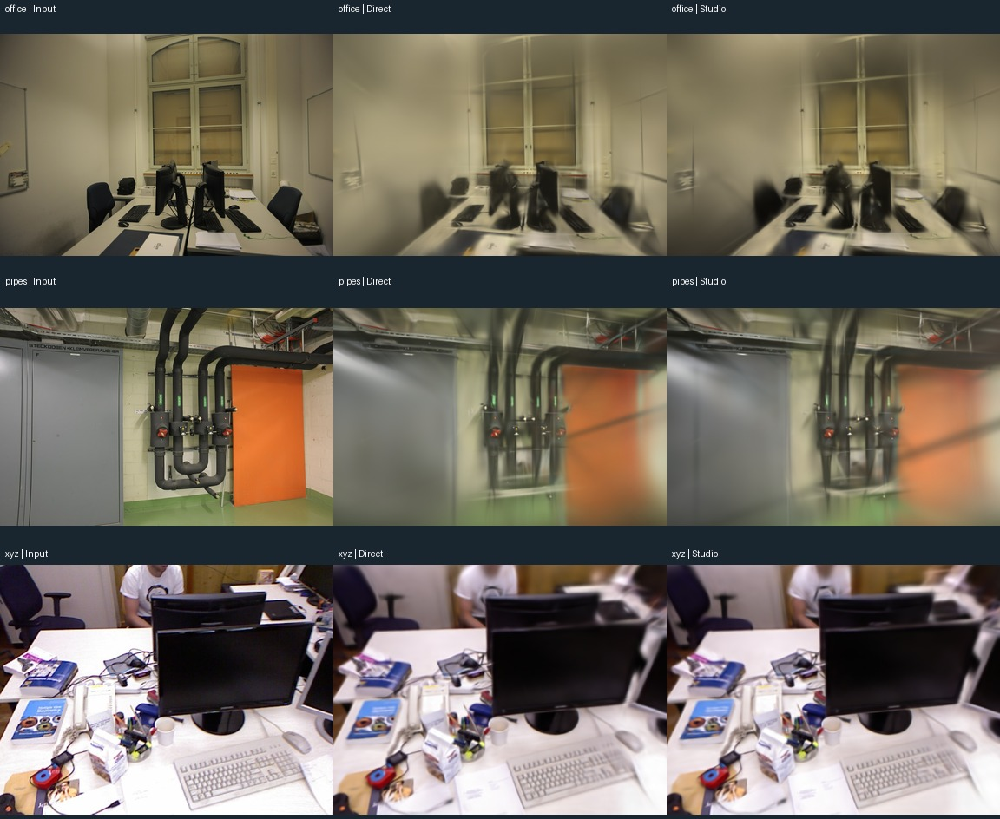

# 将已知位姿的采集导入工作台

本地导入命令读取 COLMAP 格式的内参、外参和带颜色的三维点，生成一个可直接训练的采集。历史列表、训练参数、留出评估、照片视角对照和完整 SH3 PLY 下载均复用工作台现有流程。生成这些输入所需的上游求姿时间应单独计算。[COLMAP 稀疏模型格式](https://colmap.github.io/format.html)

```sh
.venv/bin/python -m webscan.import_poses /path/to/undistorted --name "已定位的房间"
```

目录包含 `images/` 和 `sparse/`。支持 COLMAP 的文本或二进制模型、独立的 `sparse/0/` 子目录，以及通过 `--sparse` 指定一份模型；PINHOLE 和 SIMPLE_PINHOLE 相机可以混用。导入 3–200 张已定位的 JPEG 或 PNG 时逐张核对像素尺寸。导入文件含畸变参数时，先用 COLMAP 的 `image_undistorter` 生成匹配的照片和针孔模型。若服务使用独立数据目录，命令通过 `--data` 指向同一目录。输出采集 ID 后刷新工作台，在历史列表选中采集并训练。

平铺的 RGB JPEG 保留原编码和照片名，原稀疏模型文件逐字节复制。带子目录的照片改为工作台内唯一的文件名；PNG 等需要转换的图像按原尺寸生成训练 JPEG。导入在本地保存照片和结构校验清单。每次训练先核对文件，若校验失败则报告错误。该入口需要已给定的初始点。只提供手机轨迹的采集还需要生成初始几何。

## 三组实拍验收

从已具备相机与点的采集开始，在独立历史库中调用正式任务 API，串行使用预热的本地 Brush 0.3.0 Metal，统一 1000 步、512 长边、种子 42、高斯上限 15 万。同场景的直接训练和导入训练具有相同照片、位姿、内参与初始点。每八张留出一张，留出照片参与过上游求姿。三组所有输入视角均已定位。完整计时从导入命令启动到任务成功，含队列等待及 0.25 秒间隔的状态轮询。模型准备好后另外验证了拍摄视图、相机文件、预览与 PLY 的下载。[逐帧评分与训练记录](benchmarks/posed-import.json)

| 场景 | 输入 / 训练 / 留出 | 初始点 / 实际高斯 | 导入 / 位姿读取 / 训练导出（秒） | 从导入到完成（秒） | SH3 PLY 字节 |
| --- | ---: | ---: | ---: | ---: | ---: |
| ETH3D office | 26 / 22 / 4 | 2,475 / 4,067 | 0.26 / 0.033 / 7.33 | 8.04 | 961,361 |
| ETH3D pipes | 14 / 12 / 2 | 1,877 / 2,908 | 0.19 / 0.025 / 7.13 | 7.97 | 687,837 |
| TUM RGB-D xyz | 96 / 84 / 12 | 12,604 / 20,501 | 0.33 / 0.082 / 9.42 | 10.17 | 4,839,786 |

三个任务均跳过特征提取和匹配。office 和 pipes 的输入来自已有纯照片 SfM，xyz 输入来自 RGB-D 求姿与训练视角深度采样。本次只计已有位姿后的工作。直接训练与正式导入各测一次，按相同渲染画幅、相同照片及像素重新评分。office 为 20.002 / 0.80885 与 20.227 / 0.80696；pipes 为 17.853 / 0.68738 与 18.542 / 0.68112；xyz 为 21.630 / 0.77941 与 21.649 / 0.78043，依次为 PSNR（dB）/ SSIM。Metal 训练存在波动。首次实现重写了全部稀疏文件和照片名，office、pipes 的 PSNR 比直接训练低 0.49、0.90 dB。最终版本在这三个真实输入上保持全部照片及稀疏文件字节相同。每个场景的模型独立留存。[固定视角对照](#固定视角对照)

### 固定视角对照



图为每个场景首张留出照片，原图和两份渲染按原比例缩放。使用 ETH3D 的两行衍生图由 Thomas Schöps 等人的数据生成，沿用 CC BY-NC-SA 4.0。xyz 行由 Jürgen Sturm 等人的 TUM RGB-D 数据生成，沿用 CC BY 4.0。此次验收检查固定留出视角及 HTTP 产物；拖动漫游的缺陷记录见先前 desk 测试。下一步用实拍设备提供的姿态建立初始点，核对坐标方向和尺度。[数据集、作者与许可](../THIRD_PARTY_NOTICES.md) · [RGB-D 轨迹与漫游记录](RGBD-ODOMETRY.md)
