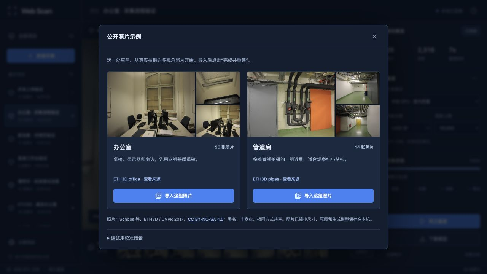
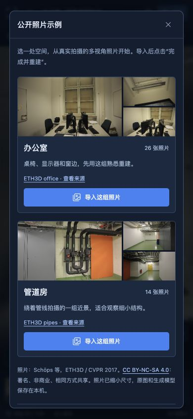
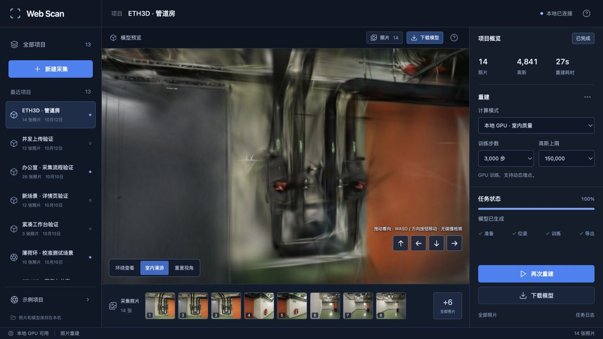

# 测试记录

## 留出照片身份检查 · 2026-10-29

`benchmark_exports.py` 现会把每次验证过的留出照片文件名、参考摘要和画幅写进运行记录，并在汇总前拒绝不一致、缺失、重复或不完整的集合；渲染图摘要刻意不参与集合。新增 4 类故障回归，完整后端 161 项、前端 18 项、类型检查与生产构建通过；构建继续提示已有约 2.99 MB 的查看器模块。

两份未改动 Brush 适配器在冻结 ETH3D pipes / office 上串行完成四次 500 步 / 512 像素控制训练：pipes 12 / 2、office 22 / 4 训练 / 留出视角。每对运行的参考身份和画幅完全相同，4 个导出均包含完整 SH3；短训练分数存在运行波动，不作为画质或速度结论。页面与查看器没有改动，不重复浏览器交互检查；8787 服务健康检查正常。[完整数据与限制](BENCHMARK-IDENTITY.md)

## 尺度末段学习率筛查 · 2026-10-29

对比适配器先做命令级检查，确认候选只追加 `--lr-scale-end 0.003`。随后在冻结 ETH3D pipes / office 场景串行完成4次3,000步 / 512像素训练；输入摘要、相机、留出照片摘要和实际渲染尺寸逐项一致，4份输出均通过完整SH3 PLY校验。同视角检查与两组留出指标均不支持候选，因此未修改默认训练器；完整数据、截图检查和限制见 [SCALE-LR-END.md](SCALE-LR-END.md)。

## 高阶 SH 学习率尺度筛查 · 2026-10-29

对比适配器先做命令级检查，确认候选只追加 `--lr-coeffs-sh-scale 10`。随后在冻结 ETH3D pipes / office 场景串行完成四次 3,000 步 / 512 像素训练；输入摘要、相机、留出照片摘要和实际渲染尺寸逐项一致，四份输出均通过完整 SH3 PLY 校验。两场景指标同向回退且同视角检查没有可见改善，因此未修改默认训练器；完整数据、截图检查和限制见 [SH-LEARNING-RATE.md](SH-LEARNING-RATE.md)。

## 优先复查视角 · 2026-10-29

新增交集回归：只有同一照片同时出现在稀疏支撑偏低和图像细节偏低清单中，才进入优先复查；任一单项不会误入。全量后端 155 项、前端 18 项、类型检查与生产构建通过；构建继续提示已有约 2.99 MB 的查看器模块。重新导入 ETH3D pipes / office 后串行完成 3,000 步 / 512 像素真实 GPU 重建：pipes 14 / 14 定位且交集为空，office 26 / 26 定位，照片 4–6 同时命中两项并正确显示。浏览器实际打开 office 质量报告与下载面板，完整 SH3、相机、留出图以及 PLY / splat 下载入口均有效；预览继续只用拖动调视角。[完整记录](CAPTURE-REVIEW.md)

## 相对图像细节诊断 · 2026-10-29

新增 1 项聚焦回归：三张棋盘格和一张纯色图中，只标出纯色图；不足四张不输出诊断。完整后端回归、18 项前端、类型检查和生产构建通过；构建继续提示已有的约 2.99 MB 查看器模块。ETH3D pipes / office 用新位姿快照串行完成 3,000 步 / 512 像素真实 GPU 重建，均通过完整 SH3、相机、留出图和 PLY / splat 导出；pipes 没有误报，office 指出照片 4–6 的低细节墙面。浏览器实际打开质量报告和下载面板，预览继续仅通过拖动调整视角。[完整记录](IMAGE-DETAIL.md)

## 原地旋转提示 · 2026-10-29

既有的相机位置诊断已经能返回 `coincident_camera_centers`，此前没有透传到质量报告或任务警告；现已显示为“原地转动没有深度视差”的补拍建议。矩阵回归继续覆盖少于三张和相机中心完全重合；两组 ETH3D 缓存复用任务均不会误报，pipes / office 为 14 / 14、26 / 26 定位。浏览器实际复查 office 的质量报告，位置、朝向、轨迹支撑和留出评测区同时可见，预览仍只通过拖动调整视角。[完整记录](PARALLAX.md)

## 辅助约束结束时刻筛查 · 2026-10-28

两个交错顺序完成 8 次真实 ETH3D GPU 训练，冻结相机、输入、留出集合和评测参考，分别复评 pipes 的 2 张与 office 的 4 张留出图。全部输出通过完整 SH3 PLY、相机、参考摘要及共同512网格校验。候选虽改善 pipes，却在 office 的两项均值与办公桌视角退化，因此未改默认训练器；同视角截图、原始汇总和研究依据见 [完整记录](AUX-LOSS-STOP.md)。

## 增点梯度阈值筛查 · 2026-10-28

以两个交错顺序完成 8 次真实 ETH3D GPU 训练：冻结相机、输入、留出集合和评测参考，分别复评 pipes 的 2 张与 office 的 4 张留出图。全部输出通过 SH3 PLY、相机、参考摘要和共同512网格校验。`8e-5` 候选在第二轮 pipes 明显退化，因此未改默认训练器；同视角截图、原始汇总和研究依据见 [完整记录](GROWTH-THRESHOLD.md)。

## 拍摄朝向诊断 · 2026-10-28

新增 2 项光轴方向回归：三张近乎平行相机会触发保守提示，三组正交方向与不足三张照片不会误报。完整后端 153 项、前端 18 项、类型检查和生产构建通过；构建继续提示已有的约 2.99 MB 查看器模块。ETH3D pipes / office 串行重建均完成，分别 14 / 14、26 / 26 定位；报告方向 p90 为 131.7°、120.2°，均未触发提示。浏览器实际打开 office 的质量报告，确认“拍摄朝向”展示角度范围和“不是完整覆盖证明”的说明，未恢复方向按钮或悬浮提示。[完整记录](POSE-DIRECTION.md)

## 拍摄位置间隔诊断 · 2026-10-28

新增 2 项相机中心回归：固定矩阵下只标出相对孤立位置，少于三张和重合相机中心不误报。真实 ETH3D pipes / office 重新跑完 3,000 步 / 512 像素 GPU 任务，分别 14 / 14、26 / 26 定位成功；质量报告同时保留稀疏轨迹和位置间隔提示，完整 SH3、相机、留出图与 PLY 均有效。桌面和手机宽度均实际打开、关闭报告；预览保留拖动旋转、滚轮缩放和拍摄视角对照，未出现方向按钮或 WASD 提示。数据与边界见 [完整记录](POSE-SPACING.md)。

## 高像素照片归一化 · 2026-10-27

新增 2 项上传回归：缩小阈值下验证大图规范化、焦距与输入尺寸记录，以及超出源图上限时在解码前返回 422。另用 6000×5000 合成 JPEG 走完整接口，得到 2400×2000 输出并保留 35mm 等效焦距。随后 ETH3D pipes / office 分别完成 3,000 步真实 GPU 重建：14 / 14、26 / 26 照片定位成功，完整 SH3、相机、留出图和 PLY 下载均有效。数值、输入尺寸、模型大小和限制见 [完整记录](HIGHRES-INGEST.md)。

## 稀疏视角支撑诊断 · 2026-10-27

新增 2 项诊断回归并连同相机回退、SfM 顺序回归运行，7 项通过；全量后端 147 项、前端 18 项、TypeScript 检查和生产构建均通过。回归固定了照片名排序、有效点筛选、相对提示线与空模型处理，也确认诊断收集不会改变传给训练初始化器的稀疏点顺序。

真实 ETH3D pipes / office 各完成一次 3,000 步 / 512 像素 Metal 任务，均全部定位、生成完整 SH3 PLY、留出渲染和相机摘要。质量报告正确显示 pipes 的 1 张、office 的 5 张相对支撑偏低照片；桌面和手机宽度页面均实际打开并关闭报告，模型保留、拖动漫游正常，页面未出现方向按钮或悬浮操作提示。[完整数据、照片列表与限制](SPARSE-COVERAGE.md)

## 公开照片示例 · 2026-10-12

本机准备了 ETH3D office 的 26 张照片和 pipes 的 14 张照片，保存在 `.samples/`。示例面板用实拍照片做预览，标明官方来源、作者和 CC BY-NC-SA 4.0 许可；程序生成的校准图收进调试选项。

- 修复空样本目录也显示“可用”的问题。只有照片和完成清单都齐全才允许导入；文件内容改变时，SHA-256 校验会拒绝导入。
- 在 1280×720 下，示例面板完整显示、不需要滚动，主页面没有溢出；390×844 下改为单列，内容在面板内滚动，主页面没有横向或纵向溢出。
- 实际从手机宽度的示例面板导入 pipes 14 张照片，点击“完成并重建”，使用默认 GPU 参数：3,000 步、512 像素、150,000 高斯预算。
- 任务 `06d601df057a4010b0f550d44c6f79d3` 成功：11/14 张定位，9 张训练、2 张评估，生成 4,841 个高斯，总任务 27.1 秒（SfM 4.90 秒、训练与导出 22.13 秒，不含数据下载和准备）。本次 PSNR 16.885、SSIM 0.667；评估视图参与过上游 SfM。
- 管线与墙面可以辨认，细节仍粗，3 张照片未定位。该组照片通过了流程验证，尚不满足完整、高精度的空间扫描要求。
- 在页面点击 PLY，浏览器成功触发下载。另从下载接口取回 1,144,025 字节的文件并解析，包含 4,841 个有效高斯；训练报告保留 ETH3D pipes 来源及许可。
- Python 30 项测试通过；前端 8 项测试通过；TypeScript 与 Vite 构建通过；浏览器未记录控制台错误。







以下为 2026-10-10 的验证记录。

2026-10-10，在本地服务 `127.0.0.1:8787` 上完成。浏览器里实际点过创建、导入、提交、查看日志、返回列表、模式切换和重置视角。截图直接来自运行中的页面，没有替换模型或拼接界面。

环境：Apple Silicon macOS、Python 3.12.14、PyTorch 2.14.1、PyCOLMAP 3.13.0、Brush 0.3.0、Node.js 24.20.0。

## 状态与交互修复 · 2026-10-10

| 问题 | 修复前的复现方式 | 修复后的检查 |
| --- | --- | --- |
| 重建参数丢失 | 在完成的办公室项目中切到 CPU、60 步、192 点，再点“检查并恢复待上传照片”；设置会变回旧任务的 GPU / 6000 步 | 按同样顺序操作，仍保持 CPU / 60 / 192；切换后端、切换项目也各自保留参数 |
| 漫游重置切错模式 | 进入室内漫游，再点“重置视角”，方向按钮消失，切回外部环绕 | 重置后“室内漫游”仍为按下状态，方向按钮仍在，视角回到起点 |
| 列表不跟进任务状态 | 提交任务后回到列表，原实现不再轮询任务，状态停在旧值 | 提交校准场景 300 步任务后停留在列表，未刷新、未重新打开项目，卡片自行从排队 / 运行变成完成 |
| 切换项目后旧请求覆盖页面 | 请求发出后当前项目或任务发生改变，原实现仍使用返回结果更新全局状态 | 加入项目 ID 和任务 ID 双重检查，并用前端回归测试覆盖切换项目、切换任务和返回列表 |
| 异常元数据影响后续读取 | 上传 JSON 内的 NaN、Infinity、-Infinity 或溢出的 1e999 | 四种输入均返回 422，不写入照片；项目详情仍返回 200 |

运行中的日志窗口也重新检查了：打开后跨过多次轮询和任务完成，窗口仍保持打开，关闭后再更新页面状态。

## 照片重建回归

在页面创建“办公室 · 本轮回归”，用文件选择器导入 ETH3D office 的 26 张照片，选择 GPU 模式、3000 步。没有直接使用数据集提供的位姿。

| 项目 | 测试结果 |
| --- | --- |
| 任务 ID | `e40bbb785a6e4b3c82cb07a4eee3960d` |
| 输入 / 注册照片 | 26 / 25 |
| 训练 / 评估视图 | 21 / 4 |
| 训练步数 | 3000 |
| 最终高斯数量 | 8954 |
| 总任务时间 | 42.83 秒 |
| 评估 PSNR / SSIM | 19.3862 / 0.8476 |

这次有一张照片没有注册成功；任务仍满足当前的注册率要求。README 中展示的 50,223 点办公室模型来自此前的 6000 步任务（73.47 秒，26/26 注册），此次复查了该模型的渲染和漫游。两次训练结果分别记录。

评估照片参与过上游 SfM，这些指标不是完全独立的端到端留出成绩。照片注册和训练也存在波动，单次耗时不代表所有场景。

## 自动检查

```text
Python：14 passed
前端状态回归：4 passed
TypeScript + Vite production build：通过
```

Python 测试包括上传去重、冻结输入、并发任务、取消、资源边界、持久化、高斯合成与梯度、坐标归一化、PLY 转换，以及新增的异常元数据检查。前端测试检查设置保留、项目隔离、后端模式切换和过期响应。

```bash
.venv/bin/python -m pytest -q
npm run test:web
npm run build
```

FastAPI / Starlette 的测试客户端仍会发出一条 httpx 弃用提示，不影响当前测试通过。

## 截图

- [项目列表](screenshots/01-workspace.png)：桌面工作台与已生成项目。
- [照片列表](screenshots/02-photos.png)：导入后的 26 张办公室照片。
- [任务状态](screenshots/04-training.png)：校准示例任务与重建设置。
- [室内结果](screenshots/03-room.png)：此前 6000 步的办公室模型，已复查渲染与漫游。
- [手机布局](screenshots/05-mobile.png)：390 像素宽的模型和漫游操作。

## 仍待测试

真实 iPhone / Android 的相机和传感器授权、HTTPS、后台恢复，NVIDIA / gsplat 后端，以及更大场景和长时间弱网上传。小屏截图来自桌面浏览器调整尺寸，不代表手机实机测试。

主题更新：界面已改成蓝色，以上 5 张截图重新从本地页面截取；检查了桌面和 390 像素布局，前端构建通过。历史重建数据仍按上文记录。


## 一屏工作台改版

- 1440×900 和 1280×720：主文档宽高等于视口；1280×720 的设置区内容和可见高度同为 637px，操作入口在屏内。
- 390×844：主文档无横向或纵向溢出，项目列表和重建设置按需展开。
- 验证项目分页、侧栏切换、照片全集、单张翻页、更多设置、下载、日志与帮助。
- 校准示例提交 300 步训练、取消后重新提交，检查状态与结果。
- 保留蓝色主题，打开面板时保留 WebGL 画面。
- 5 张截图更新为新布局；任务截图使用校准示例，办公室结果仍为此前的真实照片模型。
- 布局与配色约定见 [UI-DESIGN.md](UI-DESIGN.md)。手机相机权限仍待实机测试。


## 模型下载

模型上方增加了桌面和手机都可见的下载入口。下载面板显示文件大小，PLY 优先展示；文件名带项目名与任务编号。

对办公室任务 ab745b8c 的原始产物做了实际 HTTP 下载：PLY 11,854,178 字节，splat 1,607,136 字节，下载文件的 SHA-256 与本地产物一致。浏览器中检查手机入口并点击了 PLY 下载。

新增测试覆盖四种文件的附件头与字节一致性、Unicode 文件名、预览不触发附件下载、HTTP Range、缺失文件和未完成任务。17 项 Python 测试通过，前端构建通过。


## 采集详情对照

在 Chrome 已登录页面核对了参考项目的空采集状态：项目标题、照片计数、12 张门槛、“完成并重建”、相机、照片 / 视频导入和删除入口。

本地采用同样的采集优先结构，保留蓝色主题。实际导入了自制的 12 秒 MP4，抽取并上传 12 张不同 JPEG，完成按钮正确启用；原视频未上传到后端。另用 26 张 ETH3D 办公室照片走了导入和提交重建流程。

验证了带项目 ID 的链接刷新、设置保存、删除确认的取消操作。删除和恢复接口使用临时数据测试。普通照片少于 12 张会返回明确缺少数量。20 项 Python 测试、5 项前端测试通过。手机摄像头权限仍需实机验证，视频格式取决于浏览器解码能力。

真实照片流程复测：26 张办公室照片经新采集页提交，1000 步 GPU 任务完成后自动切换到模型工作台，生成 1744 个高斯，耗时约 20 秒。该次仅用于检查操作流程，画质不代表前述 6000 步结果。


## 导入与重复任务优化

- 相同 26 张办公室照片，1000 步训练：首次 16.76 秒，复用 7.12 秒；相机归一化结果和注册数量一致。详细阶段耗时见 [PERFORMANCE.md](PERFORMANCE.md)。
- 浏览器实际导入 12 秒 MP4，上传得到12张照片，索引与时间顺序一致。
- 25 项 Python 测试、8 项前端测试通过；覆盖缓存与顺序保护、并发上限和失败恢复。前端构建通过。

## 画质、相机对照与完整 PLY 预览 · 2026-10-12

完整对照记录见 [QUALITY.md](QUALITY.md)。Python 34 项、前端 12 项测试与 TypeScript / Vite 构建通过。新增回归覆盖非居中主点、相机旋转和平移、手机等比显示、无效相机、训练资源预算、同镜头尺寸校验、缓存隔离、完成任务照片访问边界，以及非单位四元数和完整 SH3 系数导出。

浏览器实测了原照片切换、多个拍摄视角、漫游重置保持模式、历史结果和任务链接、精细档参数保存、手机布局及质量报告。公开 npm 安装通过；查看器按需加载，入口约 59 KB，查看器模块约 3 MB（含 Spark 的解码运行时），构建仍提示大模块。


## 日志进度与中间文件清理 · 2026-10-13

实验数据及方案取舍见 [迭代记录](ITERATIONS.md)。先测试了只在最后导出 PLY，但 pipes 的一次同条件比较出现画质下降，因此最终代码保留原导出频率。已采用日志进度、精确最终步数校验及成功转换后清理中间文件。

Python 42 项测试通过，新增覆盖日志跨块/半行写入、64 KiB 读取上限、无效或倒退步数、最终文件缺失/步数不符，以及清理时保留最终模型、未知文件、目录、符号链接和失败提示。当前改动不涉及前端构建。


## 按需绘制 · 2026-10-13

前端 18 项测试与 TypeScript / Vite 构建通过；新增帧请求合并、异步重绘、连续运动结束、暂停恢复、销毁及原生动画 API 接收者检查。浏览器验证了两组模型加载、原照片切换、视角选择、拖动、环绕阻尼停止、漫游重置和项目切换；390×844 没有页面溢出。固定视角模型区域前后截图 RGB 像素相同。静止及原照片覆盖期间不再持续增加绘制计数。

两组公开照片各完成一次 1000 步真实 GPU 回归，最终 PLY 可完整解析，保留 SH3。结果是流程检查，不是训练提速或画质提升结论。配置、计数、像素比较和成绩见 [VIEWER-PERFORMANCE.md](VIEWER-PERFORMANCE.md)。


## 评测输出完整性 · 2026-10-14

Python 57 项测试通过。新增故障复现覆盖有效 PLY 配合失败评测仍返回成功，以及两份对照任务同时缺少同一张图仍继续算分的问题。现在会明确拒绝不完整结果，并保留原始训练器输出。

用 pipes、office 真实数据各训练一次留出评测，另训练一次 pipes 全照片模式，三次正常完成。历史 10000 步成绩和完整对照结果重新验证后数值不变。详细配置、开销与原始数据见 [EVALUATION.md](EVALUATION.md)。本次没有改变训练算法，不宣称速度或画质提升。


## 重复基准测试 · 2026-10-14

Python 64 项测试通过，新增交错顺序、均值/范围、运行完整性、输入与视图划分一致性、无效指标和源码快照测试。两组公开数据集完成八次 3000 步真实 GPU 训练，最终输出与评测图片完整；未采用实验参数。最终命令行入口另完成一组 500 步短对照，验证源码快照加载、参数解析和汇总输出。[增点频率对照](REFINEMENT.md)


## 照片焦距保留 · 2026-10-15

76 项后端测试通过，包括独立进程内的 PyCOLMAP 焦距先验识别、像素与方向一致性、去重、最小 EXIF 字段集、无效值回退，以及公开归档准备到导入的完整路径。两组真实照片完成无先验 / 保留先验各一次位姿求解与训练；归一化输入像素完全相同，COLMAP 正确识别 40 张照片的 20 mm 原始焦距。短训练指标有升有降，未据此宣称画质或速度提升。[完整记录](FOCAL-PRIOR.md)


## 示例归档准备 · 2026-10-15

86 项后端、18 项前端回归及 TypeScript / Vite 构建通过。新增检查覆盖乱序流的相同输出、重名和异常路径、链接、尺寸边界、损坏或截断归档、解压进程非零退出，以及读取中断时回收进程。所有失败样例均保留已有示例文件。

两组官方照片各完成一次独立的导入、冷 SfM、1000 步 Metal 训练及下载校验，分别定位 14/14 和 26/26 张；完整 SH3 PLY 与评测文件有效，下载产物字节一致。新旧准备照片完全相同，未改变重建参数。[实测配置与渲染](SAMPLE-PREPARATION.md)


## PLY 发布校验 · 2026-10-15

99 项后端、18 项前端测试及类型检查和构建通过。故障注入复现空模型、NaN 高阶颜色和缺失系数被旧版接受；修复后明确拒绝，保留原始导出。完整 SH0–SH3 仍可读取，Brush 成功任务额外要求完整 SH3。

两组独立公开照片完成冷 SfM 和 1000 步真实训练，定位分别为 14/14、26/26。正常输出的新旧转换字节一致，全部下载产物与磁盘一致。浏览器验证模型加载、拍摄视角、项目切换和管道房拖动漫游；短训练细节仍粗，没有据此宣称画质提升。[完整记录](PLY-VALIDATION.md)


## 预览精度 · 2026-10-16

固定两组模型与六个留出视角，导出无损 WebGL 画布 PNG，以同画幅、512 像素长边评分。启用扩展中间缓冲后，六个视角的 PSNR 和 SSIM 均提高，模型文件不变；滤波调整未采用。记录了每视角摘要和中间纹理容量。

99 项后端、18 项前端测试、TypeScript 和构建通过。两组独立照片完成冷 SfM、1000 步 Metal 训练与下载验证，定位 14/14、26/26。正式构建检查历史模型、拍摄视角及拖动漫游，控制台无错误。仍有拉丝和覆盖空洞，真实手机内存/帧率未实测。[完整对照](VIEWER-PRECISION.md)


## 增点结束时刻 · 2026-10-16

固定相机的两场景、两设置、各两次重复，共八次 3000 步真实训练。全部模型通过完整 SH3 和评估输出校验，参考照片与输入摘要一致。将增点结束从 80% 提前到 50% 后，两场景平均 PSNR / SSIM 下降，未修改正式参数。

浏览器复查两组首次重复的模型，检查同拍摄视角，并在 pipes 拖动漫游。实验版本仍有模糊与拉丝，没有足够质量收益。文档与数据一致性已检查；本轮无应用代码变化。[完整实验](GROWTH-STOP.md)


## 连续桌面示例 · 2026-10-19

新增 TUM 96帧纯 RGB 示例，分别显示来源和许可，桌面三列、手机面板内滚动。105项后端、18项前端测试、类型检查及构建通过。实际点击示例导入，96张照片就绪；模型加载、拍摄视角、原图对照、拖动漫游与下载信息正常。

TUM 同镜头模式定位96/96，3000步 / 512像素训练生成72,150个高斯，总任务80.89秒。ETH3D office定位26/26；pipes自动模式本次11/14，对相同输入重算SfM后14/14，记录为未解决的定位波动，没有替换首次结果。三组完整SH3与下载字节验证通过。[完整配置、来源与限制](TUM-DESK.md)


## 位姿输入顺序 · 2026-10-19

107 项后端、18 项前端测试、类型检查和构建通过。独立进程的真实特征提取测试覆盖文件创建顺序不同、混合尺寸、独立/共享相机和焦距先验保留。两组各三次前后对照，原版ID排列每场景三种，新版一种；特征字节一致。两视图几何仍有变化，未声称完全确定性。

两次完整重建和一次pipes缓存复用通过，模型与下载校验有效；原照片对照、项目切换和拖动漫游正常。旧位姿缓存因实现摘要更新而隔离，原照片和历史模型保留。[完整记录](SFM-ORDER.md)


## 两视图采样 · 2026-10-19

107项后端、18项前端测试、类型检查和构建通过。真实照片十二次前后SfM对照中，固定种子后每场景三次完整两视图记录一致，office相机结果仍有变化。TUM同镜头模式额外定位96/96。

两组新的1000步GPU任务及一次pipes缓存复用通过；完整SH3、下载字节、相机摘要和 `matching_seed=42` 的缓存传递均已核对。浏览器模型加载、项目切换和拖动漫游正常。未将重复性修复宣称为画质或速度提升。[完整数据](SFM-SEED.md)


## Mapper 随机种子实验 · 2026-10-20

完成十二次真实SfM和四次1000步GPU训练。固定Mapper种子能在本次两场景中得到重复一致的相机和稀疏文件，但office位姿阶段耗时增加约42.6%，且缺少同相机质量收益证据，未采用为默认。完整SH3与评估图片验证通过，浏览器检查候选加载及pipes漫游正常。

本轮无生产代码变化，保留原照片与所有实验模型，记录参数、时间、定位、模型大小和评估范围。[完整结果](MAPPER-SEED.md)


## 尺度约束实验 · 2026-10-20

固定两组照片的相机、输入字节、训练划分与分辨率，完成八次 3000 步真实 Metal 训练。所有模型通过完整 SH3 与评估输出校验；同视角重新评分后，office 均值提高，pipes 结果波动且均值未改善，候选未采用。

浏览器检查两组基线/候选加载及两组候选拖动漫游，无控制台错误或警告；管线和桌面细节仍有缺失。本轮未修改应用代码，不重复本地单测与构建；只提交测量、补丁与原始评估图。耗时仅覆盖训练、评估及导出，未重测 SfM 或端到端速度。[完整配置、逐次结果与取舍](SCALE-LOSS.md)


## 训练器标识 · 2026-10-20

先复现自定义版本被报告为固定 `0.3.0`，修复后记录自报版本、文件摘要与显式种子，未知版本不再冒用安装版本。114 项后端、18 项前端测试、类型检查、构建与代码检查通过；新增回归覆盖版本异常、超时和同路径文件更新。

四次固定相机训练和两次新采集的冷 SfM 完整任务通过。六个完整 SH3 模型有效，新任务报告和下载字节一致，同一原始模型的新旧转换结果一致。浏览器核对两组模型、质量面板、报告下载与拖动漫游，控制台无错误。记录约 61–70 ms 的标识读取成本，未声称画质或训练确定性提升。[完整结果](ENGINE-IDENTITY.md)


## 读图顺序实验 · 2026-10-21

使用锁定依赖的独立 Brush 源码构建，完成两次 500 步验收和八次 3000 步正式训练。正式运行共 24,000 条实际消费记录均完整；单生产任务使两场景的照片顺序在各自两次运行中一致，模型仍有变化，且两场景平均 PSNR 下降，未采用为默认。

完整 SH3、评估输出、相机与参考图摘要检查通过。浏览器加载两组基线/候选并拖动候选漫游，无控制台错误或警告；细管、线缆及未充分覆盖区域仍有缺失和拉丝。本轮只提交实验补丁及记录，应用源码和官方引擎未改变。[逐次成绩、构建与限制](LOADER-ORDER.md)


## 加权采样与初始化追踪 · 2026-10-21

基线三个采样测试通过，增加跨多次调用的固定种子测试后五项全部通过。独立实验构建完成两次 500 步验收和八次 3000 步真实训练；完整 SH3、评估集合、相机与参考图检查通过。

两场景的照片顺序各自一致，但同一初始点集合的遍历顺序在四次运行中均不同，首次采样权重也不同。保留实验补丁，未替换正式引擎；平均画质没有改善，不宣称确定性或速度收益。浏览器加载两组基线/候选、拖动候选漫游，控制台无错误或警告。[记录与下一步](SAMPLING-SEED.md)


## 点编号与初始化排序 · 2026-10-22

新增二进制 / 文本一致性测试复现点编号字节序错误，改用小端读取后8项读取测试通过。2项初始化测试检查了数值编号排序、坐标/颜色配对、不同插入顺序和抽样；同一任务此前5项采样测试通过。

修正后完成两次500步验收和八次3000步正式训练。完整SH3、评估图和原始COLMAP编号核对通过，候选点序列稳定，首次采样权重和模型仍不同。修正前探查单独保留，不计入最终对照。浏览器加载两组模型及拖动漫游正常，无控制台错误或警告；未切换正式训练器。[完整数据与取舍](INIT-ORDER.md)


## GPU 种子传递 · 2026-10-22

新增实际 Wgpu Normal / Uniform 张量测试：相同种子输出相同、不同种子输出不同。旧逻辑复现相等断言失败，补传 CubeCL 种子后1项测试通过；正式 release 构建完成。

四次定位实验和八次1000步对照均完成。候选初始完整 PLY 两场景分别逐字节相同，首次参数更新后仍有旋转等差异。八个正式模型的完整SH3、相机、输入及参考图摘要核对通过。浏览器加载两组基线/候选并拖动候选漫游，无控制台错误或警告，仍有模糊、拉丝和覆盖外缺失。

本轮只提交实验补丁与记录，应用源码和正式引擎未变；原照片和全部历史模型保留。计时包含状态读回，未作为生产提速结论。[逐次测量与复现范围](GPU-SEED.md)


## 首轮梯度与 Adam 稳定项 · 2026-10-22

独立 release 构建通过，八次3000步真实照片对照完成。逐次核对实际旋转梯度与 Adam 首次更新公式，最大误差小于 `3.24e-8`；两场景初始 PLY 相同，候选早期旋转差异缩小，但最终模型仍有变化，画质未取得一致收益。

完整SH3、输入、相机、评估集合和参考图摘要检查通过。浏览器加载两组基线/候选并拖动候选漫游，无控制台错误或警告；细节仍有模糊与拉丝。全参数组 epsilon 调整未采用，应用和正式训练器保持原状。[逐次指标与原始评估图](ADAM-EPSILON.md)


## 旋转参数独立稳定项 · 2026-10-23

新增实际GPU状态测试通过，覆盖连续更新、未设置覆盖值的参数回退、记录转换和设备迁移；release构建通过。八次3000步同相机训练完成，四次候选共120条初始化及增点 / 裁剪检查确认旋转覆盖值保留。

首轮实际更新公式核对、完整SH3、相机、输入及评估参考摘要检查通过。浏览器加载两组基线 / 候选并拖动候选漫游，无控制台错误或警告。两场景平均画质下降，未采用；应用与正式引擎不变，照片和历史模型保留。[逐次成绩、截图与取舍](ROTATION-ADAM.md)


## 增点索引排序 · 2026-10-23

1项对应关系回归和release构建通过。八次3000步真实训练完成，24,000条照片消费记录及232条索引记录完整；候选116次调用全部升序，初始PLY一致，实际选中集合和最终模型仍有变化。

完整SH3、相机、输入、评估集合及参考摘要检查通过。浏览器加载两组基线 / 候选并拖动候选漫游，无控制台错误或警告，office仍有明显拉丝和覆盖外缺失。只保留实验开关与记录，正式引擎和历史模型不变。[完整证据与同视角图](REFINE-ORDER.md)


## 训练图像缓存 · 2026-10-23

1项实际GPU测试通过，覆盖像素一致、调用方运算后缓存不变、容量边界、超预算回退与禁用路径；release构建通过。三场景12次3000步重建、36,000条消费和缓存记录全部验证。

完整SH3、输入、相机、留出集合与参考摘要检查通过。浏览器加载三组基线 / 候选并拖动候选漫游，无控制台错误或警告。未测到训练提速，默认不启用缓存，正式引擎和历史模型保留。[测量、截图和公开论文](TENSOR-CACHE.md)


## 训练阶段剖面 · 2026-10-24

新增阶段采样窗口回归，避开启动、导出与增点步；release构建通过。三场景12次训练完成，每次候选记录120个阶段样本，共720个；完整SH3、相机、评估和原始PNG核对通过。

浏览器加载三场景基线 / profile候选并拖动漫游，无控制台错误或警告。同步计时会改变融合调度，不作为生产速度结论；正式引擎保持不变。[阶段结果与论文链接](STAGE-PROFILE.md)


## SSIM统计合批 · 2026-10-24

原SSIM回归、合批数值 / 梯度检查及组件基准共3项通过。奇偶尺寸和非均匀 / 平坦图的最大图值误差1.1921e-7、梯度误差1.8626e-9，参考图保持无梯度。最终基线保留原始运算顺序，早期重排探查单独保存。

组件变慢后只做四次1000步实拍回归，完整SH3、相机和留出参考摘要检查通过。浏览器加载两组基线 / 候选并拖动漫游，无控制台错误或警告。未启用默认合批，未进行原计划长训练。[结果、截图与论文](SSIM-BATCH.md)


## 参考统计缓存 · 2026-10-24

GPU回归覆盖冷填充、命中后预测图变化、容量边界、尺寸变化、无标识和需梯度参考图回退，最大图值 / 预测梯度误差为1.1921e-7 / 1.8626e-9。匹配CLI运行时的组件基准和release构建通过。

三场景12次重建完成，36,000条缓存记录、完整SH3、相机及评估参考摘要检查通过。浏览器加载三组基线 / 候选并拖动漫游，无控制台错误或警告。性能方向保留，默认质量档和pipes画质仍待验证。[实测与代价](SSIM-REFERENCE.md)

## 参考缓存默认档复核 · 2026-10-25

复用已验证的同一实验二进制，完成12次6000步重建，72,000条消费与参考缓存记录核对通过。完整SH3、相机、输入、留出参考、实际分辨率及公开PNG摘要检查通过；没有重复构建或未变的Rust单测。

浏览器加载三场景首次重复的基线 / 候选，拖动候选漫游，无控制台错误或警告。pipes未通过事先设定的画质筛查，因此不接入默认训练；输出有效、网页正常与画质达标分别判断。[数据、8张原生渲染图与限制](SSIM-REFERENCE-DEFAULT.md)

## 二阶矩缓存与尺寸诊断 · 2026-10-25

两项实际GPU缓存回归和release构建通过。真实照片探查包含冷填充、预测变化后的命中、不缓存重复及TUM补列对照；626×469有局部不一致，诊断能够执行不代表所有尺寸数值合格。

八次1000步重建、8000条消费 / 缓存记录、32份早期状态、完整SH3、同相机评分及四张原生PNG检查通过。浏览器加载两组基线 / 候选并拖动漫游，无控制台错误或警告；默认引擎未改。[完整证据与复现](SSIM-MOMENTS.md)

## SSIM输入尾部修复 · 2026-10-25

修复前向量尾部回归在宽度625失败，修复后624～628通过；合并运行的6项SSIM / 梯度测试通过，未填充TUM 626×469照片探查的二阶矩与不缓存重复差异为0。

三场景12次短重建的输入、相机、评估图、完整SH3、PLY、原生PNG和浏览器拖动漫游检查通过，无控制台错误或警告。短训练未证明最终质量改善，不接入默认路径。[完整记录、补丁与截图](SSIM-TAIL.md)

## 张量尾部修复默认档 · 2026-10-25

完成三场景12次6000步重建，72,000条消费记录、相机和留出集合一致，完整SH3 / PLY / 原生评估PNG检查通过。浏览器加载六个默认档模型并拖动三个候选漫游，无控制台错误或警告。

office未通过预设画质门槛，因此修复仍只保留为实验依赖补丁；没有把 pipes / TUM 的改善写成通用质量结论。[数据、依赖补丁与截图](SSIM-TAIL-DEFAULT.md)

## SSIM 权重短对照 · 2026-10-25

8次1000步重建、8,000条消费记录、相机 / 留出集合、完整SH3、PLY、原生评估PNG和四个浏览器模型检查通过；两个0.3候选拖动漫游无控制台错误或警告。pipes未通过PSNR门槛，默认权重未改。[完整证据](SSIM-WEIGHT.md)

## LPIPS 感知损失试验 · 2026-10-25

LPIPS候选在第一组pipes训练的Metal反向阶段失败，日志为 `BufferTooBig(7795113984)`，没有候选PLY；基线500步完成并导出。默认路径、下载、历史模型和照片未受影响，未继续触发同一资源错误。[失败边界与复现说明](LPIPS-PILOT.md)

## LPIPS 低分辨率试验 · 2026-10-25

128像素下LPIPS基线 / 候选四次运行均完成，完整SH3和PLY通过；两个模型加载和拖动漫游无控制台错误或警告。低分辨率候选耗时约34倍且分数下降，未扩大到默认质量档。[完整数据](LPIPS-LOWRES.md)

## 冻结LPIPS预训练参数 · 2026-10-26

旧加载器的参数检查先复现18组权重需要梯度；修复后3项GPU测试通过，冻结权重和偏置、保留非零预测梯度且分数一致。干净源码副本的补丁与锁文件核对通过。

六次真实照片训练（四次128像素、两次512像素）、完整SH3、14张留出PNG与3,000条图像消费记录通过校验。浏览器加载四个结果，实际切到室内漫游并拖动三个候选，无控制台错误或警告；正式引擎未替换。[结果与复现](LPIPS-FROZEN.md)

## 可选感知评分 · 2026-10-26

127项后端（新增13项）、18项前端测试、类型检查及构建通过。回归覆盖RGB尺寸和原指标保持、分数编号还原、缺失 / 重复 / 非有限值、权重身份以及相机 / 留出数据变化时拒绝启动。真实评分器自比较约4.93e-16、交换图像得分相同、尺寸不匹配报错。

新跑两个500步默认损失模型，与上一轮两个候选核对完整SH3、相机、输入和消费顺序后，完成12对图的感知评分。浏览器加载四个模型并漫游两个新模型，无控制台错误或警告。[记录和源码](PERCEPTUAL-EVAL.md)

## 长训练结果补评分 · 2026-10-26

12个既有完整SH3模型、72对评分图及760个原文件摘要校验通过，统一512尺寸的原PSNR / SSIM逐项复现。评分器与权重身份与上一轮相同。office四个结果加载、两个候选实际切换漫游并拖动通过，无控制台错误或警告；未新增训练。[证据与结论](PERCEPTUAL-LONG.md)

## 原生尺寸评分回归 · 2026-10-26

新增9项尺寸回归，最初5项在旧实现失败，修复后136项后端、18项前端、类型和构建全部通过。覆盖混合分辨率、横竖图、舍入、旧报告和过小网格；PSNR / SSIM / LPIPS在同一不放大网格上评分。

复用六个真实照片模型验证，142个原文件摘要不变，已有512像素对照保持原分数。恢复8787服务后，浏览器原管道房模型和下载面板正常，无控制台错误或警告；没有新增训练。[报告与图示](SCORING-SIZE.md)

## 顺序匹配筛查 · 2026-10-26

新增顺序 / 穷举配对回归与输入范围检查 5 项；与图像顺序、SfM 缓存回归一起运行共 11 项通过。全量 141 项后端、18 项前端、TypeScript 检查与生产构建通过。首轮全量回归发现无效参数会在校验前加载原生 PyCOLMAP；调整为先校验后，非法方式和重叠范围会直接报错。默认穷举分支仍使用原有 4 线程、guided matching 与固定 RANSAC 种子，顺序候选需显式传入，重叠范围限制为 1–50。

真实 ETH3D pipes、office 与 TUM desk SfM 分别完成两种匹配；TUM 另完成两次 3000 步训练、12 张留出评测和完整 SH3 PLY。两份缩略图都可见桌面、显示器与键盘，顺序候选的细边略软；其 PSNR / SSIM 也较低。ETH3D 出现定位缺失，因此默认路径不变。[数据、截图检查与复现](SFM-SEQUENTIAL.md)

## 自动内参回退 · 2026-10-26

新增 2 项选择条件回归，并复跑相机图像编号、特征提取和 API 尺寸校验，共 7 项通过。pipes 真实照片自动模式定位 14 / 14，没有触发重试；office 先完成自动位姿，再完成同镜头候选、去畸变、3000 步 GPU 训练、留出评估和完整 SH3 PLY 导出。候选目录已按流程清理，原始照片、选中的相机结果和模型保留。

质量报告增加实际相机模式说明；本地页面构建后会在自动回退成功的任务中显示两轮定位数量。共同拍摄视角已人工查看：桌椅和显示器结构存在，但墙面及显示器边缘仍软，不能据此宣称训练画质提高。[数据、截图检查与复现](CAMERA-FALLBACK.md)

## 已知焦段冲突保护 · 2026-10-27

新增 35mm 等效焦距读取和回退筛选测试；有效提示、字符串 / 布尔及越界提示分别确认保留或忽略，低定位率的已知 24 mm / 48 mm 冲突会停在自动内参，缺失提示不改变既有回退。ETH3D office 无焦距提示复跑完成自动候选、同镜头候选、去畸变及场景导出，仍选择 26 / 26 的同镜头结果；只写入两个焦距提示的无损 JPEG 副本自动模式直接定位 26 / 26，不会强制共享内参。144 项后端、18 项前端、类型检查和构建通过；本地服务已重启并通过健康检查。此次没有改动训练或页面，未重复 GPU 训练或浏览器漫游检查。[数据、复现与限制](CAMERA-FALLBACK.md)

## 200 步增点间隔筛查 · 2026-10-27

`benchmark_exports.py` 新增与普通任务一致的场景、相机和报告工件；回归覆盖相机位置、视图中不泄露本地图片路径以及报告内容。32 项导出 / 评测相关测试通过。真实 pipes / office 各完成一次 100 / 200 步细化对照，4 个模型均通过完整 SH3、留出视图和参考摘要校验；随后以共同512网格复评分。候选两个场景都更软且分数下降，因此没有改动正式训练器或页面。[复现、图片与测试数据](REFINEMENT-200.md)

## 透明度正则筛查 · 2026-10-27

真实 pipes / office 各完成一次默认 `1e-9` 与候选 `1e-7` 的 3,000 步 Metal 训练。四个输出均通过完整 SH3、PLY、相机、留出集合与参考图片摘要检查；共同512网格复评确认 pipes PSNR 下降 0.63059 dB，office 下降 0.02513 dB，默认训练器没有改动。

全量 145 项后端、18 项前端测试、类型检查和生产构建通过；8787 健康检查正常。此次只增加实验记录和图像工件，未修改页面或查看器，因而没有重复浏览器交互回归。[完整测量、同视角图与复现](OPACITY-LOSS.md)

## 高梯度扩张比例筛查 · 2026-10-27

真实 pipes / office 各完成一次默认 `0.1` 与候选 `0.2` 的 3,000 步 Metal 训练。四个输出通过完整 SH3、PLY、相机、留出集合和参考图片摘要检查；共同512网格复评显示 SSIM 虽升，但 PSNR 在 pipes / office 分别下降 0.25367 / 0.76810 dB，候选 PLY 也显著增大，正式训练器保持不变。

全量 145 项后端、18 项前端测试、类型检查和生产构建通过；8787 健康检查正常。此次未改页面或查看器，未重复浏览器交互回归。[完整测量、同视角图与复现](GROWTH-SELECT.md)

## 低透明度均值噪声筛查 · 2026-10-27

真实 pipes / office 各完成一次默认 `40` 与候选 `20` 的 3,000 步 Metal 训练。四个输出通过完整 SH3、PLY、相机、留出集合和参考图片摘要检查；共同512网格复评显示 pipes 提升而 office 下降，默认训练器没有改动。pipes 的排序首张和 office 回退最大的 `0008` 视角均留图复查。

随后运行全量后端、前端、类型和生产构建回归并检查 8787 健康状态。此次未改页面或查看器，不重复浏览器交互回归。[完整测量、同视角图与复现](MEAN-NOISE.md)
