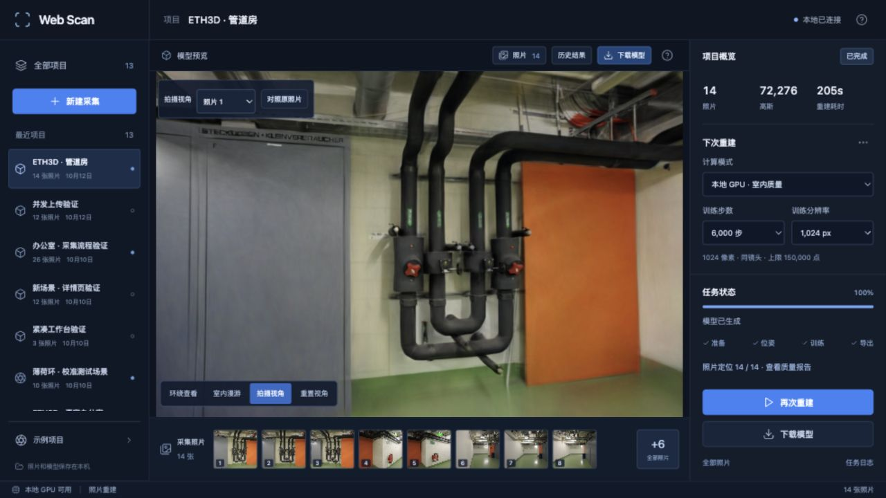
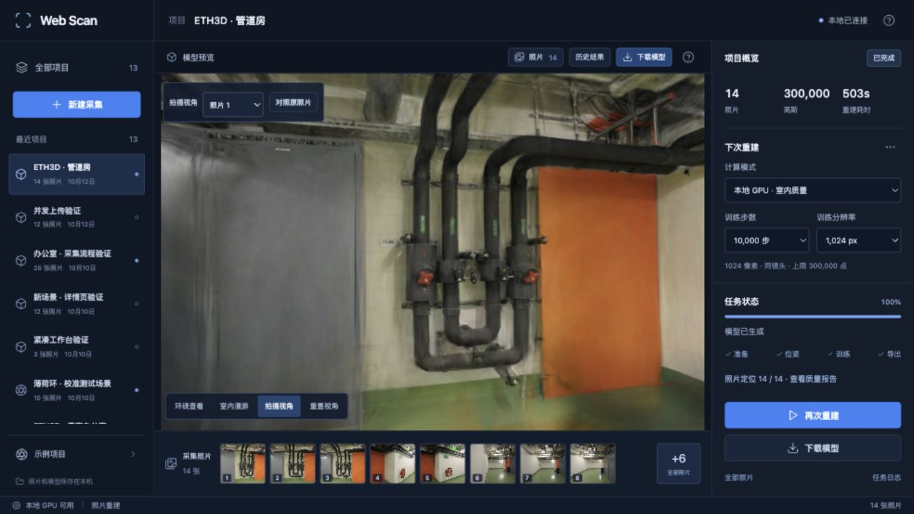
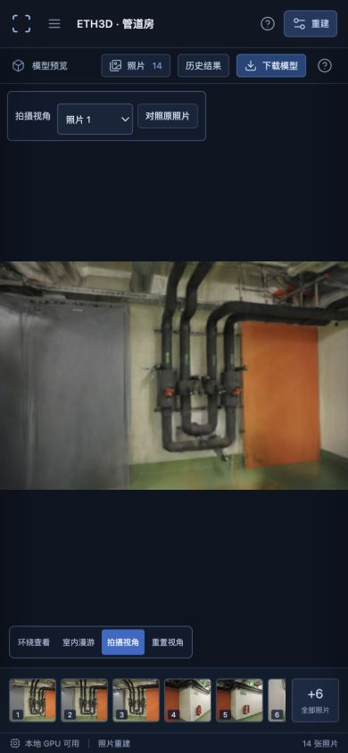

# 画质优化实测

2026-10-12，Apple Silicon Mac，本地 Brush 0.3.0 / PyCOLMAP 3.13.0。这里记录实际跑出的结果，不把更多高斯或更多步数直接当作质量保证。

## 这次改了什么

- 网页直接读取完整 PLY，通过 Spark 2.3.1 / Three.js 显示 SH3，避免旧版 `.splat` 预览丢弃方向相关颜色。
- 新增拍摄视角与去畸变原照片切换，使用真实相机内参、位姿和画幅。主点偏移、COLMAP 与 Three.js 坐标变换都有数值测试；旧任务缺少必要信息时禁用该入口。
- 位姿求解将特征预算从 4096 提到 8192，启用 guided matching，提供用户明确选择的同镜头固定焦距模式。混合尺寸照片不能使用同镜头模式，相机模式参与缓存标识。
- 训练分辨率可选 512 / 1024 / 1600；步数可选 3000 / 6000 / 10000 / 30000。新项目默认 6000 步 / 1024 像素 / 15 万高斯预算。下表额外测试了更长训练档，不等同于最终默认档。
- 最终模型可使用全部已定位照片。每 8 张留出一张的模式保留给实验对照；没有留出照片的任务不展示虚构的评估成绩。
- 增加历史结果、质量报告和未定位照片提示。历史链接包含任务 ID，不会把新模型覆盖成旧模型；下次训练设置独立保存。

## 两组同位姿对照

每组先运行新位姿流程，再连续训练快速档与精细档。两次相机 JSON 完全相同，后一次通过缓存复用；评估照片文件名集合也完全相同。高斯上限均为 30 万。

| 场景 | 定位 | 快速档：3000 步 / 512 | 精细档：10000 步 / 1024 |
| --- | --- | --- | --- |
| ETH3D pipes | 14 / 14 | 11,549 个高斯，32.09 秒 | 300,000 个高斯，503.31 秒 |
| ETH3D office | 26 / 26 | 14,394 个高斯，35.92 秒 | 231,428 个高斯，577.89 秒 |

时间包含该任务的输入检查、位姿阶段、训练和导出；快速档包含首次 SfM，精细档复用缓存。运行期间做过本地浏览器验证，GPU 可能受查看器竞争影响，以上是此次实验实际耗时，不是隔离环境下的性能基准。纯计时比较应关闭查看器重新测量。

管道房此前默认流程只定位了 11 / 14 张，生成 4,841 个高斯。新流程的同镜头约束和更充分的匹配一起启用，未单独消融，不能把全部改善归因于其中某一个参数。

## 按相同尺寸重新评分

Brush 原始日志分别在 512、1024 分辨率评分，不能直接横向比较。`scripts/compare_quality.py` 将每张评估渲染图及对应去畸变照片统一到长边 512，采用相同的 Lanczos 缩放，再计算全图 RGB PSNR 与 11×11 Gaussian-window SSIM，最后按视角等权平均。

| 场景 | PSNR：快速 → 精细 | SSIM：快速 → 精细 | 评估视角数 |
| --- | --- | --- | --- |
| pipes | 18.159 → 18.430 | 0.7301 → 0.7578 | 2 |
| office | 21.098 → 20.838 | 0.8573 → 0.8754 | 4 |

精细档的结构相似度均提高，局部文字和管线细节更清楚，但成本明显上升，办公室的平均像素误差指标反而略差。它不是所有指标、所有视角都更好。pipes 的另一评估视角仍明显偏差，漫游离开采集轨迹仍可能出现拉丝、空洞。

这些评估照片参与过上游 SfM；这是固定几何下的渲染留出对照，不是完全独立的端到端测试。样本只有两个场景和六个评估视角，不代表其他设备或房间。

原始记录：[训练记录](benchmarks/quality-runs.json)、[pipes 各视角评分](benchmarks/pipes-quality.json)、[office 各视角评分](benchmarks/office-quality.json)。

## 全部照片训练的最终模型

在上述对照完成后，pipes 使用全部 14 张已定位照片，按 6000 步 / 1024 像素 / 15 万点预算再训练一版。生成 72,276 个高斯，实际耗时 205.43 秒，复用相同位姿。模型已在浏览器查看并成功下载 PLY（约 16.3 MiB）。管线边缘和阀门更清楚，但这次照片全部参与训练，不能把同拍摄视角的改善当作留出评测提升。

这套参数作为默认精细档，旧项目继续保留自己的设置。同镜头模式仍需按实际采集条件选择。原照片没覆盖到的区域仍可能有空洞，离开采集轨迹的视角仍需单独检查。

任务：`0d7d2cb4e3474d1aaa05036de6f49aa7`，[完整报告](benchmarks/pipes-final.json)。



## 页面验证

1280×720 和 390×844：主文档没有横向或纵向溢出。验证了拍摄视角切换、同画幅原照片对照、漫游与重置、质量参数保留、历史任务切换与链接刷新。Spark 查看器未记录控制台错误。

下面是 pipes 精细档的网页实际截图；不是用原照片替换的模型画面。顶部“对照原照片”按钮可切换到真实照片。



手机拍摄视角按原图比例留边，切换漫游可使用全部视口。



## 复现

准备并导入两组公开数据集后，替换下面的项目 ID：

```bash
.venv/bin/python scripts/benchmark_quality.py --sessions PIPES_SESSION OFFICE_SESSION

.venv/bin/python scripts/compare_quality.py \
  --quick QUICK_JOB --detail DETAIL_JOB \
  --output .qa/comparison.json
```

对照脚本明确使用留出评测模式，不覆盖已有模型。切换精细档会延长增点阶段，但该实验没有另外调整增点阈值、曝光校正或法向约束。双边网格、深度约束、采集覆盖引导及 IMU/WebXR 位姿融合仍未实现。

数据来源：Schöps 等，ETH3D / CVPR 2017，[官方数据集](https://www.eth3d.net/datasets)，[CC BY-NC-SA 4.0](https://creativecommons.org/licenses/by-nc-sa/4.0/)。相关照片、重建截图与衍生模型保留该许可。


## 增点结束时间复测 · 2026-10-16

固定相机和训练预算，把增点结束从 80% 提前到 50%，每场景每种设置各重复两次。较少点数没有带来足够的收敛收益，两场景平均 PSNR / SSIM 均下降，因此保持原策略。[完整对照](GROWTH-STOP.md)

## 尺度约束复测 · 2026-10-20

将尺度损失权重从 `1e-8` 提到 `1e-6`，两场景各做两次同相机对照。office 平均成绩提高，pipes 结果不稳定且均值未改善；漫游仍有拉丝与细节缺失。没有采用为默认，也没有把单次上涨或点数变化当作稳定收益。[八次训练与同视角输出](SCALE-LOSS.md)

## 单生产任务读图 · 2026-10-21

在独立 Brush 实验构建中，从 10 个图像生产任务减少到 1 个，完整消费序列在两次重复中一致，但两场景平均 PSNR 均下降，模型仍有波动。保留追踪补丁用于继续研究，不修改正式训练器。[同相机成绩与取舍](LOADER-ORDER.md)

## 加权采样与初始化 · 2026-10-21

固定加权采样种子后，给定相同权重流的采样测试通过，但实际模型仍不确定。追踪发现同一初始点集合的容器遍历顺序和首次采样权重已发生变化；下一步先固定初始化顺序，再判断采样器对真实模型的影响。本轮不改默认设置。[同视角评分与追踪证据](SAMPLING-SEED.md)

## 初始点编号与排序 · 2026-10-22

修正实验训练器的点编号字节序，再按真实编号排序，初始点序列可重复；首次采样权重和模型仍有差异。两场景平均画质有升有降，未设为默认，继续区分随机初始化和首轮计算的影响。[读取测试、同视角成绩与限制](INIT-ORDER.md)

## GPU 初始化种子 · 2026-10-22

补上当前依赖组合中遗漏的 CubeCL 随机种子传递后，两场景的初始完整 PLY 在各自两次运行中相同；第一次参数更新后仍分叉。保留实验修正，未替换正式引擎。八次 1000 步对照的画质仍波动，不把初始状态可重复当作完整训练确定性或画质收益。[GPU 测试与同视角成绩](GPU-SEED.md)

## Adam 稳定项 · 2026-10-22

首轮实际梯度说明很小的 epsilon 会放大近零旋转梯度。全参数组由 `1e-15` 改成 `1e-8` 后早期旋转差异缩小，但八次3000步对照中 pipes 平均 PSNR 下降，office 变化很小，最终模型仍不确定；未采用为默认。[梯度证据、完整成绩与取舍](ADAM-EPSILON.md)

## 旋转组稳定项 · 2026-10-23

只调整旋转组 epsilon，其余组保留原设置，八次3000步同相机训练中两场景平均 PSNR / SSIM 均下降。早期旋转差异缩小没有转化为画质收益，未采用，暂停继续提高 epsilon。[状态验证与同视角成绩](ROTATION-ADAM.md)

## 增点索引顺序 · 2026-10-23

在属性读取和随机偏移分配前固定索引顺序，候选116次调用全部升序。八次同相机对照中pipes均值提高，office略降，实际选中集合与模型仍变化；保留实验开关，没有替换正式引擎。[逐次成绩与限制](REFINE-ORDER.md)
