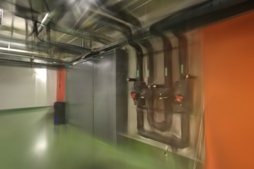
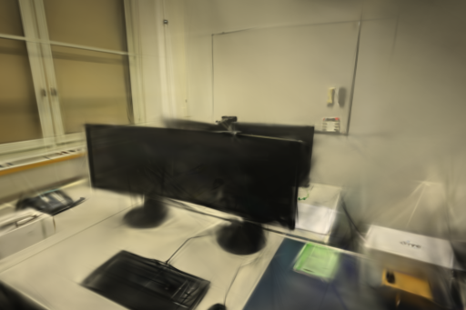

# 复用离线评分的参考统计量

2026-10-31，Apple Silicon macOS，Torch CPU，4 线程。共同网格对照现在只计算一次参考照片的 SSIM 均值与方差，再分别评测两个模型。四组固定模型各交错重复三次，完整评分中位耗时减少 15.4%–20.7%；12 张历史留出图与 6 张新重建留出图的 PSNR、SSIM 均与旧实现完全一致。采用此实现。

## 原理与取舍

[Wang、Bovik、Sheikh、Simoncelli 的 SSIM 论文与说明](https://www.cns.nyu.edu/~lcv/ssim/)给出基于局部均值、方差与协方差的结构相似性。项目保留已有 RGB、11×11 高斯窗、σ=1.5、无填充及视图等权平均定义，不改成灰度、多尺度或额外降采样的另一套分数。

首先尝试了 [VainF 的 MIT 项目 pytorch-msssim](https://github.com/VainF/pytorch-msssim)说明的可分离高斯卷积原理，将二维卷积换成横向和纵向两次卷积。虽然数学等价，Float32 累加顺序改变使首组 pipes 的逐视角 SSIM 最大偏差达到 `7.3909759521484375e-6`，超过运行前规定的 `5e-6` 容差，故停止并放弃；没有放宽门槛，也不发布该方案的提速结论。[未采用补丁](benchmarks/ssim-separable-rejected.patch)

最终保留原二维卷积，只复用同一参考照片的张量、均值与方差。两个模型共需的卷积从 10 次变为 8 次，渲染自身统计及与参考的协方差仍分别计算；每个视角结束后释放引用，不建立跨照片缓存。独立 `metrics()` 调用仍受支持，原始域掩码评分、LPIPS 和 Brush 训练损失均不改。

此次查阅的 [Brush 最新稳定版本](https://github.com/ArthurBrussee/brush/releases/tag/v0.3.0)仍为 0.3.0，继续使用已校验的官方程序。本轮实现属于离线 CPU 评测，不移植训练内核，不适用于推断 Metal / CUDA 训练收益，也不改变纯照片、已知位姿或雷达输入路径。

## 固定模型评分基线

旧实现冻结自 [9129eed](https://github.com/sakorman/web-scan/commit/9129eeda15589a7e6b65fec2a85af4a4e7e9b1e2)。每组让同一保存任务作为对照的两个输入，固定图片与相机，仍执行完整身份校验、解码、缩放及两次评分；没有因图片相同而跳过计算。每实现、每组先预热一次，再交换先后顺序重复三次，共 24 次正式测量。导入与预热不计时，文件缓存未清空，无其他训练或实验查看器竞争。

| 场景 / 实际评分网格 | 留出图 | 模型步数 | 实际高斯 | 完整 PLY 字节 | 旧评分中位数 | 复用后中位数 | 耗时减少 |
| --- | ---: | ---: | ---: | ---: | ---: | ---: | ---: |
| pipes / 512×341 | 2 | 3,000 | 11,447 | 2,703,042 | 0.604640 s | 0.509847 s | 15.68% |
| office / 512×341 | 4 | 3,000 | 14,684 | 3,466,974 | 1.210820 s | 1.023799 s | 15.45% |
| pipes / 1024×673 | 2 | 6,000 | 79,498 | 18,763,078 | 2.623522 s | 2.081137 s | 20.67% |
| office / 1024×667 | 4 | 6,000 | 77,399 | 18,267,714 | 5.122848 s | 4.291576 s | 16.23% |

每行只比较同一份输入上的新旧评分程序，不跨行比较模型质量或训练速度。512 场景来自[三角化视差实验的基线](ANGLE-INITIALIZATION.md)，1024 场景来自[张量尾部实验的基线](SSIM-TAIL-DEFAULT.md)，后者属于历史实验引擎输出；本轮没有重新训练这些模型或将实验引擎接入产品。它们分别为 14 / 14、26 / 26 定位，12 / 2、22 / 4 训练 / 留出，无失败视角。

所有逐视角分数、相机、尺寸及输出结构与旧代码逐项相等；耗时逐次值、图片摘要、引擎与适配器摘要见[公开数据](benchmarks/reference-metrics.json)。没有估计训练内存，也未单独测评分峰值内存；只保持一张参考照片的统计量存活，不把此结果称为零内存代价。

## 新照片重建回归

通过 8787 API 串行创建两个独立任务，使用原有 ETH3D 采集的冻结照片和共享 RADIAL 缓存位姿，去畸变后为 PINHOLE。纯 RGB 输入，不用真值相机、深度或雷达。Brush 0.3.0 Metal、种子 42、3,000 步、512 长边、150,000 高斯预算、SH3，每 100 步增密、2,400 步停止增密、每 500 步导出、每 8 张留出一张。

| 配置 / 结果 | pipes | office |
| --- | ---: | ---: |
| 任务 | `0be362d66c314ab7a2b06b59cc1aa8dd` | `841ddb9f31b34f1e83e5753d332c6d56` |
| 输入 / 定位照片 | 14 / 14 | 26 / 26 |
| 失败视角 | 无 | 无 |
| 训练 / 留出 | 12 / 2 | 22 / 4 |
| 原图尺寸 | 1600×1067 | 1600×1067 |
| 去畸变尺寸 | 1600×1066 | 1600×1067 |
| 渲染 / 评分尺寸 | 512×341 | 512×341 |
| 实际高斯 | 11,789 | 14,602 |
| 完整 PLY 字节 | 2,783,754 | 3,447,622 |
| SfM 缓存检查与恢复 | 0.0246 s | 0.0362 s |
| 训练及模型导出 | 22.9311 s | 23.4861 s |
| API 任务总耗时 | 23.01 s | 23.58 s |
| 共同网格 PSNR（新旧一致） | 19.512864 | 21.639036 |
| 共同网格 SSIM（新旧一致） | 0.769835 | 0.879619 |

这里的 SfM 耗时是缓存恢复，不是重新求解；API 总耗时不包括最初采集和导入。留出照片参与过上游 SfM，不能当作独立端到端质量评估。新旧程序评测同一份新模型，无需为只读评分变更再训练一份随机不同的模型。

两模型均通过完整 SH3 数值和字段检查。评分前后逐项校验照片、渲染、模型、稀疏文件与相机摘要，全部未变；新旧结果完全相同，历史成绩无需重写。

| pipes 留出 `0008` | office 留出 `0024` |
| --- | --- |
|  |  |

以上为未经修改的训练器 PNG，两种评分使用的就是同一份像素。管线、桌面和显示器边缘仍偏软；本轮不宣称改善画质、空洞或漂浮物。页面和渲染代码未改，未重复浏览器漫游。

## 验证与复现

新增 5 项回归：独立 NumPy Float64 稠密窗公式对照覆盖最小 11×11、横图、竖图，以及亮部低对比度；重复及逆序评分、不同参考照片检查防止统计量被修改或串用。全量 193 项后端、18 项前端、类型检查及构建通过。现有 TestClient 弃用提示与约 2.99 MB 查看器包体警告仍在。

亮部测试暴露了跨平台数值边界：本机旧实现相对双精度公式已有 `5.72e-5` 偏差，初次采用 `1e-4` 容差后本地通过，但 [Ubuntu CI](https://github.com/sakorman/web-scan/actions/runs/41179540032)得到 `0.99611109495`，与双精度参考的差值为 `3.32e-4`，导致 1 项测试失败。最终不再扩大容差，而将亮部用例改为与同一后端的冻结旧 Float32 公式严格相等；有纹理的三组尺寸继续独立验证双精度公式，并增加与旧公式的严格相等检查。产品计算未变，真实图片兼容性仍要求零差值。最初直接调用 `pytest` 入口未将仓库放入模块路径，按现有命令 `python -m pytest` 执行后正常；未修改系统权限或运行时检查。

从仓库根目录冻结旧评分，并使用新目录运行：

```bash
mkdir .data/benchmarks/reference-metrics-repro
git show 9129eed:scripts/compare_quality.py > .data/benchmarks/reference-metrics-repro/baseline.py
.venv/bin/python scripts/benchmark_scoring.py \
  --baseline .data/benchmarks/reference-metrics-repro/baseline.py \
  --candidate scripts/compare_quality.py --data .data \
  --jobs 0be362d66c314ab7a2b06b59cc1aa8dd 841ddb9f31b34f1e83e5753d332c6d56 \
  --size 512 --repeats 3 --output .data/benchmarks/reference-metrics-repro/scoring
```

历史四组使用数据文件中的 `source_directory`，在新的评分目录 `jobs/` 下建立对应符号链接，再传入该评分目录和任务名。脚本冻结两份评分程序、校验逐视角分数完全一致并保存预热、正式计时和输出；其他机器可替换为同配置的新任务。性能数值不保证跨硬件复现，得分与照片身份必须一致。

本轮保留有实测收益的参考统计复用，放弃会改变累加结果的分离卷积。下一步只有评分规模或瓶颈发生变化时才扩展测量；该优化不替代采集覆盖、位姿和几何约束研究。

照片及衍生图来自 Schöps 等的 [ETH3D / CVPR 2017](https://www.eth3d.net/datasets)，遵循 [CC BY-NC-SA 4.0](../THIRD_PARTY_NOTICES.md#test-dataset)。Brush 为 Arthur Brussee 等的 Apache-2.0 项目。SSIM 原论文与 VainF 的 MIT 项目用于理解计算原理，未引入新依赖；原始照片、模型和完整日志留在 `.samples` / `.data`。
