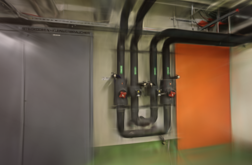
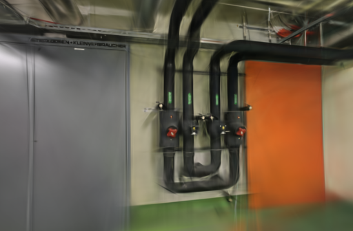
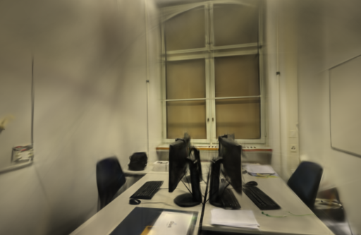
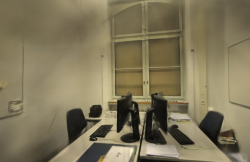

# 增点索引顺序

2026-10-23。在独立 Brush 构建中，先对选中的高斯索引排序，再生成子高斯。候选的116次增点 / 裁剪调用都按索引升序执行，排除了集合遍历顺序对父高斯与随机偏移对应关系的影响。但实际选中集合和最终模型仍有变化，画质也没有在两场景一致改善，因此保留为实验开关，没有替换正式引擎。

## 改动范围

原流程把选中索引存入 `HashSet`，直接按遍历顺序取出父高斯的坐标、旋转、尺度和颜色，再逐行分配随机偏移。同一个集合换一种排列时，同一段随机数会分配给不同的父高斯。

候选在这个转换点增加排序，之后的属性读取、偏移生成、写回和追加都使用同一个序列。索引指当前高斯数组中的位置，不是 COLMAP 原始点编号。给定相同选中集合和相同偏移序列时，排序后的对应关系固定；它不会固定上游梯度、权重或选中集合。

新增回归检查：不同遍历顺序下父高斯与样本对应相同、成员保留，关闭排序时沿用原顺序，并覆盖空集合和单元素。1项测试通过，release构建通过。本轮所有参数组的 Adam epsilon 均为原值 `1e-15`，不启用此前未采用的稳定项方案。

## 顺序验证结果

八次正式训练各执行29次增点 / 裁剪，共232条索引记录，全部无重复索引。四次候选的116条记录均升序，基线116条均非升序。24,000条照片消费记录完整，每场景的照片顺序一致，初始完整 PLY 也一致。

同设置的两次重复中，pipes 基线第一次增点的集合相同、顺序不同，复现了要排除的问题。其它调用以及两场景候选的对应调用，选中集合已经不同。因此，不能把候选的每次排序正确写成“实际增点序列已重复一致”。两场景的最终模型仍不同。

开始训练后、第1、10、100次更新的快照仍能看到差异；首次增点发生在第101次更新后。排序尚未执行时就出现的差异，不能归因于本轮改动。[完整数据](benchmarks/refine-order.json)保留逐次索引数量、顺序 / 集合摘要和状态差值。

## 同相机对照

Apple M5 / 32 GiB、Metal、Rust / Cargo 1.99.0；两组使用同一个 `0.3.0-refine-order-study` 二进制。源码锁定 Brush `3edecbb2fe79d3e2c87eeab85b15e0b1dd10d486` 及原 `Cargo.lock`。

- pipes 输入 / 定位14 / 14，训练 / 评估12 / 2；office为26 / 26、22 / 4，无失败定位视角。
- 使用10月12日同镜头模式的固定几何，核对输入、稀疏文件、相机、评估集合和参考图摘要。
- 3000步、512像素长边、15万高斯预算、SH3，每100步增点，80%步数后停止增长，每500步导出，每8张留出一张。
- 固定图像消费和初始点顺序，CLI、CPU加权采样与GPU种子均为42。每场景两设置各两次，pipes按基线、候选、候选、基线运行，office相反。
- GPU串行使用，浏览器在计时期间停在项目列表，系统和驱动缓存未清空。两组都保留状态快照，关闭首轮梯度读回；仅在本轮内比较，不与此前不同观测配置的运行拼接统计。

评分使用 `compare_quality.py`：同相机、同画幅、同参考图，统一到长边512，计算RGB PSNR与11×11 Gaussian-window SSIM，按视角等权平均。评估照片参与过SfM，属于固定几何下的渲染留出对照。

| 场景 | 重复 | 索引顺序 | 训练与导出 | 实际高斯 | PLY 字节 | PSNR / SSIM |
| --- | ---: | --- | ---: | ---: | ---: | --- |
| pipes | 1 | 原始遍历 | 23.1876 s | 11,523 | 2,720,978 | 17.4579 / 0.72704 |
| pipes | 1 | 升序 | 23.1918 s | 11,389 | 2,689,354 | 18.4317 / 0.74423 |
| pipes | 2 | 原始遍历 | 24.2165 s | 11,514 | 2,718,854 | 18.7328 / 0.74291 |
| pipes | 2 | 升序 | 23.2140 s | 11,516 | 2,719,326 | 18.8148 / 0.74509 |
| office | 1 | 原始遍历 | 24.2363 s | 14,350 | 3,388,150 | 21.3811 / 0.86547 |
| office | 1 | 升序 | 24.2153 s | 14,352 | 3,388,622 | 20.8728 / 0.86383 |
| office | 2 | 原始遍历 | 24.1958 s | 14,455 | 3,412,930 | 21.0199 / 0.85839 |
| office | 2 | 升序 | 24.2187 s | 14,461 | 3,414,346 | 21.0929 / 0.85906 |

pipes平均PSNR 18.0954 → 18.6233，SSIM 0.73498 → 0.74466；office为21.2005 → 20.9828、0.86193 → 0.86145。只有两次重复，且两场景方向不一致，尚未证明一般画质收益。

时间覆盖训练、评估、追踪、快照与导出，不含源码编译和输入复制。本轮复用几何，未重算SfM，未测新的API端到端耗时或峰值内存。排序增加CPU工作，未单独测量其开销；快照同步与一秒进程轮询也影响计时，不将约半秒的均值差当作提速。

固定展示首次重复的第一个留出视角，左右相机和画幅一致，原生PNG未修改：

| 场景 | 原始遍历 | 按索引排序 |
| --- | --- | --- |
| pipes |  |  |
| office |  |  |

八个模型通过完整SH3和评估校验。浏览器加载两场景基线 / 候选，并拖动候选漫游，无控制台错误或警告。细管和线缆仍模糊，office在覆盖外仍有明显拉丝与漂浮片段，未确认稳定的漫游改善。

## 取舍与复现

保留排序开关用于控制实验中的一个变量，不将整套实验构建设为默认。正式引擎、原照片和历史模型保留。初始化、采样和顺序已分别核查，下一步用已有TUM 96帧补充密集采集对照，先确认位姿与评估范围，再决定质量改动；完整训练确定性不作为继续画质工作的前提。

项目基线 [fd349f0](https://github.com/sakorman/web-scan/commit/fd349f0)。[refine-order.patch](benchmarks/refine-order.patch)是相对干净 Brush `v0.3.0` 的累计补丁，包含此前实验，不能叠加旧补丁。按[源码构建方法](LOADER-ORDER.md#决定与复现)换用本补丁。回归测试：

```bash
cargo test --manifest-path .tools/brush-order-study/Cargo.toml \
  --locked --release -p brush-train parent_to_sample_assignment_ignores_container_order
```

两组均将 `WEBSCAN_SINGLE_LOADER`、`WEBSCAN_TRACE_LOADER`、`WEBSCAN_TRACE_SAMPLING`、`WEBSCAN_SEEDED_SAMPLING`、`WEBSCAN_STABLE_INIT`、`WEBSCAN_TRACE_STATE`、`WEBSCAN_SEED_GPU` 设为 `1`；将 `WEBSCAN_STABLE_ADAM`、`WEBSCAN_ROTATION_ADAM`、`WEBSCAN_TRACE_GRADIENT` 设为 `0`。仅切换 `WEBSCAN_STABLE_REFINE=0` / `1`。CLI使用此前[3000步固定参数](ADAM-EPSILON.md#取舍与复现)，每次设置独立输入和输出目录。

本机资料在 `.data/benchmarks/refine-order-20261023/`，保留二进制、测试及构建日志、适配器、模型、状态与索引分析脚本。公开JSON包含逐次 / 逐视角指标、全部232次索引摘要和原图摘要。应用源码未变，不重复其本地测试；提交后由标准CI检查后端、前端、类型和构建。

补丁遵循 [Brush Apache-2.0 许可](../THIRD_PARTY_NOTICES.md#brush-loading-experiment)，照片与渲染遵循 [ETH3D 署名和许可](../THIRD_PARTY_NOTICES.md#test-dataset)。
