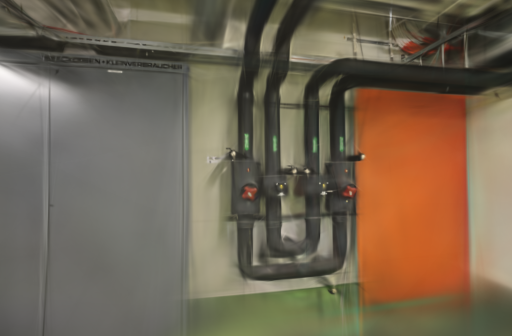
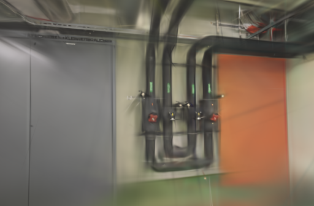
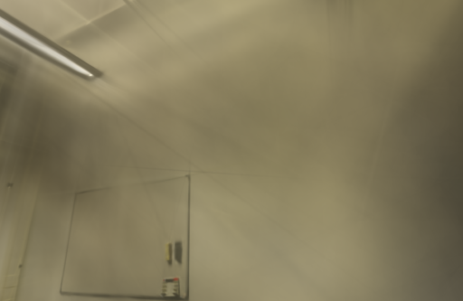
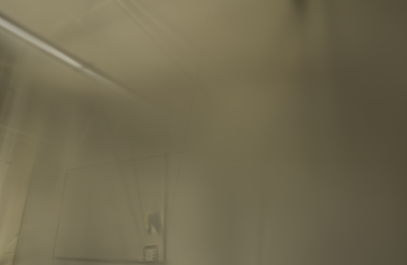

# 200 步增点间隔筛查

2026-10-27。应用适配器使用每 100 步细化一次；Brush 0.3.0 的 CLI 默认值是 200。本轮只把候选的 `--refine-every` 改为 200，以固定的 ETH3D 位姿、照片、留出视角和训练预算进行一次交错筛查。候选在两组场景均降低了共同网格上的 PSNR、SSIM，默认值保持 100。

## 设置

- Apple M5 / 32 GiB / macOS，官方 Brush 0.3.0，二进制 SHA-256 为 `8380ed40cce870025393e1ea0257e0752351c67a409d827b76dc75ec3a999a71`。
- 每组均为 3,000 步、512 像素长边、150,000 高斯上限、SH3、种子 42；每 500 步导出，2,400 步后停止增点。只切换细化间隔 100 → 200。
- pipes 输入 / 定位为 14 / 14，训练 / 留出为 12 / 2；office 为 26 / 26、22 / 4。没有未定位视角，SfM 和输入复制不计入下表时间。
- GPU 串行执行。pipes 按 100 → 200，office 按 200 → 100；浏览器没有打开模型预览。每组只有一次，结果用于排除明显退化，不足以建立通用参数结论。

## 结果

训练器原生留出分数和统一评分都指向退化。间隔加大后模型和 PLY 更小，但这不是同画质提速，不能作为性能收益。

| 场景 | 间隔 | 训练、评估、导出 | 实际高斯 / PLY | Brush PSNR / SSIM | 统一 512 网格 PSNR / SSIM |
| --- | ---: | ---: | ---: | --- | --- |
| pipes | 100 | 23.1917 s | 11,562 / 2,730,182 B | 18.89809 / 0.758471 | 18.70796 / 0.732956 |
| pipes | 200 | 22.1652 s | 3,992 / 943,661 B | 18.48677 / 0.739821 | 18.29671 / 0.711724 |
| office | 100 | 23.1741 s | 14,293 / 3,374,698 B | 21.12559 / 0.872560 | 20.98770 / 0.857521 |
| office | 200 | 22.1858 s | 5,132 / 1,212,701 B | 20.84150 / 0.855507 | 20.68288 / 0.838759 |

以 100 步为基线，200 步在 pipes / office 分别少用 4.43% / 4.26% 的训练、评估和导出时间，但高斯数量同时减少 65.47% / 64.09%。统一网格的 PSNR 分别下降 0.41125 / 0.30482 dB，SSIM 下降 0.02123 / 0.01876。两组 PLY 和评估 PNG 均通过完整 SH3、留出集合及参考图摘要校验。

## 同视角检查

两列都来自同一留出相机、同一画幅的原生 512 像素 PNG，未替换为原照片或做后期处理。pipes 的细管、接头和墙面边界在 200 步候选中更软；office 的门板线条和天花反射也更淡。漫游仍会在覆盖范围外出现空洞和拉丝，未观察到候选的补偿改善。

| 场景 | 100 步 | 200 步 |
| --- | --- | --- |
| pipes |  |  |
| office |  |  |

## 工件与复现

`scripts/benchmark_exports.py` 现在为每次比较写出与普通任务一致的 `sfm/scene.json`、`artifacts/cameras.json` 和 `artifacts/report.json`。这样 `scripts/compare_quality.py` 能先验证相机、留出照片和参考摘要，再在双方原生尺寸不被放大的共同网格上评分。

本轮输入摘要、逐次时间、模型大小、引擎和适配器摘要保存在[公开汇总](benchmarks/refine-every-200.json)。本机的完整模型、日志和评测 PNG 保留在 `.data/benchmarks/refine-every-200-20261027-rerun/`，不纳入仓库。

Brush 将细化间隔定义为高斯替换和增密的频率；其建议值与场景覆盖相关，不能把 CLI 默认值直接当作室内采集的最优值。[Brush 0.3.0 配置](https://github.com/ArthurBrussee/brush/blob/v0.3.0/crates/brush-train/src/config.rs) · [3D Gaussian Splatting](https://arxiv.org/abs/2308.04079) · [ETH3D 数据集](https://www.eth3d.net/datasets)
