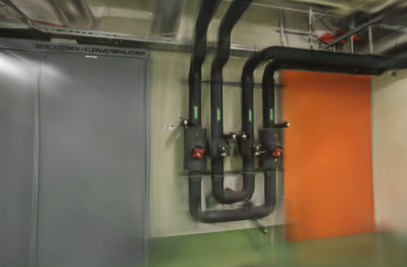
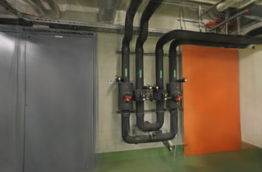

# 小场景增点频率对照

2026-10-14，Apple M5 / 32 GiB / Brush 0.3.0。测试将增点间隔从 100 步缩短到 50 步，观察同样训练预算下能否获得更多细节。两组场景都没有得到稳定的综合收益，因此默认参数保持不变。

Brush 的 [refine_every 配置](https://github.com/ArthurBrussee/brush/blob/v0.3.0/crates/brush-train/src/config.rs) 控制高斯替换与增密频率。实验只改变这一项；每次都是 3000 步、512 像素、15 万高斯上限、种子 42、相同冻结相机和输入照片。导出频率和损失参数保持一致。

## 重复方式

每场景每种设置各运行两次，共八次真实 GPU 训练，串行执行。pipes 顺序为 100 → 50 → 50 → 100，office 顺序相反。相同场景四次的输入摘要一致，留出评测视图相同且全部通过完整性校验。固定种子仍不能保证逐步训练序列相同；两次重复只能反映此次运行范围，不足以建立一般性结论。

输入 / 定位：pipes 14 / 14、office 26 / 26；训练 / 评测：pipes 12 / 2、office 22 / 4。相机来自先前成功重建，此次不重跑 SfM。下表耗时包括训练、评测、导出与结果校验，不含输入复制。

## 结果

以下均为两次运行的平均值，逐次结果和范围保存在 [原始记录](benchmarks/refinement-repeat.json)。

| 场景 | 增点间隔 | 耗时 | 高斯数 | PSNR | SSIM |
| --- | ---: | ---: | ---: | ---: | ---: |
| pipes | 100 | 23.19 秒 | 11,448 | 18.8424 | 0.77003 |
| pipes | 50 | 32.24 秒 | 80,592 | 17.5156 | 0.76697 |
| office | 100 | 23.22 秒 | 14,258 | 21.0810 | 0.87414 |
| office | 50 | 32.27 秒 | 78,218 | 20.9225 | 0.88434 |

间隔减半使高斯数量大幅增加，耗时上升约 39%。pipes 的平均 PSNR 下降 1.33 dB，SSIM 略降；office 的 SSIM 提高约 0.010，但 PSNR 略降。细小纹理有改善，尚不足以抵消其他视角的误差和额外耗时，不能用更多高斯直接推断质量更好。

以下为 pipes 第一次对照的同一评测视角。训练预算相同，图像均来自实际评测输出；它们是对照样本，不代表默认精细档的效果。

| 100 步间隔 | 50 步间隔 |
| --- | --- |
|  |  |

评测照片参与过 SfM，指标不是完全独立的端到端成绩。没有修改现有采集、历史任务或默认训练策略。数据与图片沿用 [ETH3D 许可和署名](../THIRD_PARTY_NOTICES.md#test-dataset)。

## 复现

基准脚本增加 `--repeats` 和 `--resolution`。重复顺序交错，执行前复制适配器快照，防止运行期间编辑源码影响后面的试次；汇总列出均值和最小/最大值，拒绝缺失、重复或输入不一致的运行。

```bash
mkdir -p .qa/refinement
git show 8c4db08:webscan/brush.py > .qa/refinement/baseline.py
cp .qa/refinement/baseline.py .qa/refinement/candidate.py
patch .qa/refinement/candidate.py < docs/benchmarks/refine-50.patch
.venv/bin/python scripts/benchmark_exports.py --repo . \
  --baseline .qa/refinement/baseline.py --candidate .qa/refinement/candidate.py \
  --jobs PIPES_JOB OFFICE_JOB --steps 3000 --resolution 512 --repeats 2 \
  --output .qa/refinement/results
```

默认仍为每场景一次对照、6000 步和 1024 像素。接下来优先验证更密集的采集覆盖、相机精度及曝光一致性，再考虑更激进的增点。
