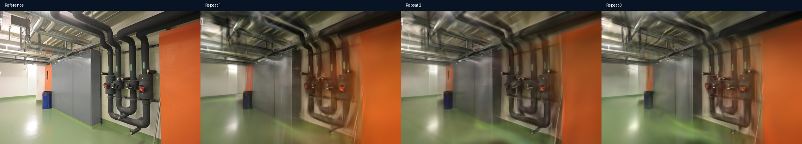
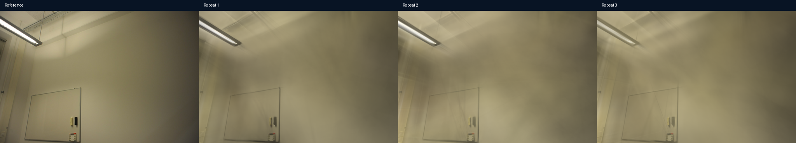
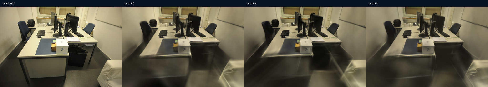
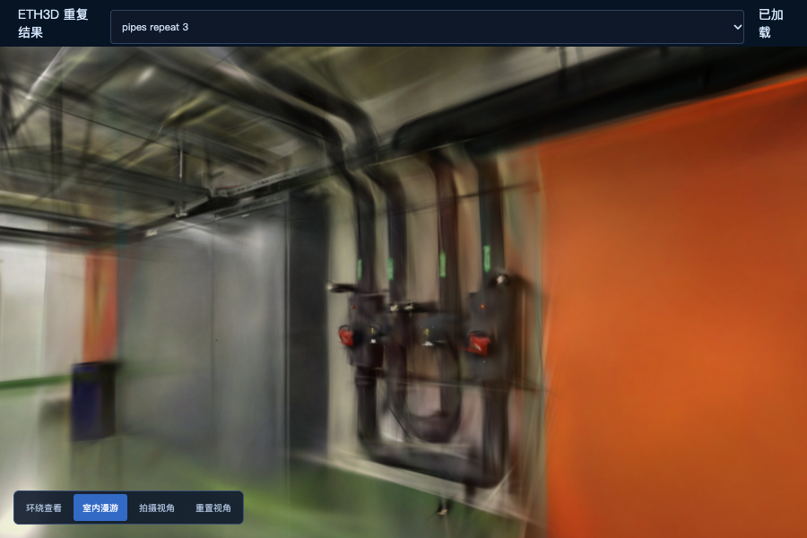
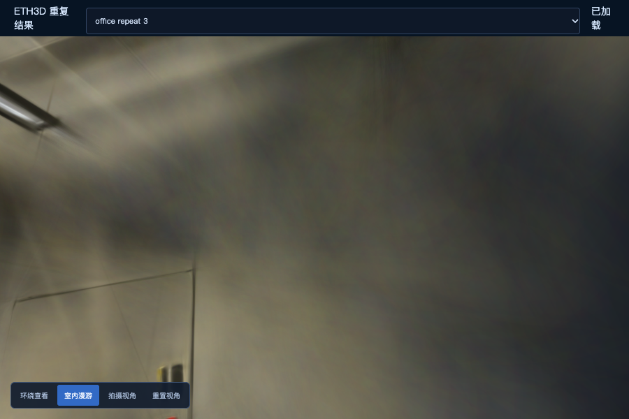

# 同配置重建的重复波动

2026-11-19。上一轮服务连接修复后，pipes 两次评分低于单次基线。本轮新增离线重复汇总工具，并固定配置完成六次实拍重建：office 三次均值的 PSNR 极差为 1.5621 dB；pipes 均值极差只有 0.1887 dB，但第 9 张留出照片为 0.9413 dB。保留工具，后续同时查看逐次、逐视角结果，避免用一次或整图平均值决定算法收益。

**没有证明上一轮 pipes 下降只是随机波动，也没有确认质量退化已解决。** 本轮没有新的训练算法或画质收益；三个样本的范围不是置信区间、正常波动上限或验收阈值。

## 研究依据与假设

- Arthur Brussee 的 [Brush 1388f74](https://github.com/ArthurBrussee/brush/commit/1388f74c6fe0236f68ee4915564bf00e9d2e3747)（2026-10-03，Apache-2.0）仍是本轮核对的主分支版本；本机继续使用已记录摘要的 0.3.0。[问题 525](https://github.com/ArthurBrussee/brush/issues/525)记录了 Linux / Vulkan 平台固定种子仍有差异的用户报告。该报告不是维护者确认的本机故障原因，不能直接套用到 Metal。
- Mohannad Adnan Al-Jaafari、Firas Abedi、Qiong Liu、You Yang 的 [DART-3DGS](https://doi.org/10.3390/jimaging12100483)（2026-10-04，期刊版本，文章 CC BY）第 4.4 节用三种训练种子报告均值与标准差。这里仅借鉴重复统计的方法；论文测试 CUDA，本轮是同一 seed 42 的重复，未移植或复现论文算法。
- 本机假设是：同一引擎、输入、相机、种子与配置的执行差异可能足以影响单次方案筛选。既有[加载顺序](LOADER-ORDER.md)、[采样种子](SAMPLING-SEED.md)、[GPU 种子](GPU-SEED.md)试验没有消除差异，本轮不再盲目调整随机源。

流程是纯照片求解 COLMAP 位姿，再由 Apple M5 / Metal 训练 Brush；不输入数据集真值位姿、深度或雷达。结果不外推到 CUDA、已知位姿或雷达流程。

## 工具与基线

基线提交 [c5d55af](https://github.com/sakorman/web-scan/commit/c5d55af880ec593c6eeeebbf328c8f8544ba6c2b)。先冻结计划和上一轮五份任务，以既有成对评分复核 pipes 的 0.9260 dB 极差，再新增 `scripts/compare_repeats.py`。工具以只读方式打开任务库，不创建任务；仅接受至少两个不同的成功 Brush 留出任务。

汇总前严格核对配置、引擎 SHA-256、种子、全部去畸变训练文件摘要、场景与相机、训练及评估视图数；复用 `compare_quality.py` 检查参考图、渲染完整性和共同评分网格。数据库与产物报告不一致、全照片训练、缺少引擎或种子身份、混用条件时拒绝汇总。输出保留每次结果，并给出均值、样本标准差（分母 n−1）、最小值、最大值、极差及逐视角统计。只核验已记录条件，不保证未记录的驱动或运行环境相同；旧任务缺少必要身份信息时不能使用。

## 固定条件与逐次结果

预先固定顺序为 pipes、office、office、pipes、pipes、office，各三次，不按结果挑选最优任务。运行前无活动训练，所有 GPU 任务串行，浏览器检查安排在训练结束后。每次新建独立 API 任务，复用已校验的 SfM；没有重新求解位姿，没有清空 Metal 或系统缓存，因此不是冷启动测试。

- 统一配置：3000 步、512 长边、150000 高斯预算、完整 SH3、同镜头 RADIAL、每 8 张留出 1 张，种子 42。细化间隔 100、增点停止 2400、导出间隔 500。实际高斯数见下表。
- Brush 0.3.0 程序 SHA-256：`8380ed40cce870025393e1ea0257e0752351c67a409d827b76dc75ec3a999a71`。
- pipes：14 输入 / 14 定位、失败 0，12 训练 / 2 留出（索引 0、8）；office：26 / 26、失败 0，22 / 4（0、8、16、24）。两场景原图都是 1600×1067；去畸变参考分别为 1600×1066 / 1600×1067。
- 原始 RADIAL `[f,cx,cy,k1,k2]`：pipes `[906.091435630405,800,533.5,-0.10091385666317157,0.06728544184812109]`；office `[906.4381085295956,800,533.5,-0.10327691090226823,0.06959028672322837]`。逐任务完整相机与摘要保留在产物及[数据](benchmarks/repeatability.json)。

所有评分使用相同相机、参考照片和 512×341 画幅，先逐图计算 PSNR / SSIM，再按视角等权平均。不是 Brush 原生日志分数。留出照片参与上游 SfM，也用于过往参数筛选，因此不是独立端到端或未见场景的泛化评估。

| 场景 / 重复 / 任务 | 高斯数 | PLY 字节 | PSNR dB | SSIM | 缓存恢复 s | 训练评估导出 s | 任务总计 s | 请求至观察完成 s |
| --- | ---: | ---: | ---: | ---: | ---: | ---: | ---: | ---: |
| pipes 1 `a2229147` | 11630 | 2746230 | 18.9663 | 0.756956 | 0.0350 | 22.9918 | 23.07 | 23.341 |
| pipes 2 `ca14d9ea` | 11585 | 2735610 | 19.1403 | 0.761632 | 0.0301 | 22.8062 | 22.90 | 24.399 |
| pipes 3 `dc5da800` | 11580 | 2734430 | 19.1550 | 0.763257 | 0.0220 | 22.6797 | 22.75 | 23.355 |
| office 1 `37fe989c` | 14559 | 3437474 | 22.6175 | 0.884364 | 0.0481 | 23.5685 | 23.69 | 24.352 |
| office 2 `d5d9ca3e` | 14506 | 3424966 | 21.2274 | 0.873877 | 0.0474 | 23.6000 | 23.71 | 24.376 |
| office 3 `9aa6b584` | 14428 | 3406558 | 21.0554 | 0.873445 | 0.0355 | 23.4880 | 23.57 | 24.379 |

“缓存恢复”是报告的 SfM 阶段，本轮实际 SfM 求解次数为 0；“请求至观察完成”含 API 和一秒轮询延迟，不含此前照片导入及首次 SfM。输入校验分别约 0.007–0.014 秒，完整计时见 JSON。未测冷启动端到端或峰值内存，不能从点数和时间的小差别宣称提速。

| 本轮三次结果 | PSNR 均值 ± 样本标准差 dB | PSNR 极差 dB | SSIM 均值 ± 样本标准差 | SSIM 极差 |
| --- | ---: | ---: | ---: | ---: |
| pipes | 19.0872 ± 0.1050 | 0.1887 | 0.760615 ± 0.003271 | 0.006301 |
| office | 21.6335 ± 0.8565 | 1.5621 | 0.877229 ± 0.006183 | 0.010918 |

pipes 索引 0 / 8 的 PSNR 极差分别为 0.5638 / 0.9413 dB，方向相反的变化会被整图均值抵消。office 索引 0 / 8 / 16 / 24 的极差为 2.0534 / 2.0005 / 1.5644 / 1.2308 dB，不能仅归因于一面墙或一个失败视角。

把上一轮条件身份一致的任务合并，只作描述统计：pipes 共六次极差 0.9260 dB，office 共五次极差 1.6638 dB。跨日期、服务修复前后的合并不是随机分组的因果对照；本轮 pipes 三次仍全部低于上一轮单次最高值。保留此前下降记录，不据此接受或否定数据库修复的画质影响。

## 同视角与漫游

下面依次为参考照片、重复 1、2、3；每格内容均为 512×341，标题不参与评分。office 墙面亮暗和阴影出现明显差异，桌边、椅子与细线仍有模糊或漂浮状伪影；pipes 地面反光、管线与墙面轮廓也不稳定。







六份完整 PLY 都在实际查看器加载，切换拍摄视角后进入漫游并拖动，无页面异常或 HTTP 错误。以下保存各场景第 3 次的同一拖动操作，未按最高分选图；偏离拍摄位置仍见拉伸、半透明边缘和细结构丢失，局部小范围检查没有证明空洞或漂浮物被修复，也不覆盖全场景任意轨迹。





## 验证、成本与复现

新增 16 项回归覆盖统计口径、任务身份漂移、训练照片及几何变化、全照片训练拒绝、重复 ID、缺库不创建和评分网格不一致。全量 325 项后端、18 项前端、类型检查与构建通过；保留既有 TestClient 弃用与前端大包警告。六份 PLY 均以 SH3 读回，实际点数与报告一致；运行期间 148 次健康及历史检查均正常，后台队列存活。

初次拼图校验把参考缩放到 512×341 包围框，产生 511×341 宽度，断言失败；改为与评分一致的 512×512 长边约束后通过，评分本身未变。第一次浏览器命令因前置脚本中止、文件尚未写出而失败，修复顺序后六模型验证通过。

新增离线汇总需重新读取并校验输入文件、计算评分；本轮三任务 pipes / office 汇总约 2.15 / 3.09 秒，不含框架导入，期间有 CPU 回归与构建活动，只作成本记录，未测隔离耗时或内存。每次重训仍约 23 秒；本工具读取历史结果时不启动 GPU。

在仓库根目录可直接汇总已完成的 pipes 三次任务：

```bash
PYTHONPATH=. .venv/bin/python scripts/compare_repeats.py --size 512 \
  --jobs a2229147134a4332b75c2f0dc91681ee ca14d9ea5323449b85271ed3ce6f3e1b dc5da8009bc846baaa5ed7f3f821145b \
  --output .data/benchmarks/repeatability-recheck/pipes.json
```

office 替换为 `37fe989c3f7e4d48a70623b7f3db466e`、`d5d9ca3e59b544d7af7dbba6f86c24b0`、`9aa6b584c61c4d779c0ce392fb594861`。仅在需要新训练时运行[六任务脚本](benchmarks/repeatability-run.py)：

```bash
.venv/bin/python docs/benchmarks/repeatability-run.py \
  --output .data/benchmarks/repeatability-new/results.json
```

脚本依赖本机保留的两个来源任务与服务 8787；输出路径必须不存在，运行前确认无其他 GPU 训练与浏览器渲染。配置与原始任务结果保留于 `.data/benchmarks/repeatability-20261119`，没有覆盖照片或历史模型。

下一步先针对 office 墙面进行固定模型、固定视角的误差分区核验，区分亮度偏差与结构损失，再决定一个有证据的训练候选。不同候选仍需预先固定重复次数及判定规则，本次三个样本不生成通用阈值。

照片与衍生截图来自 Thomas Schöps 等提供的 [ETH3D / CVPR 2017](https://www.eth3d.net/datasets)，遵循 [CC BY-NC-SA 4.0](https://creativecommons.org/licenses/by-nc-sa/4.0/)。未重新分发研究实现、原照片或模型。
