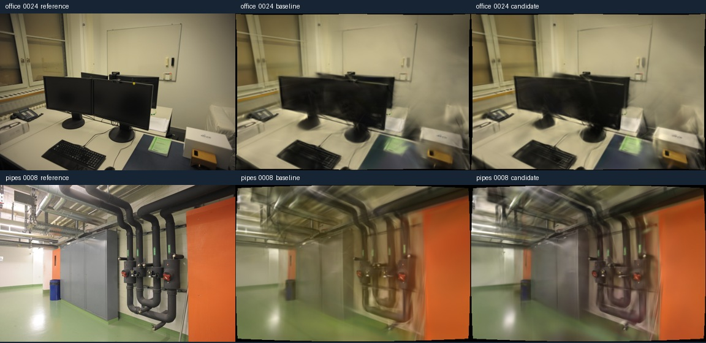

# 同镜头重试复用图像特征

2026-11-27。自动内参的首轮建图有时只能定位 ETH3D office 的 20/26 张照片。相同图片、尺寸和 SIFT 配置在同镜头重试时再次提取产生了完全相同的特征。重试现在按照片名将两张表写入独立数据库。两表在同一事务中提交；任一表缺失观测时整笔回滚，恢复原来的特征提取。两视图几何、匹配、相机参数和位姿由重试独立生成。旧任务与缓存保留，更新后的流水线签名会触发一次新求解。[COLMAP 3.13.0](https://github.com/colmap/colmap/tree/3.13.0) · [数据库结构](https://colmap.github.io/database.html)

## 计时和等价性

Apple M5，PyCOLMAP 3.13.0，CPU 四线程、最长边 1600、每张最多 8192 个 SIFT 特征、穷举引导匹配，两视图验证种子 42。每次使用新任务数据库。计时包含对特征内容取摘要的小额开销，操作系统文件缓存未清空。每个场景的首组原版与新版随后各做一次 3,000 步 Brush v0.3.0 Metal 留出训练，长边 512、种子 42、预算 150,000 个高斯，完整 SH3。

| 场景与分支 | 原版求姿 / 秒 | 复用版求姿 / 秒 | 最终定位 |
| --- | ---: | ---: | ---: |
| office，触发重试 | 21.06、20.58 | 15.76、13.93 | 各 26/26 |
| office，首轮定位充分 | 10.17 | 10.76 | 各 26/26 |
| pipes，首轮定位充分 | 6.43 | 5.95 | 各 14/14 |

office 首轮触发重试时缺少第 11–16 张，重试全部找回。默认建图有随机波动，同配置下也有直接定位全部图片的情况。隔离同镜头求解、固定映射种子 42，再用完全相同的输入相机比较，原版 8.28 秒、复用版 2.02 秒。双方得到 2,479 个稀疏点，26 台相机的内参及世界到相机矩阵最大绝对差为 0。逐行核验图像、相机、关键点、描述子、原始匹配、两视图几何的摘要全部一致。此约 4.1 倍为单次已触发的重试阶段对照。单次首次求姿和 GPU 训练另计。[各阶段实测与输入摘要](benchmarks/retry-features.json)

## 重建质量与代价

共享 RADIAL 用于 office 的触发重试，pipes 使用自动 SIMPLE_RADIAL。留出视图分别为每八张取一张，共 4 / 2 张，其余 22 / 12 张训练。参与 SfM 的留出照片不参与高斯训练。将两份模型的渲染分别逆投影回同一原始照片和画幅，在 512 像素长边共同有效区域逐视角等权评分。一次完整运行的合计涵盖 SfM 和训练、评估与导出，不含上传及 API 调度。

| 场景 / 版本 | 高斯数 / PLY 字节 | 训练导出 / 两段合计秒 | 原始域 PSNR / SSIM |
| --- | --- | --- | --- |
| office 原版 | 14,588 / 3,444,318 | 25.13 / 46.18 | 22.113 / 0.88672 |
| office 复用 | 14,414 / 3,403,254 | 23.80 / 39.56 | 21.186 / 0.87162 |
| pipes 原版 | 11,276 / 2,662,686 | 25.51 / 31.94 | 18.469 / 0.74495 |
| pipes 复用版，未触发 | 11,158 / 2,634,838 | 23.35 / 29.29 | 18.404 / 0.74217 |

office 首组相差 −0.928 dB。保留各自原来的位姿、稀疏点、参考图和相机，反序重新训练后，原版 20.665 dB / 0.87481，候选 21.713 dB / 0.87589。两组对照的差值变号，因此仅采用经等价性验证的求姿提速。pipes 的耗时或质量变化不能计作复用收益。共享内参数据库仍需空间，两视图与建图仍需重新计算。这些稀疏相机缺少外部真值，下一步在有独立真值的实拍数据上测量绝对轨迹误差。



用基线和当前版本分别对同一个冻结任务的 input 目录执行下列命令，输出选择尚不存在的目录。ETH3D 照片及衍生图来自 Thomas Schöps 等，按 CC BY-NC-SA 4.0 使用。[测试数据署名](../THIRD_PARTY_NOTICES.md) · [基线提交](https://github.com/sakorman/web-scan/commit/ee48f8a)

```sh
.venv/bin/python -m scripts.benchmark_sfm_matching --images .data/jobs/ab745b8c54ff4c159829163fd8de1c5f/input \
  --output .data/benchmarks/retry-office-reproduction --camera-mode auto \
  --matching-modes exhaustive --training-steps 3000 --resolution 512
```
