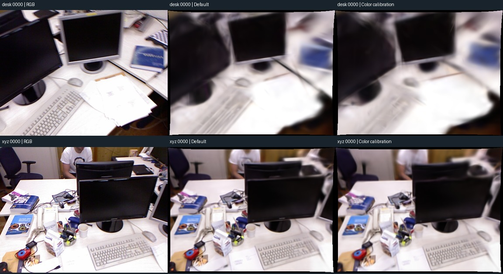

# 固定位姿下的彩色相机标定对照

TUM Freiburg 1 的 RGB 镜头标定不同于 ROS 默认针孔。实验将这套标定单独用于训练彩照，比较两条独立轨迹的原图留出画质。每条轨迹从同一个已定位的 RGB-D 场景开始，保留完全相同的相机旋转、位置、深度初始点和颜色，两侧都从同一 JPEG 解码后写入无损 PNG。候选只改 RGB 图、训练相机内参及对应二维观测。TUM 已将深度配准到彩照，官方建议按默认内参使用，另行验证去畸变。这里直接复用基线三维点。[TUM 原始说明及相机系数](https://cvg.cit.tum.de/data/datasets/rgbd-dataset/file_formats) · [基线实验](RGBD-EXTRINSICS.md)

## 同像素比较

两个场景分别使用 96 张全部定位的照片，失败 0 张，各留出序列第 0、8、…、88 帧。训练 84 张，留出 12 张。输入 640×480，基线使用焦距 525、主点 (319.5, 239.5)。使用 OpenCV 4.13 将官方标定的彩照变换到有效画面内的针孔相机，Brush 0.3.0 Metal 串行训练，1000 步、种子 42、长边 512、高斯上限 15 万。xyz 先训练基线，desk 反序。评分前将候选的 512×384 渲染投回同一张原照片，两侧统一使用有效的 94.71% 像素。[OpenCV 相机标定与投影](https://docs.opencv.org/4.13.0/d9/d0c/group__calib3d.html) · [逐图测量、标定矩阵与点文件摘要](benchmarks/rgbd-color-camera.json)

| 轨迹 | 训练彩照 | 初始点 / 实际高斯 | SH3 PLY 字节 | 图像准备 / 训练导出（秒） | 原图 PSNR / SSIM |
| --- | --- | ---: | ---: | ---: | ---: |
| desk | 原始 | 12,068 / 21,581 | 5,094,666 | 0.70 / 9.69 | 19.025 / 0.70586 |
| desk | 单独校正 | 12,068 / 20,995 | 4,956,370 | 0.71 / 9.86 | 17.944 / 0.64984 |
| xyz | 原始 | 12,604 / 20,512 | 4,842,382 | 0.61 / 9.47 | 21.790 / 0.78212 |
| xyz | 单独校正 | 12,604 / 20,166 | 4,760,726 | 0.64 / 9.53 | 20.558 / 0.73784 |

desk 和 xyz 的 24 张留出图 PSNR 全部下降。两侧使用缓存的轨迹和初始点，阶段计时从图像准备开始；求姿耗时和完整路径见各自基线。固定视角截图中的黑色边缘是排除评分的区域。本轮没有重新测量漫游。每个配置训练一次。这里同时涉及训练投影与像素重采样，无法单独量出其中一项的影响。放弃仅在训练端替换彩照标定的方案。[desk 求姿与训练](RGBD-POSE-GRAPH.md) · [xyz 求姿与训练](RGBD-XYZ.md)



## 复现

```sh
PYTHONPATH=.:.tools/depth-prior-deps .venv/bin/python -m scripts.benchmark_rgbd_color_camera \
  --source .data/benchmarks/xyz-reproduction/training-graph/sfm/undistorted \
  --out .data/benchmarks/xyz-color-camera
```

desk 使用对应精化模型的同一目录结构，并指定 `--color-first`。两份模型、原始传感器数据和缓存均保存在本机。TUM RGB-D 原始数据及衍生截图按 CC BY 4.0 使用。[数据作者与许可](../THIRD_PARTY_NOTICES.md)
